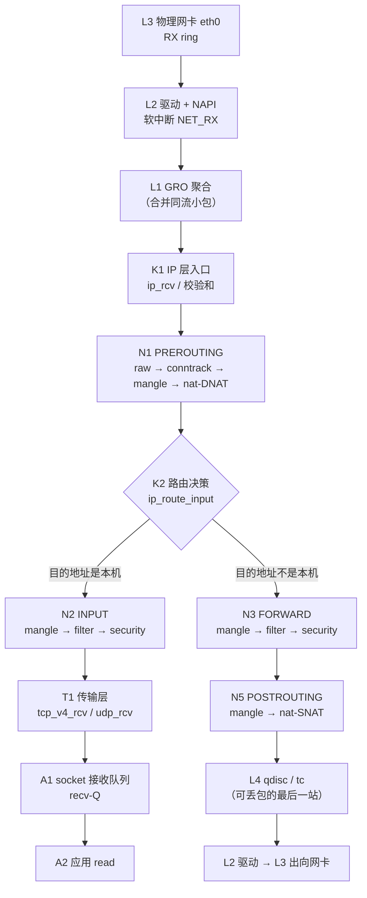
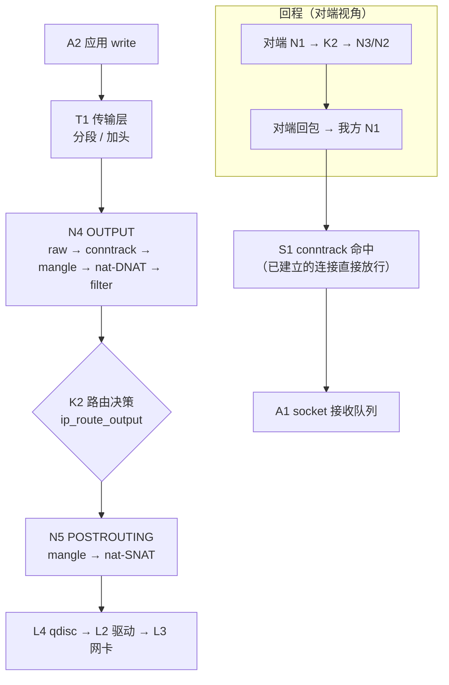
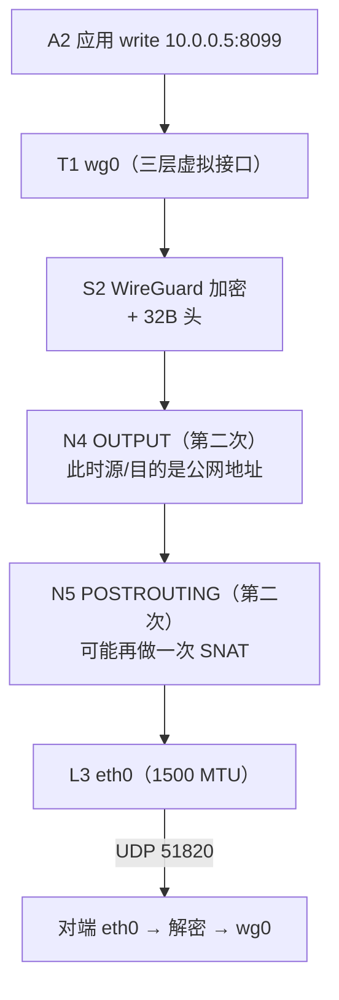
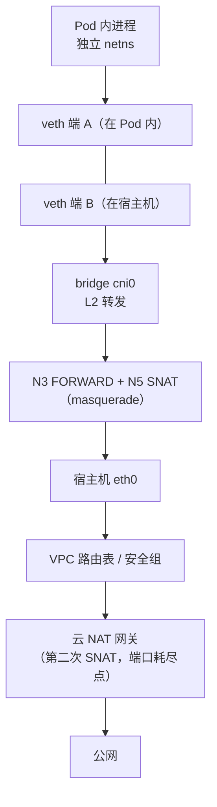

## 序言　这是地图，不是手册

> 这是一本网络知识的**地图**，不是配置手册，也不替代教材。全书只回答三个问题：它是什么、为什么存在、出问题时看哪里。厂商设备命令、无线射频工程、协议调优与 MPLS/SRv6 这类需要专门训练的领域都不在范围内——写清楚不管什么，比假装什么都管更可信。

### 一、它站在哪三本书之间

这本书不是从零开始的。此前有两份稿子，各自解决了一部分问题，也各自留下了没覆盖的地方。先把坐标系摆清楚，才不会让读者买两本发现一半重复：

| 书 | 层次 | 回答什么 |
|---|---|---|
| 《把网络拆开看》 | 方法层 | 怎么把一个问题变成可验证的实验：断言、盲测、逐层排除 |
| 《软路由完全指南》 | 场景层 | 一台真实软路由上「通了但只通一半」的完整复盘 |
| **《从协议到自愈》（本书）** | **体系层 + 运维闭环** | 这套知识在真实多节点环境里怎么组织、怎么活下来 |

「出口控制」这类具体场景归《软路由完全指南》，本书不重复；「怎么设计实验」归《把网络拆开看》，本书只继承它的纪律。本书新增的是**覆盖度**（L2 交换与无线、IPv6、QUIC/HTTP3、云与容器网络）和**一条纵轴**：从一次故障的判据，走到守护、自愈、灾备与重建，让知识不只用于「看懂」，还能用于「没人看着的时候也别坏」。

### 二、体量与体例

按 v4 大纲与执行版任务拆分的决议，规模按 **13–14 万字动态配比**，不死板均摊：第 5、6、15 章是重装章（约 1 万字），第 2、8、12 章等为轻装 / 中型章，短章绝不硬灌水。全书 15 章，每章固定七件：

```
现象与问题  →  机制  →  关键概念与对照表  →  锚点病例（≤1,500 字，每章 1 个）
→  动手验证（3–5 条命令 + 预期输出）  →  本章判据（五要素，只列新增）
→  本章不适用边界（硬要求，至少 3 条）  →  本章素材出处
```

判据统一成五要素：**现象 | 第一嫌疑人 | 第一条命令 | 看到什么算对 | 下一步**。后两列是本书刻意加的——「看到什么算对」逼着把结论写成可比对的值，「下一步」把判据接回机制，而不是给一张孤立的表。总表唯一，放附录 C。

第 3 章是全书枢纽：它把「一个包从进程到网线、再回来」画成参照图（`L`/`K`/`N`/`S`/`T`/`A` 六组代号）和 ①–⑩ 观测埋点。后面每一章都回到这张图定位，云与容器那一章也只是把它逐格填满（第 15 章）。**如果你只记一件事，记这张图**：它把「我知道该敲哪些命令，但说不清为什么」变成「我知道现在看的是哪一格」。

### 三、三条贯穿全书的纪律

**一、示例必须带前提，算式必须可复算。** 书里每个数字都写明成立条件：`ping -M do -s 1392` 只在 `wg0 = 1420` 时通，`1422/1423` 只在路径 MTU 1450 时成立，`PersistentKeepalive = 25s` 对抗的是路径上 NAT 设备的 UDP 映射老化而不是本机 30 秒 conntrack 超时。附录 D 把全书关键算式集中列出，每条都带前提。这不是严谨癖——**一个没写前提的示例，换个环境就会把读者带错方向**，而本书第一版稿子自己踩过这个坑。

**二、脱敏。** 所有地址用 RFC 1918 私网段或 RFC 5737 文档段（`192.0.2.x` / `198.51.100.x` / `203.0.113.x`）；公钥、token、私钥、真实端点一律占位（`<TOKEN>`、`<peer>`、`<hub 隧道地址>`）。代码块内不用中文弯引号，避免命令复制后不可执行。附录 H 列出环境、版本与工具默认值，全部标注「示例值，迁移前须重新核实」。

**三、只列新增，不重复造轮子。** 每章判据只收该章新增的行；机制只在该机制所属的章讲一次，其它章交叉引用。第 5 章讲 conntrack 机制、第 11 章讲策略、第 15 章只写云规模下的放大；第 6 章讲 L4/L7 连接终止、第 7 章承接 TLS 终止点、第 15 章只做映射。这条纪律是「全面」和「不注水」能同时成立的原因。

### 四、素材与诚实边界

素材来自三类：Knowly 归档里的既有书稿、诊断文档与评审（附录 G 给出检索与读取方法）；本环境的一手运维记录（WireGuard 多节点互通、NAT 超时丢包、PID 僵尸文件、只读约束下的 bashrc 兜底、备份链路静默失效等）；以及**可复现清单**（第 15 章 15.8、第 12 章 12.7 的 netem 注入）——不依赖特定环境也能自己搭出来验一遍。

必须说清一处：**第 15 章是全书唯一没有一手环境实践的章节**。它是把前 14 章映射到云与容器的「映射章」，案例来自可复现清单与通用场景，不冒充真实运维记录。同样，本书不教任何一家的控制台配置，不选型，不做性能调优；凡涉及具体产品，一律抽象为角色。

### 五、怎么读

- **想建立坐标系**：第 1 → 2 → 3 章，然后按需跳读；参照图建议打印在手边。
- **在排障现场**：直接翻附录 C 总判据表，按「现象」定位，再回对应章看前提与埋点。
- **负责稳定性 / SRE**：第 12 → 13 → 14 章是一条完整链路（判据 → 自愈 → 灾备），第 15 章给云侧映射。
- **想验证而不是相信**：附录 D 的算式、附录 E 的模板、附录 B 的命令速查，配合每章「动手验证」先写预期再做。

全书从「先定层」开始，到「先确认这一层归谁管、我能不能看见」结束。中间十四章讲的其实是同一件事：**把「我觉得」变成「我验证过」**。

---

## 目录

第 1 章　为什么网络知识要「按层」学

第 2 章　地址、子网与路由

第 3 章　一个包的旅程：全书参照图

第 4 章　链路层与「看不见的二层」

第 5 章　网络层：IP、ICMP、NAT 与 IPv6

第 6 章　传输层：TCP、UDP 与 QUIC

第 7 章　应用层：DNS、TLS 与 HTTP

第 8 章　网络安全基线：一层一层地看攻击面

第 9 章　VPN 原理与 WireGuard

第 10 章　隧道与内网穿透：把一条路接到另一条路上

第 11 章　防火墙、端口与暴露面：规则到底在哪一步生效

第 12 章　排障方法论：把「试试看」变成收敛

第 13 章　守护与自愈：让它在没人看着的时候活下来

第 14 章　灾备与不可变基础设施：怎么证明备份真的能恢复

第 15 章　云网络、容器网络与演进：把前 14 章映射上去


**附录**

- 附录 A　术语与缩略语
- 附录 B　分层命令速查（按观测埋点）
- 附录 C　全书判据总表
- 附录 D　可复算算式汇总
- 附录 E　文档模板
- 附录 F　演进路线与待办
- 附录 G　Knowly 资料检索与 API 端点速查
- 附录 H　环境、版本与工具行为差异

---


---

# 目录

1. 00-preface.md
2. 第 1 章　为什么网络知识要「按层」学
3. 第 2 章　地址、子网与路由
4. 第 3 章　一个包的旅程：全书参照图
5. 第 4 章　链路层与「看不见的二层」
6. 第 5 章　网络层：IP、ICMP、NAT 与 IPv6
7. 第 6 章　传输层：TCP、UDP 与 QUIC
8. 第 7 章　应用层：DNS、TLS 与 HTTP
9. 第 8 章　网络安全基线：一层一层地看攻击面
10. 第 9 章　VPN 原理与 WireGuard
11. 第 10 章　隧道与内网穿透：把一条路接到另一条路上
12. 第 11 章　防火墙、端口与暴露面：规则到底在哪一步生效
13. 第 12 章　排障方法论：把「试试看」变成收敛
14. 第 13 章　守护与自愈：让它在没人看着的时候活下来
15. 第 14 章　灾备与不可变基础设施：怎么证明备份真的能恢复
16. 第 15 章　云网络、容器网络与演进：把前 14 章映射上去
17. 99-afterword.md
18. 附录 A　术语与缩略语
19. 附录 B　分层命令速查（按观测埋点）
20. 附录 C　全书判据总表
21. 附录 D　可复算算式汇总
22. 附录 E　文档模板
23. 附录 F　演进路线与待办
24. 附录 G　Knowly 资料检索与 API 端点速查
25. 附录 H　环境、版本与工具行为差异


---


## 序言　这是地图，不是手册

> 这是一本网络知识的**地图**，不是配置手册，也不替代教材。全书只回答三个问题：它是什么、为什么存在、出问题时看哪里。厂商设备命令、无线射频工程、协议调优与 MPLS/SRv6 这类需要专门训练的领域都不在范围内——写清楚不管什么，比假装什么都管更可信。

### 一、它站在哪三本书之间

这本书不是从零开始的。此前有两份稿子，各自解决了一部分问题，也各自留下了没覆盖的地方。先把坐标系摆清楚，才不会让读者买两本发现一半重复：

| 书 | 层次 | 回答什么 |
|---|---|---|
| 《把网络拆开看》 | 方法层 | 怎么把一个问题变成可验证的实验：断言、盲测、逐层排除 |
| 《软路由完全指南》 | 场景层 | 一台真实软路由上「通了但只通一半」的完整复盘 |
| **《从协议到自愈》（本书）** | **体系层 + 运维闭环** | 这套知识在真实多节点环境里怎么组织、怎么活下来 |

「出口控制」这类具体场景归《软路由完全指南》，本书不重复；「怎么设计实验」归《把网络拆开看》，本书只继承它的纪律。本书新增的是**覆盖度**（L2 交换与无线、IPv6、QUIC/HTTP3、云与容器网络）和**一条纵轴**：从一次故障的判据，走到守护、自愈、灾备与重建，让知识不只用于「看懂」，还能用于「没人看着的时候也别坏」。

### 二、体量与体例

按 v4 大纲与执行版任务拆分的决议，规模按 **13–14 万字动态配比**，不死板均摊：第 5、6、15 章是重装章（约 1 万字），第 2、8、12 章等为轻装 / 中型章，短章绝不硬灌水。全书 15 章，每章固定七件：

```
现象与问题  →  机制  →  关键概念与对照表  →  锚点病例（≤1,500 字，每章 1 个）
→  动手验证（3–5 条命令 + 预期输出）  →  本章判据（五要素，只列新增）
→  本章不适用边界（硬要求，至少 3 条）  →  本章素材出处
```

判据统一成五要素：**现象 | 第一嫌疑人 | 第一条命令 | 看到什么算对 | 下一步**。后两列是本书刻意加的——「看到什么算对」逼着把结论写成可比对的值，「下一步」把判据接回机制，而不是给一张孤立的表。总表唯一，放附录 C。

第 3 章是全书枢纽：它把「一个包从进程到网线、再回来」画成参照图（`L`/`K`/`N`/`S`/`T`/`A` 六组代号）和 ①–⑩ 观测埋点。后面每一章都回到这张图定位，云与容器那一章也只是把它逐格填满（第 15 章）。**如果你只记一件事，记这张图**：它把「我知道该敲哪些命令，但说不清为什么」变成「我知道现在看的是哪一格」。

### 三、三条贯穿全书的纪律

**一、示例必须带前提，算式必须可复算。** 书里每个数字都写明成立条件：`ping -M do -s 1392` 只在 `wg0 = 1420` 时通，`1422/1423` 只在路径 MTU 1450 时成立，`PersistentKeepalive = 25s` 对抗的是路径上 NAT 设备的 UDP 映射老化而不是本机 30 秒 conntrack 超时。附录 D 把全书关键算式集中列出，每条都带前提。这不是严谨癖——**一个没写前提的示例，换个环境就会把读者带错方向**，而本书第一版稿子自己踩过这个坑。

**二、脱敏。** 所有地址用 RFC 1918 私网段或 RFC 5737 文档段（`192.0.2.x` / `198.51.100.x` / `203.0.113.x`）；公钥、token、私钥、真实端点一律占位（`<TOKEN>`、`<peer>`、`<hub 隧道地址>`）。代码块内不用中文弯引号，避免命令复制后不可执行。附录 H 列出环境、版本与工具默认值，全部标注「示例值，迁移前须重新核实」。

**三、只列新增，不重复造轮子。** 每章判据只收该章新增的行；机制只在该机制所属的章讲一次，其它章交叉引用。第 5 章讲 conntrack 机制、第 11 章讲策略、第 15 章只写云规模下的放大；第 6 章讲 L4/L7 连接终止、第 7 章承接 TLS 终止点、第 15 章只做映射。这条纪律是「全面」和「不注水」能同时成立的原因。

### 四、素材与诚实边界

素材来自三类：Knowly 归档里的既有书稿、诊断文档与评审（附录 G 给出检索与读取方法）；本环境的一手运维记录（WireGuard 多节点互通、NAT 超时丢包、PID 僵尸文件、只读约束下的 bashrc 兜底、备份链路静默失效等）；以及**可复现清单**（第 15 章 15.8、第 12 章 12.7 的 netem 注入）——不依赖特定环境也能自己搭出来验一遍。

必须说清一处：**第 15 章是全书唯一没有一手环境实践的章节**。它是把前 14 章映射到云与容器的「映射章」，案例来自可复现清单与通用场景，不冒充真实运维记录。同样，本书不教任何一家的控制台配置，不选型，不做性能调优；凡涉及具体产品，一律抽象为角色。

### 五、怎么读

- **想建立坐标系**：第 1 → 2 → 3 章，然后按需跳读；参照图建议打印在手边。
- **在排障现场**：直接翻附录 C 总判据表，按「现象」定位，再回对应章看前提与埋点。
- **负责稳定性 / SRE**：第 12 → 13 → 14 章是一条完整链路（判据 → 自愈 → 灾备），第 15 章给云侧映射。
- **想验证而不是相信**：附录 D 的算式、附录 E 的模板、附录 B 的命令速查，配合每章「动手验证」先写预期再做。

全书从「先定层」开始，到「先确认这一层归谁管、我能不能看见」结束。中间十四章讲的其实是同一件事：**把「我觉得」变成「我验证过」**。

---

## 目录

第 1 章　为什么网络知识要「按层」学

第 2 章　地址、子网与路由

第 3 章　一个包的旅程：全书参照图

第 4 章　链路层与「看不见的二层」

第 5 章　网络层：IP、ICMP、NAT 与 IPv6

第 6 章　传输层：TCP、UDP 与 QUIC

第 7 章　应用层：DNS、TLS 与 HTTP

第 8 章　网络安全基线：一层一层地看攻击面

第 9 章　VPN 原理与 WireGuard

第 10 章　隧道与内网穿透：把一条路接到另一条路上

第 11 章　防火墙、端口与暴露面：规则到底在哪一步生效

第 12 章　排障方法论：把「试试看」变成收敛

第 13 章　守护与自愈：让它在没人看着的时候活下来

第 14 章　灾备与不可变基础设施：怎么证明备份真的能恢复

第 15 章　云网络、容器网络与演进：把前 14 章映射上去


**附录**

- 附录 A　术语与缩略语
- 附录 B　分层命令速查（按观测埋点）
- 附录 C　全书判据总表
- 附录 D　可复算算式汇总
- 附录 E　文档模板
- 附录 F　演进路线与待办
- 附录 G　Knowly 资料检索与 API 端点速查
- 附录 H　环境、版本与工具行为差异

---

---


# 第 1 章　为什么网络知识要「按层」学

> **本章结论**：分层的价值不在于让你背下七层的名字，而在于给「连不上」这种含糊的现象提供一个**可以按层排除的坐标系**。每确认一层正常，你就排除一整类可能性；排到最后剩下的那一层，才是该动手的地方。

> **脱敏声明**：本章所有地址、端口、密钥均为示意或已改写，不对应任何真实运行环境。

---

## 1.1　一份排查记录是怎么变成一张判据表的

归档里留着一份排查记录。它最早只有一句话：

> A 连不上 B。

后来补上的事实骨架是这样的（数值与地址为示意）：一个客户端访问另一节点的服务，`ping` 全丢、SYN 没有回应；同一时刻，另一个客户端一直正常。中心节点上 `iptables -S` 全 ACCEPT，`net.ipv4.ip_forward=1`，抓包能看到 SYN 到达对端，但对端没有回。那次排查花了四十分钟。

另一本书的序言写过这次排查，也写过事后的那句复盘——知道该敲哪些命令，却说不清为什么这些命令能定位问题。那是它的切口，本书不重复。**本书关心的是另一件事：这份记录后来被改了三次，每次改动到底改变了什么。**

**第一次加工：补证据。** 把「不通」这句判断，换成一组带命令的观察。

| 观察 | 命令 | 结果 |
|---|---|---|
| 规则没有拦截 | `iptables -S` | 全 ACCEPT |
| 转发已开启 | `sysctl net.ipv4.ip_forward` | `1` |
| 请求到达对端 | `tcpdump -ni wg0 host <客户端IP>` | 能看到 SYN |
| 对端没有回应 | 对端 `tcpdump` | 无 SYN-ACK |

这一步之后，记录从「一句结论」变成「四条可复核的事实」。任何一个人拿着这四条，都能在自己环境里跑一遍，判断自己的情况是否相同。

**第二次加工：摆段。** 把四条事实按位置分成三栏——本机发出的、中间放行的、对端回应的。摆完立刻能看出：前两栏都有证据，第三栏缺一块。

| 段 | 证据 | 状态 |
|---|---|---|
| 本机 | SYN 已发出（对端抓包可见） | ✅ |
| 中间 | 规则 ACCEPT、转发开启、计数增长 | ✅ |
| 对端 | 收到 SYN，但没有回包 | ❌ |

这一步没有新增任何命令，只是**换了个摆放方式**，故障范围却从「整个网络」缩到了「回程那一小段」。

**第三次加工：变判据。** 把每条证据改写成「看到什么算对、没看到就转去哪」。比如「对端抓包应有 SYN-ACK，没有则查回程路由与对端策略」。到这一步，记录已经不是叙述，而是一张别人可以照着执行的表。

从一句话到一张表，中间发生的并不是「终于想明白了」，而是**把一大块不确定性切成了若干可验证的小块**。这跟顿悟无关，是个纯粹的工程动作。分层，就是下刀的方式。

再看第二个案例，来自同一套环境，现象几乎一样，根因却完全不在同一层：

> 沙箱连不上中心节点。其他 peer 的 `wg show` 里显示 `latest handshake: 27 seconds ago` 和 `persistent keepalive: every 25 seconds`，沙箱 peer 没有这两行。静置一段时间后必断，动一下又通。

第一个案例的问题在**转发与回程**（SYN 到了，对端没回）；第二个案例的问题在**会话保活**（NAT 映射老化，回包找不到路）。两者都叫「连不上」，都容易让人先去 `ping`、先去查防火墙，然后绕很久；而按照上面那张表走，第二个案例在第一条 `wg show` 上就会偏离到完全不同的方向。

**同一种现象，根因可以落在完全不同的层。** 这就是必须先有坐标系的原因。没有坐标系，排障只能靠经验、直觉和运气——那四十分钟，本质上花在了「不知道该先排除哪一块」上。

本章剩下的篇幅，就是把这把刀磨出来：1.2 说坐标系长什么样，1.3 说怎么用它收敛，1.4 给出落地动作，1.5 用一个真实病例走一遍，1.6 把「服务正常吗」拆成可勾选的五层，1.7 让你自己跑一遍并把它写进诊断文档。

---

## 1.2　分层不是背七层名字，是给不确定性一个坐标系

学校里教 OSI 七层，通常要求背名字：物理层、数据链路层、网络层、传输层、会话层、表示层、应用层。考完就忘，因为它没告诉你这些层**用来干什么**。

工程上真正用的是 TCP/IP 四层，重点也从来不是「有几层」，而是「每一层负责哪一件事，以及这件事失败时会长什么样」。

| TCP/IP 层 | 对应 OSI | 这一层负责 | 这一层出事时的典型现象 | 确认正常后排除掉什么 | PDU |
|---|---|---|---|---|---|
| 链路层 | 物理 + 数据链路 | 相邻节点之间把一个帧送出去 | 网卡没起来、ARP 不通、大包静默丢弃 | 接口、邻居发现、本段 MTU | 帧 Frame |
| 网络层 | 网络 | 决定包去哪、从哪个口出去 | 缺路由、掩码错、回程不通、NAT 映射丢 | 寻址、选路、转发、地址改写 | 包 Packet |
| 传输层 | 传输（+部分会话） | 端到端的连接与保活 | 握手不成、连接被重置、会话超时断开 | 连接状态、端口、会话存活 | 段 Segment / 数据报 Datagram |
| 应用层 | 会话 + 表示 + 应用 | 名字解析、加密、业务语义 | DNS 解析错、证书不对、端口通但业务 5xx | 名字、信任、业务语义 | 报文 Message |

封装是往下走：应用数据加上 TCP 头成为段，加上 IP 头成为包，加上以太网头成为帧。解封装往上走，一层层剥掉头交给上一层。这两句教材都有，真正有用的是它的推论：

> **每剥掉一层，你就多确认了一件事；每确认一件事，就排除一整类可能。**

### 为什么「排除」比「列举」便宜

假设四层各有 5 种常见故障。若不做切分，你要面对的是这些故障的**组合**：链路层的某一种，叠加上网络层的某一种，再叠上传输层与应用层的某一种，粗略地说是 5 × 5 × 5 × 5 = 625 种组合。逐个试是灾难。

按层排除则完全不同：先用一条命令确认链路层没事，剩下 5 × 5 × 5 = 125 种；再确认网络层，剩 25 种；再确认传输层，剩 5 种。四次判断把联合搜索变成了逐层过滤。这不是精确的概率模型（故障并不独立、也不等概率），但它说明了分层真正的收益：**把乘法关系变成加法关系**。

所以分层是排除法的数据结构，不是记忆清单。你不需要记住 625 种组合，只需要记住四次「看到什么算对」。

### 为什么工程上用四层，而不是七层

OSI 的会话层、表示层并没有消失，只是不再各自占据一层：会话状态大多由传输层或应用框架自己维护；TLS 把加密、身份认证、协商这些「表示层」职责塞进了传输与应用之间；QUIC 更进一步，把两者一起并进了传输层。

这不是模型错了，而是模型与实现之间的时间差。OSI 是为「开放系统互连」设计的参考模型，先有分层再有实现；TCP/IP 是先跑起来、后来才被整理成模型的工程事实。排障要以**实际在跑的协议栈**为准，所以本书用四层下刀。

七层模型仍有它的用处：当你要向别人解释「证书问题不属于网络层」时，「表示层」这个词能省掉半页口舌。本书的取舍是——**用四层下刀，用七层命名**。第 7 章讲 TLS 时会明确标出它跨在哪两层之间，避免读者按七层模型去找一个并不存在的独立实体。

### 知识顺序与排障顺序是相反的

这里有个容易忽略的错位：教材是自底向上教——先讲物理介质，再讲帧、包、连接，最后讲应用。这是**构建**的顺序。排障恰好相反，你从「业务打不开」这个应用层的现象出发，往下逐层排除。这是**拆解**的顺序。

两本书因此可以同时成立：一本按构建顺序讲清协议栈，一本按拆解顺序讲清怎么定位。本书用的是后者。「学过 TCP/IP」却仍不会排障，多数时候不是知识不够，而是没练过把知识倒过来用。

### 分层不是流水线

还要提前打个补丁：真实环境里，层常常是**叠起来**的，不是一条直线。

一条 WireGuard 隧道本身是网络层的东西，但它对外表现为一个虚拟网卡；这个网卡之上再跑 TCP，TCP 之上再叠 TLS，TLS 之上还能再跑 WebSocket 隧道。于是同一台机器上会同时存在好几个「MTU」、好几条「默认路由」，每个都说自己是对的。

遇到这种情况，切分依据要换成**逻辑接口**，而不是物理网卡：先问「这个包此刻在哪个接口上、被哪一层封装着」，再决定该用哪一层的判据。第 3 章画全书参照图时会把这条路径逐段标出来；第 9、10 章再展开隧道叠层。这里先记住一句：**分层是思考的坐标系，不是内核里的流水线**。

### 一个 `ping` 到底证明了什么

`ping` 通了，能排除什么？能排除「此刻存在一条双向可达的链路层 + 网络层路径」。仅此而已。它**不能**排除下面这些，每一条都对应着本书后面的一章：

- **传输层的会话会不会在几十秒后老化**——ICMP 的通，不代表承载业务的 UDP 映射还在。这正是 1.1 第二个案例，展开在第 5、6 章。
- **应用层的证书与名字解析是否正常**——一个能 ping 通的地址，完全可能 TLS 握手失败或解析到了别的机器。第 7 章处理。
- **回程路径是不是恰好走了另一条腿**——去程通、回程不通是 VPN 里最常见的一类故障，第 2、9 章会讲 `AllowedIPs` 与策略路由怎么造成它。
- **大包会不会被静默丢弃**——ICMP 小包能过，不代表 1400 字节的业务包能过，第 4 章专门拆这个幻觉。

归档里那本方法层书稿有句口诀被反复引用：**「通不通先看路由，慢不慢先看 MTU，稳不稳先看状态」**。它好用，是因为把三个不同现象分别锚定到了三个不同层，而不是笼统地说「网络有问题」。本书沿用这个术语体系，但不复述它的实验内容。

最后说清边界：本书不复述 RFC，不替代《TCP/IP 详解》，也不逐个讲七层协议。分层在这里只承担一个任务——**让「我不知道哪里坏了」变成「我已经排除了前三层，问题在第四层」**。

---

## 1.3　分层收敛法：先定层，再定协议，最后选工具

把上面的思路固化成可重复的动作，就是本书从头用到尾的**分层收敛法**：

```
第一步  定层    这个现象最可能属于哪一层？（先排除，后聚焦）
第二步  定协议  这一层在本环境里跑的是哪个协议？（UDP / TCP / TLS / WebSocket…）
第三步  选工具  哪个命令能把「我觉得」变成「是 / 否」？
```

顺序不能反。一反，就会发生下面这些动作：

| 反过来的做法 | 为什么低效 |
|---|---|
| 一上来就 `ping` | 只验证了两层的一个瞬间，通了反而给出虚假安全感 |
| 一上来就重启服务 | 可能恰好刷新了 NAT 映射，问题「好了」，根因没找到，下次还会来 |
| 一上来就改配置 | 同时改变了多个层的状态，无法归因，也无法回滚到干净的判断起点 |
| 一上来就翻日志 | 日志是应用层的视角，看不到包在网络层被丢掉这件事 |

归档评审里有句更干脆的表述，可以作为本章的判据准则：

> 遇到问题，先问「我能用什么命令把它变成是/否」，而不是「我觉得可能是」。

于是：**「我觉得可能是 MTU」不是判据；「在路径 MTU = 1450 的链路上，`ping -M do -s 1422` 通（1422 + 8 ICMP 头 + 20 IP 头 = 1450），`-s 1423` 不通（1451 > 1450）」才是判据。** 前提写在判据里，别人才复算得了；只给两个数字、不给链路 MTU，等于什么都没说。这一条稍后在 1.5 和 1.7 还会各出现一次。

### 一次真实的误诊路径

分层收敛法的价值，在走错的时候最容易看清。下面是 1.1 第二个案例里，实际发生过的一条路径：

```
现象：沙箱连不上中心节点
  → 判断「先看看通不通」        ping 通
  → 推断「链路没问题」          把两层结论当成了全层结论
  → 查防火墙、查转发、查日志    全部正常
  → 重启隧道服务                现象消失（其实是 NAT 映射被刷新）
  → 二十分钟后复现
```

复盘时只需要加一步：在 `ping` 之后、下结论之前，问一句「这个结论覆盖了哪一层、覆盖了多久」。答案是「链路层与网络层、且只在这个瞬间」。一旦这么问，就会自然去找一个能覆盖「持续维持」这一层的命令——`wg show`。这条路径会在 1.5 走完。

### 分层什么时候会误导

方法不是万能的，至少有三种情况要提前标注（第 1.9 节会汇总成边界）：

1. **有看不见的层**：云平台的安全组、负载均衡、NAT 网关不在你的主机上，主机侧抓包看不到它们丢包的动作。分层表上找不到它们，得单独补。
2. **层被折叠**：QUIC 把传输、加密、应用语义压在一起，四层切分不再干净，「定协议」这一步要更谨慎。
3. **现象跨层**：「慢」可能来自链路丢包、TCP 拥塞控制、也可能来自应用层排队。此时按层排除仍然有效，但每一层的判据要换成延迟分布，而不是通/不通。

本书第 12 章会把这套动作展开成完整的五步排障流程（连通性 → 路径 → 端口/服务 → 抓包 → 应用）。第一章只需要记住骨架：**先缩小范围，再选择武器**。

还有一条容易被忽略的纪律：**判据要写下来**。归档评审特别肯定了「`expect_fail` 比 `expect_ok` 更重要」这一点——实验里一半步骤是故意注入故障，如果故障没注入成功，后面所有观察都作废。把「我预期这里应该不通」写成断言，是把「我以为」变成「我验证」的关键。本书每章的动手验证环节，都要求先写下预期输出，再执行命令。

---

## 1.4　三段对齐：分层收敛的落地动作

分层是坐标系，还需要一个具体的观测动作。方法层书稿里最实用的那条叫**三段对齐**，归档评审称它是「全书最实用的方法」：

| 段 | 证明什么 | 典型命令 | 看到什么算对 | 缺这段说明 |
|---|---|---|---|---|
| 本机 | 我确实把包发出去了 | `tcpdump -ni wg0 host <对端IP>` | 能看到本机发出的 SYN / UDP 包 | 本机就没发：查路由、查接口、查本机防火墙 |
| 中间 | 中间设备有没有放行和转发 | `iptables -L FORWARD -n -v --line-numbers` | `pkts` 计数在增长 | 计数为 0：规则没匹配上或优先级被别的链截走 |
| 对端 | 对方收到并且回了 | 对端 `tcpdump -ni wg0 host <本端IP>` | 能看到请求包，且能看到回包 | 有进无出：查对端路由、回程路径、对端策略 |

**缺哪一段，故障就在那两段之间。** 这句话把「网络不通」这个黑盒，切成了三个可分别验证的白盒。

三段与层的对应关系值得说清：本机段主要覆盖链路层与网络层的出口，中间段覆盖网络层的转发与状态，对端段覆盖网络层回程与传输层响应。它不是新模型，而是**把分层收敛法翻译成三条能在终端里敲出来的命令**。

放到本书的环境里，三段通常落在这几个位置：

- **本机**：沙箱上的 `wg0` 接口，抓包看加密前的明文包是否进了隧道；
- **中间**：Hub 上的 FORWARD 链与 conntrack 计数，看包是否被转发、会话是否被建立；
- **对端**：Mac 或另一节点上的 `wg0`，看解密后的包是否到达、以及回包是否也走了隧道。

三段对齐有个前提常被忽略：**两端时钟要能对齐，抓包要能落盘**。否则「我在本机看到了包、你在对端也看到了包」无法证明是同一个包。方法层书稿在抓包判读一章给了时间对齐与落盘的做法，本书第 12 章会沿用，不在这里展开。

回到 1.1 的第一个案例：抓包能看到 SYN 到达，说明本机段和中间段都过了；对端没有回，问题被压缩到回程这一小段。那四十分钟里最有价值的其实就是这一条证据——可惜当时没人把它按三段摆开。**摆开这个动作，比多敲十条命令更值钱。**

---

## 1.5　实践锚点：先 `ping` 还是先 `wg show`

现在回答本章标题里那个具体问题。

**场景**：沙箱连不上 Hub，你手上有 SSH 能进沙箱。

**错误路径**（即 1.3 那次误诊）：

```
ping 10.0.0.x        → 通了
「链路没问题」
查 iptables           → 全 ACCEPT
查 ip_forward         → 1
重启 wg-quick         → 好了
（二十分钟后又断）
```

问题出在第一句之后的推断。`ping` 通只证明**此刻**存在一条双向可达的路径，它不证明这条路径**能持续存在**。用重启去「修」，恰好刷新了 NAT 映射表项，于是现象消失、根因留存。

**正确路径**：先看负责「维持」的那一层，再决定要不要往下走。

```bash
wg show wg0
```

预期输出里，每个 peer 都应该有类似这样的两行：

```text
peer: <沙箱Peer公钥>
  latest handshake: 27 seconds ago
  persistent keepalive: every 25 seconds
```

沙箱 peer 缺了第二行，且 `latest handshake` 长时间不刷新——**第一条判据就把范围收掉了**：不是链路断了，是这条链路没有被维持。

下面是归档里那份诊断文档的六段式复盘（已脱敏、按本书格式重排）：

| 段 | 内容 |
|---|---|
| **现象** | 沙箱 peer 静置一段时间后失联，动一下又通；其他 peer 正常 |
| **判据** | `wg show` 对比：正常 peer 有 `persistent keepalive: every 25 seconds`，沙箱 peer 没有 |
| **根因** | 沙箱在 NAT 后，未定期发包；UDP 会话映射老化后被清除，Hub 回包找不到有效路径 |
| **修复** | 临时：`wg set wg0 peer <沙箱Peer公钥> persistent-keepalive 25`（立即生效，重启可能丢）<br>持久：在 `/etc/wireguard/wg0.conf` 最后一个 `[Peer]` 段加 `PersistentKeepalive = 25`，再 `wg-quick reload wg0` 或 `wg syncconf wg0 <(wg-quick strip wg0)` |
| **验证** | 再次 `wg show`，应出现 keepalive 行且 `latest handshake` 持续刷新 |
| **沉淀** | 诊断文档归档；恢复文档里加入「NAT 后节点必须配 Keepalive」检查项 |

**关于 25 这个数**，必须写清前提，否则就会变成归档评审提醒过的那种「格言化过头、条件被压缩掉」：

- 它不是协议规定值，是**经验取值**；
- 目的是让保活间隔**小于** NAT 设备对 UDP 会话的老化时间，并留出余量；
- 不同设备的 UDP 老化窗口差异很大（几十秒到数分钟都有），25 秒是保守选择，不是普适最优；
- 太短增加心跳流量与移动端耗电，太长可能在映射老化后才发下一个包；
- 要测自己环境的真实窗口：先停掉保活，持续从对端向本端发包，记录「最后一次出站包」到「回包开始丢」的时间差 T，再按 T 的 1/2 ~ 2/3 设定。这个测法本身也是一条带前提的判据。

这类数值在本书里一律要求**写出前提与算式**。我们在同一套稿子里踩过这个坑：早期版本的 MTU 示例没写链路前提，读者按给出的数字复算会发现结论对不上；WireGuard 头部的字节数也曾出现过算术不一致。这些在修订版里都已处理，值得留下的不是「谁写错了」，而是那条纪律——**示例必须自带前提**：凡出现包长、MTU、超时、阈值，先写环境和算式，再写结论。本书按这条执行，1.7 还会故意演示一次。

**还有一个陷阱，正好说明「同一个 ping 在不同层含义不同」**：归档里《WireGuard 多节点互通实战》记录了「Hub 能 ping 通节点，但节点之间 ping 不通」。原因是节点 peer 的 `AllowedIPs` 只写了中心节点地址，回包时认为源地址不合法，于是走了默认路由而不是隧道。作者给的判据很直白——**「不要只测 Hub，Hub 通不代表节点间互通」**，并建议做一张完整的连通性矩阵，而不是只测一个星型中心。

把两件事并排看：`ping` 通说明不了会话能维持，`ping` 到 Hub 通说明不了到别的节点通。**工具没变，变的是它覆盖的层。** 这是本章最想留下的习惯：拿到任何一条「通/不通」的结论，先问一句「它到底证明了哪一层的什么事、能维持多久」。

---

## 1.6　「服务正常吗」不是一个问题，是五个

运维里最常收到的一句问话是「服务正常吗」。它没法回答，因为它把五个不同层的判断压成了一个布尔值。拆开之后是这样：

| ☐ | 判据 | 第一条命令 | 看到什么算对 | 不成立时的下一步 |
|---|---|---|---|---|
| ☐ | 1. 接口在吗 | `ip link show wg0` | 接口存在，状态非 DOWN | 查 `wg-quick up`、内核模块、权限 |
| ☐ | 2. 路由对吗 | `ip route get <对端内网IP>` | 输出里走 `wg0`，不是默认网卡 | 查 `AllowedIPs`、查策略路由 `ip rule` |
| ☐ | 3. 握手活着吗 | `wg show wg0 latest-handshakes` | 时间小于约 3 分钟且持续刷新 | 转第 5 章：查 NAT 会话与 Keepalive |
| ☐ | 4. 有回包吗 | 两端 `tcpdump` + 中间 `iptables -vnL` 计数 | 三段对齐都能看到对应包 | 缺哪段查哪段，见 1.4 |
| ☐ | 5. 业务通吗 | `curl -sS -o /dev/null -w “%{http_code}\n” <业务URL>` | 返回预期状态码（如 200） | 查应用层：TLS、监听端口、服务日志 |

五个都勾上，才叫「正常」。任何一个没勾，答案不应该是「不正常」，而应该是**「第 N 层待查」**——这是本书对「服务正常吗」的标准回答格式。

### 逐条展开

**第 1 条，接口在吗。** 这是唯一一条真正属于链路层的判据，也是所有后续命令的前提：接口不在，路由和握手都无从谈起。常见误读是把 WireGuard 接口的 `state UNKNOWN` 当成故障——它没有载波概念，UNKNOWN 是正常状态，DOWN 才是问题。另外，接口存在不等于地址配上了，所以第 2 条要接着看。

**第 2 条，路由对吗。** 这里选 `ip route get` 而不是 `ip route show`，是因为前者给出**内核对某个具体目标的实际选路结果**（走哪个设备、源地址是什么），后者只列出静态表项。表里写着一条 /24，不代表这个目标真的会走隧道——策略路由、规则优先级、以及 WireGuard 的 `AllowedIPs` 都可能改变结果。`AllowedIPs` 同时承担「出向选路」和「入向合法性校验」两件事，是第 9 章的重点，这里先记住：看到 `dev wg0` 才算对。

**第 3 条，握手活着吗。** 阈值「约 3 分钟」同样要带前提：WireGuard 在有流量时按固定周期重协商，无流量时靠保活维持；3 分钟是给重协商周期留出余量后的经验值，不是协议常量。判断时要看**是否持续刷新**，而不是看某一刻的绝对值——一个停在「2 分钟前」且再也不动的时间，比「5 分钟前」更可疑。这一条覆盖的是「会话是否还活着」，正好补上 `ping` 覆盖不到的那一层。

**第 4 条，有回包吗。** 单看一端必然误判：本机抓包看到请求发出，只能说明去程；对端抓包看到请求到达，仍不能说明回包走了原路。所以这一条本身就要求三段一起看（1.4）。中间计数为 0 时，常见原因不是规则写错，而是规则被更靠前的链截走——比如宿主机上 Docker 插入的 FORWARD 规则。

**第 5 条，业务通吗。** 到这里才第一次触及「服务」本身。要拿到应用层状态码，而不是满足于 TCP 能连上：`curl` 返回非 200 时，可能是证书问题、虚拟主机不匹配、后端 5xx，也可能是代理缓冲。第 7 章会展开 TLS 与 WebSocket，第 12 章会给完整的应用层判据。

### 五条判据的顺序不能换

这五条是自底向上排的，不是随手列的，顺序本身携带信息：第 1 条不成立时，第 2 条的输出没有意义（接口都不在，路由表不会被用到）；第 2 条不成立时，第 3 条的握手根本不会发生；依此类推。上一层依赖下一层正常，这正是封装关系在排障顺序上的投影。

实践中最常见的浪费，是跳过前三条直接看业务状态码，拿到一个连接超时后再回头一层层找。这不比从头走更快——**超时是个上层症状，它不告诉你下面哪一层断了**；而前三条命令各只要几秒，每条都能明确排除一整层。四十分钟里有相当一部分，就花在「拿到症状后不知道往回退几层」。

唯一允许调整顺序的情况，是你已经握有来自监控的**层信息**：例如监控明确报「握手年龄超过阈值」，那就直接从第 3 条开始，把第 1、2 条留作验证根因时的补充。这仍然是分层收敛法，只是起点由证据给定，不必重新从第一层走一遍。

### 为什么是这五列

这张表也是全书判据表的模板。按归档评审的建议，本书把判据统一成**现象 / 第一嫌疑人 / 第一条命令 / 看到什么算对 / 下一步**五要素：

- 「看到什么算对」把命令从「跑一下看看」变成可判定的观察，是防自欺的关键；
- 「下一步」让每一条失败都有出口，排查不会停在「好像不太对」；
- 「第一嫌疑人」明确这只是一个起点，不是结论，避免把假设当根因写进诊断文档。

并且**每章只列本章新增的行**，总表放附录 C。归档评审提醒过「同一张表换几种说法」会造成判据表通胀，读者面对多张表反而不知道先看哪张。本书宁可让章节里的表短一点，也要保证总表唯一。

---

## 1.7　动手验证：把它写成诊断文档

下面是一段不依赖真实环境的最小验证序列，用来把本章的三个动作跑一遍。**先写预期，再执行**；命令里的地址与密钥均为示意值。

```bash
# ① 定层：接口与地址（链路层 + 网络层）
ip link show wg0
# 预期：能看到 wg0 接口，state UNKNOWN（WireGuard 接口常见状态，不代表异常）

# ② 定层：路由是否真的指向隧道
ip route get 10.0.0.5
# 预期：输出包含 "dev wg0"，且 src 为本地隧道地址

# ③ 定协议 + 定层：WireGuard 握手与保活
wg show wg0
# 预期：latest handshake < 3 分钟且持续刷新；NAT 后节点应有 persistent keepalive 行

# ④ 三段对齐之「本机」
tcpdump -ni wg0 -c 4 host 10.0.0.5
# 预期：能看到本机发出的包；若为 0 行，说明本机根本没发，回到 ②

# ⑤ 三段对齐之「中间」
iptables -L FORWARD -n -v --line-numbers
# 预期：放行 wg0 的规则 pkts 计数 > 0；为 0 则检查规则顺序（Docker 常插在前面）

# ⑥ 应用层收口
curl -sS -o /dev/null -w "%{http_code}\n" http://10.0.0.5:8099/health
# 预期：200
```

**把结论写成断言**，而不是记在脑子里：

```bash
# 先声明预期，再让脚本替你判断
expect_ok()   { "$@" >/dev/null 2>&1 && echo "PASS: $*" || echo "FAIL: $*"; }
expect_fail() { "$@" >/dev/null 2>&1 && echo "FAIL(预期不通却通了): $*" || echo "PASS: $*"; }

expect_ok   ping -c 1 -W 1 10.0.0.5
expect_fail ping -M do -s 1423 10.0.0.5   # 仅在已确认路径 MTU=1450 的环境下才这样写
```

第二行特意留了个「坑」：`expect_fail` 只有在**你已经确认该环境路径 MTU 是 1450** 的前提下才成立（1423 + 8 + 20 = 1451 > 1450）。换一条 1500 的链路，这个包会畅通无阻，断言就会误报。这正好演示 1.3 与 1.5 反复强调的纪律——**任何断言都要带上它的前提**，否则「可复现」就是空话。

最后回到 1.1 的那条线索：一次验证跑完，不要只留一句「好了」，而要把它变成下一个人能用的记录。本书统一的诊断文档骨架如下，第 12 章会给出完整模板与填写示例：

```markdown
## 诊断记录
- 现象：一句话，必须是可观察的，不含推测
- 环境前提：链路 MTU / 内核与工具版本 / 拓扑 / 变更时间
- 判据表：现象 | 第一嫌疑人 | 第一条命令 | 看到什么算对 | 下一步
- 根因：带证据编号，说明排除了哪些层
- 修复：含回滚路径（改了什么、怎么退回）
- 验证：预期输出 + 实测输出，两者并列
- 沉淀：更新哪份检查清单、哪份恢复文档
```

从「A 连不上 B」到这张骨架，就是本章说的那三次加工。本书后面每一章的病例，都会按这个结构写。

---

## 1.8　本章小结

1. 「连不上」不是一层的问题，它可能落在链路、路由、会话、应用任意一处；**分层的用途是按层排除，不是背名字**。按层排除把组合式的故障搜索，变成逐层过滤。
2. 分层收敛法的顺序是**先定层、再定协议、最后选工具**；三段对齐把它落地成三条可敲的命令，缺哪段故障就在两段之间。工具不变，变的是它覆盖的层。
3. 判据要能回答「看到什么算对」，并且带上前提、写下来；「服务正常吗」应当被拆成五个可勾选的层，任何一个没勾上，答案是「第 N 层待查」。

下一章把坐标系填上具体坐标：地址、子网、路由表，以及本书这套环境里中心节点、Mac、沙箱三者的三层映射。第 3 章则会把「一个包从沙箱到 Hub」的完整旅程画成全书参照图，后面每一章都回到那张图上定位。

---

## 1.9　本章不适用边界

- **分层模型是教学坐标系，不是内核实现**。Linux 里 netfilter、TC、socket 层的实际路径会跨过教材画的边界，排障时以抓包和计数为准。
- **云平台有「不可见的层」**：安全组、负载均衡、NAT 网关的策略不在你的主机上，主机侧抓包看不到它们丢包的动作。第 11 章会单独处理。
- **隧道会把层叠起来**：`wg0` 是三层接口，其上再跑 TCP，再叠 TLS 与 WebSocket。此时要按**逻辑接口**分层，而不是按物理网卡；否则会出现「同一台机器上两个 MTU 都说自己是对的」。
- **`ping` 的语义有限**：ICMP 通不代表 UDP 会话在、不代表 TCP 端口开、不代表大包能过、不代表回程对称。第 4 章（MTU）与第 5 章（NAT）会分别拆掉这两个幻觉。
- **新协议在模糊边界**：QUIC 把传输与加密、应用语义压到一起，传统的四层切分不再干净；方法仍可用，但「定协议」这一步要更谨慎。
- **「慢」不在此列**：本章的判据以通/不通为主。延迟类问题需要换成延迟分布与分位数，逐层排除的顺序相同、判据不同，见第 12 章。
- **环境范围**：本章及全书案例基于 Linux + WireGuard + 自建隧道，不覆盖厂商交换设备与认证考试体系。

---

## 本章检查清单（五要素格式，只列本章新增）

| ☐ | 现象 | 第一嫌疑人 | 第一条命令 | 看到什么算对 | 下一步 |
|---|---|---|---|---|---|
| ☐ | 笼统的「连不上」 | 没定层 | `wg show wg0` | 能说出该看哪一层的状态 | 按 1.3 三步收敛 |
| ☐ | `ping` 通但业务不通 | 把链路层结论当成了全层结论 | `curl -o /dev/null -w “%{http_code}”` | 拿到应用层状态码 | 转 1.6 第 5 项 |
| ☐ | 静置后断、动一下又通 | NAT 会话老化 | `wg show wg0 latest-handshakes` | 缺 `persistent keepalive` 行 | 转第 5 章 |
| ☐ | Hub 通、节点间不通 | 回程路径 / `AllowedIPs` | 连通性矩阵（不止测 Hub） | 找出不通的那一行 | 转第 9 章 |
| ☐ | SYN 到达对端但无回包 | 回程被丢 | 对端 `tcpdump` | 有进无出 | 按 1.4 三段对齐定位 |
| ☐ | 结论靠「我觉得」 | 没有判据 | 写下预期输出再执行 | 得到 PASS / FAIL | 沉淀进诊断文档 |
| ☐ | 数字对不上但说不清哪错 | 示例缺前提 | 复算 `载荷 + ICMP头 + IP头` 与链路 MTU | 能解释通/不通的边界 | 补写环境前提 |

---

## 本章素材出处

| 来源（Knowly 归档） | 用于 |
|---|---|
| 《把网络拆开看》序言与第 9 章（2026-11-09 20:05 版，62,680 字） | 1.1 排查记录的事实背景（不复述其顿悟叙事）、1.2 口诀、1.4 三段对齐 |
| 《总体判断：这是一本问题意识很真…》（归档评审） | 1.3 判据准则、`expect_fail`、示例需自带前提的提醒 |
| 《总体判断：这是两份定位不同、互补性很强的…》（归档评审） | 本书定位、判据表通胀与统一格式、预期输出要求 |
| 《WireGuard 多节点互通实战：从“能握手”到“能互访”》 | 1.5 连通性矩阵、回包路径、`AllowedIPs` 双层语义 |
| 《根因：沙箱 peer 缺少 PersistentKeepalive》两版诊断文档 | 1.5 六段式病例、25 秒取值前提 |

> 1.1 已按评审建议改从「记录如何演化」切入，与另一本书的序言不再重复。引用时对公钥片段、公网地址、内部拓扑做了脱敏与示意化处理；归档原文含真实采集值，正式成书前需再次逐项核对。


---

---


# 第 2 章　地址、子网与路由

> 本章回答三个问题：一个 IP 地址到底在说什么、子网是怎么切出来的、一个包该从哪个口出去由谁决定。第 3 章会把这些决定放进一张完整的参照图里，本章只负责把「地址」与「选路」这两块地基打平。

## 2.1　配好了地址，却只通一半

给新加的节点配 `10.0.0.9/24`，网关写 `10.0.0.1`。配完一测，现象是三行：

```
ping 10.0.0.1        → 通
ping 10.0.0.5        → 通
ping 203.0.113.9     → 不通（100% 丢包）
```

前两行通，说明线、网卡、二层都没问题；第三行不通，说明「包能发出去，但不知道该交给谁」。这类「半通」最容易把人带去查防火墙和 DNS，实际上它落在最基础的一层：**这台机器只知道怎么走到同网段，不知道怎么走出这个网段**。

先别急着改配置。把「地址」「子网」「路由」三件事拆开，各问一句：

- 地址：`10.0.0.9/24` 里的 `/24` 到底圈定了多大一个范围？
- 子网：这个范围里，哪些地址能分给主机，哪些不能？
- 路由：目的地址不在这个范围里时，内核去查哪张表、按什么规则选？

本章就按这个顺序走。所有判断最后都能落到参照图（第 3 章）的 `K2 路由决策` 和埋点 ⑤。

## 2.2　IPv4 地址：32 位，不是四个数字

习惯上把地址写成 `10.0.0.9`，但它本质是 **32 位二进制数**，点分十进制只是为了人眼好读。真正决定「这个包是不是发给本地网段」的，是地址与掩码做一次按位与。

以 `10.0.0.9/24` 为例，`/24` 表示前 24 位是网络位，后 8 位是主机位：

```
地址   10 .  0 .  0 .  9   = 00001010 00000000 00000000 00001001
掩码  /24                = 11111111 11111111 11111111 00000000
      255 .255 .255 .  0
按位与                    = 00001010 00000000 00000000 00000000
网络地址                  = 10.0.0.0
```

同理，把主机位全置 1 得到广播地址 `10.0.0.255`。于是这个子网的三要素一次算清：

| 项 | 值 | 算式 |
|---|---|---|
| 网络地址 | `10.0.0.0` | 主机位全 0 |
| 广播地址 | `10.0.0.255` | 主机位全 1 |
| 可用主机 | `10.0.0.1` ~ `10.0.0.254` | 2⁸ − 2 = **254** 个 |

**掩码必须是连续的 1**，这是 CIDR 的前提。`255.255.0.255` 这种不连续的写法在老设备里偶尔能配，但它不是合法的网络掩码，不要在新配置里出现。

几个必须记住的特殊地址，排障时经常撞上：

| 地址/段 | 含义 | 常见误会 |
|---|---|---|
| `0.0.0.0/0` | 默认路由（任意目的） | 不是「本机地址」；服务监听 `0.0.0.0` 是「所有本地接口」，与路由里的 `0.0.0.0/0` 是两回事 |
| `127.0.0.0/8` | 环回 | 只在本机协议栈内打转，不出网卡 |
| `169.254.0.0/16` | 链路本地（DHCP 失败后自配） | 拿到这个地址说明 DHCP 没成，不是「网络通了」 |
| `10/8`、`172.16/12`、`192.168/16` | RFC 1918 私网 | 公网不可路由，出公网必须 NAT（第 5 章） |
| `224.0.0.0/4` | 组播 | 不用于单播主机地址 |
| `203.0.113.0/24`、`198.51.100.0/24`、`192.0.2.0/24` | RFC 5737 文档示例地址 | 本书统一用它代替真实公网地址，避免把示例当成可连目标 |

> 本书所有公网示例一律用 RFC 5737 保留段（`203.0.113.x` 等）。它们**在真实网络上不可达**，写进命令前请替换成自己的目标；这也是一种脱敏——书里不会出现任何一台真实机器的公网地址。

## 2.3　子网划分：三道手算例题

子网划分不需要背表，只需要一个核心关系：**主机位数 h 决定块大小 2^h，掩码位数 n = 32 − h**。

### 例题一：等长划分

把 `10.0.0.0/24` 切成 4 个等长子网，给 4 个小组用。

```
需要 4 个子网 → 借 2 位主机位（2² = 4）
新掩码 = /24 + 2 = /26
主机位 = 32 − 26 = 6 → 每块 2⁶ = 64 个地址，可用 64 − 2 = 62 个
```

四块的边界就是把最后一个字节按 64 递增：

| 子网 | 网络地址 | 可用范围 | 广播 |
|---|---|---|---|
| 1 | `10.0.0.0/26` | `.1` ~ `.62` | `.63` |
| 2 | `10.0.0.64/26` | `.65` ~ `.126` | `.127` |
| 3 | `10.0.0.128/26` | `.129` ~ `.190` | `.191` |
| 4 | `10.0.0.192/26` | `.193` ~ `.254` | `.255` |

验算第 3 块：`128 = 10 000000`，`191 = 10 111111`，前 26 位相同，后 6 位从全 0 到全 1，正确。

### 例题二：按主机数反推掩码

某网段要容纳 30 台主机，最小该用哪个掩码？

```
需要 2^h − 2 ≥ 30
h = 5 → 2⁵ − 2 = 30，正好
掩码 = /（32 − 5）= /27
```

注意 `− 2` 扣的是网络地址和广播地址。若题目是「30 台主机 + 1 个网关」，需要 31 个可用地址，`h = 5` 就不够了，得升到 `/26`（62 个可用）。**规划时永远把网关、备用地址算进去，别卡着上限配。**

### 例题三：判断两个地址是否同网段（陷阱题）

`10.0.0.9/24` 与 `10.0.0.200/25` 是否在同一子网？

```
A: 10.0.0.9   /24 → 网络 10.0.0.0   ，范围 .0   ~ .255
B: 10.0.0.200 /25 → 网络 10.0.0.128 ，范围 .128 ~ .255
```

从 A 看，B 在 `.0/24` 里，A 认为「同网段」，会直接发 ARP 而不走网关；从 B 看，A 的 `.9` 不在 `.128/25` 里，B 认为「不同网段」，回包会交给网关。**双方判断不对称**，结果就是单向不通或完全不通，而且两台机器的路由表各自都「看着对」。

这类故障的判据只有一条：**把两端掩码放在一起对比，而不是只看一端的掩码**。掩码配错一个数字，是不会有任何报错的。

## 2.4　路由表：一条路由到底说了什么

看一条真实的输出：

```
$ ip route show
default via 10.0.0.1 dev eth0 proto dhcp metric 100
10.0.0.0/24 dev eth0 proto kernel scope link src 10.0.0.9 metric 100
172.17.0.0/16 dev docker0 proto kernel scope link src 172.17.0.1
```

逐字段拆开：

| 字段 | 含义 |
|---|---|
| `10.0.0.0/24` | 目的前缀，匹配时用最长前缀规则 |
| `dev eth0` | 从哪个接口发出去 |
| `via 10.0.0.1` | 下一跳网关；没有 `via` 表示目的就是直连网段 |
| `src 10.0.0.9` | 建议的源地址（本机主动发包时选谁当源） |
| `scope link` | 该路由只在本地链路有效 |
| `proto kernel` / `dhcp` / `static` | 谁装进来的：内核自动生成 / DHCP / 手工 |
| `metric 100` | 开销，**只在同一前缀有多条候选时才参与比较** |

### 最长前缀匹配：不是最短，也不是「先配的先赢」

内核选路由的规则是：**在所有能匹配目的地址的条目里，选前缀最长的那一条**。前缀长度相同时，才比较 metric。

```
目的 10.0.0.200，表里有：
  10.0.0.0/24  dev eth0   metric 100    ← 匹配，前缀 24
  10.0.0.128/25 dev wg0   metric 50     ← 也匹配，前缀 25
  default       via 10.0.0.1           ← 也匹配，前缀 0

结果：走 10.0.0.128/25（前缀最长），metric 50 根本没机会参与比较。
```

这是全书最容易被记反的一条：**metric 不是优先级，前缀长度才是。** 很多人看到「metric 更小」就以为会优先，于是给 VPN 路由设一个很小的 metric 想抢流量，结果因为前缀比直连路由短，包还是走了物理网卡。第 9 章的 `AllowedIPs` 之所以要写具体网段，本质就是为了生成一条前缀足够长的路由。

### 路由决策落在参照图 `K2`

第 3 章图 A/B 里的 `K2 路由决策` 就是这一步：包经过 `N1 PREROUTING`（或本机发出的 `N4 OUTPUT`）之后，内核查路由表决定它是「发给本机」（走 `N2 INPUT`）还是「需要转发」（走 `N3 FORWARD`），以及从哪个 `dev` 出去。本章所有命令，都是在读或改这个决策点的输入。

## 2.5　metric、多表与策略路由

### metric 只在同前缀时说话

```
$ ip route add 10.0.0.0/24 dev eth0 metric 100
$ ip route add 10.0.0.0/24 dev wg0  metric 50
```

两条前缀完全相同（都是 `/24`），这时 metric 小的 `wg0` 生效；`eth0` 那条成为备份。这种写法常用于主备链路，但要注意：**它不按「谁活着」切换，只按「谁 metric 小」**。要真做故障切换，得配探测与路由撤销（第 13 章），光靠 metric 是静态的。

### `ip rule`：按「目的之外」的条件选表

默认只有一张 `main` 表，但 Linux 支持多张路由表，用 `ip rule` 决定「什么包去查哪张表」：

```
$ ip rule show
0:      from all lookup local
32765:  from 10.0.0.9 lookup 100
32766:  from all lookup main
32767:  from all lookup default
```

`local` 表放本机地址与广播，`main` 放常规路由。规则按优先级数字从小到大匹配，先命中先走。

一个典型用途是**源地址路由**：机器有两张网卡、两个出口，希望「从哪个地址来的包就从哪个口回去」。若只查目的，回包很可能从另一张网卡出去，被上游 `rp_filter` 判成欺骗丢掉（第 5 章 5.5.3 的对称性问题）。为源地址单独建表即可：

```
ip route add default via 203.0.113.1 dev eth1 table 100
ip rule add from 203.0.113.9/32 lookup 100
```

另一个用途是 `fwmark`：用 `iptables`/`nftables` 给特定包打个标记，再按标记查表。第 9 章 9.7.2 讲 WireGuard 多隧道互吞包时，会用 `fwmark` 让「隧道自己的外层包」不再被路由回隧道里——那是这个机制最小、也最必要的一次应用。本章不展开。

### 四种动作：谁在替你回话

`ip rule` 和 `ip route` 都能挂「动作」，除了正常的 `lookup`，还有三种丢弃型动作。它们的差别不在「丢不丢」，而在**丢的时候回不回 ICMP**——这一点决定了故障是被「快速失败」还是被「悬挂超时」。

三种动作的实测行为（2026-11-12，Linux 5.15，双 netns 验证）：

| 动作 | 本机发起时（socket 侧） | 远端发起时（对端看到） |
|---|---|---|
| `blackhole` | **立即 `EINVAL`（errno 22）**，不发包 | **无任何回应**，100% 丢包，对端按 RTO 退避 |
| `unreachable` | 立即 `EHOSTUNREACH`（113） | `From <路由器> icmp_seq=1 Destination Host Unreachable` |
| `prohibit` | 立即 `EACCES`（errno 13） | `From <路由器> icmp_seq=1 Packet filtered` |

一个容易被忽略的不对称：**`blackhole` 对本机是「立即报错」，对远端才是「静默丢弃」。** 同一个动作，作用在自己身上和别人身上，表现完全不同。把它当成「一律静默」，排障时会找错方向。

三种动作对应的 ICMP 语义：

| 动作 | ICMP | 含义 | 适用 |
|---|---|---|---|
| `blackhole` | 不发 | 「这里什么都没有」 | 防扫描、DDoS 清洗、BGP RTBH |
| `unreachable` | Type 3 Code 1 | 「没有到那里的路」 | 内部网段隔离 |
| `prohibit` | Type 3 Code 13 | 「有路，但策略不允许」 | 多租户与 ACL 拦截 |

`unreachable` 与 `prohibit` 的区分在运维里很实用：**看到「Destination Host Unreachable」说明是路由缺失，看到「Packet filtered」说明是策略拦截。** 两者都立刻中断连接，不会让上层白等，但排查方向完全不同。

### 2.5.1　ICMP 的工程价值：只禁 Echo，别封 Type 3 与 11

安全加固最常见的做法是「禁 ping」，即丢弃 `ICMP Echo Request`。这个决定本身没问题，但很多环境顺手把 ICMP **整体**禁掉，于是同时封死两类关键消息：

**一、Type 3 Code 4（Fragmentation Needed but DF set）。** 这是 PMTUD 的唯一反馈通道。封掉它，路径 MTU 小于发送方接口 MTU 时，大包会被静默丢弃——表现是「ping 通、SSH 能连、一传文件或 TLS 大证书就卡死」。第 5 章 5.4 讲过这个黑洞的完整机制。

**二、Type 11（Time Exceeded）。** 这是 `traceroute` 的全部信息来源，也是防环的最后一道闸：TTL 减到 0 时靠它终止转发。封掉它，路由环路会一直跑到带宽打满，而且**在外部完全不可观测**——你只会看到「网很慢」，看不到环路在哪一跳。

所以工程上的界限应该划在这里：

> **安全加固只禁 `Echo Request`（防 ping）；`Type 3`（不可达）与 `Type 11`（超时）必须放行，必要时限速。** 前者决定别人看不看得到你，后者决定你的网络自身能不能正常呼吸。

一个可以直接用的放行片段：

```bash
iptables -A INPUT -p icmp --icmp-type echo-request -m limit --limit 2/s -j ACCEPT
iptables -A INPUT -p icmp --icmp-type fragmentation-needed -j ACCEPT
iptables -A INPUT -p icmp --icmp-type time-exceeded -j ACCEPT
iptables -A INPUT -p icmp -j DROP
```

放行 Echo 但限速 2/秒，是为了保留「能不能通」这个最基本的探测能力；放行 Type 3 与 11，是为了让网络保留自省能力。

### 2.5.2　同一张路由表，两条代码路径

为什么本机命中 `blackhole` 是「立即报错」，而远端命中同一张表是「静默超时」？因为**本地始发与转发，走的是路由子系统的两条不同路径**。

```
本机进程 connect()
  → 路由查找（输出路径）→ 命中 RTN_BLACKHOLE
  → 系统调用直接返回 -EINVAL，skb 根本没生成

远端包到达
  → 路由查找（输入路径）→ 命中 RTN_BLACKHOLE
  → 内核丢弃该包，不回任何 ICMP
  → 远端按 RTO 退避重传，最终超时
```

两条路径的最终表现：

| 视角 | 现象 | 耗时 |
|---|---|---|
| 远端客户端 | 100% 静默丢包，SYN 反复重传 | 几十秒后 `ETIMEDOUT`；经网关时上层报 **504** |
| 本机进程 | `EINVAL` / `EHOSTUNREACH` / `EACCES` | **0 毫秒** |


`strace` 上看得一清二楚：

```
$ strace -e trace=connect curl -s -m2 http://198.51.100.77:80
connect(3, {sa_family=AF_INET, sin_port=htons(80),
           sin_addr=inet_addr("198.51.100.77")}, 16) = -1 EINVAL (Invalid argument)
```

网络包一个都没发出去——**故障发生在 `connect()` 返回之前**。

### 2.5.3　这个不对称会骗人：本机测通 ≠ 用户可用

两类典型误判，都源于「只在本机测」。

**误判一：`curl` 秒报错，被当成「对端快速拒绝」。**

```bash
# 在生产机上测一个被 blackhole 覆盖的地址
curl -sS -m4 http://198.51.100.77:80
# curl: (7) Failed to connect ... after 0 ms: Couldn't connect to server
```

`after 0 ms` 是关键：**0 毫秒意味着包没走网络**，是本地路由拒绝（`EINVAL`）。而外部用户此时正在经历几十秒超时——同一个地址，两种完全不同的体验。

判据：**`after 0 ms` 或 `errno 22/113/13` → 查本机策略路由，不要查对端服务。**

再补一条更省时间的：**这种情况不要去抓包。** 网卡上一个包都没有，`tcpdump` 只会给你一段空白，然后你会开始怀疑抓包过滤写错了、接口选错了——那才是真正浪费时间的开始。`after 0 ms` 出现时，先 `ip route show type blackhole`，十秒钟就有答案。

**误判二：`EINVAL` 被当成「参数写错了」。**

在网络编程里，`connect()` 返回 `EINVAL` 通常意味着 sockaddr 传错、socket 状态不对。极少有人会想到：**内核路由表里一条 `blackhole` 路由，就能让 `connect()` 报 `EINVAL`。**

```python
# 报错不是你的错
socket.connect(('198.51.100.77', 80))
# OSError: [Errno 22] Invalid argument
```

判据：**应用层拿到 `EINVAL` 而参数检查无误 → 查 `ip rule` 与 `ip route show type blackhole`。**

```
$ ip route show type blackhole
blackhole 198.51.100.0/24
```

这条不对称还有一层工程含义：**用堡垒机上的 `curl` 做「可达性测试」，测的其实是堡垒机自己的路由表。** 生产环境要验证「用户能不能访问」，只能在用户路径上测——这也是第 12 章「三段对齐」必须两端抓包、而不是只在一端 `curl` 的根本原因。

## 2.6　路由协议为什么存在

到这里为止，所有路由都是**人写进去的**（静态）。它在一台机器、一个小网段里完全够用。问题出在规模：

一个 N 台路由器的网络，两两之间都要有路由，静态条目数量按 N×(N−1) 增长。N=5 时 20 条还管得过来，N=50 时 2450 条，任何一次链路变动都要人去改几十台设备——不可维护。

**动态路由协议就是让路由器自己互相通告「我这边能到哪些网段」，自动算出并维护这些条目。** 两类思路：

| 思路 | 代表 | 直觉 | 适用 |
|---|---|---|---|
| 距离矢量 | RIP、BGP（路径矢量） | 每台告诉邻居「到 X 我要几跳/经过哪些 AS」，邻居据此挑一条 | 自治系统之间（BGP） |
| 链路状态 | OSPF、IS-IS | 每台把「我连着谁、链路代价多少」洪泛给全网，各自拼出完整拓扑再算最短路 | 一个组织内部 |

三个必须有的直觉，够用且不需要背协议细节：

1. **OSPF 的「区域」是为了控制洪泛范围**。拓扑变化只在本区域扩散，不惊动全网；代价是区域间路由变成汇总，精度下降。
2. **BGP 选路主要不是看「快」，而是看「策略」**。AS 之间按商业关系、前缀策略、路径长度决定收谁、通告谁、走谁。互联网级别的路由抖动、劫持，都出在这一层。第 8 章把「路由被抢走」当成一种攻击面来讲。
3. **动态路由收敛需要时间**。链路断了，检测到、洪泛、重算、下发，期间丢包是正常的。判据上：「中断时长正好等于收敛时间」提示路由协议在动作，不是链路层故障；这和上一章 STP 的 30/50 秒是同一类判断。

边界写清楚：本书**不教配置**。OSPF 的邻居状态机、LSA 类型、BGP 的团体属性与路由反射器，属于专门训练范畴，第 8 章与第 15 章各带一句就够。

### 2.6.1　ECMP：多路径带来的乱序

现代数据中心和云网络大量使用 ECMP（等价多路径）：同一个目的网段有两条以上开销相同的路径，流量按哈希分摊。

```bash
ip route show
# default via 10.0.0.1 dev eth0 metric 100
# default via 10.0.1.1 dev eth1 metric 100
# ↑ 两条同 metric 的默认路由 = ECMP
```

**哈希取什么？** 多数实现取五元组（源 IP、目的 IP、协议、源端口、目的端口）。这意味着：

- **同一条 TCP 连接，永远走同一条路径**（五元组不变）；
- **不同连接，可能走不同路径**（端口不同，哈希不同）。

这个设计是必要的——如果同一个流的包走了不同路径，到达顺序会乱，TCP 会把乱序当丢包处理。

但当 ECMP 的成员发生变化时（某条链路 down 或恢复），哈希会重算，**部分连接的路径会切换**。切换的瞬间，这些连接已经在旧路径上的包和新路径上的包会乱序到达。

**现象**：链路没有丢包（`mtr` 每跳干净），但 `ss -ti` 里 `retrans` 持续增长。

**判据**：`nstat -az | grep -i reorder`。如果 `TcpExtTCPReorder` 增长而链路丢包率为 0，就是乱序被误判为重传。

```bash
# 三个数一起看
nstat -az | grep -E "TCPReorder|TCPRetrans"
mtr -rwz -c 20 目标     # 确认链路无丢包
ss -ti 'dport = :443'   # 看单条连接的 retrans
```

**缓解办法**：

1. **保持 ECMP 成员稳定**（不要频繁上下线链路）；
2. **调整哈希策略**：某些设备支持“只用源/目的 IP 哈希”（忽略端口），这样同一个 IP 对的流量始终走同一条路径；
3. **应用层容忍乱序**：启用 RACK/TLP 等更智能的重传判断（第 6 章 6.7）。

第 3 条最实际——现代内核的 RACK 已经把“乱序误判”的概率降了很多，这也是为什么 ECMP 环境下的乱序问题没有十年前那么严重。

### 2.6.2　BGP 的六个状态：卡在哪，问题在哪

BGP 建立邻居的过程有六个状态，它是排障时最有信息量的东西。

```
Idle → Connect → Active → OpenSent → OpenConfirm → Established
```

| 状态 | 含义 | 卡在这里说明 |
|---|---|---|
| `Idle` | 初始，等待重试定时器 | 配置缺失，或路由不可达 |
| `Connect` | 正在发起 TCP 179 连接 | 通常一闪而过 |
| `Active` | **TCP 连不上，正在重试** | 179 端口不通、对端 IP 错、ACL 拦了 |
| `OpenSent` | TCP 已通，发了 OPEN | 对端不回 OPEN（AS 号不匹配也停在这） |
| `OpenConfirm` | 收到 OPEN，等 KEEPALIVE | 参数协商失败（hold time、认证） |
| `Established` | 邻居建立 | 正常 |

**“卡在 Active”是最常见的故障。** 它的含义很明确：**TCP 层没通。** 所以排查顺序是纯网络的：

```bash
# ① 179 端口通不通
nc -zv -w3 <邻居IP> 179

# ② 路由到邻居没有
ip route get <邻居IP>

# ③ 有没有 ACL 拦
iptables -vnL INPUT | grep 179
```

注意 `Active` 这个名字的误导性：它听起来像“活跃”，实际是“连不上”。很多人看到 Active 就以为邻居是好的，方向全错。

**另一种故障是“建立了但路由没进来”。** 此时 `Established`，但 `show ip bgp` 里没有期望的前缀。原因通常是：

- 对端的 `network` 声明没写（它没通告）；
- 本端有 `route-map`/`prefix-list` 过滤掉了；
- 下一跳不可达（`Next Hop` 指向一个本端没有路由的地址）。

第三条在 iBGP 全互联场景里最常见——下一跳是原始边界路由器的地址，而中间设备不知道它。

## 2.7　关键概念与常见误解

| 概念 | 常见误解 | 正确说法 |
|---|---|---|
| 最长前缀 | 「metric 小的优先」 | 先比前缀长度，同前缀才比 metric |
| 默认路由 | 「没有路由时兜底」 | 它是一条前缀 `/0` 的**正常条目**，只是永远最短，最后才被选中 |
| 网关 | 「可以随便写个能通的 IP」 | 网关必须在**直连网段**内，否则内核连 ARP 都发不出去 |
| `0.0.0.0` | 单一含义 | 路由里是「任意目的」，监听里是「所有本地接口」，两码事 |
| CIDR | 等同于「子网掩码」 | CIDR 是**记法**（`地址/前缀长度`），掩码是它的二进制实现 |
| 私网地址 | 「配了就能上网」 | 出公网必须 NAT，否则回包无路可走（第 5 章） |
| 掩码配错 | 「会有报错」 | 不会有任何报错，只会单向不通或时通时不通 |

## 2.8　锚点病例：七节点组网，最短的那条路把流量带歪了

**现象。** 一套 `10.0.0.0/24` 的 VPN 网段里挂了七个节点，Hub 在 `10.0.0.1`。新增一台网关后，从它访问 `10.0.0.5` 一直走物理网卡的公网路径，绕了一大圈且时不时超时；但访问 `10.0.0.1` 正常。配置里明明加了一条指向 VPN 接口的路由。

**判据。** 按第 1 章的分层收敛，先定层再选命令——这一步是「目的地址该走哪个 dev」，属于 `K2`，第一条命令应该是 `ip route get`，而不是 `ping` 或抓包：

```
$ ip route get 10.0.0.5
10.0.0.5 dev eth0 src 203.0.113.9 uid 1000
     cache
```

`dev eth0` —— 包根本没进 VPN 接口。再看表：

```
$ ip route show
default via 203.0.113.1 dev eth0 metric 100
10.0.0.0/24 dev wg0 metric 50
10.0.0.5/32 via 203.0.113.1 dev eth0 metric 10   ← 一条遗留的主机路由
```

**根因。** 表里有一条早先调试留下的 `/32` 主机路由，前缀 32 比 `/24` 长，`metric 10` 也小，于是最长前缀匹配毫无悬念地选中它。当初写这条路由的人以为「metric 越小越优先，我给 VPN 留了 50，够低了」——但 `/32` 与 `/24` 根本不比较 metric。**这是「metric 是优先级」这个误解最典型的现场。**

**修复。** 删掉遗留条目，让 `/24` 生效；同时把调试用的临时路由纳入「改完要清」的检查项：

```
ip route del 10.0.0.5/32
```

**验证。** 再跑一次 `ip route get`，并给出预期：

```
$ ip route get 10.0.0.5
10.0.0.5 dev wg0 src 10.0.0.9 uid 1000      ← dev 变成 wg0，src 变成隧道地址，符合预期
```

若 `dev` 仍是 `eth0`，说明还有更长前缀的条目，用 `ip route show table all | grep 10.0.0.5` 继续找，别急着改 metric。

**沉淀。** 一条可复用的判据，写进本章判据表：

> **「流量没走预期的接口」→ 先 `ip route get`，看 `dev` 与 `src`；再按前缀长度从长到短查表，不要先看 metric。**

这个病例也解释了 2.1 那个开场：`ping 203.0.113.9` 不通，很多时候不是没路由，而是**有一条你没注意到的、前缀更长的路由**把包带去了别处。

## 2.9　动手验证

四组命令，每条都写预期输出；前提：普通 Linux 主机，有 `iproute2`。

```bash
# ① 地址与掩码：确认内核实际生效的配置，而不是配置文件里写的
ip -4 addr show dev eth0
# 预期：inet 行含正确的地址与 /前缀长度，且 scope global（不是 169.254）
# 出现 169.254.x.x → DHCP 失败，回到 2.2 的特殊地址表

# ② 路由决策：对一个目的地址，内核到底选谁（埋点 ⑤）
ip route get 10.0.0.5
# 预期：dev 是预期接口，src 是该接口上的地址
# dev 不符 → 按前缀长度逐条查 ip route show，别先看 metric

# ③ 最长前缀验证：临时加一条更具体的路由，观察选路变化
sudo ip route add 10.0.0.128/25 dev wg0
ip route get 10.0.0.200
# 预期：走 wg0（前缀 25 胜过原有 /24）
sudo ip route del 10.0.0.128/25
# 预期：删除后 ip route get 10.0.0.200 回到原接口

# ④ 策略路由：确认有没有绕过 main 表的规则
ip rule show
ip route show table all | head -20
# 预期：只有 local/main/default 三张默认规则；多出的 table 100 之类要能说清用途
# 有未知规则 → 检查是否源地址路由或 fwmark（2.5、第 9 章 9.7.2）

# ⑤ 同网段判断不对称：两端分别执行，对比掩码
ip -4 addr show | grep inet
# 预期：同一链路上的两台机器，掩码长度一致
# 一端 /24 一端 /25 → 2.3 例题三的单向不通
```

第 ③ 组是本章最值得亲手做的一次：它把「最长前缀」从一个概念变成一次可见的切换，且加完立刻删掉，不留残留——正是 2.8 病例里那个人没做的事。

## 2.10　本章判据

五要素表，**只列本章新增**；全书总表见附录 C。

| 现象 | 第一嫌疑人 | 第一条命令 | 看到什么算对 | 下一步 |
|---|---|---|---|---|
| 同网段通、外网不通 | 缺默认路由或前缀过长 | `ip route get 203.0.113.9` | 返回 `via` 一个直连可达的网关 | 补 `default via`，或删掉抢占的 `/32` |
| 流量没走预期接口 | 更长前缀的路由抢先 | `ip route get <目的>` | `dev` / `src` 与预期一致 | 按前缀长度查表，不动 metric |
| 单向通、反向不通 | 两端掩码不一致 | 两端各 `ip -4 addr show` | 掩码长度相同 | 统一掩码（2.3 例题三） |
| 拿到 `169.254.x.x` | DHCP 失败 | `ip -4 addr show` | `scope global` 且非 169.254 | 查 DHCP 服务端与链路 |
| VPN 路由不生效 | 前缀不够长 | `ip route show \| grep <网段>` | 存在覆盖该目的的具体前缀 | 收紧 `AllowedIPs`（第 9 章） |
| 回包被上游丢弃 | 源地址与出口不匹配 | `ip rule show` | 无意外规则，或有正确源地址路由 | 建源地址表（2.5） |
| 中断时长正好等于收敛时间 | 动态路由/STP 在收敛 | 查设备日志时间戳 | 与收敛定时器吻合 | 等收敛，别当链路故障查 |

## 2.11　本章不适用边界

**一、不教动态路由协议配置。** OSPF 邻居建立、LSA 类型、BGP 团体属性、路由反射器都不涉及。本章只解释「为什么需要它们」，用到时请查对应文档。

**二、不讲 IPv6 编址与路由。** IPv6 地址格式、NDP、SLAAC、`ip -6 route` 的差异统一放在第 5 章，与 IPv4 对照着讲，避免在这里拆成两套。

**三、不涉及厂商设备命令。** 思科/华为的静态路由、路由重分发、VRF 配置不在范围；本书只用 Linux `iproute2`。

**四、不覆盖隧道内部的路由策略。** `AllowedIPs` 的双层语义、`fwmark` 防环回、多隧道互吞包，属于第 9 章；本章只给 `ip rule` / `fwmark` 的通用机制。

**五、不讨论大规模网络的地址规划方法论。** 汇聚、超网、地址回收、IPAM 系统是容量规划课题，本章的手算例题只覆盖 `/24` 以内的划分。

## 附　再拆开一层：IP 头、VLSM 与路由汇总

前面把地址与路由当「一个判断」讲，这一节把判断背后的数据结构摊开。排障时真正要读的，往往是这些字段。

### 附 1　IPv4 头逐字段：每个字段对应一类故障

一个不含选项的 IPv4 头是 20 字节，字段固定：

| 偏移 | 字段 | 长度 | 排障意义 |
|---|---|---|---|
| 0 | 版本 / IHL | 4b+4b | IHL 以 4 字节为单位，5 表示 20 字节；大于 5 说明带选项 |
| 1 | DSCP / ECN | 8b | 中间设备可能按 DSCP 改写优先级，导致「同一条流快慢不一」 |
| 2–3 | 总长度 | 16b | 上限 65535；与实际链路 MTU 比较是判断分片的依据 |
| 4–5 | 标识 ID | 16b | 同一原始数据报的所有分片 ID 相同，抓包靠它认亲 |
| 6–7 | 标志 / 片偏移 | 3b+13b | `DF=1` 不许分片（PMTUD 前提）、`MF=1` 后面还有片 |
| 8 | TTL | 8b | 每过一跳减 1；`traceroute` 正是靠递增 TTL 触发 ICMP 超时（第 12 章） |
| 9 | 协议 | 8b | 6=TCP、17=UDP、1=ICMP、47=GRE、50=ESP；隧道排障先确认外层协议号 |
| 10–11 | 首部校验和 | 16b | 只校验头部；硬件 offload 时抓包可能看到「错误的」校验和，属正常 |
| 12–15 | 源地址 | 32b | NAT 之后会变（第 5 章） |
| 16–19 | 目的地址 | 32b | DNAT 之后会变（第 11 章） |

三个高频用法值得记牢：

**TTL 与 traceroute。** 发 TTL=1 的包，第一跳路由器减到 0，回 ICMP time exceeded，于是知道第一跳是谁；TTL=2 得到第二跳，依此类推。它测的是**路径**，不是「延迟」，而且中间设备可能不回 ICMP——`mtr` 里某跳 100% 丢包、后面几跳又恢复正常，通常就是路由器限速了 ICMP，不是链路断了（第 12 章 12.4）。

**ID 与分片。** 抓包看到 `MF=1` 且 ID 相同的一组包，就是同一个原始数据报被切开。分片只在第一个分片里带 TCP/UDP 端口，后续分片没有——**这就是「为什么防火墙要允许分片、为什么分片常被丢弃」的根源**：设备无法判断后续分片属于哪条连接，只能靠 conntrack 记住。第 8 章把分片攻击列为网络层攻击面之一。

**协议号 47/50。** 排查 GRE 或 IPsec 隧道时，`tcpdump` 里看不到 TCP/UDP 端口，因为外层根本不是这两个协议。按端口号过滤会一无所获——要按 `proto 47` 或 `esp` 抓。这是「工具默认前提」的又一个例子。

### 附 2　为什么要有 CIDR：分类编址浪费在哪

早期把地址按第一个字节分成 A（/8）、B（/16）、C（/24）三类。一个需要 300 台主机的组织，C 类只有 254 个可用地址不够，只能拿一个 B 类（65534 个），**浪费 99% 以上**。地址耗尽迫使人放弃「按类」的固定边界，改用任意长度前缀，这就是 CIDR（1993，RFC 1518/1519）。

CIDR 带来的两个能力，正好对应本书两处判据：

- **VLSM（变长子网掩码）**：同一个主网里可以按需要切出不同大小的子网；
- **路由汇总（超网）**：把多条连续的具体路由合并成一条更短的前缀，压缩路由表规模。

### 附 3　VLSM 手算例题：一个 /24 切出四种规格

需求：从 `10.0.0.0/24` 里分出 A 组 100 台、B 组 50 台、C 组 25 台、D/E 两组各 2 台（点对点链路），外加若干子网互联。**规则是从大到小依次分配**，否则会切碎地址空间。

```
A 组 100 台：2^h − 2 ≥ 100 → h=7（126）→ /25 → 10.0.0.0/25   ，范围 .0   ~ .127
B 组  50 台：2^h − 2 ≥ 50  → h=6（62） → /26 → 10.0.0.128/26 ，范围 .128 ~ .191
C 组  25 台：2^h − 2 ≥ 25  → h=5（30） → /27 → 10.0.0.192/27 ，范围 .192 ~ .223
D 组   2 台：2^h − 2 ≥ 2   → h=2（2）  → /30 → 10.0.0.224/30 ，范围 .224 ~ .227
E 组   2 台：同上           → /30 → 10.0.0.228/30 ，范围 .228 ~ .231
剩余：10.0.0.232/29 起可继续分配
```

验算 A 组：`/25` 主机位 7，块大小 2⁷ = 128，所以下一个可用起点是 128，与 B 组对齐；B 组块大小 64，下一个起点 128+64 = 192，与 C 组对齐。**对齐是 VLSM 最容易错的地方**：子网起点必须是自身块大小的整数倍，`10.0.0.160/26` 这种写法是错的（160 不是 64 的倍数）。

`/30` 是点对点链路的标准选择：4 个地址，扣掉网络与广播正好 2 个可用。有人用 `/31`（RFC 3021）省地址，但要两端都支持，本书不默认。

### 附 4　路由汇总手算例题：把四条 /24 合成一条

某汇聚层后面挂着四个连续网段：`10.0.4.0/24`、`10.0.5.0/24`、`10.0.6.0/24`、`10.0.7.0/24`。逐字节看第三个字节：

```
4 = 00000100
5 = 00000101
6 = 00000110
7 = 00000111
    ↑↑↑↑↑↑ 前 6 位相同（000001），后 2 位变化
```

共同前缀长度 = 前两字节 16 位 + 第三字节共同的 6 位 = **22 位**，汇总结果：

```
10.0.4.0/22   （覆盖 10.0.4.0 ~ 10.0.7.255，共 4 × 256 = 1024 个地址）
```

验算：`/22` 主机位 10，2¹⁰ = 1024，与四个 /24 之和一致，没有多覆盖也没有少覆盖。若四个网段是 `10.0.5.0/24` ~ `10.0.8.0/24`，第三字节 5(00000101) 与 8(00001000) 从第 5 位就不同，**无法汇总成一条 /22**，只能拆成两条或保留四条——硬凑会覆盖到不该覆盖的网段，造成路由黑洞。

汇总与 2.4 的最长前缀是一对反操作：汇总让前缀变短、表变小；最长前缀匹配让更具体的条目优先。二者配合才有了「骨干网只存汇总路由、内部保留明细」的分层结构。第 2.6 节 OSPF 区域间的汇总、BGP 的前缀聚合，用的都是这一道题。

### 附 5　`K2` 之后还有一步：邻居子系统

`ip route get` 只回答「从哪个 `dev` 出去、源地址是谁」，还差最后一步：**下一跳的 MAC 是什么**。内核查路由得到网关 IP 后，要查邻居表（`ip neigh`，第 4 章 ARP）把 IP 解析成 MAC；解析不到就发 ARP 请求，包暂时排队等待。

```
① ip route get 203.0.113.9   → via 10.0.0.1 dev eth0
② ip neigh show 10.0.0.1     → lladdr aa:bb:cc:dd:ee:ff REACHABLE
③ 组以太网帧，从 eth0 发出
```

由此多一条判据：**「路由正确、`ping` 却第一个包超时」**——很可能只是第一次 ARP 解析的延迟，第二个包就通了。若 `ip neigh` 里该条目长期是 `INCOMPLETE`/`FAILED`，问题在二层或网关本身（第 4 章），不在路由表。第 11 章 11.8 那个病例的「回包被 `rp_filter` 丢」，也是在这一步之后才暴露的。

### 附 6　路由表的其它字段：`scope` 与 `proto` 为什么值得看

`ip route show` 里的 `scope` 常被忽略，但它解释了一类「路由明明在却不生效」的疑惑：

| scope | 含义 |
|---|---|
| `host` | 目的就是本机（local 表里的本机地址） |
| `link` | 目的在直连链路，不需要网关 |
| `global` | 可经网关到达任意目的地 |
| `nowhere` | 该地址不可达（如黑洞路由） |

`proto` 说明「谁装的」：`kernel` 是内核根据接口地址自动生成的直连路由，`dhcp`/`static`/`bgp`/`ospf` 各有来源。**排查「这条路由哪来的」时，`proto` 比猜配置文件快得多**；多人共管的机器上，一条来历不明的 `proto static` 路由往往是 2.8 病例里那种遗留条目。

黑洞路由（`ip route add blackhole 10.0.0.0/8`）是主动丢弃特定流量的手段，排障时若发现流量「毫无日志地消失」，先查有没有 blackhole / unreachable 类型的条目：`ip route show type blackhole`。

### 附 7　补充判据

| 现象 | 第一嫌疑人 | 第一条命令 | 看到什么算对 | 下一步 |
|---|---|---|---|---|
| 抓不到隧道外层包 | 外层不是 TCP/UDP（GRE/ESP） | `tcpdump -ni eth0 proto 47` | 能抓到对应协议 | 按协议号过滤，别按端口 |
| 首包超时、后续正常 | ARP 解析延迟 | `ip neigh show <网关>` | `REACHABLE` | 查二层（第 4 章） |
| 路由在却不生效 | `scope`/黑洞路由 | `ip route show type blackhole` | 无意外黑洞条目 | 查 `proto` 追溯来源 |
| 多条连续网段想合并 | 汇总算错前缀 | 逐字节比对共同前缀 | 覆盖不多不少 | 附 4 验算 |
| 大包被切成分片 | DF/PMTUD | 抓包看 `MF`/ID | 无意外分片 | 第 5 章 5.4 |

### 附 8　地址冲突、邻居表与「配完了却不通」的三类隐形原因

配置 IP 这件事看起来是「写一行、重启网络、完事」，但内核在真正启用一个地址之前会做一次冲突检测，之后还要维护一张邻居表。这两处都不产生日志，于是「配置没问题却不通」常常卡在这里。

先说地址冲突检测。IPv4 里叫 ACD（地址冲突检测，RFC 5227）：主机在启用一个地址前，会先向本网段发一个 ARP 请求，问「谁在用这个 IP」。如果有人应答，说明地址冲突，内核会拒绝启用或标记该地址为冲突状态。这个机制的价值很直接——一个网段里两台机器配了同一个地址，表现不是「都通」，而是**两台都时通时不通**：谁最后发了 ARP 应答，网关的 ARP 缓存就指向谁，流量于是在两台之间来回跳。判据不是查路由，而是抓包看有没有重复的 ARP 应答，以及 `ip neigh` 里同一 IP 的 MAC 是否在变。第 4 章讲 ARP 时侧重「同网段通信的真实路径」，这里补的是「地址唯一性」这个前提。

IPv6 把这件事做成了协议内建的 DAD（重复地址检测），靠 NDP 的邻居请求报文完成，未通过检测的地址处于 `tentative` 状态、不能用于通信。`ip -6 addr show` 里看到 `tentative` 或 `dadfailed`，就是这个环节没过。第 5 章讲 NDP 替代 ARP 时用的是「谁替谁工作」的角度，这里补的是「它同时也接管了冲突检测」。同一个机制，两章各取一面，不重复。

再说邻居表。第 2 章附 5 讲过 `ip route get` 之后要靠邻居表把下一跳 IP 解析成 MAC，但邻居表本身有状态、有老化、有容量，值得单独交代。一条邻居表项会经历 `INCOMPLETE`（发了请求没收到应答）、`REACHABLE`（刚确认过可达）、`STALE`（一段时间没验证）、`DELAY`、`PROBE` 几个状态。`REACHABLE` 不是永久的：超过 `base_reachable_time`（默认 30 秒量级，且内核会加随机抖动）没被上层确认，就退化成 `STALE`，下次发包时才重新验证。**这解释了一类「长时间空闲后第一个包慢或丢」的现象**：不是路由变了，是邻居表项老化了，需要重新做一次地址解析。判据是 `ip neigh show` 看状态，以及 `ip -s neigh` 看解析失败计数。

邻居表还有容量上限（`gc_thresh1/2/3`）。在网段很大、或遭受扫描的机器上，表项会急剧膨胀并触发垃圾回收；回收期间的解析会失败。表现同样是「偶发不通」，但根因在邻居子系统而非链路。排查顺序上它排在路由之后、二层之前：`ip route get` 正确 → `ip neigh` 状态异常 → 才怀疑网线或交换机。这个顺序和第 12 章五步法一致，只是把「连通性」这一步再细分了一格。

把三类隐形原因收成一句话：**地址冲突让流量在两个 MAC 之间跳，邻居表老化让首包等待，邻居表满让解析失败**。三者都不会报错，`ping` 可能全通也可能首包丢，唯一可靠的判据是 `ip neigh` 加一次抓包。

### 附 9　地址规划为什么值得先花半小时

前面几节全在讲「给定一个网段怎么算」，但真实工作里更贵的是「一开始该划多大的网段」。规划错了，后面所有手算都白做，而且修正成本极高——改网段意味着要动每一台机器的地址、每一条路由、每一条防火墙规则、每一份白名单。

有三条从实践里提炼出来的约束，按优先级排。

第一条是**给增长留余量，但不要一上来就划 /8**。前面 2.9.3 的 VLSM 例题里，A 组 100 台用了 /25（126 个可用），留了 26 个余量，这是合理的；有人图省事直接给每个部门一个 /16，结果几个部门就把整个私网空间用完了，后面想加一个网段都无处可加。反过来，卡着 2⁸−2=254 的上限划 /24，等容器和 VIP 一进来就得重新规划。**余量的正确算法是「当前主机数 × 1.5 到 2，再向上取到 2 的幂」**，而不是拍脑袋。

第二条是**按拓扑而不是按组织划网段**。按部门划（研发一个 /24、测试一个 /24）在物理上往往跨越多个机柜和多台交换机，VLAN 要拉得到处都是，广播域和故障域被人为放大。按位置或按功能划（每个可用区一个聚合段、每个集群一个 Pod 段），路由才能汇总成一条短前缀（2.9.4 那道题），安全策略也才能按段写。**能否汇总，是检验规划好坏最客观的标准**：如果你写不出几条 /20、/22 的汇总路由，说明地址是散的。第 15 章讲 VPC 子网规划时会再遇到这条。

第三条是**先给基础设施预留固定段，再分业务**。网关、DNS、监控、跳板、负载均衡 VIP、隧道端点、容器 Pod 段，这些都该在规划初期就从地址空间里切走并写进文档。它们的共同特点是「地址一旦被引用就很难改」——某个 IP 被写进了几十台机器的配置、白名单和监控项之后，迁走它的代价远大于当初多留一个段。第 14 章把「知识类资产」列为备份对象，地址规划表正属于这一类：它不是配置，是决定配置的东西。

一个可以直接用的规划顺序：先定总地址空间（例如 `10.0.0.0/16`）→ 按可用区/机柜切成几个 /20 的聚合段 → 每个聚合段内按功能切 /24 → 从每个 /24 里预留前 16 个地址给网关、VIP、预留位 → 剩下的才分给主机。写完之后，用 2.9.4 的方法验算每个聚合段能否汇总成一条前缀，能汇总就说明这版规划是「路由友好」的。

最后回到本章开头那个「配好了地址却只通一半」的场景。现在能给出比 2.1 更完整的答案：除了缺默认路由（2.4），还可能是邻居表没解析出网关（附 8）、地址跟别人冲突（附 8）、或者当初网段规划时把网关地址分给了某台主机（附 9）。这三类在 `ip route show` 里都看不出异常，所以**排查「半通」时，`ip -4 addr`、`ip route get`、`ip neigh` 要连着看三遍**，而不是只盯着其中一条。第 12 章把这条并入五步法的第一步，理由就在这里。

### 附 10　路由表读法：一次 `ip route show` 该看几遍

本章出现的命令里，`ip route show` 被引用得最多，但很少有人说清「一遍读完应该得到什么」。这里补一个固定读法，把 2.4 的字段表和 2.8 的病例连起来。

第一遍看**默认路由**：有没有 `default via`，`via` 后面那个网关是不是直连可达。缺 `default` 就是 2.1 那个「同网段通、外网不通」；有 `default` 但网关不在直连网段，内核连 ARP 都发不出去，表现为「路由看着有，包出不去」。

第二遍看**前缀长度的分布**：把同一目的网段的所有条目按前缀从长到短排一遍。2.8 的病例里，一条 `/32` 悄悄压过了 `/24`，`metric` 更小只是障眼法。**只读一遍很容易漏掉最长前缀的那一条**，尤其当表里几十条路由、还混着 `proto dhcp` 与 `proto kernel` 自动生成的条目时。所以读法上要主动排序，而不是顺着输出顺序扫。

第三遍看**来源与状态**：`proto` 说明谁装的，`scope` 说明它能不能经网关到达（附 6），`metric` 只在同前缀时才比较。若发现一条说不清来历的静态路由，先别删——用 `ip route get` 确认它当前是否被选中，再决定。表里的每一条都该能回答「谁装的、为什么在、删了会怎样」，答不上来的就是下次故障的候选。

第四遍**换视角**：`ip route show table all` 看有没有别的路由表，`ip rule show` 看有没有把某些包引到别的表的规则（2.5）。默认只查 `main` 表，所以「路由表里明明有，包却不走」有一半是这条——包被 `ip rule` 引到另一张表去了，而那张表里没有对应路由。第 9 章 9.7.2 的 `fwmark` 防环回、第 15 章的源地址路由，都是这个机制的正常用法；不正常的是「有人配了规则却没留下文档」。

四遍读下来，一条路由从「一行文本」变成「一次可预测的决策」。这也回到第 12 章那句判据写法：**第一条命令应该是 `ip route get`，因为它直接打印 `K2` 的结论；`ip route show` 是解释「为什么会得到这个结论」的**。两者顺序反了，就容易在正确的表上找错的原因。

### 附 11　一句话收束本章

把地址、子网、路由三件事各压成一句，作为本章的检查口令：地址是「32 位里哪几位归网络、哪几位归主机」，子网是「按主机位数切块、起点必须对齐块大小」，路由是「先比前缀长度、同前缀才比 metric、再由邻居表补上 MAC」。三句都答得上来，2.1 那个「配好了却只通一半」就只剩三种可能：缺默认路由、有更长前缀抢占、或邻居表没解析出网关。第 12 章五步法的第一步之所以先敲 `ip route get`，就是因为它一次把这三层结论都打印了出来。

### 附 12　点到点链路的 `/31` 与环回的 `/32`：两个把地址用到极致的例外

2.3 的手算都建立在一条默认规则上：**每个网段要留一个网络号和一个广播地址**，所以最小可用子网是 `/30`（4 个地址，2 个可用）。这条规则在广播型多路访问链路（以太网）上成立，但在只有两台设备、中间根本不需要广播的点到点链路上是浪费。RFC 3021 正是为这个场景开的口子：`/31` 的两个地址都当作主机地址用，没有网络号，也没有广播地址。

算一笔账。假设一个组网里有 1000 条点到点链路（隧道对接、路由器互联都算）：

```
/30：每条 4 个地址 × 1000 = 4000 个地址，其中 2000 个可用
/31：每条 2 个地址 × 1000 = 2000 个地址，2000 个全可用
```

省下来的不只是「一半地址」，而是**地址规划的余量**：一个 `/20` 地址池（2 的 12 次方 = 4096 个地址）用 `/30` 只够 1024 条链路，用 `/31` 够 2048 条。第 15 章讲 VPC 子网 CIDR 规划时说「Pod 网段很快把地址吃光」，同一笔账在点到点链路上先算一遍，结论是同一个：**规划时要把每一类用途的地址一起算进去，别等不够了再拆**。

第二个例外是 `/32` 环回地址。一台设备上用于管理、路由协议 router-id、隧道端点的 Loopback 地址，通常配成 `/32`——**它代表一个主机，不代表一条链路**，没有「同网段邻居」的概念，所以不需要网络号。判据是 `ip addr show lo` 里那条 `inet 10.0.0.5/32 scope global lo`（私网示例地址）：`scope global` 说明它可以被对外通告，`/32` 说明内核不会在它上面做邻居解析。第 9 章 Hub-and-Spoke 拓扑里，把每个节点的隧道地址当成 `/32` 主机路由来通告，正是这个用法的延伸。

两个例外的共同前提必须写清楚，**否则本章自己就犯了 1.7 批评过的「示例没带前提」**：

- `/31` 只在**两端都支持 RFC 3021 的点到点链路**上成立。若一端是老设备、或链路其实是以太网广播域，配 `/31` 会出现「能配上去但邻居解析异常」——回到第 4 章 4.3 的 ARP 判据去看，而不是继续怀疑路由。
- `/32` 用于环回是常规做法，但把 `/32` 配在**物理以太口**上，就必须补一条显式主机路由指向对端（`ip route add <对端>/32 dev eth0`），否则内核认为「这个网段里只有我自己」，连网关都找不到。这正是 2.1「配好了地址却只通一半」的一个隐蔽变体：地址、掩码、路由三项看起来都配了，缺的是那条把对端显式写进来的路由。

> 判据：`ip route get <对端>` 若返回 `dev` 正常但发包失败，先看两端前缀长度是否一致（2.3 例题三），再看是不是 `/31` / `/32` 用错了链路类型。**掩码不是配得越省越好，是要和链路类型匹配**；省下来的地址，往往会在下一次扩容时以排查成本的形式还回来。

## 2.12　本章素材出处

- CIDR 与地址结构：RFC 4632（CIDR）、RFC 1918（私网地址）、RFC 5737（文档示例地址）
- 最长前缀匹配与路由选择：Linux 内核 `fib_lookup` 相关文档、`ip-route(8)`
- 策略路由：`ip-rule(8)`、`ip-route(8)` 的 `table` 部分
- 路由协议直觉：RFC 2328（OSPFv2）概述、RFC 4271（BGP-4）概述，仅取概念层
- 本书环境素材：`10.0.0.0/24` 多节点规划、`最长前缀匹配与 metric 决策规则`、`MTU1280 策略路由防止 SSH 断`（Knowly 归档，标题已去时间戳）
- 参照图与埋点：第 3 章（`K1`/`K2` 路由决策，埋点表 ⑤）
- 跨章衔接：`rp_filter` 与非对称回程（第 5 章 5.5.3）、`AllowedIPs` 与 `fwmark`（第 9 章 9.6/9.7.2）、路由抢占作为攻击面（第 8 章）

> 本章所有公网地址均为 RFC 5737 保留段，仅作示例；真实拓扑与端点一律不出现。命令在 Linux 5.15+ / iproute2 5.15 下验证，`ip route get` 的输出格式随版本略有差异，判断以 `dev` / `src` / `via` 三个字段为准。


---

---


# 第 3 章　一个包的旅程：全书参照图

> 这一章是全书唯一「不解决问题、只给坐标系」的一章。后面 12 章遇到任何故障，都会回到这里的四张图，用一句话定位——「卡在 `N1`」「看埋点 ④」——而不再重画一遍协议栈。**节点代号固定，全书不改。**

## 3.1　四十分钟，和一张说不清的图

一份旧的排查记录里写着这样一次故障：`10.0.0.8` 访问 `10.0.0.10:8099` 不通。记录里前后试了 `ping`、`wg show`、`ss`、`tcpdump`、`iptables -L`，每样都敲了，最后通了。但记录末尾留了一句：

> 「我知道该敲哪些命令，可说不清它们分别在看哪一段。」

这句话是本书的起点。命令没有错，缺的是**一张能把命令对上位置的图**：`tcpdump -i wg0` 和 `tcpdump -i eth0` 看到的根本不是同一个包；`iptables -L` 只看了 `filter` 表，而地址改写发生在 `nat` 表；`wg show` 有握手，不代表业务包进得了隧道。

所以本章做一件事：**把一个包从进程到网线、再回到进程，完整走一遍**，在每个会做决定的地方钉一个代号，在每层标出「这里可能丢什么」。后面所有章节的案例，都只说「卡在哪个代号」，不重复解释代号含义。

先说清楚这张图不是什么：它不是 OSI 七层模型，也不是某一款内核的源码流程图。它是**排障用坐标系**——把 Linux 网络栈里真正会丢弃、改写、复制包的位置抽出来编号，够用就好。

## 3.2　从进程到网线：一次完整的封装

一个应用调用 `write()` 之后，包是这样一层层穿上衣服的：

| 顺序 | 层 | 加什么 | 地址信息 | 这里可能丢什么 |
|---|---|---|---|---|
| 1 | 应用 | 数据本身 | 目的端口（socket 已定） | 应用没写、写错目标 |
| 2 | 传输层 `T1` | TCP/UDP 头（源/目的端口、序号） | 端口 | `connect` 失败、队列满、端口耗尽 |
| 3 | 网络层 | IP 头（源/目的 IP） | 源/目的 IP | 路由决策 `K2` 选错出口、无路由 |
| 4 | `N4 OUTPUT` / `N5 POSTROUTING` | 可能改写源地址（SNAT） | 源 IP 可能变 | 规则拒绝、DNAT/SNAT 落空 |
| 5 | `L4 qdisc` | 排队调度 | — | 队列满、限速丢包 |
| 6 | 链路层 `L2` | 以太网头（源/目的 MAC） | 下一跳 MAC | ARP 失败、MTU 超限、网卡错误 |
| 7 | 物理层 `L3` | 变成电信号/光信号 | — | 坏线、双工不匹配、光衰 |

收包是反过来脱衣服，每脱一层都要做一次「这个包是不是给我的」判断。**关键认知：封装的每一层都只认自己那一层的地址。** IP 层不知道 MAC，链路层不知道端口。所以「IP 配对了但 ARP 不到网关」和「ARP 通了但端口没监听」是两个完全独立的问题，不会互相解释。

再叠一层隧道会怎样？包会**再穿一次协议栈**：内层包先按上面走一遍到 `wg0`，然后被加密、加上外层 UDP/IP 头，作为「另一个新包」从 `N4 OUTPUT` 重新出发。这就是图 C 要讲的事，也是 MTU、抓包、netfilter 三处反直觉现象的同一个根源。

### 3.2.1　封装的代价：一次发送要拷贝几次

五层封装听起来是“加几个头”，实际上是**内存拷贝**。

一次普通的 `write()` 到数据上线路，至少三次搬运：

```
① 用户态 buffer  →  内核 socket 发送缓冲区   （copy_from_user）
② socket 缓冲区  →  TCP/IP 协议栈处理        （可能原地，也可能再拷）
③ 协议栈         →  网卡 DMA 描述符          （skb 交给驱动）
```

三次拷贝的成本，在 1 Gbps 链路上大约吃掉 10–20% 的 CPU；在 10 Gbps 上会成为瓶颈。

**这就是零拷贝（zero-copy）存在的理由**：`sendfile`、`splice`、`MSG_ZEROCOPY` 这些接口的作用，是把“用户态 → 内核”这一跳省掉，让数据直接从文件页缓存送到网卡。

排障意义在哪？两处：

**一、“发送成功”不等于“已发出”。** `write()` 返回成功，只说明数据进了 socket 缓冲区（第 ① 步之后）。它可能还在缓冲区里等着，甚至因为对端窗口为 0 而一直没发出去。要确认“真的发出去了”，只能抓包。

**二、大文件传输的 CPU 占用。** 如果一次传输吃满了单个核的 `sys` 时间（`top` 里 `sy` 高），先看是不是走了普通的 `read/write` 循环，而不是 `sendfile`。

```bash
# 看进程的系统态 CPU 占比
pidstat -u 1 -p <pid>
# sy 高、us 低 → 拷贝密集，考虑零拷贝
```

这也解释了一个常见的优化结论：**Web 服务器传静态文件用 `sendfile` 比用应用层读写的吞吐高 30% 以上**，原因就是少了一次拷贝。

## 3.3　图 A　收包全路径：包进来之后有哪些分叉



三个必须记住的分叉：

**`K2` 是全场最重要的一个判断点。** 它读路由表（第 2 章），决定包是「给本机的」→ `N2 INPUT`，还是「要转发出去的」→ `N3 FORWARD`。这一步判错，后面全错：本机该收的包被转发出去，或该转发的包被本机丢掉，现象都是「莫名其妙不通」。`ip route get` 就是在直接问这个判断点。

**`N1` 与 `N5` 是地址改写发生的地方。** `N1 PREROUTING` 做 DNAT（改目的），`N5 POSTROUTING` 做 SNAT（改源）。第 5 章的整个 NAT 机制、第 11 章的防火墙规则，都挂在这两个代号上。**在 `N1` 之前抓包看到的是「原始目的地址」，之后就变了**——这是「规则明明配了却不命中」的头号原因。

**`N2`/`N3` 只过 filter，不过 nat。** 很多人把放行规则写进 `nat` 表，或把端口映射写进 `filter` 表，都是没记住「哪张表在哪个 hook 上」。第 11 章的四表五链会给出完整对照。

判定口诀，值得抄在便签上：

> 能到 `N2` 的包，说明「进得来、目的就是本机」；能到 `N3` 的包，说明「要被转发」；卡在 `N1`，八成是 DNAT 或 conntrack；卡在 `N5`，八成是 SNAT 或 `rp_filter`。

> **侧栏（不入主图）**：若环境启用 eBPF/XDP，其 Hook 点分别位于网卡驱动分配 `skb` 之前（`L3` 最前端）与 GRO 之后、`PREROUTING` 之前（`L1` 之后）。它们可以旁路整条内核栈，所以主图的判据在那里全部失效——第 15 章讲容器与云原生时会展开这个例外。

## 3.4　图 B　发包与回包：状态表是回程的通行证



**这张图最反直觉的一点**：回程包之所以能穿过 `N2`/`N3`，**不是因为防火墙规则「放过」它**，而是因为 `S1` 里已经有这条连接的状态。有状态防火墙会为「已建立的连接」开一条隐式通道，回包命中状态就被放行，根本不逐条去匹配放行规则。

由此得到两个排障结论，后面反复用：

1. **「出去通、回来不通」不等于「回程规则没配」**，先查 `S1` 里有没有这条会话（埋点 ④）。会话没建起来，往往是因为出向包在 `N5` 被 SNAT 改写了源地址，回包对不上号；或者路径不对称，回包走了另一台没记状态的设备（第 5 章 5.5.3）。
2. **状态表会满、会老化**。表满时新连接被静默丢弃，已有连接无感——这正是第 5 章 5.1/5.7 那个「晚上八点偶发丢包」病例的全部机制。表项老化则决定了 UDP 隧道必须保活。

一句话：**状态表是回程的唯一通行证，而它有容量、有寿命。** NAT 是有状态的，状态的代价是内存、老化与不对称路由；90% 的「时通时不通」都落在这三件事上。

## 3.5　图 C　隧道叠加：一个包穿越两次协议栈



隧道不是「把包塞进一根管子」，而是**把整个包当成数据，再走一遍协议栈**。三个后果必须记住，它们是三章内容的共同源头：

**后果一：MTU 减一次。** 全书统一前提——外层物理链路 MTU = 1500，WireGuard 外层开销 = IPv4 头 20 + UDP 头 8 + WG 头 32 = **60 字节**。于是：

```
外层走 IPv4：wg0 MTU = 1500 − 60 = 1440
外层走 IPv6：IPv6 头 40（比 v4 多 20）→ wg0 MTU = 1500 − 80 = 1420
内层 TCP MSS = wg0 MTU − 内层 IP 头 20 − TCP 头 20
```

工程上统一取 **`wg0 = 1420`** 这个保守值，兼容两种外层。第 5 章 5.4 给了完整算式、第 9 章 9.7 给了配置写法，三处口径一致，不各说各话。若内层包按 1500 发，加密后变成 1500 + 60 = 1560 > 1500，外层设了 DF、PMTUD 又没反馈，就是「ping 通、网页打不开」的 MTU 黑洞（第 4 章锚点、第 5 章 5.4.1）。

**后果二：`tcpdump` 看到两个版本。** 在 `wg0` 上抓到的是**明文内层包**（源/目的是 `10.0.0.x`），在 `eth0` 上抓到的是 **UDP 密文包**（源/目的是公网地址、端口 51820）。抓错接口会得出完全相反的结论：「`wg0` 上什么都没有」说明包压根没进隧道（通常是 `AllowedIPs` 没覆盖，第 9 章），「`wg0` 有、`eth0` 没有」说明加密或外层路由出了问题。埋点 ⑧ 与 ⑨ 必须配对使用。

**后果三：netfilter 走两次。** 内层包过一次 `N4`/`N5`，加密后的外层包再过一次。于是 `iptables -vnL` 里常出现「两条规则都像是对的、计数都在涨」，这不是重复配置，是两次经过。第 11 章讲规则顺序时会回来处理这个迷惑点。

## 3.6　图 D　容器与云：veth / bridge / conntrack 三件套



图 D 不是新协议栈，而是图 A/B 在**命名空间被切开**之后的样子：Pod 里有自己独立的路由表、独立的 `netns`，通过一对 `veth`（一根虚拟网线的两头）连到宿主机的 bridge。包从 Pod 出来，走的是宿主机的 `N3 FORWARD` 与 `N5 SNAT`，再进入云网络的 VPC 路由表与安全组。

三个失真点，第 15 章逐一展开，这里只登记代号：

| 代号 | 失真 | 现象 |
|---|---|---|
| `K2` | 路由表里没有 Pod 网段 | 回包被丢弃或走默认路由，表现为「能出不能回」 |
| `N5` | SNAT 端口耗尽（云 NAT 网关又做一次 SNAT） | 新建连接失败，已有连接正常 |
| `S1` | conntrack 表满 | 新连接静默丢弃，无日志 |

**为什么把云和容器放进参照图？** 因为它们没有引入新的机制，只是把已有的 `K2`/`N5`/`S1` 各放大了一层：多了命名空间、多了一次 SNAT、多了一张不受你控制的状态表。第 15 章会说明「容器里 `tcpdump` 抓不到包」「Pod 访问外部偶发 5 秒 DNS 延迟」这些现象，本质上都能在本图里找到代号。

> **厂商中立约定**：图 D 只保留抽象角色（VPC 路由表 / 安全组 / NAT 网关），不出现任何具体云厂商的产品名。本书不教任何一家的控制台配置。

## 3.7　代号约定（全书不再重复解释）

| 前缀 | 含义 | 例 |
|---|---|---|
| `L` | **链路级观测代号**（Line） | `L3 物理网卡` |
| `K` | 内核决策点（Kernel） | `K2 路由决策` |
| `N` | Netfilter 挂载点 | `N1 PREROUTING` |
| `S` | 状态（State） | `S1 conntrack` |
| `T` | 传输层 | `T1 传输层` |
| `A` | 应用 | `A1 socket 队列` |

> **重要**：`L1`–`L4` 是「链路观测编号」，**不是 OSI 七层里的 Layer 1–4**。`L3 物理网卡` 指的是「第三个链路观测点」，不是「三层网卡」。全书统一此约定。

## 3.8　观测埋点表

正文引用这张表，只说代号，不重复命令细节。

| 代号 | 位置 | 命令 | 看到什么算正常 |
|---|---|---|---|
| ① | `A1/A2` 应用与 socket | `ss -tanp`、`ss -ti` | `Recv-Q` 不堆积；`retrans` 不增长 |
| ② | `T1` 传输层 | `nstat -az \| grep -i drop` | 计数不增长 |
| ③ | `N1`–`N5` 各表计数 | `iptables -vnL`、`iptables -t nat -vnL` | 对应规则的 `pkts` 在涨 |
| ④ | `S1` 状态表 | `conntrack -L`、`cat /proc/net/nf_conntrack` | 会话成对出现，未接近 `nf_conntrack_max` |
| ⑤ | `K1/K2` 路由 | `ip route get <目的>` | 输出 `dev` 正确、`src` 符合预期 |
| ⑥ | `L4` qdisc | `tc -s qdisc show dev eth0` | `dropped` 不增长 |
| ⑦ | `L2/L3` 网卡 | `ethtool -S eth0`、`ip -s link` | `rx_dropped`/`tx_dropped` 不增长 |
| ⑧ | 线上抓包 | `tcpdump -ni eth0` | 双向有包，`[S]` 后有 `[S.]` |
| ⑨ | 隧道 | `wg show` | `latest handshake` 新鲜、`transfer` 双向有数 |
| ⑩ | 端到端 | `mtr -rwz` | 每跳丢包率 < 2% |

**使用纪律**：任何一章的病例只报告「卡在哪个代号」，不重复命令细节。这张表把「该敲什么命令」变成一次查表，正是 3.1 那句「说不清在看哪一段」的答案。

## 3.9　锚点病例：从「连不上」到「卡在 `N5`」

**现象。** 一台 NAT 后的节点，隧道握手正常（`wg show` 有 `latest handshake`），但每静置十几分钟再访问就超时，随便发点流量又恢复。第 1 章 1.3 用这个案例讲「同现象、异根因」，这里只演示**如何用参照图把范围收敛到一个代号**。

**判据（按埋点顺序收敛，不跳步）。**

```
⑨ wg show              → latest handshake 是十几分钟前，transfer 有出无进   ← 问题在回程
⑤ ip route get <对端>  → dev 正确，排除 K2
③ iptables -t nat -vnL → SNAT 规则计数在涨，排除「规则没配」
④ conntrack -L | grep <端口> → 会话不见了                                  ← 收敛到 S1
```

前三步都在排除，第四步才定位。**关键在于顺序**：先确认隧道层（⑨），再确认选路（⑤），再确认规则（③），最后才查状态（④）。反过来先去翻 iptables，会在正确的规则上浪费半小时。

**根因。** 路径上一台 NAT 设备的 UDP 映射老化了，回程包无处可投；本机 `S1` 里对应的会话也已过期。双向有流量时 Linux 走 `udp_timeout_stream`（默认 120 秒，第 5 章 5.5），但中间设备的超时不受我们控制，常见 30–300 秒。

**修复。** 在 NAT 侧配置 `PersistentKeepalive = 25`，让映射在最短老化窗口内被刷新。25 秒的来历、以及为什么不是 30，见第 5 章 5.5 与第 9 章 9.7。

**验证。** 静置 20 分钟后再测，预期：

```
$ wg show <peer> latest handshake
... seconds ago        ← 应始终 < 180 秒
$ conntrack -L | grep <端口>
udp ... <剩余寿命>      ← 会话始终存在，不会消失
```

**沉淀。** 这条判据写进本章判据表，也写进第 12 章的分层收敛五步法：

> **「静置必断、动一下就好」→ 按 ⑨→⑤→③→④ 收敛，落到 `S1` 状态/映射老化，别去查路由和规则。**

## 3.10　动手验证

四组命令，目的是把图上的代号和本机的真实输出对上号。**前提**：普通 Linux 主机，有 `iproute2`、`tcpdump`、`conntrack-tools`；抓包需要 root。

```bash
# ① 让 K2 显形：对同一目的地址，看内核选哪个出口（埋点 ⑤）
ip route get 10.0.0.5
# 预期：dev 是预期接口，src 是该接口上的地址
# 与预期不符 → 第 2 章的最长前缀问题，先解决选路

# ② 让 S1 显形：建立一条连接，立刻看状态表（埋点 ④）
curl -s -o /dev/null https://example.com &
sudo conntrack -L | head -10
# 预期：看到 tcp 或 udp 会话，带剩余寿命倒计时
# 完全看不到 → conntrack 未启用，或包没过 netfilter（走了 XDP 旁路）

# ③ 让「两个版本的包」显形：同时在两个接口抓同一份流量（埋点 ⑧ + ⑨）
sudo tcpdump -ni wg0 -c 5 &
sudo tcpdump -ni eth0 -c 5 udp port 51820 &
ping -c 3 10.0.0.5
# 预期：wg0 上是 ICMP 明文包（10.0.0.x → 10.0.0.5）
#       eth0 上是 UDP 密文包（公网地址:51820），看不到 10.0.0.x
# 两边都看不到 → 包没进隧道，查 AllowedIPs（第 9 章）

# ④ 让「可丢包的最后一站」显形（埋点 ⑥⑦）
tc -s qdisc show dev eth0
ip -s link show dev eth0
# 预期：dropped / rx_dropped / tx_dropped 计数不增长
# 持续增长 → 队列拥塞或网卡层问题，回到第 4 章的二层判据
```

第 ③ 组是本章最该亲手做的一次实验：它一次讲清了「抓错接口会得出相反结论」，也把图 C 三个后果里的两个变成了可见事实。做完这一组，第 9 章「`wg0` 上什么都没有」那句话就不再是抽象的。

## 3.11　本章判据

只列本章新增（参照图与埋点本身）；总表见附录 C。

| 现象 | 第一嫌疑人 | 第一条命令 | 看到什么算对 | 下一步 |
|---|---|---|---|---|
| 说不清命令在看哪一段 | 缺坐标系 | 先定代号，再选命令 | 每个命令都能对应一个 `L/K/N/S/T/A` 代号 | 按 3.8 埋点表逐项走 |
| 抓包看到的地址不对 | 抓错接口 | `tcpdump -ni wg0` 与 `-ni eth0` 对照 | 一个明文、一个 UDP 密文 | 图 C 后果二 / 第 9 章 |
| 规则计数都在涨但没生效 | 包过了两次 netfilter | `iptables -vnL` 分表看 | 能区分内层与外层两次经过 | 第 11 章规则顺序 |
| 出去通、回来不通 | `S1` 无状态 | `conntrack -L`（埋点 ④） | 会话存在且成对 | 查 SNAT 与不对称路由（第 5 章） |
| 静置必断、动一下就好 | 状态/映射老化 | ⑨→⑤→③→④ 顺序收敛 | 会话在静置期间消失 | 配 `PersistentKeepalive`（第 5、9 章） |
| `ping` 通、大包不通 | 隧道 MTU 叠加 | `ping -M do -s 1392`（前提 `wg0`=1420） | 1392+28=1420 通、1393 不通 | 图 C 后果一 / 第 5 章 5.4 |

## 3.12　本章不适用边界

**一、不是 OSI 七层模型，也不替代它。** 本图只编号 Linux 内核里会改写/丢弃包的位置；OSI/四层的对照在第 1 章，协议细节在第 4–7 章。别拿本图的 `L1`–`L4` 去对应 OSI 层次。

**二、不覆盖 eBPF/XDP 旁路路径。** 一旦启用内核旁路，包不经过 `N1`–`N5`，主图全部判据失效；第 15 章单独处理这个例外。

**三、不画具体厂商的云网络实现。** 图 D 是抽象角色图，VPC 路由表、安全组、NAT 网关的内部实现与产品名都不在范围。

**四、不讲抓包过滤器语法与协议字段解码。** `tcpdump`/Wireshark 的完整用法、TLS 解密、qlog 属于第 12 章与第 6 章；本章只用它们确认「包在不在某一段」。

**五、不含 IPv6 特有的路径差异。** NDP 替代 ARP、扩展头、PMTUD 在 v6 上的变化放在第 5 章，与 IPv4 对照讲。

## 附　再拆开一层：包在内核里到底是什么

参照图把「位置」标清了，这一节把「被搬运的东西」和「搬运的代价」说清，避免把图当成抽象示意图。

### 附 1　`skb`：一个包在内核里的载体

内核不用「一个包 = 一块内存」，而用 `sk_buff`（简称 `skb`）：一块数据缓冲区 + 一组元数据指针。四个关键指针：

```
head ──── data ──── tail ──── end
       ↑ 已用数据        ↑ 已用结束
head..data 之间的空白叫 headroom，留给「后面要加的头」
tail..end 之间的空白叫 tailroom，留给「后面要加的尾」
```

**为什么必须留 headroom**：收包时数据从网卡 DMA 进来，之后每往上层走一层就**剥掉**一个头（移动 `data` 指针），发包时每往下一层就**加上**一个头（把 `data` 往前移）。因为内存前面预留了空间，加头只需移动指针，**不必重新分配内存、不必拷贝整包**。隧道叠加（图 C）之所以开销可控，正是靠这套预留。

由此得到两条工程结论：

- **封装层数受 headroom 限制**。层数太多、或者某层选项特别长（IPv6 扩展头、IPsec），预留不够时内核被迫重新分配并拷贝，性能明显下降。这是「隧道别乱叠」在内核层面的理由，比 10.3 那四笔账更底层。
- **`skb` 会被克隆而不是复制**。抓包（tcpdump）、流量镜像、多播都只是增加引用计数共享同一块数据；所以「抓包导致变慢」通常不是拷贝开销，而是把包送进用户态这一动作本身。

### 附 2　NAPI 与 GRO：为什么收包不是「一个包一次中断」

早期网卡每收一个包就触发一次硬中断，高吞吐下 CPU 全耗在中断切换上（中断风暴）。**NAPI** 的办法是：第一个包触发中断后，关闭该网卡的中断，改为由软中断（`NET_RX`）**轮询**批量取包，取空或达到配额再开中断。图 A 里 `L2 驱动 + NAPI` 那一格就是它。

**GRO**（Generic Receive Offload）在 NAPI 之后把**同一条流的多个小包合并成一个大 `skb`** 再往上层送，让 IP 层、TCP 层少处理几十次。图 A 把它标为 `L1`，是收包路径上第一个「改变包形态」的位置。

排障意义有三条：

1. **在 `L1` 之前抓包看到的包数，与上层看到的不同**。`tcpdump` 挂在驱动层附近，可能看到的是合并前的小包；而应用层的 `ss`/计数看到的是合并后的流。**「抓包看到很多小包、业务统计却不是这个数」不一定是丢包**，先想到 GRO/LRO。
2. 转发/隧道场景常要**关闭 GRO/LRO**，因为合并后的大 `skb` 再加密、再分片会带来额外复杂度和延迟抖动。判据：`ethtool -k eth0 | grep -E “generic-receive-offload|large-receive-offload”`。
3. `softnet` 丢包有专门计数。软中断处理不过来时，包在 `NET_RX` 队列里被丢，`cat /proc/net/softnet_stat` 第二列（dropped）会涨——这是埋点 ② `nstat -az | grep -i drop` 里最容易被忽略的一项，且**它涨了不代表网卡有问题**（埋点 ⑦ 的 `rx_dropped` 可能仍是 0）。

### 附 3　`N1`–`N5` 上四张表的完整优先级

3.3 给了判定口诀，这里给完整的钩子顺序。同一个 hook 上多张表按固定优先级执行，顺序错了规则就不命中：

```
N1 PREROUTING : raw(PREROUTING) → mangle(PREROUTING) → nat(PREROUTING, DNAT)
                 ↑ conntrack 在 raw 之后、nat 之前登记会话
N2 INPUT      : mangle(INPUT) → filter(INPUT) → security
N3 FORWARD    : mangle(FORWARD) → filter(FORWARD) → security
N4 OUTPUT     : raw(OUTPUT) → mangle(OUTPUT) → nat(OUTPUT, DNAT) → filter(OUTPUT) → security
N5 POSTROUTING: mangle(POSTROUTING) → nat(POSTROUTING, SNAT/MASQUERADE)
```

三点要记住：

- **conntrack 的登记点在 `N1`/`N4` 的最前面（raw 之后）**，早于任何 DNAT。所以 `S1` 里记的是**改写前**的原始五元组，回包才能被正确反向还原——第 11 章「不用手写反着改的规则」的根因在这里。
- **`raw` 表的 `NOTRACK` 必须最先执行**，否则会话已经被登记了再跳过就没有意义。第 11 章 11.4 讲 NOTRACK 会赔掉规则对称性，机制就在这个顺序上。
- **`nat` 表每个连接只查一次**。同一条流后续所有包由 conntrack 直接套用第一次的改写结果，不再逐包走 nat 规则。所以「nat 表计数只涨 1」是正常的，不是规则没生效。

### 附 4　conntrack 的五元组与四种状态

`S1` 里一条会话的核心就是**五元组**：协议、源 IP、源端口、目的 IP、目的端口（ICMP 用 type/code/id 代替端口）。再加两个方向的「应答元组」，用于识别回程包。

四种状态，对应第 11 章 `--ctstate` 的取值：

| 状态 | 含义 | 判据意义 |
|---|---|---|
| `NEW` | 刚看到第一个包，还没确认对端 | 只对它做「是否允许新建连接」的策略 |
| `ESTABLISHED` | 双向都见过包 | 回程通行证的本体，放第一条规则（11.3） |
| `RELATED` | 与已有连接关联的新连接（如 FTP 数据通道、ICMP 差错） | 需要 conntrack helper 才能识别 |
| `INVALID` | 对不上任何已知会话，或校验异常 | 显式 DROP，别让它落到后面的规则 |

**「会话不在」有两种完全不同的含义**：老化消失了（第 5 章 5.5 的 UDP 映射），或**从未建立**（出向包被丢、`NOTRACK`、走了 XDP 旁路）。`conntrack -L` 查不到时，必须先用埋点 ③ 确认出向规则计数有没有涨，才能区分——这是第 12 章「每步要能排除一类」在状态层的具体应用。

### 附 5　`L4 qdisc`：可丢包的最后一站，不止一个队列

图 A/B 里的 `L4 qdisc` 是发包路径的最后一站，包在这里排队、被调度、也可能被丢弃。现代多队列网卡每个 CPU 有独立的发送队列，`tc -s qdisc show dev eth0` 会列出多个 `mq`/`fq_codel` 实例：

```
qdisc fq_codel 0: dev eth0 root refcnt 2 limit 10240p flows 1024
 Sent 123456 bytes 890 pkt (dropped 0, overlimits 0 requeues 0)
```

`dropped` 增长（埋点 ⑥）说明**拥塞丢包发生在主机自己的队列里**，不是链路中间设备——这类丢包在链路层计数（埋点 ⑦）上完全看不出来。第 6 章讲 BBR pacing、第 12 章讲 `netem` 注入，操作对象都是这一格。

**BQL**（Byte Queue Limits）会自动限制每个队列里排队的数据量，避免缓冲膨胀（bufferbloat）让延迟飙升。若发现「带宽跑满了但延迟特别高」，查的应该是这里的队列长度，而不是急着调拥塞控制算法。

### 附 6　埋点判读的通用纪律

把 3.8 那张表用起来，有两条通用规则：

- **计数类埋点（②③⑥⑦）看「增长」不看「绝对值」**。一个累计计数 10000 不可怕，可怕的是每秒还在涨。判据统一写成「不增长」，且要采样两次比较。
- **状态类埋点（①④⑤⑧⑨）看「成对/一致」**。会话成对、两端抓包对齐、`wg0` 与 `eth0` 两个版本配对、`dev`/`src` 符合预期——都是「一致」判据，单点数值没有意义。

这条纪律直接解释了第 12 章的第一步为什么先做计数类检查：**它们最便宜、最不含歧义，能先排除掉一半的层**。

### 附 7　补充判据

| 现象 | 第一嫌疑人 | 第一条命令 | 看到什么算对 | 下一步 |
|---|---|---|---|---|
| 抓包小包数与应用统计对不上 | GRO/LRO 合并 | `ethtool -k eth0 \| grep gro` | 明确是否开启 | 隧道场景按需关闭 |
| 网卡无丢包但业务丢包 | 软中断队列丢包 | `cat /proc/net/softnet_stat` | 第二列不增长 | 调 `netdev_max_backlog` 前先定位原因 |
| nat 规则计数只涨 1 | 每连接只查一次 nat | `iptables -t nat -vnL` | 属正常，不是没生效 | 查 `conntrack -L` 会话 |
| `conntrack -L` 查不到会话 | 老化 or 从未建立 | 埋点 ③ 看规则计数 | 能区分两者 | 附 4 / 第 5 章 5.5 |
| 带宽满但延迟高 | 队列缓冲膨胀 | `tc -s qdisc show` | `dropped` 不增长、队列不长 | 查 BQL/fq_codel，别先换算法 |

### 附 8　把一个包追到底：一次带数字的完整旅程

参照图给的是位置，这一节给一次带具体数字的走查，把「每层可能丢什么」变成可复算的事实。场景：一台主机 `10.0.0.8`，通过 WireGuard 隧道访问 `10.0.0.10:8099`，物理网卡 `eth0` 的 MTU 是 1500，`wg0` 设为 1420（第 5 章 5.4、第 9 章 9.7 的统一口径）。应用调用 `write()` 送出 1200 字节数据。

第一步，传输层 `T1`。内核按 MSS 分段。这里 MSS 由 `wg0` 的 MTU 决定：1420 减去内层 IPv4 头 20、TCP 头 20，得 1380。1200 字节小于 1380，一个段就够，加上 20+20 的头，形成一个 1240 字节的内层 IP 包。注意这里**不是**按 `eth0` 的 1500 算 MSS——路由决策已经选了 `wg0` 作为出口，MSS 取自出口设备的 MTU。这是「隧道里大包不通」最容易被算错的一步：如果误按 1460 的 MSS 发了 1440 字节数据，加头后内层包 1480，超过 `wg0` 的 1420，内核要么分片要么依赖 PMTUD，问题就从这里开始。

第二步，路由决策 `K2`。内核查路由表，`10.0.0.10` 命中 `10.0.0.0/24 dev wg0`（第 2 章最长前缀匹配），确定出口是 `wg0`、源地址是 `10.0.0.8`。`ip route get 10.0.0.10` 就是直接把这一步的结论打印出来，所以它是埋点 ⑤、也是排障时第一条该敲的命令。如果这一步选了 `eth0`，后面全部作废——第 8 章 8.1 的路由抢占、第 9 章 `AllowedIPs` 没覆盖，都是在这里判错的。

第三步，进入 `wg0`，`N4 OUTPUT` 与第一次 netfilter。包按内层五元组登记 conntrack 会话（`S1`），此时记的是原始地址 `10.0.0.8:随机端口 → 10.0.0.10:8099`。这一步很关键：conntrack 登记发生在任何 DNAT 之前（附 3 的钩子顺序），所以回程包能被反向还原。

第四步，加密与二次封装。WireGuard 给内层包加 32 字节自己的头并加密，再套 UDP 头 8、外层 IPv4 头 20。于是外层包长 = 1240 + 32 + 8 + 20 = **1300 字节**，仍在 `eth0` 的 1500 之内，不需要分片。这 60 字节就是图 C 后果一里反复出现的那个数。外层包的源/目的地址此时已变成两台主机的公网地址（RFC 5737 保留段仅作示例），端口是 UDP 51820。

第五步，第二次路由与 `N4`/`N5`。加密后的包作为**一个全新的包**重新走协议栈：`N4 OUTPUT` 再过一次、`K2` 再查一次（这次目的地址是公网地址，走 `eth0` 的默认路由）、`N5 POSTROUTING` 可能再做一次 SNAT。图 C 后果三说的「netfilter 走两次」就是这第五步。这也解释了 `iptables -t nat -vnL` 里为什么常出现两条计数都在涨的规则——它们分别对应内层和外层的两次经过，不是重复配置。

第六步，`L4 qdisc` 与 `L2/L3`。外层包在 qdisc 排队（埋点 ⑥），查邻居表拿到下一跳 MAC（第 2 章附 5），组成以太网帧从 `eth0` 发出。帧长 1300 + 14 + 4 = 1318 字节，小于标准的 1518，通过。

**这一路上有六个「可能丢」的位置**，每一个都对应本书的一章：MSS 算错（第 5 章 5.4）、路由选错（第 2 章、第 9 章）、conntrack 没登记或表满（第 5 章 5.5）、MTU 叠加超限（第 4 章、图 C）、规则写错链（第 11 章）、qdisc 或网卡丢弃（附 5、埋点 ⑥⑦）。把 1200 这个数换成 1440，第四步就会变成 1540 字节、超过 1500，于是「ping 通、网页打不开」——同一个场景，只改一个输入，就切换成了第 5 章那个 MTU 黑洞病例。**这就是本书坚持「示例必须自带前提、算式必须可复算」的原因**：不写清 MSS 是 1380、外层开销是 60，读者就无法判断自己的包会走通还是被丢。

### 附 9　回程不对称：一条最容易画错的虚线

图 B 里回程画得很轻松——「对端回包 → 我方 `N1` → `S1` 命中 → 放行」。但真实网络里，回程可能根本不经过同一台设备，这条虚线就断了。把断法拆开，能覆盖一大批「规则正确、就是不回包」的案例。

正常情况：出向包经过网关 A 做 SNAT，A 的 conntrack 记下「内网 `10.0.0.8:40000` ↔ 公网 `203.0.113.9:40000`」。回包从公网回到 A，A 查 `S1` 命中，把目的地址还原成 `10.0.0.8`，转发回内网。**还原靠的是 A 那张表，不是任何一条手写规则。**

断法一，回程走了另一台设备。内网服务器有两块网卡，或者有多台出口网关，回包的默认路由指向了网关 B。B 的 conntrack 里没有这条会话（出向不是从它走的），于是它要么按普通转发处理、要么被 `rp_filter` 判成源地址欺骗直接丢弃。表现是「出向有包、回向无包」，且 A 上一切正常。修复不是关 `rp_filter`（第 8 章 8.4 强调过那是拆防线），而是修回程对称——第 2 章 2.5 的源地址路由就是用 `ip rule` 保证「从哪个地址来的包就走哪个口回去」。第 11 章 11.8 那个锚点病例的第二层根因正是这个。

断法二，中间设备的映射比本机先老化。出向包经过的路径上可能有一台家用路由器、运营商 CGNAT 或云 NAT 网关（第 15 章），它们各自维护一张 UDP 映射表，超时 30–300 秒不等，且我们既看不见也改不了。本机 `S1` 里的会话还活着，中间的映射却没了，回包到不了本机。这正是 `PersistentKeepalive=25` 要解决的问题（第 5 章 5.5、第 9 章 9.7、图 C 的 3.9 病例）。**「本机状态在、路径状态不在」是隧道静置必断的标准解释**，比「隧道不稳定」精确得多。

断法三，DNAT 之后回程没有经过做 DNAT 的那台设备。外部访问一个被映射到内网的端口，`N1` 把目的改成内网地址（第 11 章 11.1），但如果内网服务器的回包走了别的出口，客户端收到的包源地址就不是它当初连的那个公网地址，会被直接丢弃。这类故障在双网卡服务器上极常见，判据是两端抓包看源地址是否一致。

三种断法共用一条判据，值得单独记：**「出向通、回向不通」时，先在出向路径的每一跳上问「这台设备记不记得这条会话」**。查的顺序是从本机 `S1`（埋点 ④）往外推，而不是从对端往回猜。第 12 章把「两端对齐抓包」列为第四步的硬要求，原因就在这里：单侧只能看到「我发了」，看不到「谁把它丢了」。

### 附 10　错误计数：内核其实一直在告诉你哪里丢了

参照图的每个代号旁边，内核几乎都有一个计数器。排障时最省时间的一步，往往不是抓包，而是先把这些计数读一遍——它们不产生歧义，也不需要理解协议细节。

按埋点顺序：`nstat -az` 汇总了 IP/TCP/UDP 层的丢弃与异常计数（埋点 ②），其中 `TcpExtListenOverflows`、`TcpExtListenDrops` 对应 accept 队列打满（第 6 章 6.3），`IpExtInNoRoutes` 对应路由决策失败；`cat /proc/net/softnet_stat` 的第二列是软中断队列丢包（附 2），它涨说明 CPU 处理不过来，而网卡计数可能仍是 0；`conntrack -S` 给出 `insert_failed`、`drop`、`early_drop`（埋点 ④），分别对应表满插入失败、非法包丢弃和提前回收；`iptables -vnL` 与 `iptables -t nat -vnL` 的 `pkts` 列（埋点 ③）能指出包停在哪一条规则；`tc -s qdisc show` 的 `dropped`（埋点 ⑥）是主机自己队列的拥塞丢弃；`ethtool -S` 与 `ip -s link`（埋点 ⑦）是网卡层的 `rx_dropped`/`tx_dropped`/`rx_crc_errors`。

用法上有两条纪律。第一，**看增量不看绝对值**：这些大多是累计计数，一个 100000 的历史值没有意义，要采样两次算差。第 3 章附 6 把这条写成「计数类埋点看增长」，这里给了具体命令。第二，**按路径顺序读**：从 `L2/L3` 往上，或从 `A1` 往下，逐层确认「这一层说没丢」，第一个说丢了的计数就定位了代号。这比抓包便宜一个数量级，而且不受加密影响——QUIC 把头部加密了（第 6 章 6.10），但内核计数照样在涨。

把这条并入第 12 章五步法：第四步「抓包」之前，其实还有一步「读计数」。它属于第三步和第四步之间，成本最低、结论最硬。本书各章的判据表里「看到什么算对」那一列大量写成「不增长」，正是因为**「不丢」是可以被计数直接证明的少数几件事之一**。

### 附 11　为什么这张图用代号而不用层名

最后交代一个体例上的选择，因为它直接影响读者怎么用这本书。

第 1 章讲过 OSI 七层与 TCP/IP 四层，本章却给每个位置钉了 `L/K/N/S/T/A` 这样的代号，而不是写「网络层」「传输层」。理由不是标新立异，是**层名在真实内核里对应不上唯一位置**。

举例：「网络层」这个说法，在收包路径上至少对应三个不同的地方——`K1` 的 `ip_rcv` 入口、`K2` 的路由决策、`N1` 里 conntrack 登记会话。三者都在处理 IP 包，但丢包原因完全不同：校验和错在 `K1`、选错出口在 `K2`、表满在 `N1`。如果病例只写「卡在网络层」，读者仍然不知道该敲哪条命令；写「卡在 `N1`」，埋点 ③④ 立刻就能查。

再举例：「链路层」在本书里被拆成 `L1` GRO、`L2` 驱动/NAPI、`L3` 物理网卡、`L4` qdisc 四个观测点，而且这四个 `L` 前缀**不是** OSI 的 Layer 1–4（3.7 已经声明过）。用层名会把「GRO 合并了小包」和「网卡 CRC 错误」混成一句「二层有问题」，用代号则能分开。

所以这张图不是模型的简化版，而是**排障动作的索引**：每个代号都绑定了一条或几条具体命令（埋点表），都对应一个明确的丢包原因。层名负责「理解协议为什么这样设计」，代号负责「现在该敲什么」。第 1 章的分层收敛法给的是前者到后者的转换规则：先定层缩小范围，再落到代号选工具，最后用埋点表拿命令。

还有一层考虑：跨平台。netfilter 的 `N1`–`N5` 是 Linux 特有的，云安全组（第 11、15 章）、eBPF 旁路（3.3 侧栏、15.6）都会改写或绕过这些位置。用「代号 + 明确的适用边界」比用通用层名更诚实——它明说了「这张图只在走过内核协议栈时成立」。一旦启用 XDP 旁路，主图判据全部失效，这个例外就能被干净地标注出来，而不会被「网络层」这种模糊说法掩盖过去。

第 12 章把「说不清命令在看哪一段」当成起点，本章给的答案不是「记住七层」，而是「给每个会做决定的位置一个名字，并让每章只引用名字」。全书 15 章里 `N1`/`K2`/`S1`/埋点 ⑧⑨ 反复出现，靠的就是这套约定：**一次定义，全书不改**。

## 3.13　本章素材出处

- Netfilter hook 顺序与四表五链：`nftables` wiki、Linux 内核 `net/ipv4/netfilter` 相关文档（第 11 章展开）
- conntrack 状态与超时：`nf_conntrack` 内核文档、`conntrack(8)`（第 5 章主讲机制）
- WireGuard 数据面与 `wg0` 接口：WireGuard 白皮书第 3 节（第 9 章主讲）
- 容器 `veth`/bridge/CNI：第 15 章；本图只借用三者关系
- 原始记录：工作区 `net-mesh-10.0.0.x.md`、`2026-11-07-pi-gw与mesh网络排查.md`、`pi-gw-完整实现文档`（Knowly 归档，标题已去时间戳）
- 参照图草图 v1（Knowly 归档 `第3章全书参照图草图_v1`）为本节底稿，代号与埋点编号沿用，未改名
- 跨章衔接：`K2` 选路（第 2 章）、MTU 黑洞（第 4 章）、`S1`/NAT（第 5 章）、`N1`–`N5` 规则（第 11 章）、分层收敛五步（第 12 章）、云与容器失真（第 15 章）

> 本章所有公网地址均为 RFC 5737 / RFC 3849 保留段，仅作示例。代号一经本书固定，后续章节不得改名；若需新增观测点，追加编号而不是重排。


---

---


# 第 4 章　链路层与「看不见的二层」

## 4.1　加了一台交换机，全网开始间歇性卡

机房扩容，加了一台接入交换机，把几台服务器从老交换机上挪过去。挪完之后，网络开始「间歇性卡」：每隔几十秒，所有机器同时断两三秒，然后又恢复。抓包看不到丢包，`ping` 平均延迟正常，只是偶尔有一个几秒的超时。

排查从三层往下走：路由表正常、`arp -a` 正常、`iptables` 无异常、带宽没跑满。所有能想到的东西都对。

最后是有人在交换机的日志里看到一行：`%SPANTREE-2-BLOCK_PVID_PEERCHANGE`——端口状态在反复切换。

**新交换机被插成了环路。** 两台交换机之间连了两根线（本来想做冗余），但没有配置链路聚合。二层没有 TTL，广播帧会在环里无限循环，几秒钟就能把带宽吃满。STP（生成树协议）的作用就是**主动把环路中的某条链路阻塞掉**，但在它完成收敛之前，那段「断几秒」就是广播风暴的窗口。

这个案例值得放在章首，因为它揭示了二层的一个本质特征：

**二层没有「跳数」这个概念。** 三层的包每过一个路由器 TTL 减一，环路由 TTL 兜底；二层的帧没有任何寿命字段，一旦成环就是无限循环。所以二层必须有一个额外的机制来「主动断开」——这就是 STP 存在的全部理由，也是它慢的原因。

本章要回答的问题是：**当一个包离开网卡、还没有到达 IP 层之前，它在二层经历了什么，以及哪些故障只能在这一层解释。**

## 4.2　以太网帧：14 字节头里的四个字段

```
┌──────────┬──────────┬──────────┬────────┬─────────────┬─────┐
│ 目的 MAC │ 源 MAC   │ 类型     │ 载荷   │ FCS         │     │
│ 6 字节   │ 6 字节   │ 2 字节   │ 46-1500│ 4 字节      │     │
└──────────┴──────────┴──────────┴────────┴─────────────┴─────┘
                                      ↑
                              这就是 MTU = 1500 的那 1500
```

四个字段，每个都有排障含义：

**目的 MAC（6 字节）。** 交换机就是靠它转发的。三个特殊值必须记住：

| MAC | 含义 | 谁会收到 |
|---|---|---|
| `ff:ff:ff:ff:ff:ff` | 广播 | 同一广播域内所有设备 |
| `01:00:5e:xx:xx:xx` | IPv4 组播 | 加入了该组播组的设备 |
| `33:33:xx:xx:xx:xx` | IPv6 组播 | 同上（NDP 靠它） |

**源 MAC（6 字节）。** 前 24 位是厂商 OUI，可以据此判断设备品牌。交换机用它学习「这个 MAC 在哪个口」，这就是 MAC 地址表。

**类型（2 字节）。** `0x0800` = IPv4、`0x86DD` = IPv6、`0x0806` = ARP、`0x8100` = VLAN 标签。抓包时看到不认识的类型值，往往是某个私有协议或封装。

**FCS（4 字节）。** 帧校验序列，CRC32。网卡收帧时算一遍，不对就丢——**而且不通知任何人**。这就是「为什么抓包看不到坏帧」的原因：坏帧在进入内核之前就被网卡丢了。

这一条解释了一个常见困惑：「交换机端口显示有大量错误包，但服务器上的抓包完全正常」。因为错误包根本没到内核，`tcpdump` 看不到，要看网卡计数器：

```bash
ip -s link show eth0
# RX: errors dropped overrun mcast
ethtool -S eth0 | grep -iE "err|drop|crc"
```

**最小帧长 64 字节**（不含前导码）。载荷不足 46 字节时用填充补齐。这个设计是为了让「冲突检测」在物理层可行——早期共享式以太网需要保证帧长足够，让发送方在帧还在线上时就能检测到冲突。

今天全双工交换网络里已经没有冲突，但这个 64 字节的最小帧长保留了下来。它带来一个副作用：**小包的实际开销远大于载荷**。一个 40 字节的 TCP ACK，加上帧头 14 + FCS 4 + 前导码 8 + 帧间隙 12，线上实际占用 78 字节——**有效载荷率只有 51%**。这就是「小包场景带宽利用率低」的物理原因。

### 4.2.1　自协商与双工不匹配

两块网卡连上时，先做自协商：交换能力（10/100/1000/2500）、双工（半/全）、流控。

协商失败有两种后果，第二种最坑：

**速率协商错**：千兆跑成百兆。表现直接——`iperf3` 只有 94 Mbps 左右。

```bash
ethtool eth0 | grep -E "Speed|Duplex|Advertised link modes"
```

**双工不匹配**：一端全双工、一端半双工。这时链路能起来、`ping` 正常、小流量完全看不出问题。一旦上负载：

- 半双工那端把「同时收发的帧」当成冲突，触发退避；
- 全双工那端不知道对面在退避，继续发；
- 结果是大量 FCS 错误、重传、吞吐断崖。

```bash
# 关键指标：冲突与 FCS 错误
ethtool -S eth0 | grep -iE "collision|fcs|alignment"
ip -s link show eth0 | grep -A1 "RX:"
```

判据：**`collisions` 或 `fcs_err` 持续增长 + `Speed/Duplex` 显示 Half** → 双工不匹配。

**为什么会发生？** 老设备（比如早期的百兆交换机、某些 IPMI 口）会把自协商关掉，写死成半双工；对端自协商检测不到对方的脉冲，就退回半双工——两端都以为自己是“默认”，实际不匹配。

修法：**两端都设成自协商**（推荐），或者**两端都写死成相同值**。最糟的是「一端自协商、一端写死」。

这条也解释了为什么「换了一根线之后变慢」：换线本身不会改变双工，但如果换线过程中端口重新协商了一次，而某端是写死的，就可能协商出错误的结果。

### 4.2.3　1518 这个数是怎么来的（以及 VLAN 为什么变成 1522）

排障时总有人问「MTU 1500 到底是谁定的」。把它算一遍，后面 VLAN、qinq、隧道叠加的加减法就都是同一道题。

标准以太网帧（不含前导码与 IFG）：

```
目的 MAC 6 + 源 MAC 6 + 类型/长度 2 + 载荷 46~1500 + FCS 4 = 1518 字节
```

- **载荷上限 1500** 就是 IP 层看到的 MTU。它来自早期共享介质的折中：帧太长会长时间占用总线，太短则头开销占比高。
- **载荷下限 46**：为了让「最小帧 64 字节」成立（1518 那行的下限 6+6+2+46+4 = 64），保证 CSMA/CD 的碰撞能在发送完成前被检测到。不足 46 的 IP 包由网卡补零（padding），抓包时看到「IP 总长 40、以太帧却 60 字节」就是这个原因，不是异常。
- **FCS 4** 是 CRC 校验，交换机转发时重算；`ethtool -S` 里的 `rx_crc_errors` 对应的就是它，物理层坏线、光衰、双工不匹配都会让这个计数上涨。

加一层 802.1Q VLAN 标签，帧头多 4 字节（TPID 2 + TCI 2，其中 12 位是 VLAN ID，所以最多 4094 个可用 VLAN），帧长上限变成 **1522**；再加一层 QinQ 是 **1526**。这时候有个容易踩的坑：**交换机的端口 MTU 若仍按 1518 配，带标签的大帧会被当成 oversize 静默丢弃**——现象和 MTU 黑洞一模一样（小包通、大包不通），但根因在二层。判据是抓包看有没有 0x8100 的 TPID，以及交换机端口的 `giants` / `rx_over_errors` 计数。

这也解释了隧道叠加为什么必须减 MTU：WireGuard 的 1420（第 5 章 5.4、第 9 章 9.7）不是随便取的安全值，而是「物理 1500 − 外层开销」算出来的；如果底层链路本身还带 VLAN 标签或走了 PPPoE（再占 8 字节），这个 1420 还得往下调。**凡遇到「 ping 通、大包不通」，先把链路上所有会加头的设备列出来，逐个减，而不是直接把 MTU 往小调碰运气。**

### 4.2.2　STP 的三个数：为什么收敛要等 30 秒

生成树阻塞冗余链路靠的是 BPDU 协商，几个定时器都有默认值，遇到「接上网线要等半分钟才通」就该想到它们：

| 定时器 | 默认 | 作用 |
|---|---|---|
| Hello Time | 2 s | 根桥发 BPDU 的间隔 |
| Max Age | 20 s | 收不到 BPDU 后，认为拓扑变化、旧信息过期 |
| Forward Delay | 15 s | 端口在 Listening / Learning 各停 15 s，共 30 s 才进 Forwarding |

所以一次「链路断了→重新收敛」最坏是 20 + 15 + 15 = 50 秒；一根新线插上去、端口从 blocking 到 forwarding 也要 30 秒。这段时间里 `ping` 不通是完全正常的，**不是故障**。工程上有两个对策：接入终端的端口开 `portfast`（跳过 Listening/Learning，直接 forwarding，但绝不能在交换机互联口上开，否则会成环）；需要快速收敛改用 RSTP（802.1w，收敛通常亚秒级）或 MSTP。

判据：`ping` 中断时长若是 30 秒或 50 秒这种整齐的数，先查 STP 状态与 `%SPANTREE` / `%SW_MATM` 类日志，别去查 IP 层。反过来，如果交换机日志里出现 `MACFLAP`（同一 MAC 在两个端口间反复抖动），那是**环路已经形成**而不是「STP 正在收敛」——这时候 STP 已经失效，要立刻找那根多余的线，4.8 的锚点病例整节讲这件事。

## 4.3　ARP：同网段通信的真实路径

同网段的两台机器通信，**根本不经过路由器**。它走的是：

```
应用 → IP 层（查路由表，发现是直连网段）→ ARP 查 MAC → 网卡发帧
```

关键在于中间那步：IP 层知道目的 IP，但网卡只认 MAC。于是要先问「这个 IP 是谁的 MAC」。

ARP 的过程是「广播问、单播答」：

```
请求：谁是 192.168.1.10？告诉 192.168.1.50     （广播，ff:ff:ff:ff:ff:ff）
应答：192.168.1.10 的 MAC 是 aa:bb:cc:dd:ee:ff （单播）
```

结果进 ARP 缓存：

```bash
ip neigh show
# 192.168.1.10 dev eth0 lladdr aa:bb:cc:dd:ee:ff REACHABLE
```

四个状态值得认识：

| 状态 | 含义 | 说明 |
|---|---|---|
| `REACHABLE` | 有效 | 正常 |
| `STALE` | 可能过期 | 用之前会再确认（但不是每次都发 ARP） |
| `DELAY` | 正在确认 | 过渡态 |
| `FAILED` | 解析失败 | 对端不存在，或 ARP 被拦 |

`FAILED` 是最有信息量的：「同网段但 ARP 不通」意味着三种可能——对端关机、对端防火墙拦 ARP、或者根本不在同一个广播域（VLAN 配错）。

**ARP 有一个容易被忽略的特性：它不验证来源。** 任何人收到「谁是 X」的请求，都可以回答「我是 X」。这就是 ARP 欺骗的物理基础，也是「同网段通信可以被中间人」的根源。防御手段（动态 ARP 检查、静态绑定、端口安全）都在交换机侧，不在主机侧。

一个实用判据：**跨网段通、同网段不通**，先看 ARP。

```bash
# 同网段
ping -c1 192.168.1.10 && ip neigh show 192.168.1.10
# 跨网段（走网关）
ping -c1 8.8.8.8 && ip neigh show 192.168.1.1
```

前者失败而后者成功，说明 IP 层与路由都没问题，问题在二层——ARP、VLAN、或交换机的 MAC 表。

### 4.3.1　ARP 表的容量与“免费 ARP”

ARP 缓存不是无限制的。Linux 有几个相关参数：

```bash
sysctl net.ipv4.neigh.default.gc_thresh1   # 低于此值不回收（默认 128）
sysctl net.ipv4.neigh.default.gc_thresh2   # 可短暂超过（默认 512）
sysctl net.ipv4.neigh.default.gc_thresh3   # 硬上限（默认 1024）
```

在「同一网段有几千台设备」的环境里（大二层、容器网络），1024 的硬上限很容易满。表满之后的行为是：**新条目加不进去，ARP 解析反复失败**，表现为「偶发连不上，重试就好」。

```bash
# 看当前表大小
ip neigh show | wc -l
# 接近上限时调大
sysctl -w net.ipv4.neigh.default.gc_thresh3=8192
```

**免费 ARP（Gratuitous ARP）** 是另一个值得知道的东西：主机主动广播「我的 IP 对应我的 MAC」，不请求任何人回答。

三个用途：

1. **IP 冲突检测**：开机时发一次，如果收到别人的应答，说明地址被占用；
2. **MAC 变更通知**：网卡换了、VM 迁移了，发一次让交换机和其他主机更新缓存；
3. **高可用切换**：VIP 从 A 漂移到 B 时，B 发免费 ARP 宣布自己接管。

第 3 条是 keepalived/VRRP 的核心机制。**如果免费 ARP 被交换机或主机防火墙拦掉，VIP 切换后流量仍然打到旧机器上**——这是「切换了但业务没恢复」的经典成因。

判据：VIP 漂移后不通 → 在旧机器上 `tcpdump -ni eth0 arp` 看有没有免费 ARP 发出，在网关上看 ARP 表是否更新。

### 4.3.2　谁在让 ARP 保持年轻：TCP 与 UDP 的差别

前面写过「`STALE` 不会立刻发 ARP，而是先照旧用旧 MAC 发数据」。这一节往下一层：**是什么把邻居从 `STALE` 捞回 `REACHABLE`？**

答案取决于上层协议，而且两者差别极大。实测（2026-11-12，veth 双 netns，强制置 `STALE` 后各发 8 秒流量）：

| 协议 | 起始状态 | 过程中 | 抓到的 ARP 包 |
|---|---|---|---|
| TCP 长连接 | `STALE` | `DELAY` → `REACHABLE` | **0 个** |
| UDP 持续发送 | `STALE` | `DELAY` → `PROBE` | **2 个** |

同样是「有数据在发」，TCP 一个 ARP 都没发，UDP 老老实实去问了。原因是内核里有个「上层协议确认」机制：

- **TCP 收到合法的 ACK**（序号在推进，证明对端真的在处理），会调用内核的邻居确认逻辑，直接告诉邻居子系统「这个对端还活着」——状态从 `DELAY` 直接跳回 `REACHABLE`，**跳过 `PROBE`，不发 ARP**。
- **UDP 没有确认语义**。发了包不代表对方收到，收到了也不能证明是同一个链路对端回的。所以 `DELAY` 的 5 秒窗口一过，内核只能老老实实进 `PROBE`，发 ARP 去问。

### `DELAY` 是什么：内核给上层留的免检窗口

为什么 `STALE` 之后不直接 `PROBE`，非要在中间垫一个 5 秒的 `DELAY`？

因为内核知道这条缓存「可能老了」，但它不急着验证——**先把包放过去，给上层一个自证的机会**。

```
STALE ──(有数据要发)──> DELAY（5 秒窗口）
                          │
            ┌─────────────┴─────────────┐
            ▼                           ▼
      TCP 拿回 ACK                 UDP 无人确认
      dst_confirm 触发              5 秒耗尽
      直接回 REACHABLE              落入 PROBE
      ARP = 0                       ARP = 2
```

`DELAY` 的本质是一句交易：**「我先信你，但你得在 5 秒内证明一下。」** TCP 用 ACK 完成了这个证明；UDP 没有这个能力，只能让内核亲自下场。

这也解释了为什么 UDP 的周期性 ARP 无可避免——**它是无连接语义在链路层的物理代价**。

**这条判据能消掉一类误判**：

> 抓包发现「明明一直在传 UDP 数据，网卡却每隔几十秒抽搐一下发个 ARP」——**这不是故障，是 UDP 缺少上层确认，内核必须定期验证物理可达性。**

具体到业务类型，以下这些跑在 UDP 上的服务会产生**正常的**周期性 ARP：

| 业务 | 端口 | 说明 |
|---|---|---|
| DNS 查询 | 53/udp | 递归器向权威查询时的邻居验证 |
| Syslog 日志流 | 514/udp | 大量单向发送，无确认 |
| SNMP 轮询 | 161/udp | 监控系统定期采集 |
| 音视频推流 | RTP 动态端口 | 持续单向发送 |
| QUIC / HTTP3 | 443/udp | 有确认但是 QUIC 层，内核看不见 |

最后一行值得注意：**QUIC 自己实现了可靠性，但内核的邻居子系统看不到它的 ACK**，所以 QUIC 流量在 ARP 视角下和普通 UDP 一样——照样会触发周期性 PROBE。

反过来说，如果在交换机上看到「某个 IP 每隔几十秒发一次 ARP」，先看它跑的是什么业务：**跑 TCP 的地址持续发 ARP，才值得怀疑。**

反过来，如果一条 TCP 长连接跑了几小时，ARP 表里它的对端一直是 `REACHABLE` 且抓不到 ARP 包，也是正常的——ACK 顺手把它续命了。

### 4.3.3　`gc_thresh3` 与那句绝望的内核日志

ARP 缓存有硬上限：

```bash
sysctl net.ipv4.neigh.default.gc_thresh3    # 默认 1024
```

这个数在两种环境里很容易撞上：**大二层**（同网段几千台）与**容器宿主**（一台机器上几百个 Pod，每个 Pod 的邻居都要在宿主侧解析）。

撞上限之后的行为不是「丢弃最老的」那么简单——内核对**新的**邻居条目不接受，直到 GC 线程把它清到 `gc_thresh2` 之下。

现场证据在 `dmesg` 里：

```bash
$ dmesg | grep -i "neighbour"
neighbour: arp_cache: neighbor table overflow!
```

看到这一行，就找到了「Pod 间偶发 `No route to host`、重试又好了」的最底层原因。它和我们前面讲的「`FAILED` 说明同网段但 ARP 不通」是同一件事的两个阶段：**表没满时是 `FAILED`（问了没人应），表满了连问都问不出去。**

处理：

```bash
sysctl -w net.ipv4.neigh.default.gc_thresh3=8192
sysctl -w net.ipv4.neigh.default.gc_thresh2=4096
```

但和 conntrack 一样，调大只是把撞墙时间推后。真正的解法是**缩小广播域**（拆分网段、按机架/业务分段），而不是无限调表。

## 4.4　交换与 VLAN：二层如何隔离

### 4.4.1　交换机只做三件事

交换机收到一个帧，做三步：

1. **学习源 MAC**：记下「这个 MAC 在我这个口」；
2. **查表转发目的 MAC**：查到就从对应口发出去；
3. **查不到就泛洪**：除入口外的所有口都发一份。

第三步是很多「意外流量」的来源：**未知单播泛洪**。当目的 MAC 不在表里（或表项已老化），交换机会把帧发给所有人——和广播一样的处理方式。

这解释了为什么「抓包看到不属于自己的流量」：你可能是某个泛洪的接收者。也解释了为什么交换机 MAC 表满了会导致性能下降——表满了之后，所有未知单播都泛洪，整个广播域变成共享介质。

```bash
# 看本机 MAC 表相关计数（部分网卡支持）
ip -s link show eth0 | grep -A2 RX
```

### 4.4.2　VLAN：把一台交换机切成多台

VLAN 的作用是**在同一个物理交换机上划出多个广播域**。不同 VLAN 之间二层完全隔离，必须经过三层设备才能通信。

实现靠 802.1Q 标签，4 字节插在源 MAC 之后：

```
┌──────┬──────┬──────┬──────────────┬──────┬─────────┐
│ 目的 │ 源   │ TPID │ PCP DEI VID  │ 类型 │ 载荷    │
│ MAC  │ MAC  │0x8100│ 3b  1b  12b  │      │         │
└──────┴──────┴──────┴──────────────┴──────┴─────────┘
```

VID 12 位，可用范围 1–4094（0 与 4095 保留）。这 4 字节让帧从 1518 变成 1522 字节——**这就是「VLAN 会吃掉 4 字节 MTU」的由来**，虽然大多数网卡会把 1500 的 MTU 保持住，但链路层的最大帧长度确实变了。

端口有两种模式：

| 模式 | 行为 | 典型用途 |
|---|---|---|
| Access | 只属于一个 VLAN，进出都不带标签 | 接服务器、接 PC |
| Trunk | 承载多个 VLAN，帧带标签 | 交换机之间、接虚拟化宿主 |

**最常见的配置错误：两端 VLAN 号不一致。** 交换机 A 的 3 号口划到 VLAN 10，交换机 B 的 5 号口划到 VLAN 20，中间 trunk 都放行了——两端都能通网关，但彼此不通。

判据：**同网段、同交换机通，跨交换机不通 → 查两端 VLAN 号。**

Linux 侧可以用 `ip link` 建 VLAN 子接口做验证：

```bash
ip link add link eth0 name eth0.10 type vlan id 10
ip addr add 192.168.10.5/24 dev eth0.10
ip link set eth0.10 up
```

如果这样能通、而物理口直连不通，就说明对方在另一个 VLAN 里。

### 4.4.3　广播域的边界

VLAN 的边界就是广播域的边界。这一点决定了三类现象：

- **广播流量不会跨 VLAN**：ARP 请求只在自己 VLAN 内传播；
- **DHCP 不会跨 VLAN**（除非有 DHCP Relay）：新机器拿不到地址；
- **组播默认不跨 VLAN**（除非配了 IGMP Snooping/Proxy）。

排查「新机器拿不到 IP」时，先确认它和 DHCP 服务器在不在同一个 VLAN——这一条能省掉大量在 DHCP 配置上的瞎找。

### 4.4.4　VLAN 间路由：两种做法与各自的坑

VLAN 之间二层隔离，要通必须经过三层。两种实现：

| 做法 | 硬件 | 路径 | 瓶颈 |
|---|---|---|---|
| 单臂路由（router-on-a-stick） | 普通路由器/防火墙 | 所有 VLAN 的流量都走同一个物理口 | 该口的带宽（进出各算一次） |
| SVI（三层交换机虚拟接口） | 三层交换机 | 在交换机内部直接转发 | 交换机的背板/ASIC 能力 |

单臂路由的坑很具体：**一个千兆口跑十个 VLAN，实际可用带宽要除以二**——因为流量进和出都走同一条线。再加上 VLAN 间互访频繁时，这个口很快就成瓶颈。

判据：`ip -s link` 看路由器那个物理口的速率，接近线速就是瓶颈到了。

**SVI 的坑在配置**：

```bash
# 三层交换机上
vlan 10
interface Vlanif10
 ip address 192.168.10.1 24
```

三个容易漏的：

1. **物理口要划进 VLAN**，否则 SVI 起来了但没口接；
2. **终端网关要指向 SVI 地址**，不是别的路由器的地址；
3. **SVI 的 ARP 表容量**——它和主机的 `gc_thresh3` 一样会满，只是名字不同。

还有一个更隐蔽的问题：**非对称路由**。VLAN 10 的网关在交换机 A，VLAN 20 的网关在交换机 B，两台交换机之间只有二层链路。于是去程走 A、回程走 B，如果 A/B 之间没有三层互通，回程就断。表现是「能 ping 通但 TCP 建不起来」——因为 TCP 需要双向。

判据：抓包看两个方向的源 MAC 是否一致（不一致说明经过了不同的三层设备）。

## 4.5　STP：为什么要主动断掉一条线

### 4.5.1　二层没有 TTL

三层的环路会被 TTL 终结：包每过一跳减一，减到零就丢弃。二层没有这个字段——以太网帧里没有任何「寿命」概念。

所以二层一旦成环，广播帧会永远循环。而且不是简单的循环：**广播会复制**。A 发给 B 和 C，B 转发给 C，C 又转发给 A，每一轮帧的数量指数增长。几秒钟就能把千兆链路打满，交换机的 CPU 也会被打满（因为每个帧都要学习 MAC）。

这就是 4.1 那个案例里「断几秒」的原因：STP 在收敛期间没能及时阻塞环路。

### 4.5.2　STP 怎么“断”

STP 的做法是选出一棵「无环的树」：

1. **选根桥**：所有交换机比较 Bridge ID（优先级 + MAC），最小的是根；
2. **算最短路径**：每台交换机算到根的最短路径，选出「根端口」；
3. **阻塞多余链路**：每条链路上选一个「指定端口」，其余端口进入阻塞状态。

阻塞的端口仍在收 BPDU（配置消息），但不转发数据帧。一旦拓扑变化，它会重新计算，必要时恢复转发。

代价是**收敛慢**：传统 STP（802.1D）从阻塞到转发要经过 Listening（15 秒）、Learning（15 秒），加上 Max Age（20 秒），最坏 50 秒。RSTP（802.1w）把这个过程压到秒级，但仍有短暂中断。

### 4.5.3　三个必须开的功能

现代接入交换机上，这三个功能应该默认开启：

| 功能 | 作用 | 不开的后果 |
|---|---|---|
| **PortFast / Edge Port** | 接终端的口跳过 Listening/Learning，直接转发 | 电脑开机后要等 30 秒才能上网 |
| **BPDU Guard** | 一旦在边缘口收到 BPDU，立刻 shutdown 该口 | 用户在办公桌下插一个家用路由器，就可能引发环路 |
| **Root Guard** | 防止某个口上的交换机抢走根桥 | 一台配置错误的交换机能让全网重新收敛 |

第三项最容易被忽略：如果某台新接入的交换机优先级被设成 0（或 MAC 恰好更小），它会成为新的根桥，整张网的流量路径全部改变。表现是「网络没断，但延迟突然变大」——因为所有流量都绕到了那台小交换机上。

判据：**全网延迟突然整体变大、且路径变长 → 查根桥有没有变。**

### 4.5.4　环路的四个特征

识别环路不需要看交换机，主机侧也能看出来：

1. **广播包比例暴涨**（`tcpdump` 里几乎全是 ARP/广播）；
2. **MAC 表抖动**（同一 MAC 在两个口之间来回学，交换机日志里能看到）；
3. **CPU 被打满**（软中断 `si` 飙高，因为要处理海量帧）；
4. **间歇性全断**（风暴期间什么都发不出去，风暴间隙能通）。

第三个特征在 Linux 主机上很直观：

```bash
top -bn1 | head -5      # 看 si（软中断）
sar -n DEV 1 3          # 看每秒包数是否异常高
```

如果一个千兆口的包数达到每秒几十万，基本可以确定有环路或广播风暴。

### 4.5.5　交换机的 MAC 表：容量与老化

交换机的核心是一张表：MAC → 端口。它的两个属性决定了二层的行为。

**容量。** 入门交换机 8K，中高端 32K–128K。表满之后的处理是**泛洪**——所有未知单播都发给所有人，交换机退化成集线器。

在虚拟化环境里这件事很容易发生：一台宿主机上五十个 VM，每个 VM 有独立 MAC，接在同一台交换机的一个口上。如果多台这样的宿主机接到同一台入门交换机，MAC 表很快就满。

**老化时间。** 通常 300 秒。到期没再看到这个 MAC 的帧，就删掉表项。下一次通信要重新泛洪 + 学习。

**MAC 漂移（MAC Flapping）** 是环路或迁移的典型信号：同一个 MAC 在两个端口之间反复学习。成因两种——

1. **环路**：同一个 MAC 的帧从两条路径到达，交换机在两个口之间来回更新；
2. **VM 迁移**：VM 从 A 宿主迁到 B 宿主，但 A 上的旧连接还在发帧。

第 2 种在虚拟化环境里很常见，而且会持续几十秒（等旧连接超时）。表现是「迁移后短暂不通，然后自己好了」。

判据：交换机日志里的 `MACFLAP_NOTIF`，或主机侧看到「偶发丢包但很快恢复」。

### 4.5.6　流控陷阱：一台机器能把全链路拖死

以太网有一个可选的流控机制：**802.3x Pause Frame**。

工作方式：接收端的缓冲区快满时，发一个 Pause 帧给对端，说“停一会儿”。对端收到后**暂停发送**（整条链路，所有流量）。

听起来很合理，但它有两个致命问题：

**一、暂停是“全链路”的，不区分流量。** 一块网卡的缓冲区满，会把它接收的所有流量都暂停——包括那些本该正常转发的。于是**一个慢速消费者可以拖死整条链路**。

**二、暂停会向上游扩散。** A 暂停 B，B 的缓冲区跟着满，B 又暂停 C……最终形成整条路径的阻塞，称为 **PFC 死锁**（Priority Flow Control，优先流控的死锁）。

**现象**：整条链路的吞吐突然掉到很低、延迟飙升，但每一段的 `mtr` 都不丢包。

**判据**：

```bash
ethtool -S eth0 | grep -i pause
# rx_pause / tx_pause 计数在涨 → 流控被触发
ethtool -a eth0
# 看流控是否开启（RX/TX 的 on/off）
```

**处理**：

1. **关掉流控**（`ethtool -A eth0 rx off tx off`），让拥塞由 TCP 处理——这是最常见的建议；
2. 如果必须开（某些存储网络依赖 PFC），要确保端到端配置一致，且**不能让流控跨越三层设备**。

第 1 条的原则是：**让 TCP 感知拥塞并退让，而不是让二层把压力藏起来。** 隐藏拥塞的代价，是它会在某个不可预测的地方一次性爆发。

## 4.6　无线：为什么 Wi-Fi 总是丢大包

802.11 与以太网最大的差别不在速率，在**介质访问方式**。

以太网是全双工交换：每个口独立，不存在冲突。Wi-Fi 是**共享介质、半双工**：同一信道上的所有设备竞争同一个「说话机会」，用 CSMA/CA（避免冲突）而不是 CSMA/CD（检测冲突）——因为无线设备发出去之后听不到自己，无法检测冲突，只能提前避免。

三个直接后果：

**一、速率是「共享」的，不是「独占」的。** 标称 1200 Mbps 的路由器，接十个设备后每个实际能分到的远低于十分之一——因为竞争开销随设备数增加。

**二、帧越长，出错概率越大。** 无线链路的误码率远高于有线（干扰、衰落、多径）。一个 1500 字节的帧在 1% 误码率下几乎必然出错，而 200 字节的帧出错概率低得多。

这就是「Wi-Fi 上小包正常、大包卡」的物理原因。对应的机制是**分片**（802.11 fragmentation）与**聚合**（A-MPDU）——前者把大帧切小以降低重传代价，后者把多个小帧打包以提高效率。两者方向相反，实际用哪个取决于环境。

**三、漫游会丢包。** 手机从一个 AP 走到另一个 AP，切换过程（关联、认证、密钥协商）通常要几十到几百毫秒。如果不支持 802.11r（快速漫游），VoIP 通话会断一下。

### 4.6.1　四个可查的指标

```bash
# 信号强度与速率
iw dev wlan0 link
# signal: -62 dBm  tx bitrate: 866.7 MBit/s

# 重传与错误计数
iw dev wlan0 station dump | grep -E "tx retries|tx failed|signal"

# 信道与干扰
iw dev wlan0 info
```

| 指标 | 正常范围 | 说明 |
|---|---|---|
| 信号强度 | -50 ~ -67 dBm | 优于 -67 算良好；-75 以下不稳定 |
| tx retries | 占比 < 10% | 高说明干扰或距离远 |
| 信道宽度 | 20/40/80/160 MHz | 越宽越快，但更容易受干扰 |
| 频段 | 5 GHz / 6 GHz 优先 | 2.4 GHz 拥挤且只有 3 个不重叠信道 |

一个常被忽略的点：**信号强不等于质量好。** 信号强度只反映功率，不反映干扰。在 2.4 GHz 上，-45 dBm 的信号也可能因为邻频干扰而丢包。判据要看 `tx retries`，不能只看 `signal`。

### 4.6.2　隐藏节点与「能连上但很慢」

两个设备都能连上 AP，但彼此听不到（距离远或中间有遮挡）。它们同时发送时会撞在 AP 处，而设备自己检测不到冲突（因为听不到对方），于是不停重传。

这个问题的表现很典型：**单台设备测速正常，多台同时用就全军覆没。** 修法是开 RTS/CTS（用控制帧提前占位），代价是开销增加。

判据：多设备并发时速率断崖式下降，且 `tx retries` 很高 → 怀疑隐藏节点。

### 4.6.3　信道规划：为什么“换信道”常常无效

2.4 GHz 频段只有 13 个信道（部分地区 11 或 14），每个信道 20 MHz 宽，而信道之间间隔只有 5 MHz。**真正互不重叠的只有 1、6、11 三组。**

5 GHz 好得多：非重叠信道有十几个，但其中一部分是 DFS 信道（雷达频段）——AP 检测到雷达信号时必须**主动让出**，表现是「用着用着突然断几秒，然后切到别的信道」。

“换信道没效果”通常有三个原因：

**一、干扰源不是 Wi-Fi。** 微波炉（2.4 GHz）、蓝牙、无线键鼠、甚至劣质 LED 灯都会干扰。换信道解决不了，因为它们覆盖的是宽频段。

**二、客户端没跟着换。** AP 换了信道，客户端要重新扫描、关联，有些设备会缓存旧信道，表现是「AP 侧看正常，客户端连不上」。判据：`iw dev wlan0 link` 看客户端实际连的信道。

**三、信道宽度与干扰的矛盾。** 把 20 MHz 调到 80 MHz 能提速，但占用的频段变宽，遇到干扰的概率也翻倍。高密度场景（办公室、公寓）反而应该用 20/40 MHz。

```bash
# 看邻居 AP 的信道占用（需要 wireless-tools 或 iw）
sudo iw dev wlan0 scan | grep -E "SSID|DS Parameter set|RSSI"
```

判据：**扫描结果里同信道 AP 超过 3 个 → 换信道有意义；否则先查非 Wi-Fi 干扰源。**

## 4.7　虚拟网卡：容器与虚拟化的二层基础

物理网卡之外，Linux 提供了多种虚拟接口。它们的共同点是「看起来像网卡」，区别在于连接到什么。

| 类型 | 连接对象 | 典型用途 |
|---|---|---|
| `veth` | 另一块 veth（成对） | 容器 ↔ 宿主；netns 互通 |
| `bridge` | 多个接口（像交换机） | 容器网络、虚拟机桥接 |
| `bond` | 多块物理网卡（聚合） | 带宽叠加、冗余 |
| `tun/tap` | 用户态进程 | VPN（WireGuard、OpenVPN） |
| `macvlan` | 物理网卡的子接口 | 容器直接拿同网段 IP |
| `ipvlan` | 同上，但共享 MAC | 无线环境（Wi-Fi 不允许多 MAC） |

三个最容易踩的坑：

**一、`veth` 是成对的，删一半会留下孤儿。** 创建时 `ip link add veth0 type veth peer name veth1`，两端必须同时存在。删掉一端，另一端会消失（因为是同一个设备的两端）。但在 netns 场景下，如果 netns 被删除，宿主侧的 veth 会变成「无对端」状态——不会自动消失，需要手动清。

**二、`bridge` 上的接口会进入混杂模式。** 这是正常的（交换机就要收所有帧），但会让某些安全扫描报警。

**三、`bond` 的模式决定了对端的要求。** mode 1（主备）对端无要求；mode 4（LACP）必须对端也配了链路聚合，否则整条链路不通。判据：`cat /proc/net/bonding/bond0` 看 `MII Status` 与 `LACP rate`。

### 4.7.1　一个能解释容器问题的判据

容器里的应用「连不上外网」，但宿主正常。三步：

```bash
# ① 容器内看路由与默认网关
ip route
# ② 容器内 ping 网关（宿主 bridge 的地址）
ping -c1 172.17.0.1
# ③ 宿主上确认转发与 NAT
sysctl net.ipv4.ip_forward
iptables -t nat -S POSTROUTING | grep 172.17
```

②通、③的 NAT 缺失 → 容器出不去（第 5 章的 SNAT）。②不通 → 二层问题：veth 对端没插进 bridge，或 bridge 没起来。

这条判据在第 15 章（容器网络）会完整展开，这里先埋一个锚点：**容器网络的问题，八成落在「veth 对端 + bridge + NAT」这三件事上。**

### 4.7.2　macvlan 与 ipvlan：为什么无线必须用后者

这两种接口都是「让容器直接拿同网段 IP」，差别在 MAC。

| 维度 | macvlan | ipvlan |
|---|---|---|
| MAC 地址 | 每个子接口一个独立 MAC | **共享父接口的 MAC** |
| 交换机端口安全 | 多 MAC 会被当成 MAC 欺骗拦掉 | 不受影响 |
| 无线网卡 | **不支持**（AP 只认一个关联 MAC） | 支持 |
| 与宿主通信 | 默认不通（需额外配置） | 同样受限 |
| 典型用途 | 有线、虚拟机桥接 | 无线、受限交换机 |

三个坑，按踩到的频率排：

**一、macvlan 子接口与宿主不通。** 这是设计使然：宿主发出的包经过 macvlan 时，内核认为「源和目的是同一个设备」，直接短路。要让它们通，得在宿主上再建一个 macvlan 接口做中转。

**二、无线环境用 macvlan 直接失败。** 802.11 关联绑定一个 MAC，多个 MAC 会被 AP 拒绝。所以 Wi-Fi 上只能用 ipvlan。

**三、交换机开了端口安全。** 默认允许的 MAC 数（常见 1–3 个）不够时，macvlan 会被当成攻击。判据：交换机日志里的 `port-security violation`，或者「容器完全不通、宿主正常」。

```bash
# macvlan
ip link add mv0 link eth0 type macvlan mode bridge
# ipvlan（无线场景）
ip link add iv0 link wlan0 type ipvlan mode l2
```

`mode l2` 与 `mode l3` 的区别：前者在同一广播域内（需要同网段），后者由内核做路由（可以跨网段，但宿主必须开转发）。

## 4.8　锚点病例：交换机接成环路之后的七十二小时

**现象。** 机房加了一台接入交换机后，全网开始「间歇性卡」：每几十秒断两三秒，然后恢复。`ping` 平均延迟正常，`mtr` 不掉包，带宽和 CPU 都不高。持续三天，所有人都在三层找原因。

**判据。** 四步，每步一个二层特有的信号。

```bash
# ① 广播占比（二层风暴最直接的证据）
sudo timeout 5 tcpdump -ni eth0 -c 2000 2>/dev/null \
  | awk '{print $3}' | sort | uniq -c | sort -rn | head -3
# 若 ff:ff:ff:ff:ff:ff 占比超过 20%，异常

# ② 每秒包数是否异常（正常业务口通常几万以内）
sar -n DEV 1 3

# ③ 网卡错误与丢弃计数
ethtool -S eth0 | grep -iE "err|drop|crc"

# ④ 相邻交换机日志（关键证据）
# %SPANTREE-2-BLOCK_PVID_PEERCHANGE
# %SW_MATM-4-MACFLAP_NOTIF   ← MAC 地址在两个口之间抖动
```

第三步在正常链路上应该几乎全零；如果 `rx_errors` 或 `rx_dropped` 持续上涨，说明二层已经在丢帧了。

第四步的 `MACFLAP`（MAC 抖动）是环路的铁证：同一个 MAC 地址被交换机在「口 A」和「口 B」之间反复学习，意味着这个 MAC 有两条路径可达——典型的环路特征。

**根因。** 两台交换机之间连了两根线（本想做冗余），但没有配置链路聚合（LACP）。两根线对交换机来说就是两个独立路径，二层成环。

STP 确实在工作——它把其中一根线阻塞了。但在**拓扑变化期间**（新设备接入、端口状态切换），STP 要重新收敛，那几十秒里两个口都短暂处于转发状态，风暴就发生了。这就是「间歇性断几秒」的来源。

**修复。** 三件事，缺一不可：

1. **把两根线做成聚合**（LACP），让它们对二层呈现为一条逻辑链路，从根上消除环路；
2. **边缘端口开 BPDU Guard**，防止有人再插成环路；
3. **开 RSTP**，把收敛时间从 30–50 秒压到秒级，即使再发生拓扑变化，中断也短得多。

```bash
# Linux 侧做 bond（mode 4 = LACP，要求交换机也配聚合）
ip link add bond0 type bond mode 802.3ad
ip link set eth0 master bond0
ip link set eth1 master bond0
ip link set bond0 up

# 验证对端也协商成功
cat /proc/net/bonding/bond0 | grep -E "MII Status|LACP rate|Partner Mac"
```

`Partner Mac` 全零意味着对端没配 LACP——此时 mode 4 会完全不通，这是「配了聚合反而不通」的最常见原因。

**验证。** 三个数：

```bash
# ① 广播占比回落
sudo timeout 5 tcpdump -ni bond0 -c 1000 2>/dev/null | grep -c "ff:ff:ff:ff:ff:ff"
# 应接近 0（除正常的 ARP/DHCP）

# ② 每秒包数回落
sar -n DEV 1 3

# ③ 长时间 ping 无中断
ping -c 1000 -i 0.1 网关 | tail -2
# 期望 0% 丢包，max 延迟不出现秒级尖峰
```

**沉淀。** 判据一句：

> **全网同时断、每次几秒、三层全正常 → 先看广播占比与交换机 MAC 抖动。**

这条判据的价值在于它把排查方向从「三层」拉回「二层」。三层的所有工具（`ping`、`mtr`、`traceroute`）在风暴期间都表现为「偶尔超时」，看不出规律；而二层的两个信号（广播占比、MAC 抖动）是确定性的。

## 4.9　动手验证

五组命令，全部是主机侧能做的二层检查（不需要登录交换机）。

```bash
# ① 网卡层面的错误与丢弃（最容易被忽略的一层）
ip -s link show eth0
# 预期：errors/dropped 接近 0
# 持续增长 → 物理层或二层问题（坏线、双工不匹配、光衰）

# ② 双工与速率协商（自协商失败的经典表现）
ethtool eth0 | grep -E "Speed|Duplex|Link detected"
# 预期：Speed 符合预期，Duplex: Full
# Half 或速率异常 → 检查对端配置或换线

# ③ ARP 表状态
ip neigh show
# 预期：目标是 REACHABLE
# FAILED 且同网段 → 对端不在同一广播域（VLAN）或 ARP 被拦

# ④ 广播占比
sudo timeout 5 tcpdump -ni eth0 -c 1000 2>/dev/null \
  | awk '{print $3}' | sort | uniq -c | sort -rn | head -3
# 预期：广播占比 < 5%

# ⑤ 虚拟接口拓扑（容器/虚拟机场景）
ip -d link show type bridge
bridge link show
# 预期：veth 对端都在预期的 bridge 上，state 为 forwarding
```

第二组最容易被跳过，但它能解释一类「时快时慢」的怪问题：**双工不匹配**。一端全双工、一端半双工，链路能起来、小流量正常，一上负载就大量冲突与重传——因为半双工那端会检测到「冲突」而退避。

这种现象在换过网线、换过交换机端口之后最常见，因为老设备可能把自协商关掉了。

### 4.9.1　在主机上，二层还能看见什么

不需要登录交换机，主机侧就能看到六类二层信息：

| 观察对象 | 命令 | 能看到什么 |
|---|---|---|
| 网卡计数 | `ip -s link` | errors / dropped / overrun |
| 网卡详细错误 | `ethtool -S` | FCS、collision、对齐错误 |
| 链路协商 | `ethtool dev` | 速率、双工、是否 link |
| 邻居表 | `ip neigh` | ARP 状态、MAC |
| 广播占比 | `tcpdump` + 统计 | 是否有风暴 |
| 帧长度分布 | `tcpdump -e` | 是否有大量小帧（冲突特征） |

最后一行值得单独说：**帧长度分布能区分“冲突”与“拥塞”**。冲突导致的错误帧多为小帧（退避后重发的小包），而拥塞表现为排队延迟。用 `tcpdump -e` 看 `length` 字段的分布即可。

第二个看不到的东西要提前说清楚：**主机看不到自己的帧是否被交换机丢弃**。交换机端口的 `output drops`、`queue full` 只有在交换机上才能看到。所以「主机侧全绿但网络有问题」时，下一步必须上交换机：

```bash
# 常见厂商
show interface counters errors
show interface | include drops
```

这条经验能省很多时间：**主机侧的工具只能证明“我发得好”，不能证明“网络收得下”。**

## 4.10　本章判据

| 现象 | 第一嫌疑人 | 第一条命令 | 看到什么算对 | 下一步 |
|---|---|---|---|---|
| 同网段不通、跨网段通 | ARP / VLAN | `ip neigh show <IP>` | 状态 REACHABLE | 查 VLAN 号与广播域 |
| 同交换机通、跨交换机不通 | 两端 VLAN 不一致 | `ip -d link show` | trunk 放行对应 VID | 统一 VLAN 号 |
| 全网同时断几秒 | 二层环路 / STP 收敛 | 抓包看广播占比 | 广播 < 5% | 查聚合与 BPDU Guard |
| 主机 CPU 软中断飙高 | 广播风暴 | `sar -n DEV 1 3` | 包数正常 | 同上 |
| 小流量正常、大流量大量重传 | 双工不匹配 | `ethtool eth0` | Full / 速率匹配 | 固定双工或换线 |
| 网卡 errors 持续增长 | 物理层（线/光/口） | `ip -s link` | errors 不涨 | 换线换口，看光功率 |
| Wi-Fi 单机正常、多机全崩 | 隐藏节点 / 干扰 | `iw dev wlan0 station dump` | retries < 10% | 开 RTS/CTS 或换信道 |
| 漫游时通话断一下 | 未开 802.11r | `iw dev wlan0 link` | 切换 < 100ms | 开快速漫游 |
| 容器连不上外网、宿主正常 | veth/bridge/NAT | 容器内 `ip route` + ping 网关 | 网关通 | 查 bridge 与 SNAT |
| 能 ping 网关但跨 VLAN 慢 | 单臂路由瓶颈 | 查路由器物理口速率 | 未贴近线速 | 改 SVI 或分流 |
| 迁移后短暂不通、自行恢复 | MAC 漂移 | 交换机 `MACFLAP` 日志 | 无漂移 | 等旧连接超时或清表 |
| 配了 bond 反而不通 | 对端没配 LACP | `cat /proc/net/bonding/bond0` | Partner Mac 非零 | 对端配聚合或降级 mode |

十行里，前五行是「有线」，中间三行是「无线」，最后两行是「虚拟化」。这个顺序也建议作为排查顺序：**先确认物理与协商，再看隔离（VLAN），再看环路，最后才轮到无线与虚拟化。**

## 4.11　本章不适用边界

**一、不教交换机配置命令。** 本章只用主机侧工具（`ip`、`ethtool`、`tcpdump`）观测二层，不涉及 Cisco/Huawei 的 CLI。需要配置交换机时请查厂商文档。

**二、不涉及光纤与物理层工程。** 光功率预算、波长、单模多模的选择都不在范围内。只讲到「errors 增长时要怀疑物理层」。

**三、不展开无线射频细节。** MCS 表、beamforming、MU-MIMO 的实现不涉及；只讲「为什么 Wi-Fi 丢大包」与四个可查指标。

**四、不覆盖数据中心的高级二层技术。** VXLAN、EVPN、TRILL、SPB 属于 overlay 范畴，放在第 10 章（隧道）与第 15 章（云与容器）。

**五、不涉及生成树的具体算法推导。** 只讲「为什么需要」与「收敛慢的代价」，不推导根桥选举的优先级向量比较过程。

## 4.12　本章素材出处

- 以太网帧与 MAC：IEEE 802.3
- VLAN：IEEE 802.1Q
- STP / RSTP：IEEE 802.1D、802.1w；BPDU Guard 见 802.1D-2004 附录
- 无线：IEEE 802.11（含 802.11r/k/v 快速漫游）
- ARP：RFC 826；邻居发现状态机见 RFC 4861（IPv6 侧同源）
- 链路聚合：IEEE 802.3ad（LACP）
- 本章案例的原始材料：工作区 `2026-11-07-pi-gw与mesh网络排查.md`（mesh 层的转发与 rp_filter）、`软路由优化与故障恢复指南`
- 参照图与埋点：第 3 章（`L1`–`L3` 链路观测点，埋点表 ⑦⑧）

> 本章环境：Linux 5.15+ / iproute2 5.15 / ethtool 5.16+。`iw` 的字段名随版本变化，判断前先看 `iw dev <dev> info` 的实际输出。


---

---


# 第 5 章　网络层：IP、ICMP、NAT 与 IPv6

## 5.1　白天正常，晚上偶发丢包

一台做 NAT 转发的网关，白天一切正常，晚上八点以后开始出现「偶发丢包」：不是持续性不通，而是每几分钟有几个连接超时，刷新一下又能打开。

监控上一切正常：CPU 不高、内存有余、带宽没满。`ping` 一直通，`mtr` 也不掉包。换过网卡、换过交换机、调过 `somaxconn`，全都没用。

这类问题最难，因为「偶发」意味着它不属于任何一个稳定的故障类别。按第 1 章的分层收敛法先把范围切开：`ip route get` 全对，路由没问题；小包大包都通，链路没问题；`ping` 一直通，连通性没问题。三条都排除之后，剩下的那一格是——**网络层里唯一「会记住上一条包」的组件**。它出问题时不会报错，只会安静地丢掉新连接，所以监控上看不见。

它到底存了什么、怎么一眼看出它到了极限、以及那天最后改了哪三处，留到 5.7 完整复盘。这里先把本章框架立起来：网络层不是一个「转发函数」，而是三件事的组合——

1. **地址与路由**：这个包该去哪（第 2 章展开）；
2. **状态**：NAT、conntrack 这些「记住上一条包」的机制（5.5）；
3. **反馈**：出错时怎么告诉对方（5.3 的 ICMP）。

三者缺一，故障就会长成「说不清」的形状。

## 5.2　IP 头：二十字节里真正重要的六个字段

IPv4 头最小 20 字节，最长 60（带选项）。字段有十几个，排障时真正用得上的只有六个。

```
 0                   1                   2                   3
 0 1 2 3 4 5 6 7 8 9 0 1 2 3 4 5 6 7 8 9 0 1 2 3 4 5 6 7 8 9 0 1
+-+-+-+-+-+-+-+-+-+-+-+-+-+-+-+-+-+-+-+-+-+-+-+-+-+-+-+-+-+-+-+-+
|版本=4 |首部长 |    DSCP/ECN   |          总长度               |
+-+-+-+-+-+-+-+-+-+-+-+-+-+-+-+-+-+-+-+-+-+-+-+-+-+-+-+-+-+-+-+-+
|           标识                |DF|MF|      片偏移            |
+-+-+-+-+-+-+-+-+-+-+-+-+-+-+-+-+-+-+-+-+-+-+-+-+-+-+-+-+-+-+-+-+
|      TTL      |     协议      |         首部校验和            |
+-+-+-+-+-+-+-+-+-+-+-+-+-+-+-+-+-+-+-+-+-+-+-+-+-+-+-+-+-+-+-+-+
|                        源 IP 地址                            |
+-+-+-+-+-+-+-+-+-+-+-+-+-+-+-+-+-+-+-+-+-+-+-+-+-+-+-+-+-+-+-+-+
|                       目的 IP 地址                           |
+-+-+-+-+-+-+-+-+-+-+-+-+-+-+-+-+-+-+-+-+-+-+-+-+-+-+-+-+-+-+-+-+
```

**TTL（生存时间）。** 每经过一个路由器减一，减到零就丢弃并发 ICMP 超时。它的作用防环，副作用是暴露路径长度：`traceroute` 就是靠它工作的。排障时看到一个异常小的 TTL，说明路径很长或者有人为改过（某些隧道会重设 TTL）。

**协议（Protocol）。** 标识上层是什么：1=ICMP、6=TCP、17=UDP、41=IPv6、47=GRE、50=ESP。抓包过滤器里 `ip proto 47` 这类写法就来自这个字段。

**总长度。** 整个 IP 包（含头）的字节数。注意不是「数据长度」——这就是 `ping -s 1472` 加 28 才等于 1500 的原因。

**DF / MF / 片偏移。** 三个字段共同决定分片行为。`DF=1` 表示不许分片（PMTUD 的前提），`MF=1` 表示后面还有分片，片偏移表示这是第几段。第 4 章讲的分片与黑洞，全部落在这三个位上。

**源与目的地址。** 排障时最常看的两个字段，也是最容易被 NAT 改写的两个（5.5）。

**DSCP/ECN。** QoS 标记与拥塞通知。家庭和办公环境很少用，但云厂商的某些实例会用它做流量分类。ECN 在数据中心里用得越来越多（配合 DCTCP），遇到「莫名限速」时可以看一眼。

一个实用技巧：用 `tcpdump -v` 看 IP 头的关键字段，比 `-X` 省时间。

```bash
tcpdump -ni eth0 -v -c 3 'icmp'
# 输出里有 ttl、id、offset、flags（DF/MF）
```

### 5.2.1　TTL、traceroute 与「路径可见性」

TTL 是 IP 头里唯一一个**每经过一跳就被改写**的字段。它原本只为防环：包每过一个路由器减一，减到零就丢弃，并回一个 ICMP 超时（type 11）。`traceroute` 把这个副作用变成了工具——故意发 TTL=1、2、3 的包，让路径上每一跳依次「自报家门」。

四个实操细节，几乎每个新手都会踩。

**一、中间跳显示星号，不代表那一段不通。** 星号的意思是「这一跳没有回 ICMP 超时」，原因通常是路由器对 ICMP 限速、或在控制面过滤。判据是看**后继跳**：第 5 跳星号、第 6 跳正常，说明第 5 跳只是不愿意回，路径是通的。

**二、星号还有第二种成因：回程不同。** 探测包 TTL 到期后，路由器要把 ICMP 超时回给源地址。如果回程被拦、或回程走了另一条不通的路，你同样看到星号。所以「星号」永远是「这一跳没把 ICMP 送回给我」，而不是「这一跳没收到我的包」。

**三、路径可能不对称。** 去程与回程走不同链路是互联网常态。`traceroute` 只看去程，回程必须在对端反向执行。这是本书反复强调「两端都测」的原因之一。

**四、MPLS 与隧道会让跳数「消失」。** 经过 MPLS 域时，IP TTL 可能只在入口和出口被处理，中间十几台设备在 `traceroute` 里完全不可见——不是它们不存在，是它们不在 IP 层转发。

### 5.2.2　`-I`、`-U`、`-T`：三种探针看到三个世界

探针类型决定了它能穿过什么。这不是「哪个更准」，而是「你到底在测什么」。

| 探针 | 命令 | 特点 | 典型盲区 |
|---|---|---|---|
| UDP（Linux 默认） | `traceroute host` | 高端口，最轻 | 被中间设备按「非业务流量」丢弃 |
| ICMP | `traceroute -I host` | 与 Windows `tracert` 同源 | 企业边界常整体禁 ICMP |
| TCP SYN | `traceroute -T -p 443 host` | 伪装成正常 Web 流量，穿透力最强 | 目标端口必须开着 |

一条实用的对比流程，用来定位「到底在哪一跳被拦」：

```bash
# ① 用 TCP 443 探：最接近真实业务
traceroute -T -p 443 -n target

# ② 用 ICMP 探：对比差异
traceroute -I -n target

# ③ 两者在哪个前缀开始分叉，那个位置就是策略设备
```

第二步比第一步少几跳，不足以证明「路更短」——它只证明「后面的跳不回 ICMP」。结论只能来自第三步：**两种探针在哪一跳开始分叉，那一跳就是策略设备。**

还有一个高频疑问：为什么 `traceroute` 到不了最后一跳？两种可能——目标禁了 ICMP（UDP 探针收不到 port unreachable），或目标端口没开。用 `-T -p` 加真实端口 能消除这个歧义。

## 5.3　ICMP：它不是“ping 协议”，是网络的错误报告系统

多数人把 ICMP 等同于 `ping`。实际上 `ping` 只用了 ICMP 的两个类型（0 回声应答、8 回声请求），剩下二十多个类型承担的是「网络自己报告问题」。

最该记住的四个：

| 类型 | 名称 | 什么时候来 | 排障含义 |
|---|---|---|---|
| 3 | 目的不可达 | 包送不到 | 看 code：0 网络不可达、1 主机不可达、**3 端口不可达**、**4 需要分片但设了 DF** |
| 11 | 超时 | TTL 减到 0 | 路由环路，或路径太长 |
| 5 | 重定向 | 有更好的下一跳 | 多网关环境的经典干扰源，通常在主机上关闭 |
| 4 | 源抑制 | 拥塞 | 早已废弃，现代实现忽略 |

其中类型 3 的 code 4（fragmentation needed）是全书最重要的一个 ICMP 消息——它就是 PMTUD 的反馈通道。**丢 ICMP 就丢了这个反馈，于是产生 MTU 黑洞。**

**端口不可达（code 3）** 也很值得注意：它是「UDP 端口没开」的唯一可靠信号。TCP 用 RST 告诉对方，UDP 没有连接，只能靠 ICMP。所以 `nc -u` 探测对方端口，有回应不一定是好事，没回应也不一定是坏事（ICMP 可能被拦）。

**ICMP 与防火墙的关系**是一笔糊涂账。很多环境默认全禁 ICMP，理由是「防扫描」。这个决定的代价是：

- `ping` 不通但服务正常（误判为故障）；
- PMTUD 失效（大包黑洞）；
- `traceroute` 只能看到星号（丢的是 ICMP 超时消息，不是数据包）。

工程上的折中做法是：**放行类型 3 code 4、类型 11，其余可限速**。允许「必要的错误反馈」，同时用速率限制防滥用。

```bash
# 只放行必要的 ICMP，其余限速
iptables -A INPUT -p icmp --icmp-type fragmentation-needed -j ACCEPT
iptables -A INPUT -p icmp --icmp-type time-exceeded -j ACCEPT
iptables -A INPUT -p icmp -m limit --limit 10/s -j ACCEPT
iptables -A INPUT -p icmp -j DROP
```

最后一行在「默认拒绝」策略下可以省略，但显式写出来更清楚：**我们不是禁止 ICMP，是限速 ICMP。**

### 5.3.1　UDP 探测的时序陷阱

`nc -u` 常被用来「探测 UDP 端口开没开」，但它给出的结论经常是错的，原因有两个。

**一、端口不可达是异步的。** TCP 用 RST 明确拒绝，UDP 只能靠 ICMP type 3 code 3 通知。这个 ICMP 由**目标主机的内核**产生，不是目标进程——所以端口确实没开时你会收到它，但它可能被中间设备拦掉，于是「没回应」既可能是开、也可能是关。

**二、`nc -u` 默认不做等待。** 它发一个包就退出，根本等不到 ICMP 回来。所以「`nc -u` 没输出」几乎不携带任何信息。

正确的探测方式有两种：

```bash
# ① 用带超时与重试的工具
nmap -sU -p 53 --max-retries 2 target
# ② 手工发一个必然触发响应的载荷，然后等 ICMP
nc -u -w 3 target 53 </dev/null
ss -uan | grep :53     # 看是否有未读响应
```

更可靠的判据是**反向**的：如果**收到**了 ICMP port unreachable，可以确定端口没开；如果**没收到**，什么都说明不了。

这条规则适用于所有「无连接」服务的健康检查。DNS、SNMP、syslog、QUIC，都不具备 TCP 那种明确的拒绝语义——这也是为什么监控系统对 UDP 服务通常只做「应用层探测」，而不做「端口探测」。

## 5.4　分片与 PMTUD：三个字段如何决定一条链路的可用性

分片机制本身在上一章讲过（MTU 与 MSS），这里只补网络层视角的三件事。

**第一，分片发生在 IP 层，与 TCP 无关。** TCP 的 MSS 协商是「预防」，IP 的分片是「事后补救」。前者让包本来就不超限，后者是把超限的包切开。现代网络几乎只依赖前者，分片只在 UDP 和 ICMP 上还常见。

**第二，中间路由器不负责重组。** 它只分片，重组由最终目的主机做。这就意味着：**一个包被切成 4 片，丢了任何一片，整个包作废**，接收端无法「部分重传」。

**第三，PMTUD 依赖 ICMP，而 ICMP 经常不通。** 这是 MTU 黑洞的根源：发送方按 1500 折算，中间链路只有 1450，路由器想回「需要分片」，但 ICMP 被抓包策略丢了，发送方永远不知道，于是一直重传。

在参照图里，这条链路是：`L3` 发出 → 中间路由器（不在图中）发现超 MTU → 回 ICMP type 3 code 4 → 我方 `N1 PREROUTING` → `K2` 路由 → `IN` → 交给内核的 PMTUD 模块。

**如果 `IN` 那一关把 ICMP 拦了，PMTUD 就断了。** 这就是为什么「放行 ICMP 错误消息」不是安全上的让步，而是功能上的必需。

一个可以直接用的判别方法：

```bash
# 逐步加大，找出边界
for s in 1472 1400 1300 1200 1000; do
  ping -c1 -W1 -M do -s $s 8.8.8.8 >/dev/null 2>&1 && echo "$s OK" || { echo "$s FAIL"; break; }
done
```

第一个 FAIL 的前一档加 28，就是路径 MTU。

### 5.4.1　PMTUD 与隧道叠加：为什么黑洞总在隧道里

MTU 问题在纯以太网上很少见——链路两端通常都是 1500。它几乎总是出现在**隧道**里，因为隧道要把一个包塞进另一个包里，天然要占用几十字节。

参照图 C 展示的正是这件事：内层包（1500）→ 加密 → 加 60 字节外层头 → 1560 → **超过物理链路的 1500**。这时有两种可能：

- 外层包设了 DF：中间设备回 ICMP「需要分片」，触发 PMTUD，发送方调小内层 MTU；
- 外层包没设 DF：中间设备分片，性能下降但能通。

WireGuard 的实现属于前一类，且它对外层包设了 DF。于是 PMTUD 必须工作，否则就是黑洞。

三层叠加时的算术（每层都要减）。先立全书统一前提：**外层物理链路 MTU = 1500，WireGuard 外层开销 = IPv4 头 20 + UDP 头 8 + WG 头 32 = 60 字节。**

```
物理链路                    1500
- 外层开销 60 (20+8+32) →  1440  ← wg0 的 MTU（外层走 IPv4 时）
- 内层 IPv4 头 20       →  1420
- 内层 TCP 头  20       →  1400  ← 内层 IPv4 的 MSS
```

外层若改走 IPv6，IPv6 头是 40 字节而非 20，外层开销变成 80，`wg0` 的 MTU 就应设 **1420**，内层 MSS 相应是 **1380**。工程上通常直接取 `wg0 = 1420` 这一个保守值：IPv4 外层下它只是略保守，IPv6 外层下正好够用。**本书后续凡出现 `wg0 MTU=1420`，一律指「兼容 IPv6 外层的保守取值」，不是「减掉内层 IP 头后的中间结果」**——第 9 章 9.7 与参照图 C 用同一口径，三处不打架。

把 `wg0` 设成 1500 的后果：内层 MSS 按 1460 协商，加密后外层变成 1460 + 40 + 60 = 1560 > 1500，外层设了 DF、PMTUD 又没反馈，于是「ping 通、网页打不开」。注意这里是 1560，不是 1540——少算的那 20 字节正是最常见的心算错误。

**判据**（前提：`wg0` MTU = 1420）：`ping -M do -s 1392` 通（1392 + ICMP 8 + IP 20 = 1420），`-s 1393` 不通（1421 > 1420）。边界只差 1 字节，换一套 MTU 就得重算——这正是第 1 章「示例必须自带前提」的纪律。

### 5.4.2　IP 选项：为什么几乎没人用

IPv4 头允许携带选项（最长把 20 字节撑到 60），历史上设计过几种：

| 选项 | 用途 | 现状 |
|---|---|---|
| Record Route | 记录路径上每个路由器地址 | 因安全原因普遍被禁 |
| Timestamp | 记录每跳的时间戳 | 同上 |
| Source Route（LSRR/SSRR） | **由发送方指定路径** | 几乎全网丢弃（可被用于绕过路由策略） |
| Router Alert | 提示路由器「这个包需要你处理」 | 仅特定协议使用（如 RSVP、IGMP） |

前两个是 `traceroute` 的早期思路，后来被 TTL 方案取代（更简单、更好实现）。第三个是安全问题：源路由允许发送方覆盖路径，等于绕开所有基于路径的访问控制，现代内核默认 `accept_source_route=0`。

实际影响只有一条：**带选项的包在真实网络里大概率被丢弃或强制转发到慢路径**。所以抓包看到 `options` 字段非空时，要怀疑这是人为构造的探测或攻击流量，而不是正常业务。

这也解释了一个常被问的问题：为什么 `ping -R`（记录路由）在现代网络上基本拿不到完整结果——沿途设备不回，或者干脆丢包。

## 5.5　NAT：一个不得已的补丁，和它带来的全部代价

NAT 的原始动机很简单：IPv4 地址不够用。把私有地址藏在少数公网地址后面，一个地址可以承载几千台设备。

它在工程上极其成功——成功到很多人忘了它是一个**修补**，而不是设计。理解这一点，才能理解它带来的所有怪问题。

### 5.5.1　三种改写

| 类型 | 改什么 | 在哪条链 | 典型用途 |
|---|---|---|---|
| SNAT | 源地址 | POSTROUTING | 内网访问外网（出口统一） |
| MASQUERADE | 源地址（自动取出口 IP） | POSTROUTING | 动态 IP 的出口（拨号、云主机） |
| DNAT | 目的地址 | PREROUTING | 端口转发、负载均衡 |
| NAPT / PAT | 源地址 + 源端口 | POSTROUTING | 多对一（最常见） |

`MASQUERADE` 与 `SNAT` 的区别只在一处：前者每次都要查出口网卡的地址，后者写死。动态 IP 必须用前者，固定 IP 用后者性能略好。

### 5.5.2　conntrack：NAT 的记忆，也是它的枷锁

地址被改过之后，回程包怎么找回原始连接？靠 `nf_conntrack`。

每个会话在表里存一条记录，包含两个方向的五元组映射：

```
原始:  src=10.0.0.1  dst=203.0.113.5  sport=51234  dport=443
映射后: src=198.51.100.7 dst=203.0.113.5 sport=40001 dport=443
```

回程包到达时，内核按「目的地址 + 目的端口」反查，找到对应表项，把地址改回去。

**这一层的关键在于：它不是「转发」，是「记住」。** 记住就要占内存，就要老化，就会满。这是全部 NAT 问题的根源。

五个必须知道的参数（Linux 默认值，可被发行版或云镜像改过）：

```bash
cat /proc/sys/net/netfilter/nf_conntrack_max                       # 表容量
cat /proc/sys/net/netfilter/nf_conntrack_count                     # 当前用量
cat /proc/sys/net/netfilter/nf_conntrack_tcp_timeout_established    # 已建立 TCP（默认 432000 秒 = 5 天）
cat /proc/sys/net/netfilter/nf_conntrack_udp_timeout               # UDP 单向/无回应流（默认 30 秒）
cat /proc/sys/net/netfilter/nf_conntrack_udp_timeout_stream        # UDP 双向有流量的流（默认 120 秒）
```

**这里有个必须说清的口径**：`udp_timeout = 30s` 只适用于「只看到单向、还没被确认」的流；一旦双向都有包，内核就把这条流升级到 `udp_timeout_stream`（默认 120 秒）。所以「UDP 会话 30 秒就没了」只在无回应时成立，不能拿来解释一条正在双向通信的隧道为什么断。用 30 秒去论证 25 秒保活，因果是错的。

`PersistentKeepalive = 25s` 真正对抗的也不只是**本机** conntrack，而是**路径上每一台 NAT 设备的 UDP 映射老化**：家用路由器、运营商 CGNAT、云 NAT 网关各有自己的超时，常见 30–300 秒，且不受我们控制。25 秒取的是这个范围的下界再留余量，保证最激进的那台设备也来得及刷新映射。为什么不取 30——30 正好卡在下界上，等于把命运交给计时精度和网络抖动；留 5 秒余量，是拿一点点流量换确定性。第 9 章 9.7 从 WireGuard 配置一侧给出同一取值的落地写法，机制不重复。

`nf_conntrack_count` 接近 `nf_conntrack_max` 时的表现，就是本章 5.1 那个案例：新连接被丢弃，已有连接不受影响。没有日志，没有拒绝，只有偶发的超时。

三个应对方向，按推荐顺序：

1. **减少表项**：短连接改长连接、连接池化、把健康检查频率降下来；
2. **调大上限**：`nf_conntrack_max` 可以调，但要同时评估内存（每条约 300 字节）；
3. **缩短老化**：对短连接密集的网关，把 `tcp_timeout_established` 从 5 天降到几小时，能显著降低峰值占用量。

第三个方向常被忽略。5 天的默认值是为「长连接要稳定」设计的，但在 NAT 网关上，大量短连接并不需要活五天——它们早就不用了，只是表项还没过期。

### 5.5.3　端口耗尽与不对称

NAT 网关还有一个隐蔽的上限：**端口池**。

一次 SNAT 需要从出口地址上分配一个源端口，可用范围通常是 32768–60999，约 28000 个。每个「内网 IP + 内网端口 → 外网 IP + 外网端口」的组合占一个。如果内网有 5000 台设备，每台同时打开 6 条连接，池子就满了。

满了之后的症状和 conntrack 表满不同：表现为**部分连接建立失败，报「Cannot assign requested address」或「连接被拒绝」**，而这台机器自己 `ping` 外网是通的。这是典型的「本机资源耗尽」，不是网络故障。

```bash
# 看一眼当前分配情况
cat /proc/sys/net/ipv4/ip_local_port_range
ss -tan state established | wc -l
cat /proc/sys/net/ipv4/ip_local_port_range
```

还有一个与 NAT 相关的经典问题：**非对称路由**。

DNAT 把流量转进内网，内网服务器的回程包按默认网关发给同一个网关，这没问题。但如果内网服务器有两块网卡，回程走了另一条路，网关就会收到一个「源地址不在入口网段」的包。此时 `rp_filter`（反向路径过滤）会判定它是欺骗并丢弃。

这个故障的全部特征是「规则完全正确、就是不回包」，而且没有任何日志。判据只有一条：

```bash
sysctl net.ipv4.conf.all.rp_filter net.ipv4.conf.eth0.rp_filter
```

严格模式（1）会丢；宽松模式（2）只检查「能不能回得去」，不检查「从哪个口进来」，通常能通。生产环境里跨网段 NAT 的场景，建议对相关接口设 2，而不是全局设 0。

### 5.5.4　自建 NAT 与云 NAT 网关的差别

同样是「有状态改写」，自建和云上的行为差异很大，这决定了排障时的第一反应。

| 维度 | 自建（iptables MASQUERADE） | 云 NAT 网关 |
|---|---|---|
| 表容量 | 由 `nf_conntrack_max` 决定，可调 | 由云厂商控制，通常不可见、不可调 |
| 老化时间 | 可调（`sysctl`） | 通常固定，文档里给的是范围 |
| 端口池 | 出口 IP × 可选端口段 | 按出口 IP 数分配，**扩容要加 IP** |
| 超限行为 | 静默丢包 | 静默丢包（表现一致） |
| 可观测性 | 能看到 count/max | 只能看云监控里的「连接数」指标 |

最后一行是最大的差别：**云上的 NAT 网关你看不到表**。所以同样的故障，在自建环境里一条 `cat /proc/sys/...` 就能定位，在云上只能靠间接证据推断：

- 云监控里的「活跃连接数」接近配额；
- 新连接失败集中在高峰期；
- 已有长连接完全正常。

这三个特征同时出现，基本可以判定是 NAT 网关侧的会话/端口耗尽，而不是你的实例有问题。处置方式也不同：自建可以调参，云上只能加出口 IP、减少短连接、或者改用「实例直连公网」绕开 NAT 网关。

### 5.5.5　NAT 的四种行为，和「为什么打洞有时成功有时不成功」

同类 NAT 在实现上有四种行为，它们的差别决定了两个 NAT 后面的设备能不能直连。

| 类型 | 映射规则 | 外部谁能进来 | 打洞难度 |
|---|---|---|---|
| Full Cone（全锥形） | 内网地址端口固定映射到一个外网端口 | 任何知道这个端口的人 | 容易 |
| Restricted Cone | 只允许「内网曾主动发过包的目标 IP」 | 该 IP 的任意端口 | 容易 |
| Port Restricted | 只允许「曾发过包的目标 IP + 端口」 | 那一对 IP:端口 | 中等 |
| Symmetric（对称） | 每换一个目标就换一个新外网端口 | 几乎不可能预测 | 困难，需中继 |

关键差别在最后一行：**对称 NAT 会给每个「目标地址」分配不同的源端口**。于是「我先告诉对方我的端口、对方再回我」这种经典打洞手法失效——因为发出去的时候端口已经变了。

判据（Linux 上的 `MASQUERADE` 默认是对称行为）：

```bash
# 连两个不同目标，看 conntrack 里分配的源端口是否相同
conntrack -L | grep <你的内网地址>
```

两个不同的 `dst` 对应同一个 `sport` → 大致是对锥形；对应不同 `sport` → 对称。

这个性质直接决定了第 10 章的设计取舍：**为什么要中继、为什么 Cloudflare Tunnel 这类方案不挑 NAT**——因为它们不尝试打洞，而是让客户端主动建立一条出向长连接，把流量「拉」回来。

一句话：**NAT 不是一个统一的东西，是一族行为相近但细节不同的实现。** 跨厂商、跨运营商时，这层差异往往是「同样的配置，家里能用、公司不能用」的真正原因。

### 5.5.6　经典血案：NAT Hairpin（内网访问自己的公网 IP）

这是 NAT 环境里最容易让人怀疑人生的一个问题。

**现象。** 外网用户通过 `203.0.113.9:80` 访问内网 Web，一切正常。同一栋楼里的办公 PC 通过**同一个公网地址**访问，超时或直接被拒。而从这台 PC `curl` 内网地址 `192.168.1.10:80`，完全正常。

**机制。** 三步，每步都合理，合起来就错了：

1. PC 发 SYN，目的 `203.0.113.9:80`，源 `192.168.1.50`。
2. 网关 DNAT 把目的改成 `192.168.1.10:80`，包转进内网。**注意：源地址没变，还是 192.168.1.50。**
3. Web 回包，目的 `192.168.1.50`。两者同网段，**回包直接走二层交换**，不经过网关。

问题出在 PC 侧：它发的 SYN 目标是 `203.0.113.9`，收到的 SYN-ACK 源却是 `192.168.1.10`。四元组对不上，内核把这个包当作「不属于任何已建立的连接」丢弃。

**解法。** DNAT 的同时补一条 SNAT，让回程也必须经过网关：

```bash
# 目的改写（原有）
iptables -t nat -A PREROUTING -d 203.0.113.9 -p tcp --dport 80 \
  -j DNAT --to-destination 192.168.1.10:80

# 关键补充：内网访问内网时，把源也改成网关的内网地址
iptables -t nat -A POSTROUTING -s 192.168.1.0/24 -d 192.168.1.10 \
  -p tcp --dport 80 -j SNAT --to-source 192.168.1.1
```

改写后 Web 看到的源是网关，回包自然交给网关，网关再靠 conntrack 还原给 PC。四元组对上，连接建立。

**判据。** 三个现象同时成立，基本就是 hairpin：**外网通、内网访问公网地址不通、内网直连内网通。**

```bash
# 在 Web 上抓包看源地址
tcpdump -ni eth0 'tcp port 80' -c 4
# 源是内网 PC 而不是网关 → 缺 SNAT
```

顺带一句：家里路由器「访问自己的公网 IP 打不开管理页」，是同一个原因。固件里那个 `NAT Loopback` 开关，控制的就是这条 SNAT。

## 5.6　IPv6：不是「更长的地址」

把 IPv6 当成「IPv4 的地址扩容」，是理解它的最大障碍。它其实是**另一套设计哲学**：把 IPv4 里靠中间设备打补丁实现的功能，重新放回端到端。

四个根本差异，比「128 位」重要得多：

| 维度 | IPv4 | IPv6 |
|---|---|---|
| 地址分配 | 手工/DHCP | SLAAC（无状态自动配置）为主 |
| 广播 | 有（ARP、DHCP 发现） | **没有广播**，全用组播 |
| 首部校验和 | 有 | **取消了**（交给上下层） |
| 中间设备分片 | 允许 | **禁止**，只能由源端分片 |
| NAT | 事实标准 | **设计上不鼓励**（端到端可达） |

最后一行是关键：IPv6 的设计假设是「每个设备都有全局地址」。这让很多在 IPv4 里靠 NAT 才能实现的隔离消失了，也让很多在 IPv4 里必须靠 NAT 才能掩盖的问题暴露出来。

### 5.6.1　编址：八个组、两个缩写规则

128 位，写成 8 组 16 位十六进制：

```
2001:0db8:85a3:0000:0000:8a2e:0370:7334
```

两个缩写规则：

1. **每组的前导零可以省略**：`0db8` → `db8`，`0000` → `0`。
2. **连续的全零组可以用 `::` 代替，但整个地址里只能出现一次**。

```
2001:db8:85a3::8a2e:370:7334     ✅
2001:db8:85a3::8a2e::7334        ❌ 两个 ::
```

前缀写法与 IPv4 一致：`2001:db8::/32`。三个常见前缀必须记住：

| 前缀 | 含义 | 用途 |
|---|---|---|
| `::1/128` | 环回 | 等价于 127.0.0.1 |
| `fe80::/10` | 链路本地 | 每块网卡自动生成，只在同一链路内有效，**必须带 `%eth0` 这样的接口名** |
| `fc00::/7` | 唯一本地（ULA） | 等价于 RFC1918 私有地址，`fd` 开头最常见 |
| `2000::/3` | 全球单播 | 公网可路由的地址都在这里 |

**链路本地地址是最容易踩坑的一个。** 每块网卡都自动有一个 `fe80::` 开头的地址，即使你没配任何 IPv6。`ping6 fe80::1` 会失败，必须写 `ping6 fe80::1%eth0`——因为同一个链路本地地址可能出现在多块网卡上，内核需要你指明从哪块出去。

### 5.6.2　NDP：ARP 的替代品，但不只是 ARP

IPv6 没有 ARP，用 NDP（Neighbor Discovery Protocol）。NDP 不是一个协议，是一组 ICMPv6 消息：

| 消息 | 作用 | 对应 IPv4 的什么 |
|---|---|---|
| RS（Router Solicitation） | 主机问「有没有路由器」 | 无（DHCP 的发现部分） |
| RA（Router Advertisement） | 路由器答「我在这，前缀是 X」 | 无（DHCP 的一部分） |
| NS / NA（Neighbor Solicitation / Advertisement） | 问「这个地址的 MAC 是多少」 | **ARP** |
| Redirect | 「走另一个网关更快」 | ICMP 重定向 |

所以 SLAAC 的全过程只有两步：**主机发 RS，路由器回 RA，主机自己按 RA 里的前缀 + 自己的接口标识算出地址**。没有 DHCP 服务器，没有租约，没有续期。

这带来一个运维上的重要差异：**IPv6 地址是「自动就有」的，你可能根本没配过它。**

```bash
ip -6 addr show
# inet6 2408:xxxx:.../64 scope global dynamic mngtmpaddr noprefixroute
#        valid_lft 2591977sec preferred_lft 604777sec
# inet6 fe80::xxxx/64 scope link
```

看到 `scope global dynamic` 就说明这个地址是 RA 给的，会随前缀变化而变化。如果服务器上突然出现一条你没配过的 IPv6 路由，八成就是 RA 造成的。

**RA 还有一个安全含义**：任何能发 RA 的设备都能把自己变成默认网关。这是「IPv6 中间人」的经典手法，所以在不受信任的网络上，通常要关掉 RA 接受：

```bash
sysctl -w net.ipv6.conf.all.accept_ra=0
```

代价是：关掉之后 SLAAC 不工作，必须手工配地址或用 DHCPv6。

### 5.6.3　双栈与地址选择：为什么“解析出 IPv6”会变成故障

同时有 A 记录和 AAAA 记录的域名，在双栈主机上会优先用 IPv6。这是 RFC 6724 定义的默认地址选择规则，不是「谁先返回用谁」。

规则表有十几条，实际生效的优先级大致是：

```
同网段的 IPv6  >  有全局 IPv6  >  同网段 IPv4  >  有全局 IPv4
```

这个顺序带来的经典故障是：**域名解析出了 AAAA，但主机的 IPv6 根本出不去。**

`getaddrinfo` 会返回 AAAA 记录，应用尝试连那个地址，超时（通常 20 秒以上），然后回落 IPv4。用户看到的是「打开网页转圈二十秒，然后突然好了」。这种「慢但能通」的问题，比彻底不通更难查。

现代应用普遍实现了 **Happy Eyeballs**（RFC 8305）：同时发起 IPv6 和 IPv4 连接，谁先成功用谁，延迟约 250 毫秒。但这依赖应用库的实现，`curl` 支持，很多老程序不支持。

排查方法很直接：

```bash
# 看解析出什么
getent ahosts example.com
# 强制只用 IPv4
curl -4 -s -o /dev/null -w "%{time_total}\n" https://example.com
# 强制只用 IPv6
curl -6 -s -o /dev/null -w "%{time_total}\n" https://example.com
```

两个时间的差距超过一秒，就说明有一侧在超时。

**要不要关 IPv6？** 这是运维里最常见的偷懒解法，也是最短视的。关掉之后：

- 可以立刻解决「解析出 v6 但连不上」的问题；
- 但会失去 v6 的端到端能力，未来迁移成本更高；
- 而且很多云厂商的实例默认开启 v6，关掉之后某些内部服务可能不通。

更合理的是**只关闭「接受 RA」**，或者用 `gai.conf` 调整优先级，而不是全局禁用：

```bash
# 让 IPv4 优先（仅当确实没有可用的 v6 出口时）
echo "precedence ::ffff:0:0/96  100" >> /etc/gai.conf
```

### 5.6.4　过渡机制：为什么它们都不太成功

IPv4 与 IPv6 不能互通，必须有过渡机制。历史上出现过四类，各有各的问题。

**双栈（Dual Stack）。** 最干净的做法：设备同时有 v4 和 v6 地址，应用自己选。缺点是每台设备都要有 v4 地址——在 v4 地址耗尽的时代，这等于没有解决根本问题。它现在是「有 v6 就用 v6，没有就回 v4」的默认形态。

**隧道（6in4 / 6rd）。** 把 v6 包装进 v4 包里传。缺点是 MTU 变小、需要固定端点、延迟增加。6rd 是运营商侧的简化版，部署在少数 ISP。

**翻译（NAT64 / DNS64）。** 让纯 v6 主机访问 v4 服务：DNS64 把 A 记录合成为 AAAA，NAT64 网关再把 v6 包翻译成 v4。缺点是所有连接都经过网关、丢失端到端语义、只支持部分协议。

**464XLAT。** 手机网络里最常见：应用以为自己在用 v4，实际上终端把包转成 v6，到运营商侧再转回 v4。对应用透明，但对排障不透明——你抓包看到的和实际发生的事不一样。

一句话总结：**所有这些机制都解决「能通」，但都不解决「干净地通」。** 所以真实网络里最常见的是双栈 + 少量 NAT64，其余都在边缘场景。

对排障的影响是：**看到 IPv6 地址不代表走的是原生 v6**，可能是翻译或隧道。判据是看 MTU 和延迟——隧道和翻译路径的 MTU 通常更小、RTT 更高。

```bash
# 看是不是原生 v6：路径 MTU 和第一跳
ip -6 route get 2001:4860:4860::8888
ping6 -c2 -M do -s 1400 2001:4860:4860::8888
```

### 5.6.5　在 IPv6 上，哪些问题消失了，哪些出现了

这是本章最值得记住的一节，因为它决定了「遇到 v6 问题该往哪想」。

**消失的问题：**

- **NAT 相关的一切。** 没有地址转换，就没有 conntrack 老化、没有端口耗尽、没有 SNAT 回程不对称。端到端可达是默认状态。
- **ARP 广播风暴。** v6 没有广播，邻居发现用组播，且只发给相关节点。
- **DHCP 租约管理。** SLAAC 让地址配置变成「路由器通告前缀，主机自己算」。
- **首部校验和错误。** v6 取消了它，交给上下层（TCP/UDP 有自己的校验和）。

**出现的问题：**

- **地址变更的隐蔽性。** RA 的前缀一变，主机地址跟着变，而你可能不知道。IPv4 里地址是「配上去就不动」的，v6 不是。
- **隐私地址。** 默认启用临时地址（RFC 4941），同一台机器对外呈现的地址会周期性变化。这对「按 IP 做白名单」是致命的。
- **ICMPv6 是必需协议。** v4 里 ICMP 可以全禁，v6 里不行——NDP 就是 ICMPv6。禁掉 ICMPv6 等于把 v6 网络打断。
- **分片只能由源端做。** 中间路由器遇到超 MTU 的包只能回 ICMPv6「包太大」，所以 PMTUD 在 v6 上是强制的，黑洞问题更严重。
- **工具链不一致。** `ping6` 与 `ping`、`ip6tables` 与 `iptables`、`traceroute6`，很多环境里要分开调用。

这张对照表可以直接当作判据使用：**v4 上遇到的 NAT 类故障，在 v6 上不存在；v6 上的故障，多半与地址、ICMPv6、PMTU 三者有关。**

### 5.6.6　IPv6 排障命令对照

v6 的工具链和老习惯不一致，这一节把它对齐。

| 目的 | IPv4 | IPv6 |
|---|---|---|
| 看地址 | `ip -4 addr` | `ip -6 addr` |
| 看路由 | `ip route` | `ip -6 route` |
| 路由决策 | `ip route get 1.1.1.1` | `ip -6 route get 2606:4700::1111` |
| 邻居表 | `ip neigh`（ARP） | `ip -6 neigh`（NDP） |
| 连通性 | `ping` | `ping6` 或 `ping -6` |
| 路径 MTU | `ping -M do -s` | `ping6 -M do -s` |
| 防火墙 | `iptables` | `ip6tables`（或 nft 的 `inet` 表） |
| 抓包 | `tcpdump ip` | `tcpdump ip6` |
| 监听 | `ss -4 -ltn` | `ss -6 -ltn` |

三个最常踩的细节：

1. **链路本地地址必须带接口名**：`ping6 fe80::1%eth0`。不带 `%` 会报 `Address family not supported` 或直接失败。
2. **`iptables` 不等于 `ip6tables`**。很多环境只配了 v4 的规则，v6 默认全通——这既是安全隐患，也是「v4 封了但 v6 还能连」的原因。
3. **nft 有一个 `inet` 表族**，能同时匹配 v4 与 v6，是新环境的推荐写法；但混用 `iptables`（nft 后端）与 `nft` 容易造成规则顺序混乱。

### 5.6.7　IPv6 的安全面：为什么「默认全通」最危险

v6 的默认状态和 v4 有一个致命差别：**很多环境只配了 `iptables`，没配 `ip6tables`**。结果是 v4 被严格限制，v6 默认全通——攻击者只需要用 v6 地址就能绕开全部规则。

这是 v6 迁移里最常见、也最容易被忽略的安全漏洞。检查方法只有一条：

```bash
ip6tables -S | head
# 如果只有 -P INPUT ACCEPT，说明 v6 没有任何过滤
```

三个 v6 特有的攻击面：

**一、RA 劫持。** 任何能发 RA 的设备都能宣称自己是默认网关（5.6.2 讲过）。在办公网、公共 Wi-Fi 里，这是「v6 版中间人」的标准手法。防护是 `accept_ra=0`，或者用 RA Guard（交换机侧）。

**二、ND 欺骗。** NS/NA 相当于 ARP，同样可以被伪造。攻击者可以把自己伪装成任意地址的持有者，做流量劫持。防护是 NDP 监控或静态邻居表。

**三、地址数量爆炸。** 一台机器可能有多个 global 地址（隐私地址、临时地址、稳定地址），按 IP 做白名单几乎不可行。这是「v6 逼着你用身份而不是地址做访问控制」的现实原因，也是零信任在 v6 时代更自然的原因。

这三条与第 8 章（安全基线）直接衔接：**v6 的问题不是「新协议不安全」，而是「旧习惯没跟上」。** 防火墙、监控、白名单，在 v4 上配了什么，v6 上必须配一遍。

### 5.6.8　一个最小可用的 IPv6 防护基线

把上一节的结论落成可执行的四条。这不是完整方案，是「不做就等于裸奔」的下限。

**第一条，确认 v6 真的被过滤了。**

```bash
ip6tables -S | head -5
# 只有 -P INPUT ACCEPT 就是没有过滤
```

**第二条，放行已建立连接与必要 ICMPv6。** NDP 就是 ICMPv6，禁掉它等于把 v6 打断。

```bash
ip6tables -A INPUT -m conntrack --ctstate ESTABLISHED,RELATED -j ACCEPT
ip6tables -A INPUT -p ipv6-icmp --icmpv6-type 133:136 -j ACCEPT   # RS/RA/NS/NA
ip6tables -A INPUT -p ipv6-icmp --icmpv6-type 1 -j ACCEPT         # 目的不可达（含包太大）
ip6tables -A INPUT -p ipv6-icmp --icmpv6-type 2 -j ACCEPT         # 包太大
ip6tables -A INPUT -p ipv6-icmp --icmpv6-type 3 -j ACCEPT         # 超时
ip6tables -A INPUT -p ipv6-icmp -m limit --limit 10/s -j ACCEPT
ip6tables -A INPUT -p ipv6-icmp -j DROP
```

**第三条，只放行真正需要的服务端口**，其余 DROP。注意 `ss -6 -ltn` 里那些绑在 `::` 上的监听——它们是双栈的，v4 规则管不到。

```bash
ss -6 -ltn | grep -v 127.0.0.1
```

**第四条，关掉不需要的 RA 接受**（服务器侧），防止被恶意 RA 改写默认路由。

```bash
sysctl -w net.ipv6.conf.all.accept_ra=0
sysctl -w net.ipv6.conf.default.accept_ra=0
```

四条做完，至少不会出现「v4 封得严严实实、v6 一路裸奔」的情况。这也是第 8 章会反复强调的一件事：**安全的盲区通常不在新协议上，而在「忘了给新协议配同样的规则」上。**

## 5.7　锚点病例：表满之后，网络会安静地坏掉

**现象。** 一台 NAT 网关，白天正常，晚八点后出现「偶发连接失败」。失败的特征很一致：不是超时，不是拒绝，而是「点一下没反应，再点一下就好了」。`ping` 全程正常，`mtr` 不掉包，带宽和 CPU 都在低位。

**判据。** 这个案例的价值在于：它用三个「正常」排除掉了三个最常见的方向，从而把范围压到一个很窄的地方。

第一步，`ping` 通、`mtr` 不掉包 → 链路层和路由层基本排除（对应埋点 ⑤⑦⑩）。

第二步，`ss -tan` 看状态分布：没有大量 `SYN-SENT`，没有 `CLOSE-WAIT` 堆积 → 不是对端不回、也不是应用不关连接（对应埋点 ①）。

第三步，`iptables -vnL` 的 DROP 计数在涨，但增长率与失败次数对不上 → 不是规则拦截（对应埋点 ③）。

三个方向都排除后，剩下一类：**内核里的有状态组件**。

```bash
cat /proc/sys/net/netfilter/nf_conntrack_count
cat /proc/sys/net/netfilter/nf_conntrack_max
# 262128 / 262144
```

**根因。** conntrack 表接近上限。表满之后，新会话无法插入，内核丢弃这些包——**不返回 RST、不返回 ICMP、不写日志**。已有会话不受影响，所以「正在用的连接正常、新连接偶发失败」。

为什么是晚上？因为晚间是短连接高峰。每个 DNS 查询、每个健康检查、每个 API 调用都建一条表项，短连接的表项在 TIME_WAIT 之后还要存活一段时间。白天的表项周转慢，撞不到上限。

**修复。** 分两步，先止血再治本。

止血：临时调大上限，并立刻观察是否回落。

```bash
sysctl -w net.netfilter.nf_conntrack_max=524288
```

治本：把「不该活那么久」的表项调短。默认 `tcp_timeout_established` 是 5 天，在 NAT 网关上完全没有必要。

```bash
# 短连接密集型网关：把已建立连接的老化从 5 天降到 2 小时
sysctl -w net.netfilter.nf_conntrack_tcp_timeout_established=7200
# UDP 的 30 秒（无回应流）/ 120 秒（双向流）通常合适，不要为了省表项调得更短，否则会打断实时业务
```

第三步是降低表项产生速率：把健康检查从 5 秒一次改成 30 秒一次，把短连接改成连接池。这一条效果最持久，也最难推动——因为它要求改应用。

**验证。** 三个数一起看，缺一个都不算修好：

```bash
# ① 表项峰值是否下降
watch -n5 'cat /proc/sys/net/netfilter/nf_conntrack_count'
# ② 是否还有丢弃（这个计数在 nstat 里）
nstat -az | grep -i conntrack
# ③ 业务侧失败率是否归零
```

第二条最容易被忽略：`nstat` 里的 `NfConntrackDrop` 或 `NfConntrackEarlyDrop` 如果停涨，才算真正修好；否则只是「上限调大了、撞得晚一点」。

**沉淀。** 这一例留下的判据只有一句，但极其有用：

> **所有连接都正常、只有新连接偶发失败 → 先看 `nf_conntrack_count` 与 `max` 的比值。**

它比「怀疑网络」「怀疑防火墙」快得多，而且不依赖任何上下文。

### 5.7.1　同一个上限，三种长相

表满这件事会伪装成三种完全不同的故障，判据相同，处置不同。

**变体一：只有新连接失败，老连接正常。**
最典型的一种，也就是 5.7 的主病例。判据是「失败与并发峰值同步、已有长连接无感」。

**变体二：DNS 解析间歇性失败。**
DNS 查询也是连接（UDP 53 或 TCP 53），每个查询在 conntrack 里占一条表项。表满时，表现为「网页打不开、但 `nslookup` 多试几次又能出结果」。

这个变体的误导性很强：运维第一反应是「DNS 服务器有问题」，去换了 8.8.8.8 或 223.5.5.5，现象缓解了几天又回来——因为换 DNS 只改变了查询的**目标**，没有改变「每次查询都建表项」这件事。

判据：在网关上看 `nf_conntrack_count`，同时看 DNS 流量占比。如果 53 端口的表项占了三成以上，就是它。

**变体三：容器或 Pod 的建连失败率上升。**
容器场景下，conntrack 是宿主级的，所有 Pod 共享一张表。一个跑短连接压测的 Pod，可以打满整台宿主的表，让所有其他 Pod 的新连接失败。

这个变体的特征是「故障范围与业务无关」：同一个节点上，A 业务正常、B 业务失败，两者没有依赖关系。判据是看宿主的 `nf_conntrack_count`，而不是看容器的指标。

三种变体的共同点：**故障都发生在「新建连接」这个动作上，而已有连接完全正常。** 记住这一点，比记住任何一个具体命令都有用。

### 5.7.2　为什么调大上限不是长久之计

`nf_conntrack_max` 可以调到百万级，内存也扛得住（每条约 300 字节，一百万条约 300 MB）。但这只是把问题推后。

原因在于：**表项的增长率取决于业务，不取决于内核。** 如果每个请求都建一条连接，QPS 翻倍，表项峰值就翻倍；调大上限只延长了「多久撞一次」的间隔，没有改变趋势。

真正有效的顺序是：

1. **减少表项产生**（连接池、长连接、健康检查降频）——最持久，但需要改应用；
2. **缩短不必要的老化**（`tcp_timeout_established` 从 5 天降到小时级）——立刻见效，风险低；
3. **调大上限**——只作为缓冲，同时监控增长率。

只做第 3 条的环境，通常半年内会再次出事，而且第二次更难查——因为这次的「正常值」已经是被撑大后的上限了。

### 5.7.3　从现象到根因：一条更细的排查顺序

5.7 的病例可以抽象成一个顺序。它比「先看网络」精确得多，因为每一步都在缩小范围。

```
新连接失败，但要区分四种可能
│
├─ ① ping 对端通吗？
│   ├─ 不通 → 路由/链路问题（第 2 章、第 4 章）
│   └─ 通 → 往下
│
├─ ② 失败是「立刻拒绝」还是「超时」？
│   ├─ 立刻拒绝 → 端口没开、或 REJECT 规则（查服务）
│   └─ 超时 → 往下
│
├─ ③ 已有连接正常吗？
│   ├─ 正常 → 几乎可以断定是「新建连接」这一环出了问题
│   └─ 也异常 → 网络层或链路层问题
│
├─ ④ nf_conntrack_count / max 是多少？
│   ├─ > 0.9 → 表满（本章 5.7）
│   └─ < 0.5 → 往下
│
└─ ⑤ 出口端口够用吗？（ss -s、ip_local_port_range）
    ├─ 接近耗尽 → SNAT 端口池瓶颈（5.5.3）
    └─ 充足 → 查应用层的连接池与超时设置
```

这个顺序的价值在于：**每一步都能用一条命令回答**，且大部分故障在第二步就分流了。

第 ③ 步最容易被跳过，但它恰恰是最强的信号——「已有连接正常、新连接失败」这个组合，几乎把范围锁定在「资源»而不是「链路」上。
## 5.8　动手验证

四组命令，覆盖本章的全部判据。老规矩：先写预期，再执行。

```bash
# ① 状态表容量与用量（埋点 ④）
cat /proc/sys/net/netfilter/nf_conntrack_count
cat /proc/sys/net/netfilter/nf_conntrack_max
# 预期：比值 < 0.7；> 0.9 就有风险

# ② 看一条会话的两个方向（埋点 ④）
conntrack -L 2>/dev/null | head -3 || grep -m3 . /proc/net/nf_conntrack
# 预期：同一会话出现两行，源/目的互为镜像

# ③ NAT 规则是否真的在改写（埋点 ③）
iptables -t nat -vnL POSTROUTING
# 预期：MASQUERADE/SNAT 规则的 pkts 在涨

# ④ IPv6 到底有没有在用
ip -6 addr show scope global
ip -6 route get 2001:4860:4860::8888 2>/dev/null || echo "no v6 route"
# 预期：有 global 地址且 route get 返回 dev，才说明 v6 可用
```

第三条有个常见误读：`pkts` 涨不代表改写成功，只代表匹配上了。改写是否成功要看 `conntrack` 里有没有两条镜像记录。这两件事经常被混为一谈。

第四条则能避免一个高频误判：**有 IPv6 地址 ≠ 有 IPv6 出口**。`ip -6 addr` 显示 `scope global dynamic` 只说明从 RA 拿到了地址，`ip -6 route get` 才能证明「去公网的包有路可走」。

## 5.9　本章判据

| 现象 | 第一嫌疑人 | 第一条命令 | 看到什么算对 | 下一步 |
|---|---|---|---|---|
| 只有新连接偶发失败 | conntrack 表满 | `cat /proc/sys/net/netfilter/nf_conntrack_count` | 比值 < 0.7 | 调 max 或缩短老化 |
| 新连接报「无法分配地址」 | SNAT 端口耗尽 | `ss -s`、`cat /proc/sys/net/ipv4/ip_local_port_range` | 有可用端口 | 扩端口段或加出口 IP |
| NAT 规则对、内网不回包 | 非对称路由 / rp_filter | `sysctl net.ipv4.conf.all.rp_filter` | 相关接口为 2 | 改宽松模式或修正回程 |
| 小包通、大包不通 | MTU / PMTUD 黑洞 | `ping -M do -s` 逐档 | 找到边界值 | 放行 ICMP type3 code4 或 clamp MSS |
| `ping` 通但 UDP 服务不通 | ICMP 被限速/拦截 | `nc -u` + 抓包 | 能收到 port unreachable | 放行类型 3 |
| 网页转圈二十秒才好 | IPv6 地址选择 | `curl -4` 与 `curl -6` 计时 | 两者差别 < 1 秒 | 调 `gai.conf` 或修 v6 出口 |
| 有 v6 地址但访问不通 | 无 v6 路由 / RA 错误 | `ip -6 route get 2001:4860:4860::8888` | 返回 `dev` | 查 RA 与上游 |
| 服务器地址莫名变化 | RA 前缀变更 / 隐私地址 | `ip -6 addr` 看 `valid_lft` | 地址稳定 | 关 `accept_ra` 或改用静态地址 |
| 内网访问自己的公网 IP 不通 | NAT hairpin（缺 SNAT） | Web 上抓包看源地址 | 源是网关而非内网 PC | 补 POSTROUTING SNAT |

九行里有三行与 v6 有关，这不是比例失调。IPv4 的故障模式已经被讲烂了，而 v6 的三类问题（地址选择、路由可达、ICMPv6 被拦）在真实环境里被严重低估。

## 5.10　本章不适用边界

**一、本章不讲路由协议。** OSPF、BGP 的报文格式、邻居建立、选路算法都不涉及。本章假设路由表已经存在，只讲「怎么用路由表」，不讲「怎么算出路由表」。需要跨设备动态路由时，请查对应厂商文档或第 2 章的概述。

**二、本章不涉及 IPv6 的完整部署。** 只覆盖「作为使用者会遇到的那部分」：编址、NDP、双栈选择、过渡机制的存在与局限。DHCPv6-PD 的地址委派、多级前缀分配、运营商的 v6 规划，都不在范围内。

**三、本章只讲 Linux 的 conntrack 实现。** 商业防火墙、云网关的会话表实现细节不同（容量、老化策略、哈希算法），但「有状态 → 占内存 → 会满」这个逻辑是通用的。不要把本章的 `sysctl` 参数直接套到厂商设备上。

**四、本章不覆盖 NAT 穿透（打洞）。** STUN/TURN/ICE 的协商过程、对称 NAT 的判定、中继的选择，属于第 10 章。本章只讲 NAT 本身怎么工作，不讲两个 NAT 后面的设备怎么找到彼此。

## 5.11　本章素材出处

- IP/ICMP 字段与类型：RFC 791、RFC 792；ICMPv6 见 RFC 4443
- PMTUD 与黑洞：RFC 1191、RFC 8899（DPLPMTUD）
- IPv6 编址与 NDP：RFC 8200、RFC 4861、RFC 4862（SLAAC）
- 地址选择与双栈：RFC 6724（默认地址选择）、RFC 8305（Happy Eyeballs v2）
- 过渡机制：RFC 6146（NAT64）、RFC 6877（464XLAT）
- conntrack 行为与默认值：Linux 内核 `nf_conntrack` 文档、`/proc/sys/net/netfilter/*`
- 本章案例的原始数据：工作区 `被改写的源地址-20261107网络优化实录`、`软路由优化与故障恢复指南`
- 参照图与埋点：第 3 章（图 A 的 `N1`/`N5`/`S1`，埋点表 ③④⑤⑩）

> 本章环境：Linux 5.15+ / iproute2 5.15 / iptables 1.8（nft 后端）。conntrack 默认值以主线内核为准，不同发行版与云镜像可能已调整，判断前先读实际值。


---

---


# 第 6 章　传输层：TCP、UDP 与 QUIC

## 6.1　同一个文件，有人一秒传完，有人传了十分钟

一条百兆链路上的两台机器互传文件，`iperf3` 测出来 92 Mbps，接近线速。但同样的链路，用 `scp` 传一个 2 GB 的镜像，速度在 8–40 Mbps 之间来回跳，偶尔还会停住十几秒。

`ping` 全程 30 ms（跨地域专线），`mtr` 每一跳都不掉包。换 `iperf3` 再测，还是 92 Mbps。

（注：这里的 `scp` 用的是现代 SFTP 引擎，排除了 SSH 应用层缓冲区这条老限制——OpenSSH 8.9 之前有一条约 2 MB 的静态通道窗口，在高 BDP 链路上先天跑不满，那是应用层问题，不是传输层问题。）

同一个网络、同样的两端、同样的协议栈，为什么会差这么多？

区别在于 `iperf3` 默认只跑一条流、且时间短；`scp` 要传完整个文件，时间拉长到十几分钟。**时间一长，微小的随机丢包就有机会出现。** 抓包发现：链路上大约有 0.1% 的丢包（十万分之一），`ping` 一个小时才丢几个，`iperf3` 跑十秒根本碰不上，但 `scp` 跑十分钟就撞上了。

0.1% 的丢包为什么能让吞吐掉到 8 Mbps？因为拥塞控制的反应是**乘法**的：一次丢包把拥塞窗口减半，恢复需要若干个 RTT。30 ms 的 RTT 下，一次减半要两三秒才能涨回来；如果丢包间隔比恢复时间还短，窗口就永远在低位徘徊。

换成 BBR 之后，同一条链路稳定在 85 Mbps 以上。因为 BBR 把「丢包」和「拥塞」解耦了：它用带宽和 RTT 建模，不再把每个丢包都当成拥塞信号。

这个案例说明一件事：**传输层的「慢」有三种完全不同的成因，而它们的判据在同一组数字里。**

- **窗口小**：接收方读得慢，或发送方被拥塞控制压住；
- **重传多**：链路真有丢包；
- **RTT 大**：物理距离或排队延迟。

三者常常同时出现，但根因只有一个。接下来的几节，就是把这三组数字拆开看。

## 6.2　TCP 保证了什么，不保证什么

先划清边界，否则后面所有的机制都容易理解偏。

**TCP 保证四件事：**

1. **可靠**：数据不丢（丢了会重传）、不重复、按序交付。
2. **面向连接**：通信前要握手，通信中双方维护状态。
3. **流量控制**：接收方告诉发送方「我还能收多少」（窗口）。
4. **拥塞控制**：发送方自己估计「网络能承受多少」（拥塞窗口）。

**TCP 不保证五件事：**

1. **不保证速度**——它只保证最终送到，不承诺多快。
2. **不保证延迟稳定**——排队、重传都会造成抖动。
3. **不保证消息边界**——它是字节流，`write` 三次可能被 `read` 一次读出来。
4. **不保证连接真的「通」**——对端断电时，本地连接要等超时才失效。
5. **不保证安全**——明文传输，加密要靠 TLS。

第 3 条是应用层 bug 的高发区：很多协议自己定义长度前缀或分隔符，就是因为 TCP 不保留边界。

第 4 条是运维的坑：「连接还在」不代表「服务还活着」。这就是为什么所有长连接系统都要自己做心跳，而不能依赖 TCP 的 keepalive（默认两小时才探一次）。

## 6.3　十一个状态与两次关闭

TCP 的连接不是开关，是一条有站点的路径。

```
客户端（主动关）：
CLOSED → SYN_SENT → ESTABLISHED → FIN_WAIT_1 → FIN_WAIT_2 → TIME_WAIT → CLOSED

服务端（被动关）：
CLOSED → LISTEN → SYN_RECV → ESTABLISHED → CLOSE_WAIT → LAST_ACK → CLOSED
```

两次关闭来自「半关闭」设计：FIN 只表示「我没有数据要发了」，不表示「我不想接收」。所以要四个包，而不是两个。

这个设计的存在，是为了支持「客户端说完了但还在等服务端说完」的场景（比如 HTTP/1.0 的请求-响应）。代价是状态变多，排障时必须知道自己在看哪个状态。

四个状态值得单独记住，因为它们直接对应四类故障：

| 状态 | 含义 | 常见成因 |
|---|---|---|
| `SYN-RECV` 堆积 | 收到 SYN、回了 SYN-ACK，但没等到 ACK | SYN 洪水，或回程不通 |
| `CLOSE-WAIT` 堆积 | 对方发了 FIN，应用没调 `close()` | **代码问题**，不是网络问题 |
| `TIME-WAIT` 大量 | 主动关闭方等待 2MSL | 短连接过多 |
| `FIN-WAIT-2` 大量 | 我方已发 FIN，对方还没发 | 对端应用没关连接 |

这四行里，只有第一行是网络问题。这也是本章最想传达的一条纪律：**看到连接状态异常，先分清是「网络的错」还是「程序的错」。**

### 6.3.1　`ss -lnt` 里那两个数字，不是缓冲区

这是全章最反直觉的一处，也是「服务明明活着、客户端却大量建连超时」的绝杀判据。

平时看到 `ss -tan` 的 `Recv-Q`/`Send-Q`，含义是「接收缓冲区里还有多少字节没被读」「发送缓冲区里还有多少没被确认」。但在 **LISTEN 状态**下，内核把这两个字段改写了：

```
State   Recv-Q  Send-Q  Local Address:Port
LISTEN  0       511     0.0.0.0:8099
LISTEN  12      128     0.0.0.0:80      ← Recv-Q 接近 Send-Q，危险
```

| 状态 | `Recv-Q` | `Send-Q` |
|---|---|---|
| LISTEN | **已完成三次握手、但应用还没 `accept()` 的连接数** | **全连接队列的最大长度**（`min(backlog, somaxconn)`） |
| 非 LISTEN | 接收缓冲区里未读字节数 | 发送缓冲区里未确认字节数 |

判据：**`Recv-Q` 持续接近 `Send-Q`** → 全连接队列（accept queue）打满。

打满之后的行为取决于一个参数：

```bash
sysctl net.ipv4.tcp_abort_on_overflow
# 0（默认）：静默丢弃客户端的 ACK，客户端会重试，表现为「建连慢/偶发超时」
# 1：直接回 RST，客户端立刻看到「连接被拒绝」
```

默认值 0 是最坑的：**连接看起来建立了（客户端视角），但服务端从没接受它**。客户端会重传 ACK，超时后重试，用户看到的是「转圈很久然后失败」。

两件事要做：

```bash
# ① 调大队列容量
sysctl -w net.core.somaxconn=4096
# 应用侧 listen(backlog) 也要跟着调大，两者取小

# ② 找出「accept 太慢」的原因
ss -lnt | grep -v " 0 "
# Recv-Q 高的那个端口，去看它的应用是不是单线程 accept、或被慢查询卡住
```

调 `somaxconn` 只是给缓冲，治本要解决「应用 accept 得慢」。一个常见的场景是：应用在 `accept` 之后同步做了一件耗时的事（比如查数据库），于是 accept 循环被阻塞，队列一直涨。

## 6.4　TIME_WAIT：为什么必须存在，以及为什么它会变成麻烦

主动关闭的一方，在发完最后一个 ACK 之后，进入 `TIME_WAIT`，持续 2MSL（Linux 上是固定的 60 秒）。

很多人觉得这是浪费——连接都结束了，为什么还占着端口？两个理由，缺一不可。

**一、防止旧连接的残余包污染新连接。** 网络里可能还有上一条连接的迟到包在飘。如果立刻用同一个四元组建新连接，这些旧包会被当成新连接的数据。2MSL 就是「等它们自然消亡」的时间。

**二、保证最后的 ACK 能重传。** 如果最后一个 ACK 丢了，对端会重发 FIN；处于 `TIME_WAIT` 的一方还能再回一个 ACK。如果直接 `CLOSED`，内核只能回 RST，对端会认为异常。

所以 `TIME_WAIT` 是协议正确性的一部分，不是 bug。

但它确实有代价：每个 `TIME_WAIT` 占一个四元组。高并发短连接的服务（每秒几千次健康检查、几千次 API 调用）会把本地端口耗尽。

**先分清是谁在 `TIME_WAIT`。** 主动关闭的一方才会进入这个状态。所以：

- `ss -tan state time-wait` 在**客户端**上大量出现 → 客户端发起短连接（典型：健康检查、脚本循环 `curl`）
- 在**服务端**上大量出现 → 服务端主动关闭（典型：`Connection: close`、HTTP/1.0 无 keep-alive）

处理方式按优先级：

| 顺序 | 手段 | 代价 |
|---|---|---|
| 1 | 连接池 / keep-alive | 无，但需要改应用 |
| 2 | 让服务端承担关闭（把 2MSL 挪到端口多的一侧） | 服务端压力略增 |
| 3 | `net.ipv4.tcp_tw_reuse=1` | 只影响出向连接，相对安全 |
| 4 | `tcp_tw_recycle` | **不要开**，已在 4.12 移除 |

第 4 条值得单独说一句：网上还有大量老文章推荐它。它在 NAT 环境下会造成「部分客户端连不上、部分正常」的诡异故障——因为它靠时间戳判断重复，而 NAT 会改写时间戳。内核把它删掉是有原因的。

第 3 条也要注意：`tcp_tw_reuse` 只对**出向**连接生效（`TIME_WAIT` 的套接字可以被重用于新连接），对**入向**无效。所以服务端 `TIME_WAIT` 多，开它没用。

一个常被忽略的量化：默认 `ip_local_port_range` 是 32768–60999，约 28000 个端口。如果每个连接活 60 秒（`TIME_WAIT`），理论上限是 28000/60 ≈ 466 个/秒的新建连速率。超过这个数，就会出现「Cannot assign requested address」。这就是「短连接压测把本机打挂」的算术原理。

## 6.5　CLOSE_WAIT：这是代码问题，不是网络问题

如果 `TIME_WAIT` 是正常现象，`CLOSE_WAIT` 堆积就是异常，而且几乎总是应用的问题。

它的含义很明确：**对方发了 FIN，我收到了，也回了 ACK，但我的应用还没有调用 `close()`。**

内核已经把球踢给了应用，应用不接。原因通常是：

- 连接泄漏：异常分支没有 `close()`；
- 连接池只借不还；
- 长事务持有连接，线程卡在别处；
- 框架里的超时机制失效，连接一直挂在「使用中」。

判据：

```bash
ss -tan state close-wait | wc -l
# 持续增长 = 泄漏，不要再去查网络
```

定位到具体进程：

```bash
ss -tanp state close-wait | head
# 看 pid/进程名，去查那个服务的连接管理
```

一个常见的误判：看到 `CLOSE_WAIT` 就去调 `tcp_fin_timeout`。这个参数只影响「发了 FIN 之后等多久」，而 `CLOSE_WAIT` 等的是**应用调用 `close()`**，跟内核参数无关。调参数不会有任何效果。

这条判断非常重要，因为它决定了你花时间的方向：**`TIME_WAIT` 查复用，`CLOSE_WAIT` 查代码。**

## 6.6　窗口、拥塞控制与三个数字

这一节是全章最硬的部分。但只要抓住「两个窗口取小」这一条，剩下的都能推出来。

### 6.6.1　两个窗口

TCP 的发送量受两个独立约束：

- **接收窗口（`rwnd`）**：接收方告诉发送方「我的缓冲区还能收多少」，由接收方主动通告。它防的是**把接收方压垮**。
- **拥塞窗口（`cwnd`）**：发送方自己估计「网络能承受多少」，由发送方维护。它防的是**把网络压垮**。

实际能发多少 = `min(rwnd, cwnd)`。

这两个窗口的故障表现完全不同，但都能在 `ss -ti` 里看到：

```
cubic wscale:9,9 rto:201 rtt:0.027/0.013 mss:1448 cwnd:10 bytes_acked:1 ...
```

- `cwnd:10` 表示拥塞窗口是 10 个 MSS（约 14 KB）——太小，说明被拥塞控制压住了；
- 如果 `ss -ti` 里看到 `snd_wnd` 很小（比如 2048），说明是**接收方**读得慢，窗口没打开；
- `wscale:9,9` 是窗口缩放因子，没有它，TCP 窗口最大只有 64 KB，长肥管道（高带宽 × 高延迟）永远跑不满。

**窗口缩放是长距离传输的关键。** 带宽时延积（BDP）= 带宽 × RTT。100 Mbps × 100 ms = 1.25 MB，也就是在途数据要有 1.25 MB 才能填满管道。64 KB 的窗口只能让这条链路跑到约 5 Mbps——这就是「带宽够、跑不快」的常见原因之一。

### 6.6.2　拥塞控制的四个阶段

不用背算法，记住四个阶段的行为就够了：

| 阶段 | 触发条件 | 窗口怎么变 |
|---|---|---|
| 慢启动 | 连接刚开始 | 每个 RTT 翻倍（指数增长） |
| 拥塞避免 | 达到慢启动阈值 | 每个 RTT 加 1 个 MSS（线性增长） |
| 快速重传 | 收到 3 个重复 ACK | 立刻重传丢失的段，不等超时 |
| 快速恢复 | 重传后 | 窗口减半，然后继续线性增长 |

关键洞察：**丢包会让窗口减半，恢复却要线性爬。** 所以随机丢包对吞吐的打击远大于直觉——这就是 6.1 那个案例的全部机制。

三种主流算法的取舍：

| 算法 | 判据 | 特点 | 适用 |
|---|---|---|---|
| CUBIC | Linux 默认 | 基于丢包，窗口随丢包激进收缩 | 干净链路、数据中心 |
| BBR | Google | 基于带宽与 RTT 建模，不把丢包当拥塞 | 跨境、无线、有随机丢包 |
| Reno | 早期 | 老算法，现在基本见不到 | 兼容性场景 |

BBR 的核心差别：它周期性地探测「最大带宽」和「最小 RTT」，用这两个数算出应该发多快。因为不看丢包，随机丢包不会触发降速——所以在 0.1% 丢包的链路上，它能跑出 CUBIC 十倍的吞吐。

代价也不小：BBR 对缓冲区的占用比较激进，在多流共享的瓶颈链路上可能挤压 CUBIC 流。这是「公平性」争议的来源。

切换方法：

```bash
sysctl net.ipv4.tcp_congestion_control          # 看当前
sysctl -w net.ipv4.tcp_congestion_control=bbr    # 切换（需内核支持）
```

### 6.6.3　三个数字放在一起才有意义

`ss -ti` 里的指标很多，排障时只看三个，但必须一起看。

| 指标 | 含义 | 单独看的陷阱 |
|---|---|---|
| `rtt` | 往返时延 | 大不等于有问题，跨洲 200 ms 是正常的 |
| `retrans` | 重传次数/总数 | 非零不等于严重，要看增长率 |
| `cwnd` | 拥塞窗口（MSS 数） | 小不等于慢，要看 BDP 是否小 |

组合起来才能定位：

| 组合 | 结论 | 下一步 |
|---|---|---|
| RTT 正常 + retrans 持续涨 + cwnd 反复收缩 | 链路随机丢包 | 查物理链路，或换 BBR |
| RTT 大 + retrans 为 0 | 物理距离/排队延迟 | 只能优化路径，不能改协议 |
| RTT 抖动 + cwnd 波动 | 拥塞（队列在涨落） | 查瓶颈带宽与 bufferbloat |
| cwnd 一直很小但不涨 | 接收窗口小，或应用读得慢 | 看 `snd_wnd`、查对端应用 |
| retrans 高但 cwnd 不降 | 可能是虚假重传（乱序） | 看是否有多路径/ECMP |

最后一行值得展开：**乱序会被误判为丢包。** 多路径（ECMP、bonding）下，同一个流的包可能走不同路径、乱序到达，触发快速重传。这时候 `retrans` 在涨，但链路根本没丢——表现是「看起来在丢包，实际只是顺序乱了」。判据是看 `ss -ti` 里的 `reordering` 字段，或者抓包看是否有重复 ACK。

## 6.7　RTO 与重传：为什么恢复是「指数级变慢」的

`rto:201` 是重传超时，单位毫秒。它的计算基于 RTT 的平滑值与方差：

```
SRTT   = (1-1/8)·SRTT + (1/8)·RTT
RTTVAR = (1-1/4)·RTTVAR + (1/4)·|SRTT-RTT|
RTO    = SRTT + 4·RTTVAR
```

不用记公式，记住结论：**RTO 随 RTT 抖动而变大**，抖动越大，超时越保守。

超时之后的行为是**指数退避**：第一次等 1 个 RTO，第二次 2 个，第三次 4 个，依此类推。所以一次丢包的代价不是「一个 RTT」，而是「若干个 RTO」，可能是几百毫秒到几秒。

这就是为什么「轻微丢包」对吞吐的打击远超直觉：一个包丢了，可能等好几秒才重传成功，而这几秒里窗口一直没涨。

现代内核有三条加速路径：

1. **快速重传**：收到三个重复 ACK 就立刻重传，不等 RTO；
2. **SACK（选择性确认）**：告诉发送方「我收到了哪些，缺哪些」，只重传缺的那段；
3. **F-RTO / RACK**：更精确地判断「是真的丢了还是只是乱序」。

三条都依赖对端支持。如果中间有设备做 TCP 代理（某些老防火墙、某些 CDN 的透明代理），SACK 选项可能被剥离，于是恢复速度退化到「只能等 RTO」。这是「经过某个设备就变慢」的一个隐蔽原因。

判据：

```bash
ss -ti | grep -o 'sack_ok\|retrans:[0-9/]*'
# 看不到 sack_ok 而 retrans 在涨 → 协商被中间设备干扰
```

### 6.7.1　Wireshark 的四个红色标记，各自意味着什么

抓包里带 `[TCP ...]` 方括号的条目是 Wireshark 的推断标记，不是协议字段。看到红色别慌，先分清是哪一类。

| 标记 | 触发条件 | 代价 | 说明 |
|---|---|---|---|
| `[TCP Retransmission]` | **RTO 超时** | 最高（几百毫秒到数秒） | 说明快速重传没生效：可能是窗口太小、或 ACK 数不够 |
| `[TCP Fast Retransmission]` | 收到 3 个重复 ACK | 低（约 1 个 RTT） | 正常机制，说明 SACK/快速重传在工作 |
| `[TCP Previous segment not captured]` | 序号出现跳跃 | — | **两种可能**：真的丢包，或抓包器自己丢了（`tcpdump` 报 dropped） |
| `[TCP ZeroWindow]` | 接收窗口降到 0 | 极高（发送方停止） | 接收端应用不读数据，缓冲区满。随后会看到 `ZeroWindowProbe` |

判读要点：

**看到 `Retransmission` 多于 `Fast Retransmission`**，说明链路不仅丢包，而且恢复慢。查 `ss -ti` 的 `cwnd` 是否长期偏小——窗口小到不足以产生 3 个重复 ACK 时，快速重传永远触发不了，只能等 RTO。

**看到 `Previous segment not captured` 先别下结论。** 用 `tcpdump` 抓包时如果内核来不及读，会丢包并打印 `X packets dropped by kernel`。先确认抓包侧没丢，再认定链路丢。

**看到 `ZeroWindow` 一定要去查接收端的应用**，不是网络问题。典型是消费线程卡死、或 GC 停顿过长。`ZeroWindow` 之后的 `ZeroWindowProbe` 是发送方在定期敲门问「你腾出空间了吗」。

**最后一条纪律**：Wireshark 的标记是启发式的，它也会误判（比如乱序被判成重传）。判据永远是「标记 + 序号 + 时间戳」三者一起看，不能只看颜色。

## 6.8　用 netem 制造损伤：把「用户说慢」变成可复现的数字

真实网络问题难以复现，`tc netem` 可以在本机造出来。它是第 12 章「盲测」的基础工具。

```bash
# 加 100ms 固定延迟
tc qdisc add dev eth0 root netem delay 100ms

# 加抖动（100ms ± 20ms）
tc qdisc change dev eth0 root netem delay 100ms 20ms

# 加 1% 随机丢包
tc qdisc change dev eth0 root netem loss 1%

# 加乱序（25% 的包延迟 10ms 到达）
tc qdisc change dev eth0 root netem delay 10ms reorder 25%

# 限制带宽（需要 tbf 配合）
tc qdisc change dev eth0 root netem delay 50ms rate 10mbit

# 恢复
tc qdisc del dev eth0 root
```

四个参数对应四类真实故障：

| 参数 | 模拟什么 | 观察什么 |
|---|---|---|
| `delay` | 物理距离、卫星链路 | RTT 变化、握手变慢 |
| `loss` | 无线、拥塞、坏链路 | retrans 涨、cwnd 收缩 |
| `reorder` | 多路径、ECMP | 虚假重传 |
| `rate` | 带宽限制 | 吞吐上限、排队延迟 |

一个必须注意的点：**netem 只在出口方向生效。** 在 `eth0` 上加 `delay 100ms`，只有从本机发出的包被延迟，回来的包不受影响。这与真实链路（双向都延迟）不同，做实验时要在两端都加，或者记住这个偏差。

在容器或隧道场景里，netem 加在哪个接口上，决定了你测的是什么：

- 加在 `eth0`（物理口）→ 测的是整条外网链路；
- 加在 `wg0`（隧道口）→ 测的是隧道内部的传输质量；
- 加在 `veth`（容器口）→ 测的是容器与宿主之间。

三个位置的 RTT 数字会完全不同，混用会让结论完全失真。这一点在第 15 章的容器网络里会再次用到。

## 6.9　UDP：无连接不等于不可靠

「UDP 不可靠」这句话容易误导。准确的说法是：**UDP 只提供「把数据报交给网络」这一个动作，其余全部由应用自己决定。**

它去掉的东西：连接、重传、排序、流量控制、拥塞控制、消息边界问题（UDP 天然有边界）。

它保留的东西：端口、校验和（可选）。

这带来两个极端的自由：

**自由一：延迟可以做得很低。** 没有握手、没有重传等待、没有队头阻塞。游戏、语音、视频会议用它，因为「丢掉一帧」比「等一帧重传」好。

**自由二：可靠性要自己造。** QUIC 就是这么干的：它跑在 UDP 上，把可靠传输、拥塞控制、加密全部在用户态实现了一遍。

UDP 排障的两个特点：

**一、没有 RST 语义。** TCP 端口没开，内核回 RST；UDP 端口没开，内核回 ICMP port unreachable——而这个 ICMP 经常被拦。所以「UDP 探测无回应」什么都不能证明（第 5 章 5.3.1 讲过）。

**二、conntrack 的老化分档，不是「UDP 一律 30 秒」。** Linux 对 UDP 记两个超时：只看到单向、没有回应的流走 `nf_conntrack_udp_timeout`（默认 30 秒）；一旦双向都有包，就升级到 `nf_conntrack_udp_timeout_stream`（默认 120 秒）。TCP 已建立连接则是 432000 秒（5 天）。机制在第 5 章 5.5 讲过，这里只取排障时要用的结论。

```bash
cat /proc/sys/net/netfilter/nf_conntrack_udp_timeout          # 30
cat /proc/sys/net/netfilter/nf_conntrack_udp_timeout_stream   # 120
cat /proc/sys/net/netfilter/nf_conntrack_tcp_timeout_established  # 432000
```

**为什么 UDP 隧道必须保活**：不保活，路径上 NAT 设备的 UDP 映射会老化，回程包无处可投。这些设备的超时常见 30–300 秒且不受我们控制，所以 `PersistentKeepalive` 取 25 秒——比最小的老化窗口还短并留余量（第 5 章 5.5 给了完整因果，第 9 章 9.7 给配置写法）。**注意别把这 25 秒解释成「本机 conntrack 只有 30 秒」**：本机双向流走的是 120 秒那档，真正的约束在路径中间，不在本机。

### 6.9.1　如果要在 UDP 上做可靠传输，需要自己补什么

QUIC 之所以复杂，是因为它把 TCP 做过的事重做了一遍。列出来，就知道「在 UDP 上做可靠传输」的成本：

| 能力 | TCP 提供 | 在 UDP 上要自己实现 |
|---|---|---|
| 可靠交付 | ✅ | 序号 + ACK + 重传队列 |
| 按序交付 | ✅ | 接收缓冲区重组 |
| 去重 | ✅ | 序号判重 |
| 流量控制 | ✅ | 接收窗口通告 |
| 拥塞控制 | ✅ | 慢启动/拥塞避免/丢包检测 |
| 消息边界 | ❌ | UDP 天然有 |
| 加密 | ❌ | TLS 1.3（QUIC 内建） |

这张表的用处是：**当有人说「我们自己用 UDP 做一个协议」时，可以立刻问他补了上面哪几项。** 少补一项，就少一个 TCP 已经解决过的问题。

实际工程里，绝大多数「自研 UDP 协议」只补了前三项，然后在弱网环境下崩掉——因为拥塞控制这一项最难写，也最容易被忽略。

## 6.10　QUIC：把可靠性和加密一起搬进用户态

QUIC 是这一章唯一「新」的东西，也是最近五年传输层最大的变化。它的定位可以一句话概括：**用 UDP 重写一遍 TCP + TLS，并把多路复用做对。**

### 6.10.1　它解决了 TCP 的哪三个问题

**问题一：队头阻塞（HOL Blocking）。** TCP 是严格有序的字节流，前一个包丢了，后面的包即使到了也要在内核缓冲区里等着。HTTP/2 在一条 TCP 连接上跑几十个流，一个流丢包，所有流一起卡。

QUIC 的流（stream）是独立的：每条流有自己的序号空间，一条流丢包不影响其他流。

**问题二：握手延迟。** TCP 握手 1 RTT + TLS 握手 1-2 RTT，合计 2-3 RTT。QUIC 把传输握手与 TLS 1.3 合并，首次连接 1 RTT，会话恢复可以 0 RTT。

0-RTT 有代价：**它能被重放**。攻击者可以录下 0-RTT 数据包重发，因为客户端在没有服务器确认的情况下就已经发了应用数据。所以 0-RTT 只能用于幂等请求（如 `GET`），不能用于支付、下单这类操作。这是「快」付出的安全代价。

**问题三：连接迁移。** TCP 的「连接」由四元组定义，手机从 Wi-Fi 切到 4G，源 IP 一变，连接就断了。QUIC 用 Connection ID 标识连接，与四元组解耦，切换网络时只需发一个迁移帧，连接继续。

### 6.10.2　它与 TCP 的对照

| 维度 | TCP + TLS | QUIC |
|---|---|---|
| 底层承载 | IP 之上 | UDP 之上 |
| 实现位置 | 内核 | 用户态 |
| 握手 | 2–3 RTT | 1 RTT，可 0 RTT |
| 多路复用 | 无（靠应用层模拟） | 内建流，无队头阻塞 |
| 加密 | 可选（TLS 层） | 强制（握手即加密） |
| 连接标识 | 四元组 | Connection ID |
| 升级速度 | 跟内核走，以年计 | 跟应用走，以周计 |
| CPU 开销 | 低 | 较高（用户态 + 每包加密） |
| 中间设备可见性 | 高（明文头） | 低（几乎全加密） |

最后两行是工程上最要紧的取舍：**QUIC 换来了灵活性和性能，代价是 CPU 与可观测性。**

### 6.10.3　它让排障变难了

这是本书必须提醒的一点：QUIC 把几乎全部头部都加密了，传统抓包分析基本失效。

| 你能看到 | 你看不到 |
|---|---|
| UDP 端口（通常是 443） | 具体的流 ID、帧类型 |
| 包长分布（可推测握手/数据） | HTTP 请求内容、状态码 |
| 连接 ID 的变化（可推测迁移） | 重传的具体原因 |

排障只能靠两样东西：

1. **qlog**：QUIC 实现可以导出结构化的事件日志（`SSLKEYLOGFILE` 类似物），浏览器与 curl 都支持；
2. **应用层指标**：连接建立时间、0-RTT 命中率、丢包恢复时间。

```bash
# curl 支持把 QUIC 的密钥写出来，供 Wireshark 解密
curl --http3 -v https://cloudflare-quic.com 2>&1 | grep -iE "quic|alpn"
# 部分实现需要设置 QLOGDIR 环境变量导出 qlog
```

还有一个现实的网络问题：**很多企业网络对 UDP 443 有限速或直接阻断**（因为历史上 UDP 常被滥用）。所以 HTTP/3 的典型行为是「先试 QUIC，失败后回落 TCP」——这会让「为什么有时候快有时候慢」变得难以解释。

判据（前提先写清，否则这个数字没有意义）：同一客户端、同一目标、同一网络，缓存预热后 h3 与 h2 各跑 10 次取中位数比 `time_total`；且先用 `curl -w “%{http_version}”` 确认 h3 那次真的走的是 HTTP/3。满足这两个前提时，中位数差距超过 30% 才提示发生了回落或 UDP 443 被限速。单次测量抖动轻易就能超过 30%，不能当判据。

**补充：三个问题背后的三个代价。** 上面写的是 QUIC 解决了什么，但排障的人更该知道它把复杂度挪到了哪里，否则一旦出问题会连「该看哪一层」都判断错。

**代价一：队头阻塞只被搬到更细的粒度，没有消失。** TCP 的队头阻塞来自「一条字节流、一个序号空间」；QUIC 把它拆成多条流，每条流独立编号，于是一条流丢包不再卡住别的流。但在**同一条流内部**，序号仍然是严格有序的——丢一个包，这条流后面的帧照样要等。所以「QUIC 没有队头阻塞」是不准确的说法，准确说法是「把队头阻塞的范围从整条连接缩小到单条流」。HTTP/3 还把头部压缩换成 QPACK，就是为了避免 HPACK 那种「一个头部块依赖前序、又把所有流串起来」的二次耦合。判据上的意义：如果现象是「某一个大资源卡住、其它小资源正常」，先看是不是单流内的丢包，别急着归因到 UDP 被限速。

**代价二：连接迁移要靠 PATH_CHALLENGE 重新验明正身。** Connection ID 让连接与四元组解耦，但服务端不能仅凭「收到一个带旧 CID 的新地址包」就承认迁移——那等于给放大攻击开了门（攻击者伪造源地址，就能把流量引到受害者）。所以迁移时服务端会向新地址发 PATH_CHALLENGE，客户端必须回 PATH_RESPONSE，且响应里的随机数要对得上。这个来回至少 1 RTT，期间连接是「可迁移但未验证」状态。这解释了一个常见困惑：切网之后不是立刻恢复，而是卡一下再恢复；也解释了为什么在 NAT 后面迁移经常失败——新四元组对应的 NAT 映射尚未建立，挑战包根本到不了。第 9 章的 WireGuard 漫游是同一个问题的另一种解法（靠端点更新而非路径验证），对照着看更清楚。

**代价三：0-RTT 的「快」是把风险从协议推给了应用。** 会话恢复时客户端不必等服务端确认就发数据，服务端也无法区分这是新请求还是录下来的旧包重放。协议层唯一的防护是「0-RTT 数据不参与密钥派生、且服务端可以单方面拒绝」，剩下「这个请求重放两次会不会出事」只能由应用自己回答。所以 RFC 层面反复强调：只有幂等请求能走 0-RTT。工程上真正要做的判断不是「开了 0-RTT 快多少」，而是「我们有多少接口是非幂等的、它们会不会被客户端在恢复连接时提前发出去」。把这条写进上线检查单，比压测那几个 RTT 有用得多。

**可观测性的净损失**：头部加密之后，中间设备看不到流 ID、帧类型、重传原因，传统 `tcpdump` 基本只能看到 UDP 443 的包长序列。排障入口因此从「抓包看标志位」变成「让端侧导出 qlog」。这不是工具退化，而是**观测点从网络侧移到了端侧**——第 12 章讲两端对齐抓包时会再用到这个结论。

### 6.10.4　现在该不该用

| 场景 | 建议 |
|---|---|
| 面向公网的 Web/API | 用，浏览器已全面支持，回落到 h2 无损失 |
| 内网服务间调用 | 谨慎，CPU 开销与可观测性下降需要权衡 |
| 跨地域、高丢包链路 | 用，收益最明显 |
| 需要深度审计/DDoS 清洗 | 谨慎，加密头让清洗设备看不清 |
| 老旧客户端 | 不用，兼容成本高 |

一句话：**QUIC 是“为公网优化的 TCP”，不是“更好的 TCP”。** 在干净的内网里，它的收益有限，成本却是实打实的。

## 6.11　连接终止 vs 直接转发：代理改变的是「谁和谁在对话」

这是本章的最后一节机制，也是现代网络里最容易被忽略的一层。

### 6.11.1　两种代理，两种世界观

| 维度 | L4 代理（IPVS、DSR、四层转发） | L7 代理（Nginx、Envoy、HAProxy） |
|---|---|---|
| 看到的单位 | 连接（四元组） | 请求（HTTP 报文） |
| 是否终止 TCP | 否（转发），或半终止 | **是，完全终止** |
| 后端看到的源 IP | 客户端（直通模式）或代理 | **一定是代理** |
| 能做路由决策 | 只能按四元组 | 可按 Host、Path、Header |
| 能做限流/鉴权 | 弱 | 强 |
| 对协议的要求 | 无 | 必须能解析（HTTP/1.1、h2） |
| 加密位置 | 端到端（或代理处终止） | **通常在代理处终止** |

关键差别在第三、四行：**L7 代理一旦终止了 TCP，后端看到的所有连接都来自代理**。「客户端 IP」这个概念在代理之后就不存在了，除非显式传递。

### 6.11.2　连接终止带来的三个连锁后果

**后果一：客户端 IP 消失。** 这是最直接的影响。后端日志、限流、风控、审计，全部依赖真实的源 IP，而它们拿到的是代理的地址。

传递方式有两种：

- **`X-Forwarded-For`（XFF）**：一个 HTTP 头，代理把客户端 IP 追加进去。问题是它可以被客户端伪造——如果代理不做「覆盖」而是「追加」，攻击者可以先发一个假 XFF，代理追加真 IP，后端取第一个就中了招。
- **PROXY protocol**：在 TCP 层就插入一行「源 IP 源端口 目的 IP 目的端口」，与 HTTP 无关，伪造难度高。需要代理与后端同时支持。

**后果二：TCP 语义丢失。** 连接不再是端到端的。客户端与代理之间一条连接、代理与后端另一条。于是：

- 客户端的 TCP 超时、重传、拥塞控制，只作用于「客户端到代理」这一段；
- 后端的慢，会变成代理的慢，但客户端看到的只是「等」；
- 两边的时间戳、RTT、重传计数完全不相关。

这就是为什么「在客户端抓包看 RTT」和「在后端看 `ss -ti`」经常给出矛盾的结论——它们根本不是在测同一条连接。

**后果三：TLS 的终止点决定了一切。** L7 代理必须解密才能看 HTTP 头，所以 TLS 在代理处终止。这意味着：

- 证书要装在代理上，不是后端；
- 后端如果是明文，那「内网可信」就成了一条必须成立的假设；
- 端到端的加密保证被打破，代理由此成为攻击面。

### 6.11.3　直通（DSR）为什么省事

DSR（Direct Server Return）让响应包不经过代理，直接从后端回到客户端。它要求代理只做「转发请求」，不改写目的地址（或改写后保持源地址）。IPVS 的 DR 模式就是这个思路。

优点是后端能拿到真实客户端 IP，且响应不占代理带宽。缺点是无法做 L7 路由（因为不解包），且对网络拓扑有要求（后端要能直接路由回客户端）。

判据：看响应包的路径。

```bash
# 在客户端抓包，看响应的 TTL 与 IP ID
tcpdump -ni eth0 -v 'tcp port 443' -c 2
# 如果响应包的源 IP 是后端而请求发往代理，就是 DSR
```

### 6.11.4　一个实用的判据

遇到「行为不一致」的请求时，问一个问题：**这个请求在后端看到的源 IP 是谁？**

```bash
# 后端侧
ss -tn | head -3
# 全是代理的地址 → L7 终止
# 有真实客户端地址 → L4 直通或 DSR
```

这一条能立刻解释三类现象：为什么限流误伤、为什么日志对不上、为什么两端抓包不一致。

### 6.11.5　侧栏复盘：加限流之后，全站被限

6.11 的机制有一个直接后果，压缩成六段。

**现象。** 服务前加 L7 反向代理，同时上「每 IP 每分钟 100 次」限流。上线后大量用户报 429，日志里所有请求源 IP 完全相同——代理地址。

**判据。**

```bash
# ① 后端日志的源 IP 分布
tail -1000 access.log | awk '{print $1}' | sort | uniq -c | sort -rn | head
# 单一 IP 占 100% → 代理终止了连接

# ② 代理是否传了 XFF，以及是追加还是覆盖
curl -s -H "X-Forwarded-For: 192.0.2.10" https://api.example.com/debug/headers

# ③ 限流读的是 remote_addr 还是 XFF
```

**根因。** 两个问题叠加：代理终止 TCP（机制，无法避免）+ 限流读 `remote_addr`（配置，可修）。只修第一个不可能，只修第二个不安全。

**修复。**

```nginx
# 代理侧：覆盖语义，防止客户端预置假 XFF
proxy_set_header X-Forwarded-For $remote_addr;
proxy_set_header X-Real-IP $remote_addr;

# 应用侧：只信任来自代理的 XFF
set_real_ip_from 10.0.0.0/8;
real_ip_header X-Forwarded-For;
real_ip_recursive on;
```

**验证。** 两个方向都要验：

```bash
curl -s https://api.example.com/health && tail -1 access.log
# 日志应为真实客户端 IP

curl -s -H "X-Forwarded-For: 9.9.9.9" https://api.example.com/health
# 必须记录真实 IP 而非 9.9.9.9（说明覆盖生效）
```

第二条最容易被漏：只做「读 XFF」不做「覆盖 XFF」的环境，伪造头直接生效。

**沉淀。** **后端看到的源 IP 全相同 → 先查代理是否终止连接，再查 XFF 是覆盖还是追加。**

## 6.12　锚点病例：0.1% 丢包下的吞吐雪崩

6.1 那个悬案，用六段式收口。

**现象。** 跨地域专线，`ping` 稳定 30 ms，`mtr` 不掉包。`iperf3` 单流跑 92 Mbps（接近百兆线速），但 `scp` 传 2 GB 镜像时速度在 8–40 Mbps 之间跳，偶尔停十几秒。同一个网络、同样的两端、同样的协议栈。

**判据。** 四步，每步一个数字。

```bash
# ① 抓包看有没有丢包（0.1% 只有长时间跑才看得出来）
tcpdump -ni eth0 -c 20000 'tcp port 22' -w /tmp/cap.pcap
tshark -r /tmp/cap.pcap -Y 'tcp.analysis.retransmission' | wc -l
# 两万个包里出现十几条重传 → 约 0.1%

# ② 看窗口与 BDP 的关系
ss -ti 'dport = :22'
# cwnd:10~24  mss:1448  rtt:30/2

# ③ 算 BDP：要多少在途数据才能填满这条链路
#    92 Mbps × 30 ms = 345 KB ≈ 238 个 MSS
#    实际 cwnd 只有 10~24 个 MSS（14~35 KB）→ 窗口远小于管道

# ④ 换成 BBR 再测同一件事
sysctl -w net.ipv4.tcp_congestion_control=bbr
# cwnd 稳定在 200+ 段，scp 稳定在 85 Mbps 以上
```

关键在第三步的算术：**管道需要 238 段，实际只发 10–24 段。** 这说明窗口不是被接收方压住的（`snd_wnd` 很宽），而是被拥塞控制压住的。

再看恢复与丢包的赛跑：

- 0.1% 丢包 = 每 1000 个包丢一个；238 段窗口下约每 4.2 个 RTT 就丢一次（≈126 ms）；
- CUBIC 一次减半后，从 119 段恢复到 238 段需要约 119 个 RTT（≈3.6 秒）。

**丢包间隔 126 ms，恢复时间 3.6 秒。** 窗口永远回不去，吞吐稳定在「刚减半后」的水平——这就是 8 Mbps 的来源。

**根因。** CUBIC 把**每个丢包都当成拥塞信号**。在随机丢包（非拥塞丢包）的链路上，这个假设不成立，于是它把一条健康的链路当成拥塞链路反复降速。丢包率只有 0.1%，但惩罚是乘法的、恢复是加性的，两者不对称。

`iperf3` 之所以测不出来：默认只跑 10 秒，238 段窗口下 10 秒发不了 1000 个包，根本碰不上那个 0.1%。

**修复。** 切换拥塞控制算法：

```bash
# 确认内核支持
sysctl net.ipv4.tcp_available_congestion_control
# 切换（对新建连接生效，已有连接不变）
sysctl -w net.ipv4.tcp_congestion_control=bbr
```

BBR 不看丢包，它周期性探测「最大带宽」和「最小 RTT」，用这两个数算出应该发多快。随机丢包不再触发降速。

代价要写清楚：BBR 对缓冲区的占用更激进，在多流共享的瓶颈链路上可能挤压 CUBIC 流——这是它的公平性争议来源。同一台机器上混跑两类流时，需要实测再决定。

**验证。** 三个数一起看：

```bash
# ① 窗口是否接近 BDP
ss -ti 'dport = :22' | grep -o 'cwnd:[0-9]*'
# 应从 10~24 涨到 200+

# ② 长时间吞吐是否稳定
scp big.iso user@target:/tmp/
# 应稳定在 85 Mbps 以上，不再出现 8 Mbps 的低谷

# ③ 重传是否还在（应该还在，但不再拖垮窗口）
ss -ti | grep -o 'retrans:[0-9/]*'
```

第三条特别重要：**换了 BBR 之后重传不会消失**，因为链路确实在丢包。区别在于丢包不再导致降速。如果换了之后吞吐还是上不去，说明瓶颈不在拥塞控制，回到第 ① 步查别的原因。

**沉淀。** 判据一句：

> **低丢包率 + 吞吐远低于带宽 + `cwnd` 远小于 BDP → 先算 BDP，再决定换不换算法。**

这条判据的价值在于它先要求你算数。很多人在这一步直接换算法，换完发现没效果，因为瓶颈其实是窗口缩放没开、或者接收方读得慢——那两个问题换什么算法都没用。

## 6.13　动手验证

四组命令，覆盖本章全部判据。先写预期，再执行。

```bash
# ① 状态分布：先分清是哪一类问题（埋点 ①）
ss -tan | awk 'NR>1 {print $1}' | sort | uniq -c | sort -rn
# 预期：ESTAB 占绝大多数；CLOSE-WAIT 为 0
# CLOSE-WAIT 持续增长 → 应用没关连接，查代码，不要调内核参数

# ② LISTEN 队列是否打满（6.3.1 的判据）
ss -lnt | awk 'NR>1 && $2>0 {print $2, $3, $4}'
# 预期：Recv-Q 远小于 Send-Q
# Recv-Q 接近 Send-Q → accept 队列满，查应用 accept 速度

# ③ 三个指标一起看（埋点 ①）
ss -ti 'dport = :443' | head -5
# 预期：rtt 与物理距离相符；retrans 不增长；cwnd 与 BDP 匹配
# cwnd 恒小 + snd_wnd 小 → 收方读得慢（应用问题）

# ④ 用 netem 复现「慢」，再验证算法差异（第 12 章盲测基础）
sudo tc qdisc add dev eth0 root netem delay 30ms loss 0.1%
ss -ti 'dport = :22' | grep -o 'cwnd:[0-9]*'
# 预期：CUBIC 下 cwnd 反复被打到低位
sysctl -w net.ipv4.tcp_congestion_control=bbr
ss -ti 'dport = :22' | grep -o 'cwnd:[0-9]*'
# 预期：新建连接后 cwnd 稳定在高位
sudo tc qdisc del dev eth0 root

# ⑤ 抓包看握手与重传序列（埋点 ⑧，第 3 章参照图）
sudo tcpdump -ni eth0 -c 60 'tcp port 443' 2>/dev/null | grep -E '\[S\]|\[S\.\]|\[P\.]'
# 预期：[S] 之后有 [S.]（握手完成）；重传间隔不成倍增长
# 只有 [S] 没有 [S.] → 回程或对端问题；重传间隔 1s/2s/4s → RTO 退避（6.4）
```

第二组是本章新增的辨伪点：`ss -lnt` 那两个数字在 LISTEN 状态下含义被改写，不查它就会漏掉「accept 队列打满」这一类。

第三组的判读要点：`cwnd` 与 `snd_wnd` 取小才是实际发送窗口。只盯 `cwnd` 会漏掉「接收方读得慢」。

第四组的意义在于：**netem 能把 6.12 的因果链完整复现**——先造 0.1% 丢包与 30 ms 延迟，看 `cwnd` 怎么塌，再换算法看它怎么稳。做完这一组，6.1 那个悬案就不再是别人的故事了。

**注**：`sysctl` 改拥塞控制只对**新建连接**生效，已有连接保持原算法。验证时要重新建连，否则会看到「改了没用」的假象。

## 6.14　本章判据

| 现象 | 第一嫌疑人 | 第一条命令 | 看到什么算对 | 下一步 |
|---|---|---|---|---|
| 大量 `CLOSE-WAIT` | 应用未 `close()` | `ss -tan state close-wait \| wc -l` | 不持续增长 | 查代码/连接池，不要调内核参数 |
| 大量 `TIME-WAIT` | 短连接过多 | `ss -tan state time-wait \| wc -l` | 速率 < 端口数/60 | 上连接池；出向可开 `tcp_tw_reuse` |
| 大量 `SYN-RECV` | SYN 洪水或回程不通 | `ss -tan state syn-recv \| wc -l` | 接近 0 | 查回程与 `tcp_syncookies` |
| 服务活着但客户端大量建连超时 | accept 队列打满 | `ss -lnt` 看 Recv-Q/Send-Q | Recv-Q 远小于 Send-Q | 调 `somaxconn` 并查 accept 速度 |
| 连接建立失败、报「无法分配地址」 | 本地端口耗尽 | `ss -s`、`ip_local_port_range` | 有可用端口 | 扩端口段或减少短连接 |
| 吞吐远低于带宽 | 丢包导致窗口收缩 | `ss -ti` 看 `retrans`/`cwnd` | retrans 不涨、cwnd 接近 BDP | 换 BBR 或修链路 |
| 带宽够但长距离跑不满 | 窗口不足（缺窗口缩放） | 抓 SYN 看 `wscale` | 有 wscale 且值足够 | 两端开启 `tcp_window_scaling` |
| RTT 正常但偶发数秒卡顿 | RTO 指数退避 | 抓包看重传间隔 | 无成倍增长的重传 | 查链路丢包或中间设备剥 SACK |
| 经过某设备后变慢 | 中间设备干扰协商 | 抓 SYN/SYN-ACK 的 options | MSS/SACK/wscale 未被改写 | 绕过或调整该设备 |
| 后端看到源 IP 全相同 | L7 代理终止连接 | `ss -tn` 看对端 | 有真实客户端地址 | 配 XFF/PROXY protocol |
| HTTP/3 时快时慢 | QUIC 回落 TCP | h3/h2 各 10 次取中位数，且先确认 `http_version=3` | 中位数差距 < 30% | 查 UDP 443 是否被限速 |

十一行里，前四行是「状态与连接队列类」，中间五行是「性能与传输类」，最后两行是「架构与代理类」。这个顺序也建议作为排查顺序：**先看连接状态与队列，再看性能指标，最后才怀疑架构。** 反过来做，很容易在架构上绕半天，而问题其实是一个没关的连接。

## 6.15　本章不适用边界

**一、不展开拥塞控制的数学细节。** 只讲四个阶段的行为与三种算法的取舍，不推导 CUBIC 的三次函数、不分析 BBR 的 pacing 模型。需要调优内核参数时，请查对应内核版本的文档。

**二、不涉及 TCP 的扩展选项实现。** 时间戳、SACK、窗口缩放、快速打开（TFO）只讲到「有这个东西、影响什么」，不涉及内核代码路径。

**三、不覆盖应用层协议的传输选型。** 什么场景该用 WebSocket、什么该用 gRPC 流、什么该用 SSE，属于第 7 章。

**四、不深入 QUIC 的具体实现。** quiche、msquic、ngtcp2 的差异，以及 0-RTT 的具体密钥调度，都不在本章范围。这里只讲它对排障意味着什么。

**五、不涉及内核旁路（DPDK、XDP）。** 那些方案绕开了整条内核协议栈，本章的所有判据都不适用。相关讨论见第 15 章。

## 6.16　本章素材出处

- TCP 状态机与重传：RFC 793、RFC 5681（拥塞控制）、RFC 6298（RTO 计算）
- SACK 与快速重传：RFC 2018、RFC 6675
- 窗口缩放：RFC 7323
- UDP 与 conntrack 超时：Linux 内核 `nf_conntrack_proto_udp.c`、`/proc/sys/net/netfilter/*`
- QUIC 与 HTTP/3：RFC 9000（传输）、RFC 9001（TLS 集成）、RFC 9114（HTTP/3）
- 0-RTT 重放风险：RFC 8446 附录 E.5、RFC 9001 第 9.2 节
- BBR：Google 的 BBR 论文与 Linux 内核 `tcp_bbr.c`
- 本章案例的原始数据：工作区 `2026-11-07-pi-gw与mesh网络排查.md`、`WG-over-TCP技术调研-20261108.md`
- 参照图与埋点：第 3 章（`T1`、`A1`，埋点表 ①⑧）

> 本章环境：Linux 5.15+ / iproute2 5.15 / curl 8.x（h3 支持需编译开启）。`tcp_congestion_control` 的可选值取决于内核模块，判断前先 `sysctl net.ipv4.tcp_available_congestion_control`。


---

---


# 第 7 章　应用层：DNS、TLS 与 HTTP

## 7.1　“网站打不开”，三个人给了三个答案

同一个故障，三个角色给出三种互不相容的判断：

- 运维说：「DNS 有问题，解析出来的 IP 不对。」
- 开发说：「证书过期了，浏览器报警。」
- 老板说：「网络断了，别的网站也打不开。」

三个人都不是瞎猜——他们各自看到了一个真实的现象碎片。问题在于，**「打不开」这三个字把三个完全不同的层次压在了一起**：

| 层次 | 失败时的表现 | 谁来负责 |
|---|---|---|
| 名字解析（DNS） | 压根没连上，报「找不到服务器」 | 解析配置、DNS 服务 |
| 信任建立（TLS） | 连上了但被拒，报证书错误 | 证书、时间、CA 链 |
| 语义交换（HTTP） | 连上了、也加密了，但返回错误码 | 应用、网关、上游 |

三层的排障工具完全不同，而且**下层不通时，上层永远看不到**。这就是为什么「三个人三个答案」：他们各自在自己那一层看到了异常，但没人确认这是不是同一层的问题。

本章的任务是把这三层拆开，每层给三条判据，最后用一条命令确定「到底卡在哪一层」。

先看一个更麻烦的场景。

## 7.2　DNS：不是“把域名换成 IP”这么简单

DNS 最容易被低估。多数人以为它是「查表」，实际上它是一个**分布式、带缓存、多级委派**的系统，每一级都可能出问题。

### 7.2.1　一次解析，五站

```
应用 → ① NSS 配置 → ② /etc/hosts → ③ 本地缓存 → ④ 递归解析器 → ⑤ 权威服务器
```

**① NSS（Name Service Switch）** 决定「先问谁」。`/etc/nsswitch.conf` 里的这一行：

```
hosts: files dns
```

含义是：先查 `files`（即 `/etc/hosts`），再问 `dns`。把它反过来，行为就完全变了。

**② `/etc/hosts`** 是本地静态表。它的优先级高于 DNS，改它立刻生效——这也是「为什么改了 hosts 马上管用，改了 DNS 记录要等」的原因。

**③ 本地缓存** 有两层：`systemd-resolved` 或 `nscd` 的进程内缓存，以及内核的 DNS 缓存（如果有）。很多“改了记录不生效”的故事，卡在这一层。

**④ 递归解析器** 是真正干活的那台（运营商的、8.8.8.8、或自建的）。它负责从根开始逐级问，然后把结果缓存起来。

**⑤ 权威服务器** 是域名的“官方”，它给出的 TTL 决定了别人能缓存多久。

五站里任何一站出错，表现都是「解析失败」，但修法完全不同。

### 7.2.2　TTL 是“剩余寿命”，不是“记录年龄”

DNS 应答里每条记录带一个 TTL。它的准确含义是：**这条记录还能在缓存里活多久。**

两个直接推论：

**一、多次查询 TTL 不一定单调递减。** 因为每次查询可能落到不同的递归节点，各自缓存的进度不同。连查三次看到 `TTL=1113 → 9 → 899` 不是错乱，是三个不同节点的缓存剩余时间。

**二、TTL 没到期，改了记录也不生效。** 这就是「迁移域名要提前把 TTL 调小」的全部理由。标准操作：提前 24–48 小时把 TTL 从 86400 降到 60，切换完成后再调回去。

一个常见的误区：有人用 TTL 反推「这条记录是多久以前更新的」——不成立，因为 TTL 只反映缓存，不反映源头。

### 7.2.3　三种失败，三个方向

DNS 失败只有三类，区分它们能把范围缩到很小。

| 现象 | 响应码 | 含义 | 排查方向 |
|---|---|---|---|
| 域名不存在 | `NXDOMAIN`（3） | 权威说「没这个名」 | 拼写、域名的 NS 配置、子域是否委派 |
| 服务器解析不了 | `SERVFAIL`（2） | 递归器自己出错 | 上游超时、DNSSEC 校验失败、递归器故障 |
| 完全没有响应 | 超时 | 包丢了或没人听 | 53 端口是否可达、防火墙、UDP 被限速 |

**最容易误判的是第二类。** `SERVFAIL` 看起来像「域名有问题」，实际上它常常是「递归器到权威的链路有问题」——比如权威只允许特定来源查询、或者 DNSSEC 签名过期导致校验失败。

判据：`SERVFAIL` 时，直接问权威：

```bash
# 先拿权威 NS
dig +short NS example.com
# 直接问权威（绕过递归）
dig @ns1.example.com example.com A
```

如果权威答得出来、递归器却 `SERVFAIL`，问题在递归器或中间链路，不在域名本身。

**第三类（超时）要区分 UDP 与 TCP。** DNS 默认用 UDP 53，响应超过 512 字节（或 EDNS0 协商的大小）时会截断，客户端再改用 TCP 重问。如果 UDP 通、TCP 53 被拦，表现是「小记录能查到、大记录查不到」——比如 `A` 记录正常、`TXT` 或 `DNSSEC` 记录超时。

```bash
dig +tcp example.com TXT
# 走 TCP；如果这条超时而 UDP 的 A 记录正常，就是 TCP 53 被拦
```

这一类故障在「限制严格的办公网」里很常见，而且极难自查——因为它只在查询某些记录类型时才暴露。

### 7.2.4　EDNS0 与截断：为什么大记录必须走 TCP

DNS 最初规定：UDP 响应最大 512 字节。超过就截断，客户端看到 TC（Truncated）标志位置 1，改用 TCP 重问。

512 字节在只有 A 记录的时代够用。有了 DNSSEC、TXT、IPv6 之后完全不够——一个带签名的响应轻松超过 1 KB。

EDNS0（RFC 6891）给的解法：在查询里附一条 OPT 伪记录，声明「我这边能收多大的 UDP 包」。

```
;; OPT PSEUDOSECTION:
; EDNS: version: 0, flags:; udp: 1232
```

**1232 这个数是算出来的**：IPv6 的最小 MTU 是 1280，减去 IP 头 40 与 UDP 头 8，得 1232。取这个值可以避免「响应太大被分片，分片丢一片就整包作废」。2020 年的 DNS Flag Day 就是推动全网从 4096 降到 1232 的那次行动。

三个由此而来的实际故障：

**一、中间设备不支持 EDNS0。** 有些老防火墙看到带 OPT 记录的查询直接丢弃或改写，表现是「某些解析器能查、某些不能」。

**二、大 UDP 包被分片丢弃。** 声明了 4096，但路径 MTU 只有 1500，响应被分片，丢一片就超时。这与第 4 章的 MTU 黑洞是同源问题。

**三、截断标志被忽略。** 客户端不认 TC 位、不回退 TCP，于是拿到一个残缺的应答。

判据三条：

```bash
# ① 强制小缓冲，看是否触发截断重试
dig +bufsize=512 +ignore example.com TXT
# +ignore 表示「忽略 TC 位，不要重试 TCP」——能看到截断的原始结果

# ② 强制 UDP，看是否超时
dig +notcp example.com DNSKEY

# ③ 强制 TCP，对比
dig +tcp example.com DNSKEY
```

②超时、③正常，就是「大 UDP 包在路径上被丢」。这条判据在排查「DNSSEC 站点解析失败」时几乎必用。

### 7.2.5　DNS 的三类安全风险

DNS 是明文 UDP，天生没有认证。三类风险按危害排序：

**一、缓存投毒。** 攻击者伪造应答，让递归器把「错误的 IP」缓存下来，之后所有用户都被导向假站点。防御手段是事务 ID 随机化、源端口随机化，以及 DNSSEC。

**二、解析劫持。** 中间人直接应答（常见于公共 Wi-Fi 与部分运营商），或者修改应答。表现是「解析结果与你配置的 DNS 不符」，而本地完全看不出异常。

**三、隧道外泄。** 把数据编码进域名查询发出去（`data.attacker.com`），绕过防火墙。这类流量看起来就是正常 DNS，很难按内容识别。

有一条判据能覆盖前两类：

```bash
# 同时问三个不同的解析器，比对结果
for ns in 8.8.8.8 223.5.5.5 1.1.1.1; do
  echo -n "$ns: "; dig +short @$ns example.com A | head -1
done
```

三个结果不一致，说明有劫持或缓存污染。

还有一个容易被忽略的细节：**域名的大小写与结尾的点**。`Example.COM.` 与 `example.com` 在 DNS 协议里是同一个名字（大小写不敏感），但某些应用层的字符串比较是敏感的。曾有真实故障是因为「配置里多写了一个结尾的点」，导致应用认为这是两个不同的域名，走了不同的策略。一个字符的差别，在日志里几乎看不出来。

### 7.2.6　缓存有六层，你只清了一层

「我清了缓存还是老结果」——因为 DNS 缓存不止一层。

| 层 | 位置 | 清法 | 存活时间 |
|---|---|---|---|
| 1 | 浏览器 DNS 缓存 | 重启浏览器 / `chrome://net-internals/#dns` | 约 1 分钟 |
| 2 | 应用进程内缓存 | 重启应用 | 由应用决定 |
| 3 | 操作系统缓存 | `resolvectl flush-caches`（或 systemd-resolve 的同名子命令） | 由 TTL 决定 |
| 4 | 本地递归器（自建） | `rndc flush` / 重启 unbound | 由 TTL 决定 |
| 5 | 运营商/公共递归 | **清不了** | 由 TTL 决定 |
| 6 | 权威服务器 | 无需清（它就是源头） | — |

关键事实：**第 5 层你控制不了。** 所以「改记录立刻全网生效」是不可能的，唯一能控制的是 TTL。

排查「清了还不生效」的顺序：

```bash
# ① 跳过所有缓存，直接问权威
dig +norecurse @$(dig +short NS example.com | head -1) example.com A
# ② 问你的递归器（看它缓存了什么）
dig @127.0.0.53 example.com A
# ③ 清本地缓存后再问
resolvectl flush-caches 2>/dev/null || systemd-resolve --flush-caches
dig example.com A
```

三步的差异就是答案：①有、②没有 → 递归器缓存；②有、③有 → 本地缓存没清掉；①没有 → 权威根本没更新（改错了地方）。

这张表还能解释一个常见困惑：**服务端日志里能看到某个 IP 的请求，但那个 IP 的用户说是别的地区。** 域名解析到哪个节点，取决于他的递归器缓存了哪条记录——他本人的位置只在第一次解析时起作用。

## 7.3　TLS：握手只有 1-RTT，失败却有七种

TLS 1.3 把握手压到 1 个 RTT，但「连不上」的原因反而更多了——因为每一步都在校验什么。

### 7.3.1　1-RTT 里发生了什么

```
>>> ClientHello            支持的套件、key_share、SNI、ALPN
<<< ServerHello            选定套件、服务端 key_share
<<< {Certificate}          证书链（1.3 中已加密）
<<< {CertificateVerify}    用私钥签名，证明持有证书
<<< {Finished}             服务端完成
>>> {Finished}             客户端完成，之后全是应用数据
```

花括号表示「用握手密钥加密」。所以 1.3 里连证书都是加密的，抓包只能看到消息类型和长度。

三个可观察点：

- **SNI 明文**：`ClientHello` 里的 `server_name` 没加密，中间人知道你访问哪个域名。
- **ALPN 协商**：客户端列出 `h2,http/1.1`，服务端选一个。选不到就退回 1.1。
- **会话恢复**：第二次连接可以 1-RTT 甚至 0-RTT（有重放风险，第 6 章讲过）。

### 7.3.2　证书链：为什么浏览器能过，curl 不能

这是最高频的一类「玄学」故障：同一个站点，浏览器正常，命令行工具报错。

原因在于**补链能力不同**：

- 浏览器有中间证书缓存，还能通过证书里的 AIA 字段在线拉取缺失的中间证书；
- `curl`、`Java`、`Python requests` 通常不做这件事，链断了就直接失败。

判断只需一行：

```bash
openssl s_client -connect example.com:443 -servername example.com -showcerts </dev/null 2>&1 \
  | grep -E "Verify return code|^ [0-9] s:"
```

正常应该看到 2 张以上证书（叶子 + 中间），且 `Verify return code: 0`。

**一个常见误判**：只看了叶子证书的有效期，就断定“证书没问题”。实际上链断了、根证书不在信任库里、SAN 里没有这个域名，任何一种都会让校验失败，而浏览器可能因为缓存而“看起来正常”。

修复方式是把中间证书拼进去：

```bash
cat server.crt intermediate.crt > chain.pem
# nginx: ssl_certificate chain.pem;
```

验证不必等客户端报错，本地就能验：

```bash
openssl verify -CAfile ca.pem -untrusted intermediate.crt server.crt
```

### 7.3.3　ALPN 协商失败：为什么“服务支持 h2”却用不上

ALPN 是 TLS 的扩展：客户端在 ClientHello 里列出支持的协议，服务端选一个。

```bash
curl -sv --http2 https://example.com 2>&1 | grep ALPN
# * ALPN: curl offers h2,http/1.1
# * ALPN: server accepted http/1.1
```

三种成因，按出现频率排：

**一、服务端确实没开 h2。** 老版本 nginx 要显式写 `listen 443 ssl http2;`，漏了就没有 ALPN 里的 h2。升级后配置模板没跟着改，是常见原因。

**二、中间设备改写了 ClientHello。** 某些老防火墙、负载均衡、SSL 卸载设备会重写或剥离 ALPN 扩展。判据：直连后端时 ALPN 正常，经过代理就只剩 `http/1.1`。

**三、客户端根本没发 ALPN。** 用明文 http 时不存在 ALPN（只能走 Upgrade）；某些老 `curl` 编译时没开 nghttp2，请求 h2 的选项被静默忽略。

验证要分层做：

```bash
# ① 直连后端（绕过代理）
curl -sv --http2 https://backend-ip/ -H "Host: example.com" 2>&1 | grep ALPN

# ② 经过代理
curl -sv --http2 https://example.com/ 2>&1 | grep ALPN

# ③ 两者不一致 → 代理的问题
```

还有一个容易混淆的现象：**ALPN 协商成功，但请求仍然走 1.1。** 原因可能是应用层配置了降级（某些网关按 UA 或路径强制 1.1），或者客户端在协商后主动放弃。判据是看响应里有没有 `HTTP/2 200` 这样的协议标识，而不是只看 ALPN 一行。

### 7.3.4　证书校验错误码：一张对照表

`openssl` 的 `Verify return code` 是定位证书问题的关键。常见值：

| 码 | 含义 | 处理 |
|---|---|---|
| 0 | 校验通过 | — |
| 9 | 证书未生效（not yet valid） | 检查系统时间、证书生效时间 |
| 10 | 证书过期 | 换证书 |
| 18 | 自签证书 | 导入 CA，或换正式证书 |
| 19 | 无法获取本地签发者证书 | 缺根证书，检查信任库 |
| 20 | 无法获取本地 CRL | 与链无关，可忽略 |
| 21 | 无法验证第一张证书 | **缺中间证书**，最常见 |
| 62 | 主机名不匹配 | 改 SAN，不要改 CN |

第 9 条（未生效）在容器里特别常见：镜像里的时间不对，或者宿主时钟漂移，导致证书“还没生效”。这类故障的诡异之处在于——**只有部分机器报错**，因为只有它们的时钟偏了。

### 7.3.5　会话恢复：第二次连接为什么快

完整握手 1 RTT（TLS 1.3）。但用户刷新页面时，往往感觉“没花时间”——因为走了会话恢复。

两种机制：

| 机制 | 原理 | 服务端是否要存状态 |
|---|---|---|
| Session ID | 服务端保存会话参数，通过 ID 索引 | 是（需共享存储） |
| Session Ticket | 服务端把会话参数加密后交给客户端保存 | 否（无状态） |

TLS 1.3 里两者统一为 PSK（Pre-Shared Key）：客户端带着 ticket 来，服务端解密验证，直接跳过证书交换，0-RTT 甚至可以把应用数据放在第一个包里。

代价是 0-RTT 数据**可以被重放**——攻击者录下那段加密数据重发，服务端会当真。所以：

- 0-RTT 只能用于幂等请求（GET 之类的读操作）；
- 服务端必须能做防重放（记录用过的票据），否则等于给重放攻击开门。

判据：如果某个接口用 GET 却产生了副作用（这类设计很常见，比如 `GET /api/delete?id=1`），它在 0-RTT 下就可能被重放。这是「协议优化的收益」与「接口设计的历史债」撞在一起的地方。

### 7.3.6　mTLS：双向认证时的四个坑

普通 TLS 只验服务端。mTLS（mutual TLS）要求客户端也出示证书，常见于服务间调用、API 网关。

客户端发起时带证书：

```bash
curl --cert client.crt --key client.key https://api.example.com/
```

四个高频坑：

**一、只给了叶子证书，没给中间证书。** 与服务端一样，客户端证书链也要完整。表现是服务端报 `unknown ca` 或直接 TLS alert。

```bash
# 把链拼好再给 curl
cat client.crt intermediate.crt > client-chain.crt
curl --cert client-chain.crt --key client.key https://api.example.com/
```

**二、服务端没有请求客户端证书。** 如果服务端没配 `ssl_verify_client on`（nginx），客户端带了也没用，而连接照样成功——于是你以为 mTLS 生效了，实际上没有。

判据：服务端日志里有没有客户端证书的 subject；或者用 `openssl s_client -cert ... -key ...` 看握手过程中有没有 `CertificateRequest`。

**三、证书的 EKU 不对。** 客户端证书的扩展密钥用法必须是 `clientAuth`。如果签的是 `serverAuth`，服务端会拒绝。

```bash
openssl x509 -in client.crt -noout -text | grep -A2 "Extended Key Usage"
```

**四、时间与序列号。** mTLS 证书通常短有效期（90 天甚至 24 小时）。过期或被吊销（CRL/OCSP）时，报错往往只有一句 `certificate verify failed`，不会告诉你具体原因。

排查顺序：先看服务端有没有要求证书 → 再看客户端证书链是否完整 → 再看 EKU → 最后看时间与吊销。

## 7.4　HTTP：可读的协议，和被误读的状态码

### 7.4.1　报文只有四段

```
请求 = 请求行 + 头 + 空行 + body
     GET /api/v1/items?page=2 HTTP/1.1
     Host: api.example.com
     Accept: application/json

响应 = 状态行 + 头 + 空行 + body
     HTTP/1.1 200 OK
     Content-Type: application/json
     Content-Length: 42

```

两个必须记的规则：

**空行是分隔符。** 头与 body 之间必须有一个空行（`\r\n\r\n`）。没有它，服务端会把 body 当成头的一部分解析。

**长度有两种声明方式，二选一。** `Content-Length` 给确定长度；`Transfer-Encoding: chunked` 给分块（每块前有十六进制长度）。两者同时出现是协议错误。都没有时，靠连接关闭表示结束（HTTP/1.0 的行为）。

### 7.4.2　状态码的“归责”比含义更重要

背状态码含义没什么用，记住「谁该负责」才有用。

| 区间 | 含义 | 归责 | 排查方向 |
|---|---|---|---|
| 1xx | 信息 | — | 极少直接看到（101 是升级） |
| 2xx | 成功 | — | 206 是部分内容（断点续传） |
| 3xx | 重定向 | 通常客户端跟 | 301/302 的缓存行为、308 保留方法 |
| 4xx | 客户端错误 | **调用方** | 参数、鉴权、路径、限流（429） |
| 5xx | 服务端错误 | **被调用方** | 应用异常、上游超时、网关（502/504） |

**4xx 与 5xx 的分界，是「该改谁」的分界。** 看到 4xx 去查调用方，看到 5xx 去查服务方——这条判断能立刻把「谁的问题」这类扯皮解决掉。

三个高频误读：

**401 与 403 不是一回事。** 401 是「你没证明你是谁」（缺凭证或凭证无效），403 是「我知道你是谁，但你不许」。401 通常伴随 `WWW-Authenticate` 头，403 没有。

**502 与 504 都指向网关，但原因不同。** 502（Bad Gateway）是「上游返回了网关看不懂的东西」——通常上游挂了或返回了非 HTTP 内容；504（Gateway Timeout）是「上游没在超时前回」。前者查上游存活，后者查上游慢。

**429 是「限流」，但 `Retry-After` 才是关键。** 没有 `Retry-After` 的 429 会让客户端盲目重试，把限流放大成雪崩。

### 7.4.3　幂等性决定了“能不能重试”

这是应用层最容易被忽视的一条协议语义：

| 方法 | 幂等 | 可安全重试 |
|---|---|---|
| GET / HEAD | 是 | ✅ 是 |
| PUT / DELETE | 是 | ✅ 是（结果相同） |
| POST | **否** | ❌ 否，除非有幂等键 |
| PATCH | 通常否 | 视实现 |

这条不只是协议规范，它直接决定超时重试会不会造成重复下单、重复扣款。

工程上的标准解法是**幂等键（idempotency key）**：客户端生成一个唯一 ID 放在头里，服务端见到重复的 ID 就返回第一次的结果，而不是执行第二次。

判据：如果一个接口超时后你不敢重试，说明它没有幂等保证——这不是网络问题，是接口设计问题。

### 7.4.4　chunked 与流式响应

分块传输让服务端可以在「还不知道总长度」时就开始发送。这对流式场景（日志、SSE、大文件生成）是必需的。

但它在代理上有坑：**很多反向代理默认开启缓冲，会把 chunked 攒成一大块再转发。** 表现是「半天没动静，然后一次性全出来」。

```nginx
proxy_buffering off;
proxy_cache off;
# 或由后端声明
add_header X-Accel-Buffering no;
```

顺带一句：`gzip` 也会攒数据（为了压缩效率），流式响应必须同时关掉它。这两个开关不关，前端怎么调都没用。

### 7.4.5　缓存：一条头决定用户看到什么

HTTP 缓存是应用层最容易被“感觉”支配的地方——「我明明更新了，用户还是看到旧页面」。原因几乎总是这几条头。

| 头 | 含义 | 谁遵守 |
|---|---|---|
| `Cache-Control: max-age=600` | 浏览器最多缓存 10 分钟 | 浏览器 |
| `s-maxage=600` | 共享缓存（CDN）最多缓存 10 分钟 | CDN/代理 |
| `no-cache` | **可以存，但每次用前必须回源验证** | 全部 |
| `no-store` | 完全不存 | 全部 |
| `private` | 只能浏览器缓存，CDN 不许 | CDN |
| `public` | 都可以缓存 | 全部 |

**最容易被误解的是 `no-cache`。** 它不表示“不缓存”，而是“缓存可以存，但每次使用前要回源确认”。真正“不缓存”的是 `no-store`。

验证机制是条件请求：

```
客户端：If-None-Match: "abc123"        （带上上次的 ETag）
服务端：304 Not Modified               （没变，用你本地的）
```

304 本身没有 body，所以它比重新传一遍快得多——但**它仍然要走一次网络**。这就是 `max-age` 与 `ETag` 的区别：前者完全不发请求，后者每次都问但可能只回 304。

**三个高频事故：**

**一、CDN 缓存了带 Cookie 的响应。** 如果响应里有 `Set-Cookie` 却没有 `private`，CDN 可能把它缓存下来发给所有人——这是严重的安全事故。

**二、`Vary` 缺失导致内容串台。** 同一个 URL 返回不同语言/不同终端的内容时，必须 `Vary: Accept-Language` 或 `Vary: User-Agent`，否则 CDN 会用第一个请求的版本应答所有请求。

**三、发布后用户看到旧页面。** HTML 被缓存了。标准做法是：HTML 用 `no-cache`（每次验证），静态资源带 hash 文件名 + 长缓存（`max-age=31536000, immutable`）。这样发布只需改 HTML 里引用的文件名。

判据：`curl -sI https://example.com/page` 看 `Cache-Control`、`Age`、`ETag`、`X-Cache` 四个头。`Age` 很大说明命中了 CDN 缓存，`X-Cache: HIT` 同理。

### 7.4.6　Range：断点续传与它的两个陷阱

大文件下载靠的是 HTTP 的范围请求：

```
GET /big.iso HTTP/1.1
Range: bytes=1048576-2097151

HTTP/1.1 206 Partial Content
Content-Range: bytes 1048576-2097151/1073741824
```

服务端要在响应头里声明 `Accept-Ranges: bytes`，客户端才敢尝试分段。

两个陷阱：

**一、代理把 Range 剥了。** 某些 CDN 或反向代理会把 `Range` 头丢掉，于是服务端返回 `200` + 完整文件。客户端期待 206 却收到 200，行为是「下载从头开始，进度条反复归零」。判据：

```bash
curl -sI -H "Range: bytes=0-99" https://example.com/big.iso | head -3
# 期望 206；若是 200，说明 Range 没被尊重
```

**二、`If-Range` 与文件变更。** 断点续传时，如果文件在断点之后被更新过，续传拼出来的文件是坏的。`If-Range` 用 ETag 或 Last-Modified 解决这个问题：不一致时服务端返回完整的 200，而不是拼错的 206。

```bash
curl -H "Range: bytes=100-" -H 'If-Range: "abc123"' https://example.com/big.iso -o part
```

判据：断点续传得到的文件校验不过 → 先看服务端有没有支持 `If-Range`。

## 7.5　WebSocket：一次升级，之后就不是 HTTP 了

WebSocket 的建立过程是一个标准的 HTTP 请求，带三个特殊的头：

```
GET /ws HTTP/1.1
Host: example.com
Upgrade: websocket
Connection: Upgrade
Sec-WebSocket-Key: dGhlIHNhbXBsZSBub25jZQ==
Sec-WebSocket-Version: 13
```

服务端同意时回 `101 Switching Protocols`。**从这一行之后，这条连接就不再是 HTTP 了**——后续是 WebSocket 帧（二进制协议），只是复用了同一条 TCP。

三个排障要点：

**一、101 之后协议变了，抓包工具要换解码器。** 用 HTTP 过滤器看不到任何内容，要切到 WebSocket 解码，或者用 `tcpdump -A` 看裸字节。

**二、中间的代理必须支持 Upgrade 透传。** 很多老代理、部分 CDN 会吃掉 `Upgrade` 头，表现是「握手一直 200 而不是 101」。这是「本地直连正常、经过网关就不行」的典型。

**三、空闲连接会被中间设备掐断。** 默认的 TCP 空闲超时（NAT 30 分钟、负载均衡常见 60 秒）会让“看起来正常”的长连接静默消失。所以 WebSocket 必须有应用层心跳（ping/pong 帧或自定义消息），周期要小于最短的空闲超时。

与 SSE（Server-Sent Events）的选择：

| 维度 | WebSocket | SSE |
|---|---|---|
| 方向 | 双向 | 单向（服务端→客户端） |
| 协议 | 自定义帧 | 就是 HTTP 文本流 |
| 代理友好度 | 需要 Upgrade 透传 | 天然友好（但怕缓冲） |
| 自动重连 | 要自己写 | 浏览器内建 |
| 适用 | 交互式、双向 | 通知、日志、进度 |

### 7.5.1　WebSocket 的帧与心跳

101 之后，数据以帧（frame）传输。帧头两个字节就包含了关键信息：opcode 决定类型（1=text、2=binary、8=close、9=ping、10=pong），MASK 位表示是否掩码（客户端到服务端必须置 1），后面是长度与载荷。

排障只需记住三个 opcode：**8 是关闭、9 是 ping、10 是 pong**。

心跳有两个层次，缺一不可：

**协议层 ping/pong。** 由 WebSocket 库自动发，但它走同一条 TCP 连接——如果中间设备把状态表清了，ping 也发不出去，只能等 TCP 超时。

**应用层心跳。** 自己定义一条消息（比如 `{“type”:“ping”}`），服务端回 `pong`。它的价值是能穿过代理，且能验证「应用层还活着」，而不只是「TCP 还连着」。

一个常见事故：只做了协议层 ping，没做应用层心跳。表现是「连接显示已建立，但消息发出去没回应」——TCP 还在，只是对端进程卡死了。

判据：`ss -tnp` 显示 ESTAB，但业务无响应 → 去查对端应用，别只看连接状态。

## 7.6　HTTP/2 与 HTTP/3：解决了什么，代价是什么

| 版本 | 传输层 | 核心改进 | 遗留问题 |
|---|---|---|---|
| 1.1 | TCP | keep-alive 复用 | 队头阻塞（应用层）、头重复传输 |
| 2 | TCP | 多路复用、HPACK 头压缩、二进制分帧 | **TCP 层的队头阻塞仍在** |
| 3 | QUIC | 流级独立、0-RTT、连接迁移 | 可观测性下降、UDP 443 可能被限 |

关键洞察：**HTTP/2 只解决了应用层的队头阻塞，没解决 TCP 层的。** 一条 TCP 连接上跑几十个流，只要有一个包丢了，所有流都在内核缓冲区里等着——因为 TCP 要求严格有序。这就是 h3 要换掉 TCP 的根本原因。

h2 的两个实用判据：

```bash
# 是否真的用上了 h2（看 ALPN 协商结果）
curl -sv --http2 https://example.com 2>&1 | grep ALPN

# h2 的流控窗口（默认 64 KB，长肥管道上要调）
# 服务端 nginx: http2_body_preread_size / http2_chunk_size
```

h2 在「高延迟 + 多请求」的场景收益最大；在「单大文件下载」的场景，h2 与 h1.1 差别很小——因为没有并发流可复用，瓶颈还是那条 TCP。

### 7.6.1　h2 的两个调优点

h2 的性能瓶颈不在协议本身，而在两个窗口。

**一、流控窗口。** h2 有连接级与流级两层窗口，默认 64 KB。在高延迟链路上，64 KB 正是「带宽够、跑不快」的原因，与 TCP 的 BDP 问题同源。

```nginx
http2_body_preread_size 128k;
http2_chunk_size 8k;
```

**二、并发流上限。** 服务端通过 `SETTINGS_MAX_CONCURRENT_STREAMS` 告诉客户端「同时最多几个流」，默认值因实现而异（nginx 常见 128）。设小了浏览器排队，设大了后端压力上升。

```bash
tshark -r h2.pcap -Y 'http2.settings' -T fields -e http2.settings.max_concurrent_streams
```

一个容易忽略的差异：**h2 的头部压缩（HPACK）是有状态的。** 连接建立后维护一张动态表，两边同步更新。如果中间有设备做 TCP 代理却不理解 h2，动态表会错位，表现是「偶发的头部解析错误」——这类故障只在长连接上出现，短连接反而正常。

## 7.7　跨域与 Cookie：最像“网络故障”的应用层问题

这一类问题的迷惑性在于：**浏览器报的错看起来像网络错误，实际上是安全策略。**

### 7.7.1　同源策略与 CORS

浏览器只允许页面访问「同源」的资源。同源 = 协议 + 域名 + 端口三者全同。

跨源请求时，浏览器会拦，但它拦的方式很特别：**请求可能已经发出去了，服务端也处理了，只是响应被浏览器藏起来不给 JS。**

这解释了一个高频困惑：「服务端日志里有这条请求，说明网络是通的，但前端说 CORS 报错」——两边都没错。

CORS 的三类请求：

| 类型 | 触发条件 | 行为 |
|---|---|---|
| 简单请求 | 方法 GET/POST/HEAD，且头是白名单内的 | 直接发，看响应头决定是否交出结果 |
| 预检请求 | 其他情况（PUT、自定义头、JSON 的 Content-Type） | 先发 `OPTIONS`，同意了才发真实请求 |
| 带凭证 | `withCredentials: true` | `Access-Control-Allow-Origin` **不能是 `*`** |

第三条是最常见的坑：前后端联调时用了 `*`，带上 Cookie 之后立刻失败，而报错文案只说「CORS 策略阻止」，不说「因为你带了凭证」。

判据：看响应头有没有这几行，以及值是否精确匹配。

```
Access-Control-Allow-Origin: https://app.example.com    ← 不能是 *
Access-Control-Allow-Credentials: true
Access-Control-Allow-Methods: GET,POST,PUT
Access-Control-Allow-Headers: content-type,authorization
```

预检请求还有一个隐蔽问题：**`OPTIONS` 请求不带 Cookie**，所以「所有接口都要登录」的网关会直接拒绝预检，前端看到的仍然是 CORS 错误。修法是把 `OPTIONS` 放行。

### 7.7.2　Cookie 的三个属性

| 属性 | 作用 | 踩坑 |
|---|---|---|
| `Domain` | 哪些域名能收到 | 设了 `.example.com` 则子域全收；不设则仅当前域 |
| `Path` | 哪些路径能收到 | 默认是当前目录，常导致「登录接口能收到、其他接口收不到」 |
| `Secure` | 只在 HTTPS 发送 | 本地 http 调试时 Cookie 完全不发 |
| `SameSite` | 跨站时是否发送 | `Strict` 会让「从外部链接跳进来」丢登录态 |

`SameSite` 是近两年的高频事故源：浏览器默认从 `None` 收紧为 `Lax` 之后，大量「第三方站点嵌入我们的页面」场景集体丢 Cookie。修法是显式设 `SameSite=None; Secure`——注意两个必须同时设，缺一个浏览器就不认。

判据：**「登录后立刻掉登录态，但从站内跳转正常」→ 先看 SameSite。**

### 7.7.3　HSTS 与混合内容：一个“不可撤销”的头

```
Strict-Transport-Security: max-age=31536000; includeSubDomains; preload
```

这个头让浏览器在一年内**强制**用 HTTPS 访问该域名，即使你输入的是 `http://`。

它的设计特点是**不可撤销**：一旦浏览器记住了，即使你把服务端改成 http，浏览器仍然只走 https，而且用户点不进「继续访问」——因为证书错误页面在 HSTS 下不给绕过按钮。

这带来两个真实事故：

**一、证书过期导致全站不可访问。** 平时证书过期用户还能点「高级 → 继续」，HSTS 下不行。判据：报错里出现 `NET::ERR_CERT_DATE_INVALID` 且没有「继续」链接。

**二、调试环境被锁死。** 在开发机上设了 `preload`，之后本地 https 没配好，浏览器死活进不去。清法：`chrome://net-internals/#hsts` 里删掉该域名的记录。

**混合内容（Mixed Content）** 是另一个坑：https 页面里加载 http 资源。

| 类型 | 例子 | 浏览器行为 |
|---|---|---|
| 可升级（upgradable） | 图片、音视频 | 自动尝试改成 https，失败则静默不显示 |
| 可阻止（blockable） | 脚本、iframe、XHR | **直接阻止**，控制台报错 |

判据：控制台报 `Mixed Content` 时，先看是哪种类型。图片不显示通常只是升级失败；而脚本被阻止会导致功能整块失效——两者的处理优先级完全不同。

顺带一条：HSTS 只对**域名**生效，不管端口。给 `example.com:8443` 设了 HSTS，浏览器会强制 `https://example.com:8443`，而不会自动换成 443。

## 7.8　锚点病例：一部分用户解析到了旧地址

**现象。** 服务迁移后，大部分用户正常，但某几个地区的用户打开页面白屏。服务端访问日志里，这些用户**从未到达**。让他们 `ping` 域名，返回的是迁移前的旧 IP。

**判据。** 三步，每步都在缩小范围。

第一步，确认是不是解析问题——让用户直接访问新 IP 的临时地址：

```bash
curl -k -H "Host: www.example.com" https://203.0.113.10/health
# 200 说明服务本身正常，问题在名字到地址这一段
```

第二步，比对不同解析器的结果：

```bash
for ns in 8.8.8.8 223.5.5.5 1.1.1.1; do
  echo -n "$ns: "; dig +short @$ns www.example.com A | head -1
done
# 某个解析器返回旧 IP → 它的缓存还没过期
```

第三步，查这条记录的 TTL 与切换时间：

```bash
dig www.example.com A
# TTL 剩余 68400 秒（约 19 小时）→ 迁移前把 TTL 设成了 86400
```

**根因。** 迁移时没有提前调小 TTL。权威记录的 TTL 是 86400（一天），切换瞬间，全世界已经缓存的记录要等最长 24 小时才更新。所谓「部分地区」就是「那部分地区用的递归节点缓存还没过期」。

还有一个放大因素：如果旧 IP 在迁移后仍然有服务在应答（没下线），用户不会看到错误，只会看到**旧版本的内容**——这类故障更隐蔽，因为「能打开，只是不对」。

**修复。** 分三层，按见效速度：

1. **立刻**：旧地址保留跳转（301 到新站），至少让用户能用；
2. **短期**：联系主要递归解析器（运营商、公共 DNS）申请清缓存——不是所有都能清，但大厂通常有渠道；
3. **长期**：把 TTL 降下来（比如 300 秒），代价是权威服务器的查询量上升。

**验证。** 多节点比对，直到全部一致：

```bash
# 用多个公共解析器轮询，直到结果一致
for i in 1 2 3; do
  for ns in 8.8.8.8 223.5.5.5 1.1.1.1 114.114.114.114; do
    printf "%s " "$(dig +short @$ns www.example.com A | head -1)"
  done; echo; sleep 60
done
```

**沉淀。** 判据一句：

> **部分用户访问异常、且服务端日志里没有这些请求 → 先让用户 `dig` 一次，比对 IP。**

这条判据的价值在于它把「服务端无事可查」这种无助感，变成了一个用户端就能完成的检查。而它揭示的根因（TTL 太长），是可以在变更流程里预防的——**任何涉及 IP 变更的操作，前置条件都是「TTL 已经降到足够小」**。

## 7.9　动手验证

五组命令，按「先分层再深入」的顺序。先写预期，再执行。

```bash
# ① 分层判定：到底是哪一层断的（一条命令覆盖三层）
curl -sS -o /dev/null -w "dns=%{time_namelookup} tcp=%{time_connect} tls=%{time_appconnect} ttfb=%{time_starttransfer} total=%{time_total}\n" https://example.com/
# 预期：四段时间依次递增
# dns 大 → 解析慢；tcp 大 → 连不上；tls 大 → 握手慢；ttfb 大 → 服务端慢

# ② DNS 多解析器比对（判劫持/缓存）
for ns in 8.8.8.8 223.5.5.5 1.1.1.1; do echo -n "$ns: "; dig +short @$ns example.com | head -1; done
# 预期：三个结果一致
# 不一致 → 缓存未过期、或解析被劫持

# ③ 证书链完整性
openssl s_client -connect example.com:443 -servername example.com -showcerts </dev/null 2>&1 \
  | grep -E "Verify return code|^ [0-9] s:"
# 预期：Verify return code: 0 (ok)，且至少 2 张证书

# ④ HTTP 语义与缓存
curl -sI https://example.com/ | grep -iE "cache-control|age|etag|x-cache|content-length|transfer-encoding"
# 预期：能看清「缓存策略」与「长度声明方式」

# ⑤ WebSocket 升级（如果能拿到升级前的响应）
curl -sI -H "Upgrade: websocket" -H "Connection: Upgrade" \
     -H "Sec-WebSocket-Key: dGhlIHNhbXBsZSBub25jZQ==" -H "Sec-WebSocket-Version: 13" \
     https://example.com/ws
# 预期：101 Switching Protocols
# 返回 200 → 代理吃掉了 Upgrade 头
```

第一组是最值得记住的一条：**curl 的四个时间点，正好对应三层**。`time_namelookup` 是 DNS，`time_connect` 是 TCP，`time_appconnect` 是 TLS，`time_starttransfer` 是「服务端开始回数据」。哪个数大，问题就在那一层。

这条命令能替代一半的「猜」。

## 7.10　本章判据

| 现象 | 第一嫌疑人 | 第一条命令 | 看到什么算对 | 下一步 |
|---|---|---|---|---|
| 完全打不开、报「找不到服务器」 | DNS | `dig +short 域名` | 返回预期 IP | 查解析器与 hosts |
| 部分用户解析到旧 IP | TTL 未过期 | `dig 域名` 看剩余 TTL | TTL 已很小 | 等 TTL / 清缓存 / 旧站跳转 |
| `SERVFAIL` | 递归器到权威的链路 | `dig @权威NS 域名` | 权威能正常应答 | 查 DNSSEC、来源限制 |
| 大记录查询超时、A 记录正常 | TCP 53 被拦 | `dig +tcp 域名 TXT` | 能返回 | 放行 TCP 53 |
| 证书报错、浏览器正常 | 证书链不完整 | `openssl s_client -showcerts` | Verify code 0，≥2 张证书 | 拼中间证书 |
| 证书「尚未生效」 | 系统时间漂移 | `date` + `openssl x509 -dates` | 时间在有效区间内 | 校时（NTP） |
| 4xx | 调用方问题 | 看响应 body 的错误码 | 语义明确 | 改客户端/鉴权 |
| 5xx / 502 / 504 | 服务方或上游 | 查上游是否存活 / 是否超时 | 上游正常 | 502 查存活，504 查慢 |
| 前端报 CORS 但服务端有日志 | 浏览器安全策略 | 看响应头 `Access-Control-Allow-*` | 精确匹配来源、带凭证时不是 `*` | 放行 OPTIONS、改头 |
| 登录后立刻掉登录态 | `SameSite` 收紧 | 看 `Set-Cookie` 属性 | `None; Secure` 同时存在 | 显式设置 |
| 更新后用户看到旧内容 | 缓存头 | `curl -I` 看 `Cache-Control`/`Age` | `no-cache` 或 `max-age` 很小 | 改 HTML 为 no-cache |
| 流式响应半天不动 | 代理缓冲 | 关 `proxy_buffering` 再试 | 立即出数据 | 关 buffering + gzip |

十二行里，前三行是「名字」，中间三行是「信任」，后六行是「语义与缓存」。**这个分组也建议作为排查顺序：先确认找到的是谁，再确认敢不敢信，最后才看它说了什么。**

## 7.11　本章不适用边界

**一、不展开 DNSSEC 的签名链验证细节。** 只讲到「签名过期会导致 SERVFAIL」，不推导 RRSIG/DS 记录的验证过程。

**二、不涉及 TLS 1.2 及更早版本。** 只讲 1.3 的 1-RTT 与 0-RTT；1.2 的 2-RTT、重协商、CBC 套件等内容不展开。

**三、不覆盖完整的 HTTP/2 帧类型与流控调优。** 只讲「队头阻塞为什么没解决」与「ALPN 怎么确认」，h2 的 HEADERS/DATA/WINDOW_UPDATE 帧格式不展开。

**四、不涉及应用层协议选型（gRPC / GraphQL / REST）。** 本章只讲传输语义，不讲 API 设计。

**五、不覆盖 OAuth/OIDC 等身份协议。** 它们建立在 HTTP 之上，但属于独立话题，第 8 章只在「身份与访问」一节带过。

## 7.12　本章素材出处

- DNS：RFC 1034/1035（协议）、RFC 6891（EDNS0）、RFC 4033-4035（DNSSEC）
- TLS：RFC 8446（TLS 1.3）、RFC 6066（SNI）、RFC 7301（ALPN）
- HTTP：RFC 9110（语义）、RFC 9112（1.1）、RFC 9113（h2）、RFC 9114（h3）
- WebSocket：RFC 6455
- 缓存：RFC 9111
- 本章案例的原始材料：Knowly 归档 `一字定乾坤-DNS-静默漏洞`、`一个字符让DNS沉默`（工作区同名文档）；IMA `ch10_DNS全链路`、`ch07_dns_fakeip`
- 参照图与埋点：第 3 章（`A1`/`A2`，埋点表 ①②）

> 本章环境：Linux 5.15+ / bind-utils（dig）9.18+ / OpenSSL 3.0 / curl 8.x。`dig` 的行为在不同版本间有细微差异（尤其 EDNS0 与 `+trace` 的输出），判断前先 `dig -v`。


---

---


# 第 8 章　网络安全基线：一层一层地看攻击面

> 第 7 章讲的 TLS、证书校验是「密码学」，不是安全的全部。真实世界里的安全是**分层的**：链路层有 ARP 欺骗，网络层有地址伪造与路由劫持，传输层有状态耗尽，应用层有注入与越权。本章把前 7 章的每一层重新走一遍，问一句「这一层原生容易被怎么打」，形成一张立体攻击面地图。

## 8.1　一条「更优的路由」把整个隧道偷走了

一台装有增强模式代理工具的机器，平时通过 WireGuard 访问内网。某天起，内网服务全部超时，但 `wg show` 握手正常、`ping` 隧道地址也通。查了密钥、查了防火墙、重启了隧道，都没用。

最后发现：那个代理工具为了「接管全部流量」，在路由表里插了一条优先级更高的默认路由。发往内网地址的包，本来该走 `wg0`，现在被这条「更优」的路由引到了代理的虚拟网卡，再被它按自己的规则处理掉。

```
$ ip route get 10.0.0.5
10.0.0.5 dev utun3 src 198.51.100.10        ← 预期是 dev wg0，实际被引走
```

没有任何攻击流量，没有任何入侵痕迹，配置也「都对」。但结果是**机密性目标被破坏了**：本该进加密隧道的流量，走了一条不受控的明文路径。

这个案例值得放在安全章开头，因为它纠正一个常见误区：**安全事件不等于「有人攻击」**。一条被抢走的路由、一条忘配的 v6 规则、一个把证书校验关掉的开关，都是安全边界的失效。第 2 章讲路由、第 5 章讲 NAT、第 7 章讲 TLS，本章把它们统一成一句判据：**每一层协议都有它原生的脆弱性，防守就是逐层确认「这一层的信任假设还成立吗」。**

## 8.2　为什么安全必须独立成章

如果把这个主题塞进第 7 章（应用层），它会被压缩成「TLS 握手排错指南」，丢掉整张地图。原因是：**不同层的攻击利用的是完全不同的信任假设，互不解释。**

| 层 | 原生信任假设 | 一旦被打破 |
|---|---|---|
| 链路层 | 「同一个广播域里的 ARP 应答是真的」 | 流量被劫持到攻击者的 MAC |
| 网络层 | 「源 IP 是发包者自己填的、路由是管理员配的」 | 伪造源、路由被抢、地址被冒用 |
| 传输层 | 「建连的成本由双方分担」 | SYN Flood 把状态表打满 |
| 应用层 | 「证书链可信、输入是可信数据」 | 中间人、注入、越权 |

把这四行连起来看会发现一件事：**加密只保护其中一段**。TLS 能保证「链路中间的人看不到内容」，但它管不了「你连的到底是不是对端」（那是证书与路由的事），也管不了「ARP 把你引到了别处」。第 7 章的证书校验只是这张图里的一格。

本章的组织方式因此是按层纵切，与全书的分层横轴构成经纬：横轴是「包怎么走」，纵轴是「每层哪里可能被骗」。

## 8.3　链路层：广播域里的信任太廉价

以太网默认信任同一广播域内的所有应答。ARP 没有认证：任何人都可以声称「`10.0.0.1` 的 MAC 是我」，主机收到就会更新自己的 ARP 缓存。这就是 **ARP 欺骗（ARP spoofing）**：攻击者把自己的 MAC 冒充成网关，流量先到它，再转发给真网关，形成中间人。

三个特征决定了它的判据：

1. **不需要破解任何东西**，只需要在同一个二层域里发免费 ARP；
2. **现象是「通，但慢/时断」**，不是「不通」——因为攻击者通常会转发，只是多了一跳；
3. **`ip neigh` 里网关的 MAC 会变**，这是最直接的一条证据。

防守手段按成本从低到高：静态绑定网关 ARP（`ip neigh add ... nud permanent`）、交换机开 DHCP Snooping + 动态 ARP 检测（DAI）、划分 VLAN 缩小广播域。**VLAN 在这里第一次显出安全价值**：它不只是「隔离广播」，更是「缩小谁能骗你」的范围。第 4 章讲 VLAN 是从转发角度，这里是从信任边界角度。

另一类链路层攻击是 **MAC 泛洪**：往交换机灌大量伪造源 MAC，把 MAC 表撑满，交换机退化成集线器开始广播所有帧，攻击者就能旁听到原本单播的流量。判据是交换机日志里的 MAC 表容量告警与端口上异常的源 MAC 数量。

## 8.4　网络层：伪造、劫持与「被抢走的路由」

### IP 伪造与反向路径过滤

IP 头里的源地址是发包者自己填的，接收方默认不验证。攻击者可以伪造源地址发起反射放大攻击（向 DNS/NTP 服务器发小查询、把源写成受害者，大响应就砸向受害者）。

防守的核心是一个内核开关，第 5 章 5.5.3 从排障角度讲过它，这里从安全角度再讲一次：

```
net.ipv4.conf.all.rp_filter = 1     # 严格模式：回这个源地址的出接口，必须等于入接口
```

`rp_filter` 就是「反着查一遍路由」：收到一个包，用它的**源地址**当目的去查路由，如果选出的出口不是这个包进来的网卡，就判定为伪造并丢弃。它同时防住了地址伪造和非对称路由误伤——**这也是为什么排障时不能一上来就把它关掉**：关掉确实能让「规则正确但不回包」消失，但同时也把这道防线拆了。正确做法是先修路由对称（第 2 章 2.5 的源地址路由），而不是关开关。

`rp_filter = 2`（loose）是折中：只要源地址在路由表里有任意可达路径就放行，适合多线接入环境。本书第 5 章提到的 `loose` 配置就是这个取值。

### 路由层面的攻击：抢占、劫持与污染

8.1 的案例属于**本地路由抢占**，它的共同特征是「一条更长前缀或更优先规则的路由，把流量引到了不该去的地方」。往上放大到自治系统之间，就是 **BGP 路由劫持**：某个 AS 错误（或恶意）通告了不属于自己的前缀，全球流量被吸过去。第 2 章 2.6 讲 BGP 是按策略选路，这里的教训是「策略错了，路就错了，而且没有加密能救」。

三层污染还有 **DNS 投毒**（第 7 章 7.2 的权威/递归链在这里被利用）与 ** rogue RA**（IPv6 网络里伪造路由通告，把自己宣告成默认网关，第 5 章 5.6）。它们的共同点是：**利用「协议默认相信收到的通告」这一假设**。

防守的通用思路只有两条，值得记住：

- **缩小信任域**：VLAN、安全组、网络策略、前缀过滤（只接受该接受的路由/通告）。
- **给通告加认证**：DNSSEC 给解析结果签名、RA Guard 在交换机上拦非法 RA、RPKI 给 BGP 前缀归属做密码学验证。第 7 章的 DNSSEC 就是这一条在应用层的落地。

### ICMP 不该被全禁

常见误配是「为了安全把 ICMP 全 drop」。代价在第 5 章讲过：PMTUD 依赖 ICMP type 3 code 4，禁掉之后大包静默黑洞，出现「ping 不通但网页能开」或反之的诡异现象。安全上正确的做法是**限速放行必要的 ICMP 类型**，而不是一刀切。这也是「基线」和「封锁」的区别：基线是知道每个东西为什么存在、该留哪一条。

### 8.4.1　源地址伪造与反射放大：uRPF 与 BCP 38

前面讲的攻击大多需要“能连上目标”。这一类不需要——它只需要**能伪造源地址**。

**反射放大**的原理：

```
攻击者伪造受害者 IP，向大量开放服务器发查询
        ↓
每台服务器都回一个"大得多的响应"给受害者
        ↓
受害者的带宽被这些响应打满
```

放大倍数决定攻击成本：

| 协议 | 请求大小 | 响应大小 | 放大倍数 |
|---|---|---|---|
| DNS（ANY 查询） | 约 60 B | 可达 3 KB | 约 50× |
| NTP（monlist） | 约 234 B | 可达 48 KB | 约 200× |
| memcached（UDP） | 约 15 B | 可达 750 KB | **约 50000×** |

memcached 那一条是 2018 年 GitHub 遭遇 1.35 Tbps 攻击的来源——**一条 15 字节的请求，换来 750 KB 的响应。**

**根本条件是“能伪造源地址”。** 如果每个网络都做到出口过滤，伪造就不成立。

出口过滤的标准做法叫 **BCP 38**：ISP 在入口检查“源地址是否属于该客户分配的网段”，不属于就丢。

在主机与边界路由器上，对应的机制是 **uRPF（unicast Reverse Path Forwarding）**：

| 模式 | 检查什么 | 适用 |
|---|---|---|
| 严格（strict） | 源地址的回程路由必须走**同一块**入口网卡 | 单出口、对称路由 |
| 宽松（loose） | 只要“能路由回去”就放行 | 多出口、非对称 |

严格模式在双出口环境里会误杀（第 11 章 11.5.1 讲过的 `rp_filter` 就是同一件事的主机侧版本）。

```bash
# 主机侧
sysctl net.ipv4.conf.all.rp_filter
# 路由器侧（厂商命令不同，概念一致）
# ip verify unicast source reachable-via rx      ← 严格
# ip verify unicast source reachable-via any     ← 宽松
```

**判据**：如果你的出口设备允许“源地址不属于自己网段”的包出去，就等于给反射攻击提供了弹药。检查方法：

```bash
# 从内网发一个伪造源地址的包，看能不能出去（需 root）
hping3 -S -a 1.2.3.4 -p 80 <外部目标> -c 1
# 能发出去 = 过滤缺失
```

**这一节的意义**：它把“安全”从“保护自己”扩展到“不成为攻击别人的工具”。BCP 38 是互联网层面的公共品——**你不做，别人就会被攻击。**

## 8.5　传输层：状态是一种有限资源

第 6 章讲过 TCP 状态机与 `ss` 的判读。从攻击面看，**每一个半开连接都要占内核内存**，这就是 SYN Flood 的原理：攻击者发大量 SYN 但不回 ACK，服务器的 `SYN-RECV` 队列被占满，正常用户建不了连。

内核的三道防线，按作用顺序：

| 机制 | 作用 | 代价/边界 |
|---|---|---|
| `tcp_syncookies` | 队列满时不分配状态，把连接信息编码进 SYN-ACK 的序号 | 会丢失部分 TCP 选项（如 wscale），影响大窗口性能；只在队列满时触发 |
| `tcp_max_syn_backlog` | 半连接队列容量 | 调大只是提高阈值，不解决根本 |
| SYN Proxy（SYNPROXY） | 由防火墙代答握手，验证客户端真实后才把连接交给后端 | 需要 netfilter 支持，配置较复杂 |

判据在 `ss -tan state syn-recv | wc -l`：正常环境应接近 0；持续高位且源地址分散，就是 SYN Flood 或回程不通（第 6 章判据表两者都列了，这里补上「分散」这个区分点）。

**状态耗尽不限于 TCP**。第 5 章的 conntrack 表满、端口池耗尽，本质都是「有状态组件是有限资源」这一条。第 15 章会讲云 NAT 网关的 SNAT 端口耗尽——同一类问题，只是规模放大了。**把「状态有成本」当成一条贯穿全书的基线，比记住每个参数名有用。**

### 8.5.1　SYN Cookies：把状态编码进序号

8.3.2 讲了 SYN 洪水的现象。这一节讲它的核心防御机制——**为什么它能不占表项也不丢连接**。

正常握手：服务端收到 SYN，分配一个半开连接表项，回 SYN-ACK，等 ACK。

SYN 洪水打的正是这个表项：**每个 SYN 占一个，表满了就不接受新连接。**

SYN Cookies 的做法是：**不分配表项，把连接信息编码进 SYN-ACK 的序列号。**

```
seq = hash(源IP, 源端口, 目的IP, 目的端口, 密钥, 时间计数器)
```

服务端回 SYN-ACK 时用这个值当初始序列号，然后**忘掉这条连接**。当客户端回 ACK 时，服务端用同样的参数再算一次哈希，如果 `seq - 1` 匹配，说明这个 ACK 来自一个真实收到过 SYN-ACK 的客户端——于是才分配表项、建立连接。

**关键点：哈希里包含客户端无法伪造的信息**（源 IP、端口），所以伪造源地址的攻击者收不到 SYN-ACK，也就无法完成第三步。

副作用是：**SYN-ACK 里不能带 TCP 选项**（MSS、SACK、窗口缩放都放不进去），因为选项会占空间，而编码空间只有序列号那几个字节。

这就是 SYN Cookies 的代价：**开启期间建立的连接会丢失 MSS 协商，退化成默认值。**

```bash
sysctl net.ipv4.tcp_syncookies
# 1 = 仅在队列满时启用（推荐）
# 2 = 总是启用（性能与选项都有损失）
```

**抓包上的差异**：

| 状态 | SYN-ACK 里 |
|---|---|
| 正常 | 有 `mss`、`sackOK`、`wscale` |
| 触发 cookies | **没有这些选项** |

```bash
tcpdump -ni eth0 -c 2 'tcp[tcpflags] & tcp-syn != 0 and tcp[tcpflags] & tcp-ack != 0' -v
# 看 options 里有没有 mss
```

内核日志里还有一行直接证据：

```
possible SYN flooding on port 8080. Sending cookies.
```

```bash
dmesg | grep -i "SYN flooding"
```

看到这行，说明队列已经满过——即使攻击已经结束，这个记录也值得追。

**判据**：`dmesg` 有 SYN flooding、`nstat` 的 `TCPReqQFullDrop` 增长、且 SYN-ACK 里没有 MSS 选项 → 正在用 cookies 抗洪。

## 8.6　应用层：加密不是终点，身份与授权才是

### TLS 终止点在哪，信任就在哪断

第 7 章讲 TLS 1.3 握手、证书链、SNI、ALPN。安全上最要紧的问题是：**这条加密连接是在哪里终止的？**

- 端到端直连：证书在源站，中间设备看不到内容；
- 经过 L7 代理（第 6 章 6.11、第 7 章开头）：TLS 在代理处终止，代理解密后再与源站建立另一条连接。此时「客户端 ↔ 源站」的端到端机密性**在代理内部是断开的**，代理能看到全部明文。

这不是漏洞，是架构取舍，但必须显式承认：**证书装在哪、谁能看到明文，是同一个问题**。因此证书私钥的访问控制、代理节点的审计、以及 `X-Forwarded-For` 这类头部的可信边界（客户端可以伪造它，只有代理覆盖写入时才可信），都要跟着一起设计。

### 零信任接入：从「进没进内网」到「是不是这个身份」

传统模型是「内网可信、外网不可信」，靠 VPN 划一条边界。问题是内网一旦被突破（或像 8.1 那样路由被抢），横向移动毫无阻力。零信任的思路是**不按网络位置授权，按身份与设备状态逐次授权**：每次访问都要验证「谁、用什么设备、访问哪个服务」，且默认最小权限。

它和本书前面的技术不是替代关系：WireGuard 提供的是加密通道与节点身份（第 9 章），零信任是在这条通道之上再加一层「按服务授权」。工程上常见的落地是「网段可达 ≠ 服务可访问」——防火墙/安全组按最小端口放行，服务侧仍要求独立认证。

### 最小权限与分段

把「能连到」和「能访问」分开，靠三层分段叠加：

| 手段 | 层 | 粒度 |
|---|---|---|
| VLAN / 私有网段 | 二层/三层 | 广播域与网段 |
| 安全组 / 防火墙规则 | 三层/四层 | IP + 端口 |
| 网络策略（NetworkPolicy） | 容器 | Pod/标签 + 端口 |

第 11 章讲端口暴露面最小化，第 15 章讲安全组与 NetworkPolicy 的对应关系。**基线检查里最容易漏的是 v6**：v4 封得严严实实、v6 一路裸奔，第 5 章 5.6 已列为独立判据，这里再强调一次——「忘了给新协议配同样的规则」是安全盲区的头号来源。

## 8.7　攻击面地图：一张表收束全章

| 层 | 典型攻击 | 信任假设 | 第一判据 | 主要防守 |
|---|---|---|---|---|
| 链路 | ARP 欺骗、MAC 泛洪 | 广播域内应答可信 | `ip neigh` 网关 MAC 是否变化、MAC 表容量 | 静态绑定、DAI、VLAN |
| 网络 | IP 伪造、路由抢占/劫持、rogue RA、DNS 投毒 | 源地址与通告可信 | `ip route get`、`rp_filter`、解析结果比对 | rp_filter、前缀过滤、RA Guard、DNSSEC |
| 传输 | SYN Flood、状态表耗尽 | 建连成本共担 | `ss -tan state syn-recv`、`conntrack -L` | syncookies、SYNPROXY、限速 |
| 应用 | 中间人、注入越权、证书误配 | 输入可信、证书链可信 | `openssl s_client` 验证链、代理终止点 | TLS 正确配置、最小权限、零信任 |

这张表的用法不是背攻击名，而是**遇到异常时按层问「这一层的信任假设还成立吗」**。8.9 的锚点病例会演示一次完整的收敛。

## 8.8　锚点病例：Surge 增强模式抢走 WG 出站路由

**现象。** 一台 Mac 客户端，WireGuard 隧道握手正常、隧道地址可 ping，但访问 Hub 身后的内网服务全部超时。同一配置在另外几台机器上正常。没有告警，没有入侵痕迹。

**判据。** 按第 1 章分层收敛，先定层：握手与隧道地址都通，说明 `N1`/`K2` 之前的隧道层没问题（埋点 ⑨）；问题落在「包选了哪个出口」，属于 `K2`。第一条命令应该是 `ip route get`：

```
$ ip route get 10.0.0.5
10.0.0.5 dev utun3 src 198.51.100.10       ← 异常：预期 dev wg0 / src 10.0.0.x
```

再查路由表来源，发现一条由增强模式代理插入的默认路由/规则，优先级高于隧道路由；`ip rule` 里还有配套的 `fwmark` 规则。对照参照图，这是 `K2` 被改写，不是 NAT、不是防火墙、不是 DNS。

**根因。** 代理工具为「接管全部流量」建立了高优先级路由与虚拟网卡，把发往内网网段的包也一并劫持。这类工具的设计目标就是「抢路由」，只是在这个场景里抢过了界。**把它归类为「路由层面的攻击」不是修辞**：它利用的正是「本机路由表由本机程序可改」这一信任假设，与 BGP 劫持在机制上同构，只是作用域从 AS 缩到一台主机。

**修复。** 二选一，并写清取舍：

```
方案 A（推荐）：在代理配置里把内网网段加入绕过列表，让 10.0.0.0/24 直连 wg0
方案 B（临时）：手工补一条更长前缀的路由覆盖
  sudo route -n add -net 10.0.0.0/24 -interface wg0
```

方案 B 只是应急——代理下次重写路由时会被覆盖，而且没有解决「谁有权改路由」这个根。方案 A 才是把信任边界划清楚。

**验证。** 给出预期：

```
$ ip route get 10.0.0.5
10.0.0.5 dev wg0 src 10.0.0.x          ← dev / src 符合预期
$ curl -s -o /dev/null -w "%{http_code}" http://10.0.0.10:8099
200
```

同时确认代理重启后配置仍生效（避免「修好一次、下次复发」）。

**沉淀。** 两条判据进本章判据表：

> **「握手正常、隧道地址通、业务不通」→ 先 `ip route get`，看 `dev`/`src` 是不是被引走。**
> **「本机装了会接管流量的工具」→ 把它列为路由层的信任边界，写进基线检查，而不是当成偶发故障。**

顺带一个反思：这次排查一开始去查密钥和防火墙，走了弯路。原因和第 3 章 3.1 那句一样——没先给命令定层。**安全事件里一半的时间浪费，是把 `K2` 的问题当成了 `N1`/`S1` 去查。**

## 8.9　动手验证

五组命令，每条给预期；前提：Linux 主机（Mac 上命令名略异，看第 2 章说明）。

```bash
# ① 路由层信任：确认内网网段确实走隧道（埋点 ⑤）
ip route get 10.0.0.5
# 预期：dev wg0、src 10.0.0.x
# dev 是 utun*/tun* 等虚拟网卡 → 8.8 的路由抢占

# ② 链路层信任：网关 MAC 是否稳定
ip neigh show dev eth0
# 预期：网关条目的 MAC 与已知值一致，状态 REACHABLE
# MAC 变化或同一 IP 出现两个 MAC → ARP 欺骗嫌疑

# ③ 网络层防线：rp_filter 是否被误关
sysctl net.ipv4.conf.all.rp_filter net.ipv4.conf.default.rp_filter
# 预期：1（严格）或 2（loose 多线环境），不应为 0
# 为 0 且无人能说明理由 → 防线被拆，查是谁改的

# ④ 传输层状态：半连接是否异常堆积
ss -tan state syn-recv | wc -l
# 预期：接近 0
# 持续高位且源地址分散 → SYN Flood；集中在少数源 → 回程不通（第 6 章）

# ⑤ 应用层信任：证书链与终止点
echo | openssl s_client -connect example.com:443 -servername example.com 2>/dev/null \
  | openssl x509 -noout -issuer -subject
# 预期：Verify return code: 0 (ok)，issuer 是预期 CA
# 自签或 issuer 异常 → 中间可能有 TLS 终止/代理解密（第 7 章 7.3）

# ⑥ v6 不能裸奔：v4 与 v6 的规则要成对检查
sudo ip6tables -S | head -20
# 预期：与 iptables 对应的放行/拒绝策略一致
# 空规则（默认全放行）而 v4 配得很严 → 第 5 章 5.6 的盲区
```

第 ① 与第 ⑥ 组最容易被跳过，也最常出问题：一个是「本地程序改了路由」，一个是「新协议没配规则」，两者都不会产生任何告警。

## 8.10　本章判据

只列本章新增；总表见附录 C。

| 现象 | 第一嫌疑人 | 第一条命令 | 看到什么算对 | 下一步 |
|---|---|---|---|---|
| 握手正常、隧道通、业务不通 | 路由被抢占 | `ip route get <内网地址>` | `dev wg0`、`src` 为隧道地址 | 把内网网段加入代理绕过列表 |
| 通但慢/时断，无丢包 | ARP 欺骗 | `ip neigh show` | 网关 MAC 与已知值一致 | 静态绑定、开 DAI、缩 VLAN |
| 源地址分布异常的大量半连接 | SYN Flood | `ss -tan state syn-recv \| wc -l` | 接近 0 | 开 syncookies / SYNPROXY，限速 |
| 回包被丢、`rp_filter=0` 才通 | 非对称路由 + 防线被拆 | `sysctl net.ipv4.conf.all.rp_filter` | 1 或 2，且有说明 | 修路由对称（第 2 章 2.5），别关开关 |
| v4 封得严、v6 全通 | v6 规则缺失 | `ip6tables -S` | 与 v4 策略成对 | 补齐 v6 规则（第 5 章 5.6） |
| 证书 issuer 异常 | TLS 被中途终止 | `openssl s_client` 看链 | `Verify return code: 0` | 确认代理终止点与私钥权限 |
| 解析结果和预期不一致 | DNS 投毒/缓存 | 多解析器比对（第 7 章 7.9） | 结果一致 | 上 DNSSEC / DoH |

## 8.11　本章不适用边界

**一、不讲渗透测试与漏洞利用。** 本章是防守基线，不提供攻击工具、利用链、绕过手法；所有攻击只描述到「它能打破哪个信任假设」为止。

**二、不覆盖密码学细节。** 证书签名算法、密钥交换数学、TLS 1.3 密钥调度属于第 7 章与专门教材，本章只问「信任终止在哪」。

**三、不涉及合规与等保条款。** 基线在这里指技术检查项，不是制度清单；审计、留痕周期、等级保护要求不在范围。

**四、不讲具体厂商安全产品配置。** WAF、IDS/IPS、零信任厂商控制台、云安全中心的规则写法都不涉及。

**五、不深入 DDoS 清洗与运营商侧防护。** SYN Flood 只给本机可做的三道防线；Anycast、流量清洗、黑洞路由属于运营商与专业服务范畴。

**六、不重复前文的机制推导。** `rp_filter`、conntrack、DNSSEC、TLS 证书链的原理分别在第 5、7 章，本章只补「安全上意味着什么」，不复述。

## 附　再拆开一层：纵深防御与几个常被跳过的检查

8.7 给了攻击面地图，这一节补三件事：地图背后的组织原则、每层被跳过的检查项、以及「基线」到底该怎么验收。

### 附 1　纵深防御：不指望任何一层单独挡住

「纵深防御」（defense in depth）的意思是：**假设每一层都可能被突破，所以每层都留一道独立的检查**。它和「把最强的那道墙修到最厚」是相反的思路。

套到本书环境里，一次远程访问要连过四道：

```
① 网络边界：安全组/主机防火墙只开必要端口（第 11 章）
② 通道：WireGuard 提供加密与节点身份（第 9 章）
③ 主机：SSH 密钥认证、禁用口令登录（第 7 章远程访问）
④ 服务：应用自身的认证与授权（零信任，8.6）
```

任何一道单独失守，后面还有三道。反过来，如果四道里其实只有一道（例如「进了 VPN 就等于可信」），那这一道一旦被 8.1 那种路由抢占绕开，横向就全通了。

**判据写法**：做基线检查时，对每一项问一句「如果这道失效了，还有谁拦着」。答不上来的地方就是单点。

### 附 2　二层还有哪些没提到的攻击

8.3 只讲了 ARP 欺骗与 MAC 泛洪。同一层常见的还有三种，机制都来自「交换机默认信任收到的帧」：

| 攻击 | 利用什么 | 判据 | 防守 |
|---|---|---|---|
| VLAN 跳跃（VLAN hopping） | 伪造 802.1Q 标签，或利用交换机 native VLAN 自动去标签 | /trunk 口收到带标签的帧 | 关闭未用端口的 trunk、显式指定 native VLAN、把未用口划入隔离 VLAN |
| DHCP 饥饿 / 伪造 DHCP | 伪造大量 MAC 租完地址池，或冒充 DHCP 服务器下发假网关/DNS | `ip neigh`/租约里出现陌生网关 | 交换机开 DHCP Snooping，只信任上联口 |
| STP 根桥抢占 | 发优先级更低的 BPDU 让自己成为根桥，把流量引到自己 | 根桥 ID 变化、拓扑频繁重算 | 根桥优先级固定、接入口开 BPDU Guard / Root Guard |

第三项和第 4 章 4.2.2 的 STP 收敛是同一个机制的 abuse 面：STP 靠「谁优先级低谁当根」选举，而 BPDU 没有认证。这正是本章反复强调的那句话——**每一层协议都有它原生的脆弱性，信任假设就是攻击面**。

### 附 3　网络层：分片攻击与 BGP 的认证缺口

**分片攻击**利用的是 第 2 章附节讲的分片结构：后续分片不带端口，防火墙难以判断它属于哪条连接。攻击者可以构造重叠分片（offset 故意重叠）绕过检查，或发大量不完整分片耗尽重组内存。防守是：边界丢弃非首个分片（`iptables -A INPUT -f -j DROP`，在确认业务不需要分片后）、限制重组内存、以及优先用 PMTUD/TCP MSS  clamping 避免分片（第 5 章 5.4）。

**BGP 的认证缺口**更要紧。8.4 说「策略错了路就错了」，但 BGP 会话本身有 TCP MD5 / TTL security 这类保护，**前缀归属却长期没有密码学验证**——任何 AS 都能通告别人的前缀。RPKI（Resource Public Key Infrastructure）就是给「哪个 AS 有权通告哪个前缀」做签名，路由器据此过滤非法通告；BGPsec 进一步给整条 AS_PATH 签名。它们和 DNSSEC、RA Guard 是同一类思路（8.4 的「给通告加认证」），只是部署在自治系统之间。

对读者最实际的一条判断：**如果你的流量突然绕远、或某个前缀时通时不通，且本机一切正常，问题可能根本不在你的网络里**。这时候 `mtr` 看路径是否换了 AS，比在本机反复查配置有用。

### 附 4　传输层：反射放大与限速的边界

SYN Flood 是「打状态表」，反射放大是「借别人的服务器打带宽」：伪造源地址为受害者，向开放 DNS/NTP/memcached 等 UDP 服务发小查询，服务器把大响应发给受害者。放大倍数可达几十到上万倍。

三个数字层面的判断：

- **本机不该成为放大器**：开放解析器、NTP monlist、memcached UDP 都该关或限速。检查 `ss -ulnp` 看有没有意外对公网开放的 UDP 服务（8.9 第 ⑤ 组的延伸）。
- **限速要放在尽可能靠前的位置**：`iptables` 的 `limit`/`hashlimit`、或第 3 章侧栏提到的 XDP 早期丢弃。等到包进了协议栈、建了 conntrack 表项再限速，防护成本已被付出。
- **`syncookies` 不是攻击发生时才有用**：它是队列满时的兜底，会丢部分 TCP 选项（2.9.1 的 wscale 就在其中），所以「开了 syncookies 之后吞吐下降」是预期代价，不是新故障。第 6 章 6.14 判据表里「窗口不足」那一行要和这里对照看。

### 附 5　应用层：证书体系的三个常被跳过的检查

第 7 章讲了证书链与 SNI/ALPN，8.6 讲了终止点。补三个安全上必须单独确认的点：

1. **吊销状态**。证书没过期不等于没被吊销。CRL/OCSP/OCSP stapling 的检查在不少客户端里默认是「软失败」（拿不到吊销信息就放行）。基线检查要确认关键服务端开启了 stapling，且客户端策略不是无条件放行。
2. **证书透明度（CT）**。CA 误签发是真实存在的风险，CT 日志要求所有公开证书可被审计。检查 `openssl s_client` 输出里的 SCT，能发现「链看起来完整但没进 CT 日志」的异常签发。
3. **HPKP 的教训**。曾经有「把公钥固定死」的方案（HTTP Public Key Pinning），一旦配错或密钥轮换就会把自家站点锁死，现已被浏览器废弃。**这是「更强的安全检查也可能造成更大的可用性事故」的经典案例**——和第 5 章「禁掉 ICMP 反而制造 MTU 黑洞」、第 8 章「关掉 `rp_filter` 拆防线」是同一类取舍。安全基线不是「越严越好」，而是「知道每个开关的代价」。

还有一个云原生特有的边界：**SSRF 与实例元数据服务**。若应用能被引导去访问任意 URL，云环境里的元数据地址就成了高价值目标——因为那里可能放着临时凭据。防守在网络层是「限制实例出向 + 强制走代理」，在应用层是「校验 URL 白名单」。这属于第 15 章云侧最小权限的接口，本章只登记。

### 附 6　基线怎么验收：一张可勾选清单

把本章收束成可以逐项打勾的东西，而不是一张知识表：

- [ ] 每一层都问过「信任假设是什么、被打破会怎样」（8.2 表）
- [ ] `ip neigh` 网关 MAC 与已知值一致；交换机开了 DAI / DHCP Snooping
- [ ] `ip route get <内网网段>` 走预期接口；无可疑高优先级路由（8.8）
- [ ] `rp_filter` 非 0，且非对称路由已用源地址路由修好，不是靠关开关
- [ ] v4 与 v6 的放行规则成对；无 v6 裸奔
- [ ] `ss -tulnp` 里无意外监听；管理口绑定 127.0.0.1 或隧道地址
- [ ] 证书链 `Verify return code: 0`，终止点明确、私钥权限最小
- [ ] 半连接/conntrack 用量有监控，阈值与自愈次数告警已配（8.5、第 13 章）
- [ ] 每一项都答得出「这道失效了，还有谁拦着」（附 1）

**验收的思想和第 14 章的备份演练一致**：不检查「配置写没写」，检查「结果对不对、失效时能不能发现」。一份从不报警的基线，和没有基线差别不大。

### 附 7　补充判据

| 现象 | 第一嫌疑人 | 第一条命令 | 看到什么算对 | 下一步 |
|---|---|---|---|---|
| 根桥频繁变化 / 二层时断 | STP 根桥抢占 | 交换机日志、根桥 ID | 与规划一致 | 固定优先级 + BPDU Guard |
| 客户端拿到陌生网关/DNS | 伪造 DHCP | `ip neigh` / 租约 | 网关为预期值 | DHCP Snooping |
| 流量绕远、本机一切正常 | 上游 BGP 前缀异常 | `mtr` 看 AS 路径 | 与历史路径一致 | 上游/运营商侧，别查本机 |
| 开了 syncookies 后吞吐降 | TCP 选项被丢 | 抓 SYN 看 `wscale` | 属预期代价 | 第 6 章窗口缩放对照 |
| 证书链完整但签发可疑 | 缺 CT / 吊销检查 | `openssl s_client` 看 SCT | 有 SCT、 stapling 正常 | 确认客户端吊销策略 |
| 安全基线全绿却仍失守 | 单点、无纵深 | 附 6 逐项勾 | 每项都有第二道 | 补独立防线 |

### 附 8　「加密了就安全了」为什么是错觉

安全讨论里最顽固的一个误会，是把「加密」当成「安全」的同义词。第 7 章讲 TLS、第 9 章讲 WireGuard，都是加密机制；但本章反复出现的结论是：加密只保护「传输中不被看见/篡改」这一件事，其余的信任问题一个都没解决。把这件事说透，比多列几种攻击更有用。

加密回答的是四问里的两问：机密性（别人看不到）、完整性（别人改不了）。它**不回答**：你是谁（身份）、你有没有权限做这件事（授权）、以及你连的对端是不是你以为的那个（端点真实性）。后面两问靠证书体系与密钥管理，而这两者恰恰是工程上最容易配错的部分。

一个具体例子：客户端连上一个 TLS 站点，证书链完整、算法够强、握手成功。但如果客户端把证书校验关掉了（很多内部工具为了连自签证书图省事会这么做），那么中间人只要能把自己插进路径，就能用任意证书完成握手，客户端看到的全是「加密成功」。**加密强度在这里毫无意义，因为身份这一环被跳过了。** 判据不是「有没有用 TLS」，而是「校验链是否为 0、失败时是否真的拒绝连接」。第 7 章 7.3 把证书链校验列为排障项，安全上的分量比排障时更重。

第二个例子来自第 8 章 8.1 的路由抢占：流量本来要走 WireGuard 加密隧道，被一条更高优先级的路由引到了明文路径上。加密机制完全没被攻破，甚至根本没被调用——包压根没进隧道。这说明**加密的作用域是「被选中的那条路径」，而不是「所有可能的路径」**。所以基线检查里，`ip route get` 和 `wg show` 属于安全判据，不只是连通性判据。

第三个例子是终止点。第 6 章 6.11、第 7 章开头、第 8 章 8.6 都讲过：L7 代理会终止 TLS，解密后再与源站建立另一条加密连接。于是「客户端到源站」之间存在一段**明文驻留在代理进程内存里**的区间。这不必然是问题，但它意味着「端到端加密」这个说法在架构上不成立，私钥放在哪、谁能读代理内存、日志里会不会记下明文，都成了必须回答的问题。把它说清楚，比笼统写「全链路 HTTPS」诚实。

由此得到一条可以贯穿全书的判据：**遇到「已经加密了」的说法，追问三句——身份怎么验证、密钥怎么保管、在哪一段终止。** 三句都答得上来，加密才真的构成安全边界。这也解释了本章为什么把「零信任」放在最后一节：零信任的本质就是不再用「在不在加密通道里」来做授权判断，而是每次访问都重新验证身份与权限。

### 附 9　东西向流量：被南北向思维漏掉的那一半

传统安全设计盯着「南北向」（内外网边界）：把入口守好、开最少的端口、装好防火墙。第 11 章的暴露面最小化、第 8 章 8.10.1 的纵深防御，大体都是这个视角。但在多节点或容器环境里，一旦边界被突破（或者像 8.1 那样被绕过），**节点与节点之间的「东西向」流量往往完全没有管控**：内网默认互通、服务之间不认证、数据库对同网段全开放。

这不是新问题，只是被放大了。第 8 章 8.6 讲零信任时提过「网段可达 ≠ 服务可访问」，东西向就是这个不等式最常失效的地方。三种落地手段按粒度排：网段/VLAN 分段（第 4 章、第 8 章 8.3）——只能把「谁能连到谁」切开；安全组/网络 ACL（第 11、15 章）——能按 IP+端口管，但地址会变；网络策略（第 15 章）——按工作负载身份管，最贴合动态环境。三者叠加才叫分段，只做第一层等于没做。

判据上有个很实用的自检：**随便挑两台内网机器，问「A 能不能直连 B 的某个不该被访问的端口」**。如果答案是「能，因为都在内网」，那么边界一旦失效，横向移动就没有阻力。第 15 章 15.8 的可复现清单里那个「两个子网互不通」的实验，反过来做一遍就是东西向检查。第 8 章 8.10.6 的验收清单最后一条「这道失效了，还有谁拦着」，主要针对的也是东西向——南北向通常有好几道，东西向常常一道都没有。

补一个运维视角：东西向管控最大的阻力不是技术，是「不知道谁该连谁」。所以落地顺序应当是先观测（把实际的连接关系记下来，第 15 章 15.5 的流日志），再按观测结果写策略，最后才收紧为默认拒绝。**反过来先写默认拒绝，第一天就会把业务打断，然后被人一刀切成全放行**，这比没有策略更糟。这条和第 14 章「先验证备份真的能恢复再依赖它」是同一类工程纪律：先建立可观测的事实，再施加约束。

### 附 10　一次安全事件的收敛顺序

本章给了攻击面地图和验收清单，最后补一个「真出事时按什么顺序查」的收敛法，把地图变成动作。它和第 12 章五步法是同构的，只是第一嫌疑人换成了「信任假设被打破」。

第一步先问**范围**：是全部流量、某一类流量、还是某几个源？全量异常多半是路由、DNS 或上游（第 2、7 章）；局部异常更可能是权限、白名单或某个代理规则。这一步能省掉一半的瞎查。

第二步问**最近改了什么**：谁改了路由、谁装了会接管流量的工具、谁动过证书或安全组、有没有新协议（v6）被启用。8.1 的路由抢占、8.8 的锚点病例、5.6 的 v6 盲区，全部是「变更后」触发的。**多数安全边界失效不是被攻破，是被改坏**，所以变更记录比攻击检测更常用。

第三步按 8.7 的表**逐层验信任假设**：`ip neigh` 验二层、`ip route get` 与 `rp_filter` 验三层、`ss`/`conntrack` 验四层、`openssl s_client` 验证书链与终止点。每一步都对应一条能给出「是/否」的命令，不做推测。

第四步**确认有没有第二道防线**：如果这一层真被突破了，还有谁拦着（8.10.1）。答不上来，就在修复里补一道，而不是只把这一道修好。

第五步**沉淀**：把「信任假设 → 判据 → 修复」写成诊断文档（第 1 章 1.7、第 12 章 12.6），并回填到 8.10.6 的验收清单。安全事件最怕的是「修好了、不知道为什么」，下次同样的边界还会以另一种形式失效。

这个顺序和第 12 章五步法共享同一条纪律：**每一步都要能排除一类可能**，且都先写「看到什么算对」再执行（第 1 章 1.7 的断言纪律）。两章的差别只在嫌疑人的集合：一个按协议层，一个按信任假设。合起来看，本书的分层横轴与本章的安全纵轴确实是同一套方法的两种切法。

## 8.12　本章素材出处

- ARP 欺骗与二层防护：IEEE 802.1Q / DHCP Snooping 与 DAI 相关厂商文档（概念层）
- `rp_filter` 与反向路径校验：Linux 内核 `Documentation/networking/ip-sysctl.rst`
- SYN Flood 与 syncookies：RFC 4987（TCP SYN Flooding 与缓解）、Linux `tcp_syncookies` 文档
- DNSSEC / RPKI / RA Guard：RFC 4033–4035、RFC 6480、RFC 6105（概念层，仅取「给通告加认证」这一思路）
- 零信任：NIST SP 800-207（概念层）
- 实践素材：工作区 `软路由安全优化` 记录、Knowly `R86S 安全优化记录`、`Surge 抢占路由` 排查记录（标题已去时间戳）
- 参照图与埋点：第 3 章（`K2` 选路、`N1`/`N5` 改写、`S1` 状态，埋点 ⑤④⑨）
- 跨章衔接：VLAN（第 4 章）、`rp_filter`/IPv6 盲区（第 5 章）、TCP 状态与代理终止（第 6、7 章）、端口最小化（第 11 章）、安全组与 NetworkPolicy（第 15 章）

> 本章所有地址均为 RFC 5737 / RFC 3849 保留段或私网段；涉及密钥、token 的位置一律用占位符，不出现任何真实凭据。防守手段只描述机制与取舍，不构成可直接照搬的生产安全配置。


---

---


# 第 9 章　VPN 原理与 WireGuard

## 9.1　三台机器，两个通，一个不通

一套四节点的 WireGuard 组网，拓扑是典型的 Hub-and-Spoke：一台有公网地址的 Hub，三台在不同网络里的 Spoke。

某天新增了一台 Spoke。配置写完后，`wg show` 显示握手成功，`transfer` 双向都有数字，但 `ping` 对端隧道地址不通。同批配置的另外两台，一切正常。

```
                    ┌─────────────────────────────┐
                    │  Hub    10.0.0.1            │
                    │  公网 203.0.113.9:51820     │
                    │  ip_forward / FORWARD / rp_filter
                    └───────┬─────────────┬───────┘
                            │             │
                   ┌────────▼──────┐  ┌───▼───────────┐
                   │ Spoke B       │  │ Spoke A（新）  │
                   │ 10.0.0.5      │  │ 10.0.0.9      │
                   └───────────────┘  └───┬───────────┘
                                          │ 192.168.2.0/24
                                    ┌─────▼──────────┐
                                    │ NAS  192.168.2.10
                                    └────────────────┘

```

配置写完，第一反应是查对照：三份配置文件逐行 diff。`Interface` 段的 `Address`、`PrivateKey`、`ListenPort` 都对；`Peer` 段的 `PublicKey`、`Endpoint`、`PersistentKeepalive` 也对。差异集中在同一行上，但那一行看起来是「更精确」，不是「更宽松」——正因为如此，没人第一眼觉得它有问题。

现象是三行：

- `ping 10.0.0.1`（Hub）：**通**
- `ping 10.0.0.5`（另一台 Spoke）：**不通**
- 在 Hub 上 `ping 192.168.2.10`（这台 Spoke 身后的 NAS）：**不通**

而两侧的 `wg show` 都显示 `latest handshake: 30 seconds ago`，`transfer` 双向都有数字。

三个目标、三种结果、三个不同的原因，全都压在同一行 `AllowedIPs` 上：

1. **能到 Hub**，因为它的 `[Peer]` 里目标写的是 `10.0.0.1/32`——恰好只覆盖 Hub 自己。发送侧有路由，回程准入也匹配。
2. **到不了另一台 Spoke**，因为 `10.0.0.5` 不在 `10.0.0.1/32` 里，包根本没进隧道，走默认路由出去了。
3. **Hub 到不了 NAS**，因为 Hub 上这台 Spoke 的 `allowed-ips` 只有 `10.0.0.9/32`，没有声明 `192.168.2.0/24`——Hub 的路由表里根本没有这个网段。

三件事，三个不同的原因，都在同一行 `AllowedIPs` 上。

这个案例之所以值得放在这一章开头，是因为它同时踩中了 WireGuard 最容易误解的三处：

1. **`AllowedIPs` 不是「允许谁进来」，而是「哪些目的地址交给这条隧道」**（发送侧路由语义）。
2. **它同时还是接收侧的准入名单**（源地址必须落在里面，否则静默丢弃）。
3. **它决定的是「可达性声明」，不是「权限」**——你声明了别人的网段，才有回程；你没声明自己的网段，别人就找不到你身后的东西。

这一行配置，在 `wg` 的命令行里只有一个参数，但它同时承担了路由表、访问控制列表、拓扑声明三种角色。理解了这一点，后面所有的「握手正常但不通」都能在三步内定位。

## 9.2　VPN 到底解决什么

「VPN 是加密隧道」这句话太粗，它掩盖了 VPN 实际承担的四个彼此独立的职责。分清楚这四个，才知道出问题时该查哪一层。

**第一，机密性与完整性。** 包在公网上传输时不能被读、不能被改。这是密码学层面的事，由 Noise/IPSec/TLS 等协议保证。**这一层坏了，是「能通但数据可疑」，不是「不通」。**

**第二，身份认证。** 我要确定对面那台机器确实是它自称的那台，而不是中间人。WireGuard 用静态公钥对；IPSec 用证书或预共享密钥；OpenVPN 用证书体系。**身份错了的典型表现是「握手失败」，日志里通常有 key 或 certificate 字样。**

**第三，地址与拓扑。** 内网地址如何在公网上被承载？这就是「隧道」这个词的实质：把一个私有地址族的包，装进另一个地址族的包里。**这一层决定「谁能访问谁」，`AllowedIPs`、路由表、Hub 转发都属于这一层。**

**第四，会话保持。** 在有状态设备（NAT、防火墙）后面，隧道必须定期发点东西，否则状态表老化，映射消失。**这一层坏了，表现是「能用一会儿，然后必断」，而不是「一直不通」。**

把四个职责对上四种现象，排障就从「猜」变成了「分类」：

| 现象 | 大概率是哪一层 |
|---|---|
| 握手失败、`wg show` 无 latest handshake | 身份认证（公钥不对、Endpoint 不通） |
| 握手成功、transfer 不动 | 地址与拓扑（`AllowedIPs`、路由、转发） |
| 能通一会儿，静置必断 | 会话保持（`PersistentKeepalive`、NAT 老化） |
| 能通但内容异常、偶发被拒 | 机密性与完整性（密钥不匹配、MTU、中间设备改写） |

这份对应关系会在本章反复用到。它也是本书“分层收敛”在 VPN 场景下的具体化：**先分类，再选武器。**
### 9.2.1　VPN 不是零信任

这里要澄清一个常被混用的概念。VPN 解决的是「通道」问题，零信任解决的是「每次访问都要证明身份」的问题。两者不冲突，但也不能互相替代。

VPN 的信任模型是**边界式**的：一旦进入隧道，就被视为「内网的一员」，之后能访问什么取决于路由和防火墙。这也是它最大的弱点——**隧道一旦被攻破，攻击者就获得了内网的平移能力**。

零信任把这条边界拆掉：没有「进来了就信」这回事，每个请求都要单独认证与授权。它的实现通常不是 VPN，而是应用层代理（如各类身份感知代理）加上细粒度策略。

对自建环境来说，现实的做法是「VPN 做通道，访问控制做在应用层」：

- 隧道只负责把包安全地送到对端；
- 谁能访问哪个服务，由服务本身的认证、以及主机防火墙的端口策略决定；
- 不要用「能连进隧道」当作「有权限」的同义词。

这句话在排障时也有用：如果业务报「权限不够」，先分清是**网络不通**还是**认证不通**。前者查本章，后者查第 7、8 章。


## 9.3　三条路线：IPSec、OpenVPN、WireGuard

三者不是「新旧替代」关系，是三种不同的工程取舍。

**IPSec** 是标准体系，分 IKE（协商）与 ESP（数据）两个协议族。它的优点是成熟、被几乎所有网络设备原生支持（路由器、防火墙、云网关），缺点是配置复杂、状态多、NAT 穿越需要额外处理（NAT-T 把 ESP 包进 UDP 4500）。它的设计年代是「两端都是固定设备、拓扑稳定」，所以对漫游和动态地址支持得别扭。

**OpenVPN** 是用户态实现，用 TLS 做握手，用 tun/tap 承载。优点是灵活（可以跑 TCP 443，容易被防火墙放行）、跨平台好、生态成熟；缺点是用户态转发导致吞吐受限，且「TCP over TCP」在丢包链路上会退化成互相等待。

**WireGuard** 是内核态实现，只有约四千行代码。它的取舍极其激进：

- **不做协商**：没有 IKE 那种多轮能力交换，只有一个固定模式的握手。
- **不区分「连接」**：没有 session 状态机，只有「这个 peer 的密钥有没有、最近一次握手是什么时候」。
- **把路由塞进配置**：`AllowedIPs` 既是路由又是准入，省掉一张独立的 ACL。
- **只跑 UDP**：把可靠性交给上层，避免 TCP-over-TCP。

这套取舍的收益是：吞吐接近线速、延迟低、配置短到可以手写、代码少到容易审计。代价是：**它不提供任何「聪明的」功能**——没有自动发现、没有动态路由、没有细粒度权限、没有会话审计。你需要什么，得自己在外面加。

一句话总结三者的位置：

> IPSec 是「标准」，OpenVPN 是「灵活」，WireGuard 是「最小」。选型不是选哪个更强，而是选你愿意在哪一维上付代价。

本书后面的内容以 WireGuard 为主，原因是它在自建环境里最常见，且它的机制足够简单，可以把「隧道」这件事讲透。IPSec 与 OpenVPN 只作对照，不展开配置。
### 9.3.1　怎么选

把三条路线的取舍压成一张表：

| 维度 | IPSec | OpenVPN | WireGuard |
|---|---|---|---|
| 实现位置 | 内核（多数系统） | 用户态 | 内核 |
| 握手开销 | 多轮 IKE | TLS 握手 | 2 个包 |
| 吞吐 | 高 | 中（受用户态限制） | 接近线速 |
| 配置复杂度 | 高 | 中 | 低 |
| NAT 穿越 | 需要 NAT-T | 天然支持 | 天然支持（UDP） |
| 生态与设备兼容 | 最好（路由器/云网关原生） | 好 | 较好（新设备逐渐原生） |
| 细粒度权限 | 有（ACL） | 有（插件） | **无**（靠外部） |
| 审计与日志 | 较完善 | 较完善 | 极少 |
| 适合场景 | 跨厂商、企业边界 | 兼容性优先、穿透受限 | 自建、性能优先、节点可控 |

选择不是「哪个先进」，而是「你更怕哪种麻烦」：

- 怕跨厂商对接不通 → IPSec；
- 怕被网络限制（只有 443 能出）→ OpenVPN over TCP 443；
- 怕配置复杂、要性能 → WireGuard，然后自己补权限和审计。

本书选 WireGuard 讲透，正是因为它「简单到可以被完整理解」——把它的机制弄清楚，再看 IPSec 和 OpenVPN，会发现自己只是在看同一件事的三种做法。

### 9.3.2　裸 WireGuard 落地时的真实痛点

WireGuard 本身只是一层数据面，它把所有「管理」问题都留给了使用者。企业里落地时，这四个痛点几乎必然出现：

1. **地址与密钥的分配没有服务发现**。加一个节点，要手工改 N 个配置文件；节点换 IP，所有 peer 的 `Endpoint` 都要跟着改。
2. **没有中心化的 ACL**。谁能访问谁，只能靠 `AllowedIPs` 与路由表达，粒度粗、不可审计。
3. **没有 NAT 穿透的协商**。两个都在 NAT 后的节点，要么靠中继，要么手工配置 `Endpoint`。
4. **没有身份体系**。静态密钥意味着「密钥即身份」，员工离职要一个个撤销。

这正是 Tailscale、Netbird、Headscale 这类产品存在的原因：**它们在 WireGuard 之上加了一个控制面**，负责身份（SSO/OIDC）、ACL、地址分配、NAT 穿透协调与密钥轮换；数据仍然走 WireGuard 的点对点直连，控制面只在建立连接时参与。

Headscale 是 Tailscale 控制面的开源实现，适合自建。三者选型的粗略判据：

| 场景 | 建议 |
|---|---|
| 节点 < 10、拓扑稳定、全静态 | 裸 WireGuard，配好 `syncconf` 脚本即可 |
| 节点多、经常增删、要 SSO 与 ACL | 有控制面（Tailscale 托管 / Headscale 自建） |
| 不能出公网、要完全自控 | 裸 WireGuard + 自己的配置分发 |
| 需要打洞穿透 | 必须用带协调服务的方案，裸 WG 做不到 |

本书后面的运维章节（第 13、15 章）讲的监控与自愈，对这两种形态都适用：**控制面管「能不能连上」，数据面管「连上之后稳不稳」，两者的问题不能用同一套判据。**


## 9.4　Noise IK：三个固定长度的包

WireGuard 的握手用 Noise_IKpsk2 模式。IK 的含义是「发起方预先知道接收方的静态公钥」——也就是配置里那个 `PublicKey`。psk2 表示附带一个预共享密钥（可选，用于抗量子加固）。

握手只有两条消息，加上一个特殊情况，包长是固定的：

| 消息 | 长度 | 作用 |
|---|---|---|
| Handshake Initiation | **148 字节** | 发起方发：加密的静态公钥 + 时间戳 + 临时公钥 |
| Handshake Response | **92 字节** | 响应方回：临时公钥 + 会话密钥派生材料 |
| Cookie Reply | **64 字节** | 对端负载过高时要求带 cookie 重试（DoS 防护） |
| Transport Data | ≥ 32 字节 | 实际数据：16 字节认证标签 + 载荷 |

长固定这件事有排障价值。抓包看到 148 与 92 的一去一回，就是一次成功握手；看到 64，说明对端在做流量控制，你的机器被判断为可疑来源。

```
18:47:34 UDP 10.0.0.10.41234 > 10.0.0.8.51820: UDP, length 148
18:47:34 UDP 10.0.0.8.51820 > 10.0.0.10.41234: UDP, length 92
```

内容是密文，但**长度暴露了协议动作**。这就是「加密不等于不可观测」的具体例子：中间人知道你什么时候握手、多久握一次，只是不知道你说了什么。

握手不是握手完就结束的。WireGuard 会周期性重握手（约每 120 秒），每次轮换会话密钥。这带来两个后果：

**一、前向安全性。** 会话密钥只活两分钟，即使某一把被攻破，也影响不到历史流量。

**二、`latest handshake` 是活的体征。** 它是「最近一次成功握手距今多久」。这个数字如果一直增长不刷新，说明对端失联——这是埋点 ⑨ 里最有信息量的一个字段，比 `transfer` 更早发现问题。

还有一个常被忽略的机制：**漫游**。WireGuard 不要求 peer 的源地址固定。当它从同一个 peer 收到一个用正确密钥加密的包，就会把该 peer 的 `endpoint` 更新为这个包的源地址。这就是手机在 Wi-Fi 和 4G 之间切换时隧道不中断的原因——不需要重新协商，只需要一个包。

这个设计也解释了「为什么 NAT 后面的节点必须设 `PersistentKeepalive`」：如果它不发包，NAT 就不知道它还活着，映射被回收，对端发来的包无处可投。而它自己不知道这件事，因为 UDP 没有连接状态。
### 9.4.1　密钥与时间

握手成功之后，双方各持有一对会话密钥（发送密钥与接收密钥）。这对密钥只管两分钟，之后当前会话被标记为「正在过期」，下一次发包会触发新握手。

重握手不会打断数据流：在新会话建立之前，旧密钥仍然可用（有一段重叠窗口）。所以你抓包会看到「正常的数据包中间突然插了一对 148/92」，那是密钥轮换，不是异常。

这条机制带来两个运维上的推论。

**推论一：`latest handshake` 每两分钟才会动一次。** 如果你在 30 秒内连续两次 `wg show` 看到时间戳没变，那是正常的——不是「握手卡住了」。判断「对端是否活着」的正确方式是比较「距上次握手的时间」与「预期周期」：超过 3 分钟没刷新，才算可疑。

**推论二：空闲的隧道也会产生少量流量，但少到可以不算钱。** 每次重握手 148 + 92 = 240 字节，两分钟一次，一天 86400 / 120 = 720 次：

```
240 B × 720 = 172,800 B = 168.75 KiB ≈ 0.165 MiB/天（只算重握手）
```

再把 `PersistentKeepalive` 算上（每 25 秒 32 字节，一天 86400 / 25 = 3456 次）：

```
32 B × 3456 = 110,592 B ≈ 0.105 MiB/天
合计 ≈ 0.27 MiB/天/节点
```

结论要说准：一天 0.27 MiB，50 个节点一个月也不到 400 MiB，**「按流量计费、几十个节点加起来并不算小」并不成立**。真正的取舍不是流量，而是可达性：设了保活，路径上的 NAT 映射不会老化；不设，NAT 后的节点会静默失联，排障成本远高于这点流量。写这一条是为了提醒：**任何「量级判断」都要先算，凭「感觉不少」下结论，和凭感觉调参数一样危险。**

> 口径说明：只算重握手是 0.165 MiB/天，连保活一起算是 0.27 MiB/天。若拿旧稿里的「17 MB」来比，放大倍数分别是约 103 倍与约 63 倍——不写清含不含保活，这个比值就没意义。

还有一点容易被误读：**`transfer` 的计数是累加的，不会重置。** 它记录的是这条隧道自建立以来的总字节数，不是「这一秒的速率」。用它判断「有没有流量」可以，判断「现在的吞吐」不行——那要用 `ip -s link show wg0` 看增量，或者看间隔采样后自己算差。

一个小技巧：想快速判断「包到底有没有进隧道」，不要看累加值，看两次采样之差。

```bash
a=$(wg show wg0 transfer | awk '{s+=$2} END {print s}'); sleep 5
b=$(wg show wg0 transfer | awk '{s+=$2} END {print s}')
echo "5 秒内变化: $((b-a)) 字节"
```

数字为 0，说明这条隧道在这个窗口内什么都没收——比看一个恒定的累加值可靠得多。


## 9.5　`AllowedIPs` 的双层语义

这是全章最重要的一节。理解了它，9.1 那个案例的每一步都能复现。

### 9.5.1 发送侧：它是一张路由表

当内核要把一个包送出去，它先查主路由表，再查策略规则。WireGuard 在启用时，会把每个 peer 的 `AllowedIPs` 注册成「指向该隧道接口的路由」。

```
AllowedIPs = 10.99.0.2/32          → 只有去 10.99.0.2 的包进隧道
AllowedIPs = 10.99.0.0/24          → 整个网段进隧道
AllowedIPs = 192.168.2.0/24, 10.99.0.0/24
AllowedIPs = 0.0.0.0/0, ::/0       → 全隧道（所有流量）
```

写小了的后果：包根本不进隧道。它会走默认路由出去，而你以为它在隧道里。这时候抓包会看到「`wg0` 上什么都没有，`eth0` 上有明文」——这是埋点 ⑧ 最容易抓错的地方，也是 9.1 里「访问 NAS 不通」的直接原因。

### 9.5.2 接收侧：它是一份准入名单

从隧道收到一个包时，内核要做一次反查：这个包的**源地址**，落在哪个 peer 的 `AllowedIPs` 里？

- 匹配上了：接受，并顺便更新该 peer 的 `endpoint`（漫游）。
- 匹配不上：**直接丢弃，不产生任何日志、不产生 ICMP、不产生计数**。

第二个行为是 WireGuard 最「不讲道理」的地方，也是排障最费劲的地方——因为它完全静默。`wg show` 里不会显示「丢弃了 N 个包」，`dmesg` 里也没有。你只能通过 `transfer` 的 received 数字不增长来推断。

**判断方法**：从 A 发 ping 给 B，同时看两端的 `wg show`。

```
# 在 A 上
transfer: 0 B received, 148 B sent      ← 只有出，没有进

# 在 B 上（如果能登录）
transfer: 148 B received, 0 B sent      ← 收到了，但没回？还是回了没到？
```

两侧一对照，就知道包停在哪。A 的 received 是 0、B 的 received 是 148，说明包到了 B；那问题在 B 的回程（B 的 sent 是 0，说明 B 根本没发——通常是 B 的路由表里没有 A 的地址，或者 B 的 `AllowedIPs` 不含 A）。

### 9.5.3 三个必须记住的推论

**推论一：想连谁，就写谁的地址。** 这是发送侧。

**推论二：想谁能连你，就写你自己的地址在对端的 `AllowedIPs` 里。** 这是接收侧。两者不是同一件事，配置时必须双向检查。

**推论三：`/32` 和 `/24` 不是精度问题，是范围问题。** 写 `/32` 只代表「这一台」，写 `/24` 代表「整个网段都通过这条隧道可达」。想访问对端身后的内网，必须把那个网段写进来，否则对方回包时找不到路。

9.1 那个案例，三条推论各踩了一次：发送侧写了 `/32`（只能到 Hub 本身）、接收侧 Hub 也只写了 `/32`（回程能到，但到不了 Spoke 身后的 NAS）、NAS 的网段根本没被任何一方声明。
### 9.5.4　十个反直觉的例子

下面这些写法在本环境里都真实出现过，每一条都对应一次「明明配了却不通」。

| 写法 | 直觉 | 实际 | 为什么 |
|---|---|---|---|
| `AllowedIPs = 10.99.0.2` | 写一台主机 | 内核按 `/32` 处理，可以 | 省略掩码等价于主机地址 |
| `AllowedIPs = 10.99.0.0/24` 两端都写 | 图省事 | 能通，但路由互相覆盖，排查时看不出谁负责 | 同网段双向声明等于把两家网段混在一起 |
| 只在对端写你的网段 | 觉得「对方要能连我」 | **不通** | 你自己的发送侧没有声明目标，包出不去 |
| 只在自己这侧写对端网段 | 觉得「我要连对方」 | **能发不能收** | 对方没有声明你的源地址，回包被静默丢弃 |
| 写 `0.0.0.0/0` 走全隧道 | 觉得「全走隧道最安全」 | 可能连不上 VPN 服务器本身 | 隧道把自己的传输路径也吞了，需要 `ip rule` 或精确路由排掉 |
| 同一 peer 配多个 `Endpoint` | 想做冗余 | 只有最后一个生效 | `wg set` 是覆盖语义，不是追加 |
| `AllowedIPs` 里写域名 | 以为会解析 | 直接报错 | 只接受 CIDR |
| 想排除某个网段 | `!10.1.0.0/16` 这种写法 | 不支持 | WireGuard 没有否定语法，要拆成多个更小网段 |
| IPv6 忘了写 | 只配了 v4 | v6 流量走默认路由，绕过隧道 | 需要 `::/0` 或具体 v6 网段 |
| `AllowedIPs` 写成对端的公网地址 | 想「连对方的物理网卡」 | 一般不通 | 公网地址不在隧道内，应由 `Endpoint` 处理 |

其中第 3、4 两条是最常见的死法，它们的共同点是：**只检查了一个方向**。

`AllowedIPs` 是一个双向契约——「我发给你的、你发给我的」都要在各自的配置里声明。任何只改一侧的调试，都会得到「一半通」的结果。

一个实用的检查脚本（放在 Hub 上跑，逐 peer 核对）：

```bash
for pub in $(wg show wg0 peers); do
  echo "peer $pub: $(wg show wg0 allowed-ips | awk -v p="$pub" '$1==p {print $2}')"
done
```

输出里每行应该有「该 peer 的隧道地址 + 它身后的所有网段」。缺一样，就补一样。


## 9.6　配置逐行拆解

一份最小可用的两端配置长这样（A 有公网地址，B 在 NAT 后）：

A 侧：

```ini
[Interface]
Address    = 10.99.0.1/24
ListenPort = 51820
PrivateKey = <A 的私钥>
MTU        = 1420

[Peer]
PublicKey  = <B 的公钥>
AllowedIPs = 10.99.0.2/32
```

B 侧：

```ini
[Interface]
Address    = 10.99.0.2/24
PrivateKey = <B 的私钥>
MTU        = 1420

[Peer]
PublicKey           = <A 的公钥>
AllowedIPs          = 10.99.0.0/24
Endpoint            = <A 的公网地址>:51820
PersistentKeepalive = 25
```

四组不对称，每一组都有原因：

**`ListenPort` 只在有公网的一侧写。** NAT 后面那一端不需要固定端口，因为它是主动发起方，NAT 会为它分配映射。反过来，如果两侧都写死，而其中一侧在 NAT 后，对端的 `Endpoint` 就会指向一个不存在的端口——这是「握手包发出去、回应回不来」的经典成因，也是最容易漏配的一项。

**`Endpoint` 只写在 NAT 那一侧。** 公网端看到的是对方 NAT 之后的地址，由握手包自动学习（这就是 9.4 说的漫游机制），不需要手写。

**`AllowedIPs` 两侧含义不同。** A 写 B 的隧道地址（`/32`），B 写整个隧道网段（`/24`）——因为 B 要把去往 A 以及其他 peer 的流量都交给 A（在 Hub-and-Spoke 里，Hub 是转发点）。

**`PersistentKeepalive` 只写在 NAT 那一侧。** 25 秒这个数的来历见第 6 章：它要小于典型 NAT 的 UDP 老化窗口（常见 30–120 秒），并留出余量。太短费电耗流量，太长不起作用。

还有两个不写在配置里、但在 `wg set` 时容易踩的坑：

**`MTU = 1420` 不是可选项。** 外层 1500 减去 IPv4 头 20、UDP 头 8、WG 头 32，得 1440；如果再走 IPv6 路径，还要再减 20，得 1420。接口 MTU 设 1500 的后果是：ping 通、SSH 能连、网页打不开、`git clone` 卡死。这正是第 4 章的主题。

**`PrivateKey` 要用文件路径，不要用 shell 进程替换。** 在 `ip netns exec` 或某些容器环境里，`<(cat key)` 形式的进程替换拿不到文件描述符，表现为「命令成功执行但密钥没生效」——`wg show` 里 `private key: (hidden)` 正常显示，但握手永远失败。
### 9.6.1　密钥：生成、分发、轮换、吊销

WireGuard 的密钥体系极简，只有两类：

- **静态密钥对**：长期身份，一台机器一对，配置在 `[Interface]` 里。
- **临时密钥对**：每次握手现生成，用完即弃，不落到文件。

静态密钥的生成只需要两条命令：

```bash
wg genkey | tee private.key | wg pubkey > public.key
chmod 600 private.key
```

**私钥永远不出本机**，给别人看的只有 `public.key`。这一点和 SSH 一样，但 WireGuard 少了「公钥放哪」的麻烦——它没有 `authorized_keys` 文件，公钥直接写在配置的 `[Peer]` 段里。

分发上有三条纪律，都是踩过坑之后总结的：

**一、私钥不进版本库。** 配置文件里只留 `PrivateKey = /etc/wireguard/wg0.key`（文件权限 600） 这样的占位，真密钥单独存放，权限 600。这条不是洁癖：一旦私钥进了 Git 历史，就算删掉文件也还在历史里。

**二、公钥要核对，不要凭记忆。** 常见事故是「A 把 B 的公钥抄错一个字符」，结果是握手永远不发响应——因为对端解密失败，静默丢弃。核对方法：在 B 上 `wg show` 看 `public key`，与 A 配置里 `[Peer]` 的 `PublicKey` 逐字符比对。一个字符的差别在终端里几乎看不出来，建议用 `diff`：

```bash
wg show wg0 public-key | tr -d '\n' | diff - <(grep PublicKey /etc/wireguard/wg0.conf | awk '{print $3}')
```

**三、轮换要有顺序。** 直接替换一端的密钥，会导致隧道中断直到另一端也更新。正确顺序是：

1. 在 A 上生成新密钥对；
2. 在 A 的配置里，把 `[Interface]` 的 `PrivateKey` 换成新的（暂时保留旧 peer 配置）；
3. 把 A 的新公钥给 B，B 更新 `[Peer]` 的 `PublicKey`；
4. 确认握手恢复；
5. 清理旧密钥。

**吊销**在 WireGuard 里没有「证书吊销列表」这种机制，只有一条路：把该 peer 从配置里删掉，然后 `wg syncconf`。

```bash
wg set wg0 peer <要删的公钥> remove
```

删完之后要确认一件事：**该 peer 的 `AllowedIPs` 也随之消失**，路由表里的对应条目会被自动移除。如果删了 peer 但路由还在，说明有手工加的静态路由没清，那是另一个问题。

最后一个容易忽略的点：**`wg syncconf` 与 `wg setconf` 的区别**。

- `wg setconf`：用文件完全替换当前配置。**没写进文件的 peer 会被删除**。
- `wg syncconf`：把文件里的配置同步到当前状态，但如果文件里少了一个 peer，它同样会被删除。

两者的差别在于对「未变化部分」的处理：`syncconf` 会跳过没有变化的 peer，不会重置它们的会话（不打断已有连接）；`setconf` 会重建全部。日常改配置用 `syncconf`，破坏性小。

```bash
wg syncconf wg0 <(wg-quick strip wg0)
```

`wg-quick strip` 的作用是把 wg-quick 特有的字段（`Address`、`MTU`、`DNS`、`Table`）剔掉，只留 `wg` 能理解的部分。少了这一步，`syncconf` 会因为不认识的键报错。


## 9.7　拓扑设计：Hub-and-Spoke 与全互联

两种基本形态，选择取决于节点数量和流量模式。

**Hub-and-Spoke**：所有节点只与中心节点建立隧道，节点之间的流量经 Hub 转发。

- 优点：配置量是 O(N)，密钥分发简单，便于集中审计和策略控制。
- 缺点：Hub 是单点（带宽、可用性）；节点间通信多一跳；Hub 必须开 `ip_forward`，并处理 `FORWARD` 放行与 `rp_filter`。

**全互联（Full Mesh）**：每两个节点之间都有隧道。

- 优点：无单点、路径最短、节点间直连延迟低。
- 缺点：配置量 O(N²)，10 个节点就是 45 条隧道；密钥轮换、端点变化都成倍复杂；NAT 后的节点之间往往需要中继，直连不一定成功。

实践中常见的第三种是混合：以 Hub 为控制面（密钥分发、监控），节点之间尝试直连，失败则回落到 Hub 中转。这种形态的复杂度最高，但性能最好。

选择的一条经验法则：

> 节点少于 6 个、且节点间流量大 → 全互联；节点多、或需要集中管控 → Hub-and-Spoke；两者都要 → 混合，但先想清楚谁负责回落。

Hub-and-Spoke 里有一个必查项：**Hub 的转发配置**。它要同时满足三条，缺一条就会出现「A 通 Hub、B 通 Hub，但 A 通不了 B」：

1. `net.ipv4.ip_forward=1`
2. `FORWARD` 链允许 `wg0` 到 `wg0`（同接口转发）
3. `rp_filter` 不能是严格模式（否则从 wg0 进来、源地址属于另一网段的包会被判为欺骗）

第 3 条尤其隐蔽，而且有一个几乎没人提的坑：**接口最终生效的 `rp_filter` 取 `conf.all` 与 `conf.接口名` 两者中的最大值（最严的那个）**。

如果系统的 `conf.default.rp_filter` 是 1，新建 `wg0` 时它的专属参数也会继承为 1。此时你只改 `conf.all=2`，内核算出来是 `max(2,1)=1`，严格校验依然生效——**规则看起来改了，包照旧被丢**。

```bash
sysctl net.ipv4.conf.all.rp_filter net.ipv4.conf.wg0.rp_filter
# 两个值都必须 <= 2，且实际生效的是两者中较大的那个
```

这也是「配置全对但不通」的典型成因：`rp_filter` 的默认值由内核配置和容器运行时共同决定，不同机器可能不一样。
### 9.7.1　监控：四个指标就够

WireGuard 没有内置指标端点，但 `wg show all dump` 输出的是制表符分隔的机器可读格式，直接能喂给监控。

```bash
wg show all dump
# 接口  公钥  私钥  监听端口  fwmark
# 接口  公钥  端点  允许IP  最近握手(Unix)  收字节  发字节  保持连接
```

四个值得采的指标：

| 指标 | 取法 | 正常值 | 异常含义 |
|---|---|---|---|
| **握手年龄** | `now - 最近握手时间` | < 180 秒 | 持续增大 = 对端失联 |
| **接收增量** | 两次采样之差 | > 0（有业务时） | 恒为 0 = 回程不通或对端没发 |
| **发送增量** | 同上 | > 0 | 恒为 0 = 发送侧路由错 |
| **握手频率** | 单位时间内的握手次数 | ≈ 每 2 分钟 1 次 | 突然飙升 = 链路不稳或密钥反复失效 |

第三列的阈值来自 9.4.1：正常握手周期约 120 秒，给 50% 余量就是 180 秒。这不是精确科学，是「够早发现、又不误报」的经验值。

一个能直接跑的采集片段：

```bash
wg show all dump | awk -F'\t' 'NF>=8 {
  iface=$1; pub=$2; hs=$6; rx=$7; tx=$8;
  age = (hs==0) ? -1 : systime()-hs;
  printf "%s\t%s\t%d\t%d\t%d\n", iface, substr(pub,1,8), age, rx, tx
}'
```

`hs==0` 表示从未握手，要单独告警——这是最严重的一类，通常意味着端点配错或对端从没起来。

**三个监控上的坑：**

**一、别用 `transfer` 的绝对值做告警。** 它是累加的，重启后归零。要做速率就用增量。

**二、握手人龄要按 peer 分别算。** 一个 Hub 上挂着十个 Spoke，其中九个正常、一个失联，只看接口级别看不出问题。

**三、`latest handshake` 是「上次成功」而不是「上次尝试」。** 对端一直不发包、也不设 keepalive 时，这个时间会一直变老——但那不一定是故障，可能只是闲着。要区分「闲」和「死」，得结合 `PersistentKeepalive` 是否开启：开了还变老，才是真死。

这套指标与第 13 章的守护与自愈闭环直接衔接：**握手年龄 > 180 秒触发重连，连续三次重连失败触发重建**。监控与自愈用的是同一批数字，不需要两套采集。

### 9.7.2　一个容易被忽略的配置：`fwmark` 与多隧道

单机挂多条 WireGuard 隧道时（比如一条连公司、一条连家里），会遇到一个问题：**内核如何知道「这个 UDP 包该从哪条物理链路出去」**。

默认情况下，`wg0` 收到要发往外部的包后，会用主路由表决定出口。如果主路由表的默认路由指向 `wg1`，那 `wg0` 的加密包就会被塞进 `wg1`，形成嵌套。

解法是给隧道打标记，再用策略路由把它导出去：

```bash
# 给 wg0 的加密包打标记 51820
wg set wg0 fwmark 51820

# 让带这个标记的包走物理网卡，而不是默认路由
ip rule add not fwmark 51820 table 51820
ip route add default via <物理网关> dev eth0 table 51820
```

这套写法的关键是 `not fwmark`：**除了带标记的包，其他都走这张表**。这样物理出口和隧道出口被彻底分开，不会互相吞。

`file` 里对应的写法是 `[Interface]` 段的 `FwMark = 51820`，`wg-quick` 会自动生成上面两条规则。手工 `wg set` 时不会，需要自己补——这是「用 wg 而不是 wg-quick」最常踩的坑之一。


## 9.8　锚点病例：能握手、不能互访

**现象。** 新加一台 Spoke（隧道地址 `10.0.0.9`），它身后挂一台 NAS（`192.168.2.10`）。加完后：

- `ping 10.0.0.1`（Hub）通
- `ping 10.0.0.5`（另一台 Spoke）不通
- `ping 192.168.2.10`（自己身后的 NAS，从 Hub 发起）不通
- 两台机器上 `wg show` 都显示 `latest handshake: 30 seconds ago`，`transfer` 双向非零

握手正常、有流量，就是业务不通。这是最典型的「地址与拓扑」类故障。

**判据。** 按埋点顺序做三步，每步都能给出一个是/否。

第一步，问 ⑤（路由）：在 Hub 上 `ip route get 10.0.0.9`。结果是 `dev wg0`，正确。说明 Hub 认为「去 10.0.0.9 走隧道」。

第二步，对 `transfer`（埋点 ⑨）：在 Spoke 上 ping Hub 的同时观察自己这一侧的接收计数。`received` 在涨，说明回程通；`sent` 在涨而 `received` 不动，说明回程被丢。

第三步，看准入（埋点 ⑨ 的 `allowed ips` 字段）：Hub 上这台 Spoke 的 `allowed ips` 是 `10.0.0.9/32`，Spoke 上 Hub 的 `allowed ips` 是 `10.0.0.0/24`。

到这一步，三件事已经清楚了：

- Hub → Spoke：路由有，准入有（`/32` 匹配得上），所以 `ping 10.0.0.9` 能通
- Spoke → 另一台 Spoke：Spoke 的 `AllowedIPs` 是 Hub 的 `/24`，包能进隧道；但 Hub 收到后要转发，而 Hub 上另一台 Spoke 的 `AllowedIPs` 是 `10.0.0.5/32`，`10.0.0.9` 的包源地址落在 Hub 自己的 `/24` 里——**被 Hub 自己的 peer 配置判为「不属于任何 peer」，丢弃**。
- Hub → NAS：Hub 的路由表里根本没有 `192.168.2.0/24`，包在 Hub 的 `K2` 就没出口。

**根因。** 一句话：**`AllowedIPs` 只声明了「隧道地址」，没有声明「节点身后的网段」。** 具体是三处：

1. **Spoke 侧**：`AllowedIPs` 应从 `10.0.0.1/32` 改为 `10.0.0.0/24`——它要访问的是整个 mesh，不只是 Hub 本身。**注意这里不要写 `192.168.2.0/24`**：NAS 就在这台机器身后，访问它不需要走隧道，写进去反而会把本该直连的流量绕进隧道。
2. **Hub 侧**：该 Spoke 的 `allowed-ips` 要从 `10.0.0.9/32` 补成 `10.0.0.9/32,192.168.2.0/24`——这是「声明这个 peer 身后有哪些网段」，Hub 才知道把去 NAS 的包交给谁。
3. **其他 Spoke**：不用改。它们的 `AllowedIPs` 里已有 `10.0.0.0/24`，去 NAS 的包先交给 Hub，由 Hub 转发给这台 Spoke。

**修复。** 三条命令，改完 `wg syncconf` 生效：

```bash
# Spoke 上：把「整个 mesh」声明为经由 Hub 可达（不含自己身后的 NAS 网段）
wg set wg0 peer <Hub 的公钥> allowed-ips 10.0.0.0/24

# Hub 上：声明这台 Spoke 身后还有 192.168.2.0/24
wg set wg0 peer <Spoke 的公钥> allowed-ips 10.0.0.9/32,192.168.2.0/24

# Hub 上：确认转发与 rp_filter
sysctl -w net.ipv4.ip_forward=1
iptables -A FORWARD -i wg0 -o wg0 -j ACCEPT
sysctl -w net.ipv4.conf.all.rp_filter=2
sysctl -w net.ipv4.conf.wg0.rp_filter=2
```

**验证。** 三件事分别验，不要只 ping 一下就算完：

```bash
# ① 隧道内互通
ping -c2 10.0.0.5
# ② 跨网段可达（经 Hub 转发）
ping -c2 192.168.2.10
# ③ 确认包真的进了隧道，而不是走了默认路由
tcpdump -ni wg0 -c 4 'host 192.168.2.10'
```

第三步是关键。前两步通、第三步没包，说明走的是物理网卡——`AllowedIPs` 的发送侧又写小了。

**沉淀。** 这次留下的不是一条命令，是一张检查表：

| 检查项 | 命令 | 通过标准 |
|---|---|---|
| 握手新鲜 | `wg show` | `latest handshake` < 3 分钟且持续刷新 |
| 双向有数 | `wg show` | `transfer` 两侧都不为 0 |
| 路由指向隧道 | `ip route get 10.0.0.5` | 输出 `dev wg0` |
| 准入覆盖源地址 | `wg show` 的 `allowed ips` | 含对端所有可达网段 |
| 转发与过滤 | `ip_forward`、`FORWARD`、`rp_filter` | 三条同时满足 |

这张表后来成了本环境的「加节点必查五项」。
### 9.8.1　同一个原因，三种变体

9.8 的根因只有一条（`AllowedIPs` 没声明身后网段），但它在不同拓扑下会伪装成三个完全不同的故障。

**变体一：能通一个方向，另一个方向超时。**
A 能 ping B，B 不能 ping A。这不是「单向链路」，而是**回程的准入失败**：A 的 `AllowedIPs` 里有 B 的地址（发送侧 OK），但 B 的 `AllowedIPs` 里没有 A 的地址（回程被静默丢弃）。修复只需在 B 上补 A 的地址。

判断口诀：**能发不能收，查对端的 `allowed ips`。**

**变体二：隧道内全通，访问对方内网全超时。**
`ping 10.99.0.2` 通，`ping 192.168.2.10` 不通。原因是对端没有把你身后的网段声明进去，或者你这一侧的发送侧没覆盖 `192.168.2.0/24`。

判断口诀：**隧道地址通、内网不通，查两侧的网段声明。**

**变体三：Hub 上一切正常，Spoke 之间互不相通。**
A 通 Hub、B 通 Hub，A 不通 B。这时候问题不在 `AllowedIPs`，而在 **Hub 的转发**：`ip_forward`、`FORWARD` 链、`rp_filter` 三条之一没满足。

判断口诀：**都通 Hub 但彼此不通，查 Hub 的三件套。**

三种变体的排查路径完全不同，但第一步相同：`ip route get` + `wg show` 两个命令，先判断「包有没有进隧道」。

### 9.8.2　为什么这个病例值得沉淀成文档

同样的错，这个环境里在三个月内犯了三次。第三次之后才写下了 9.8 末尾那张五项检查表。

回头看，前两次之所以重复犯错，不是记性差，而是**每次的排查都是从零开始的经验推理**：这次先怀疑防火墙、下次先怀疑 MTU，路径不同，结论相同，但没有留下可复用的判据。

第一次修复后如果只写了「改了 `AllowedIPs`」，第二次遇到同样的现象，仍然要从头走一遍。写下的必须是**判据**而不是**结论**：

- 结论：「`AllowedIPs` 要写对端网段」——下次换个拓扑就不适用。
- 判据：「`ip route get` 的输出里 `dev` 必须是隧道接口」——任何拓扑都适用。

这也是本书坚持每章给五要素判据表的原因：**结论会过时，判据不会。**


## 9.9　动手验证

三条命令，覆盖 9.8 的全部判据。建议先声明预期，再执行。

```bash
# ① 握手与双向流量（埋点 ⑨）
wg show wg0
# 预期：latest handshake < 3 分钟；transfer 两侧都不为 0
# 若 received 恒为 0 而 sent 在涨：回程被丢（准入或路由）

# ② 路由是否真的指向隧道（埋点 ⑤）
ip route get 10.0.0.5
# 预期：输出包含 "dev wg0"，src 为本机隧道地址
# 若 dev 是 eth0：AllowedIPs 的发送侧没覆盖这个地址

# ③ 隧道内的包长什么样（埋点 ⑧）
tcpdump -ni wg0 -c 6 icmp
# 预期：能看到明文 ICMP（wg0 上是解密后的内层包）
# 同时 tcpdump -ni eth0 udp port 51820 看到 148/92/密文包
```

第二条最容易误判：`ip route get` 显示 `dev wg0` 只证明「发送侧对」，不证明「接收侧对」。接收侧的验证只能靠 `wg show` 的 `transfer` 与对端日志对照。
### 9.9.1　三个抓包视角

同一条隧道，在三个位置抓包会看到三种完全不同的东西。分不清这一点，抓包只会加深困惑。

| 抓包位置 | 看到的 | 用途 |
|---|---|---|
| `tcpdump -ni wg0` | **解密后的内层包**（明文 IP/ICMP/TCP） | 判断业务包有没有进隧道、源目的地址对不对 |
| `tcpdump -ni eth0 udp port 51820` | **加密后的外层包**（UDP，148/92/密文） | 判断握手有没有发生、有没有被丢 |
| `tcpdump -ni wg0` + `eth0` 同时 | 两者一一对应 | 判断「进了隧道但没出去」还是「出去了但没回」 |

最常见的误判是：在 `eth0` 上抓不到业务包的 IP 地址，就以为「没走隧道」。实际上它走的是隧道，只是被加密了——你在 `eth0` 上只能看到 UDP 51820。

反过来，在 `wg0` 上看到明文包、在 `eth0` 上什么也没有，说明包刚进隧道就停了——通常是 `S2`（加密/发送环节）或 `N5`（SNAT）出了事。

第三个视角是 MTU：如果内层包大小接近 1420，而外层物理链路的 MTU 也是 1500，抓包会看到「大包在外层消失了」。这就是第 4 章讲的 MTU 黑洞，只是发生在隧道里。


## 9.10　本章判据

| 现象 | 第一嫌疑人 | 第一条命令 | 看到什么算对 | 下一步 |
|---|---|---|---|---|
| 无 `latest handshake` | 端点不可达 / 公钥不匹配 | `wg show wg0` | `latest handshake` 持续刷新 | 查 `Endpoint`、防火墙、公钥是否互配 |
| 握手正常、`received` 恒 0 | 准入（接收侧 AllowedIPs） | 两侧 `wg show` | 源地址落在对端 `allowed ips` 内 | 补对端网段 |
| 握手正常、路由不走隧道 | 发送侧 AllowedIPs | `ip route get 10.0.0.5` | `dev wg0` | 补目标网段 |
| 握手 3 分钟前、不再刷新 | 对端失联 | `wg show` 多次采样 | 时间戳持续更新 | 查对端存活与网络 |
| 静置后必断、动一下就恢复 | NAT 映射老化 | `wg show` + `conntrack -L` | 有 `persistent keepalive` 行 | 设 `PersistentKeepalive=25` |
| 小流量正常、大流量卡死 | MTU | `ping -M do -s 1392`（前提 wg0 MTU=1420） | 1392+28=1420 通、1393+28=1421 不通 | wg0 MTU 设 1420，内层 MSS 相应 1380 |
| Hub 上 A 通 B 不通 | Hub 转发或 rp_filter | `ip_forward`、`iptables -vnL FORWARD` | 三条同时满足 | 见 9.7 末 |

## 9.11　本章不适用边界

**一、本章不教 IPSec 与 OpenVPN 的配置。** 只在 9.3 做路线对比，具体配置、证书体系、IKE 版本差异都不涉及。需要跨厂商设备互通（路由器、云网关）时，请直接查对应厂商文档。

**二、本章不涉及自动发现与动态路由。** WireGuard 没有控制平面，节点增删、密钥分发、网段通告都得手工或靠外部工具（如 Netmaker、Tailscale 的控制面）。本章讲的是「手工配置如何不出错」，不是「如何自动化」。

**三、除 9.7.2 的防环回基础用法外，本章不讨论多出口策略路由。** 9.7.2 讲的 `fwmark` 只为解决「多条隧道互相吞包」，是最小必要知识；基于域名、GEO 或多网卡权重的分流，以及 `ip rule` 的完整用法，属于第 2 章与第 10 章，本章不展开。

**四、不覆盖商业托管服务。** Tailscale、Netbird、Cloudflare WARP 等产品的账号体系、ACL 语法、退出策略不在本书范围；它们的底层仍是本章讲的这套机制。

## 9.12　本章素材出处

- WireGuard 协议与握手：官方白皮书（Noise_IKpsk2、包长、密钥轮换周期）
- 多节点互通与 `AllowedIPs` 踩坑：Knowly 归档 `200045_WireGuard_多节点互通实战从能握手到能互访`、`WireGuard 网络配置说明（Hub-and-Spoke）`、`查看沙箱 Peer 的 AllowedIPs`
- 静置必断与 keepalive：Knowly `pi-gw 重启与 WireGuard`、`ws-tunnel-keepalive` 系列
- 本章案例的原始拓扑与现象：工作区 `2026-11-07-pi-gw与mesh网络排查.md`、`net-mesh-10.0.0.x.md`
- 参照图代号与埋点：第 3 章（图 A/C、观测埋点表 ⑨④⑤⑧）

> 本章环境：Linux 5.15+ / wireguard-tools 1.0.20210914+ / iproute2 5.15。不同版本的行为差异见附录 H。


---

---


# 第 10 章　隧道与内网穿透：把一条路接到另一条路上

> 第 9 章讲清楚了 WireGuard 这条隧道本身。本章往上退一层：隧道作为一个**类别**有哪些形态、为什么「套一层」解决不了所有问题、以及两个都在 NAT 后面的节点到底怎么找到彼此。锚点会回到一个具体的工程选择——为什么某类隧道客户端必须在 pty 模式下运行。

## 10.1　端口没开，却要能连进来

一台没有公网地址的节点，藏在运营商级 NAT（CGNAT）后面：它主动访问外网没问题，但外部无法主动连它——没有可映射的公网端口，入向连接根本没有落点。

需求是：从外面能 SSH 进这台机器。三条路摆着：

- 让运营商给公网地址（拿不到）；
- 在路由器上做端口映射（路由器自己也在 CGNAT 后面，映射无效）；
- **让这台机器主动向外建立一条长连接，把流量从这条连接里「拉」回来。**

第三条就是内网穿透的全部直觉。它不试图「打洞让外部进来」，而是**把方向反过来**：内网节点先出去，外部访问走这条已建立的连接。理解这一点，本章后面所有方案（中继、Cloudflare Tunnel、WebSocket 隧道）都只是同一个思路的不同实现。

这也解释了第 5 章 5.5 的一句话为什么重要：NAT 是有状态的，状态表是回程的通行证（参照图 `S1`）。**穿透方案的立足点，就是「主动出向的连接能建状态，而被动入向的不能」。**

## 10.2　隧道的分类：别只看「能通」

「隧道」这个词被用得很泛。按封装层次分三类， confusion 大多来自没区分它们：

| 类别 | 封装对象 | 代表 | 关键性质 |
|---|---|---|---|
| 二层隧道 | 以太网帧 | VXLAN、GRE（可配二层）、L2TP | 能跑 ARP、能跨网段「同广播域」，开销大 |
| 三层隧道 | IP 包 | WireGuard、IPsec（tunnel 模式）、GRE、IPIP | 只转发 IP，最常用；`wg0` 就是三层虚拟接口 |
| 应用层隧道 | 字节流/连接 | SSH 端口转发、TLS 隧道、TCP-over-WebSocket | 不产生新接口，靠代理进程转发连接 |

**参照图 C 讲的是三层隧道**：内层 IP 包被加密后作为外层包的数据，穿两次协议栈。而应用层隧道（本节后半、10.4）不产生 `wg0` 这样的接口，它是「一个进程把 A 连接的字节搬到 B 连接」，包根本不进内核的 IP 转发路径。两者排障方式完全不同：前者查 `ip route` / `wg show`（埋点 ⑤⑨），后者查进程、文件描述符与连接状态（埋点 ①）。

几个常见封装的取舍：

- **GRE**：简单、无加密，常被当作「先打通再说」的底层载体；没有机密性，通常要叠 IPsec。
- **VXLAN**：把二层帧塞进 UDP，靠 VNI 做隔离，是云与容器 overlay 网络的基础（第 15 章）。underlay（承载网络）必须能跑通、MTU 要留 50 字节开销，否则大包黑洞。
- **IPsec**：功能最全（认证、加密、密钥协商），配置也最重，常用于站点到站点。
- **WireGuard**：第 9 章主角，代码量小、基于 Noise IK、默认 UDP，代价是没有内置的「穿越一切」能力。

**分类的用处**：有人问「能不能用 X 替代 Y」时，先问「你要的是二层互通、三层路由，还是一条应用连接」。答案不同，选型完全不同，不能用「都是隧道」糊过去。

## 10.3　隧道不是万能的：四笔必须算的账

初学者容易把隧道当成「哪里不通套哪里」。每套一层，都要付四笔代价：

**一、MTU 开销。** 每加一层封装就多几十字节头。第 3 章图 C 算过 WireGuard 的 60 字节；VXLAN 约 50 字节；再叠 PPPoE、VLAN 标签，可用 MTU 一路往下掉。套两层隧道时，**每一层都要减一次**，而不是只减最外面那层。判据仍是 `ping -M do -s` 逐档找边界，但必须写清「这条路径上一共叠了几层」。

**二、队头阻塞（TCP-over-TCP）。** 这是最隐蔽的一笔。若在一条 TCP 连接里再跑 TCP（例如把 TCP 流量塞进基于 TCP 的隧道），内层丢包会触发内层重传，外层也把丢包当成自己的丢包再重传一次，两层重传互相放大，吞吐塌得比裸链路快得多。**所以承载隧道的外层协议优先选 UDP**（WireGuard、QUIC、VXLAN 都是），要么就接受这个代价并显式限流。第 6 章讲 QUIC 把可靠性搬进用户态，正是为了在 UDP 上避开这一问题。

**三、可观测性下降。** 加密隧道里，中间设备只能看到外层包（第 3 章图 C 后果二）；`tcpdump` 抓错接口就会得出相反结论。再叠一层，`wg0` 与 `eth0` 上各有一个版本的包，两版还可能来自不同隧道。埋点 ⑧ 与 ⑨ 必须配对，且要**两端对齐**（第 12 章）。

**四、状态与老化。** 隧道外层连接同样要占 conntrack 表项、同样会老化（第 5 章 5.5、第 8 章 8.5）。UDP 隧道必须保活，否则静置必断；大量隧道并发时，表项与端口都是有限资源。第 15 章会讲这在云 NAT 网关上如何放大成端口耗尽。

> 一句话：**隧道买来的是「连通性」，付出去的是 MTU、重传效率、可观测性和状态资源。** 这四笔账在方案评审时就要算，别等上线后当成「偶发故障」来查。

## 10.4　穿透：从打洞到中继

### 打洞为什么经常失败

两个都在 NAT 后的节点想直连，理论上是「同时向对方的公网映射地址发包，把 NAT 表项撞开」，即 UDP 打洞（STUN/ICE 那一套）。它需要两个前提：

1. 双方能知道彼此的**公网映射地址与端口**（靠一台公网可达的协调服务器）；
2. NAT 的映射行为可预测——同一个内网端口对外的映射端口稳定，且允许来自协调服务器之外地址的入包。

现实里第二条经常不成立。**对称 NAT** 会对每个不同的目的地址分配不同的映射端口，你从协调服务器看到的端口，对真正的对端不可用；有些 CGNAT 还做端点过滤，只放行「先联系过的那个地址」的入包。于是打洞成功率随网络环境剧烈波动，不可作为生产依赖。

### 中继：不赌 NAT，赌一条出向长连接

**中继（relay）方案彻底放弃直连**：内网节点主动向一台有公网地址的中继服务器建立出向长连接，外部访问先到中继，中继再把数据从这条长连接推给内网节点。

```
外部客户端 ──> 中继服务器 <──── 出向长连接 ──── 内网节点（NAT 后）
                                  ↑ 由内网节点主动发起，状态在 NAT 上一直活着
```

它绕开了所有 NAT 判定问题，因为**根本不需要入向连接**。代价是：流量都要过中继（带宽与延迟成本）、中继成为单点与信任边界（第 8 章：TLS 在哪终止、谁能看到明文）、长连接需要保活。

第 5 章 5.5 结尾那句话在这里落地：**为什么中继型方案「不挑 NAT」**——它们不尝试打洞，而是让客户端主动建立出向长连接把流量拉回来。这是本章与第 5 章之间最重要的一次呼应。

### 常见的三种实现形态

| 形态 | 外层 | 适用 | 主要约束 |
|---|---|---|---|
| SSH 反向转发 | TCP（SSH） | 临时运维、单端口 | TCP-over-TCP 的队头阻塞；连接断了要重连 |
| TCP-over-WebSocket | TCP + TLS + WebSocket | 只能出 443 的受限网络 | 依赖 WS 升级成功；长连接保活 |
| 云隧道（如 Cloudflare Tunnel） | 出向 TLS 长连接 | 无公网入口暴露服务 | 依赖云服务端；信任边界在厂商 |

**WebSocket 那一行为什么关键**：很多企业/公共网络只放行 80/443 的 HTTP(S)，其余端口全封。把隧道伪装成一次 HTTPS 里的 WebSocket 升级（`Upgrade: websocket`，第 7 章 7.5），就能借 443 出去。代价是又多一层封装，以及中间代理若不支持/主动断开长连接，隧道会静默失效。

**Cloudflare Tunnel 这类方案**是「中继」的托管形态：内网跑一个守护进程主动连到云端，外部访问由云端转发回来，主机无需开放任何入向端口。本书把它列为**待办演进项**——方向明确（不再暴露端口、把攻击面收成一个出向连接），具体配置留待手动评估，不在这里给步骤。第 11 章讲暴露面最小化时会对照这个思路。

## 10.5　pty 模式：一个看似无关、其实决定成败的选择

隧道客户端有两种跑法：**pipe 模式**（把标准输入输出当数据通道）和 **pty 模式**（分配伪终端，模拟一个交互式终端）。

差别只在几个字节上，但足以让隧道莫名其妙地断：

- **pipe 模式下**，本地进程对数据做行缓冲/块缓冲，某些字节（如 `0x03` Ctrl-C、`0x1A` Ctrl-Z、`0x11`/`0x13` XON/XOFF）会被当成控制字符或流控信号处理；终端还会对 `\n` 做 `\r\n` 转换。隧道里跑的是**任意二进制字节流**，任何一次「帮我把这个字节解释一下」都是数据损坏。
- **pty 模式**配合 `raw` 设置（关闭回显、关闭行规范、关闭流控），让这条通道变成**逐字节透传**，不再解释任何控制字符。

所以它不是一个「交互体验」选项，而是**数据完整性的前提**。判据很直接：

```
现象：隧道能建、小请求正常，传输稍大的二进制内容就校验失败/连接被重置
第一嫌疑人：pipe 模式下的字节被终端解释
第一条命令：确认客户端是否以 pty/raw 模式启动，并抓一段原始字节比对
```

这也解释了一个运维上的纪律：这类客户端要**成组管理**（多个客户端各有名字、各自一条 pty 会话），并用 token 做身份认证；进程守护、断线重连、状态检查放到第 13 章。**本章只回答「为什么必须是 pty」，不重复守护机制。**

## 10.6　锚点病例：能连上，传文件就断

**现象。** 一台 NAT 后的节点通过 WebSocket 隧道对外提供文件传输。交互式操作（列目录、看状态）一切正常；一旦传稍大的二进制文件，传到一半连接被重置，重连后又能重复。查过带宽、查过 MTU、调过超时，都没用。

**判据。** 按分层收敛：连接能建、小数据正常 → 不是连通性与路由（埋点 ⑤⑩）；大二进制才断 → 怀疑「数据被改写」而不是「链路丢包」。第一条命令不是 `ping`，而是**在隧道两端对同一段原始字节做比对**：

```
# 发送端记录待传数据的校验值
sha256sum payload.bin
# 接收端记录落地数据的校验值
sha256sum payload_recv.bin
# 预期：两者相同；不同即证明数据在通道里被改写
```

同时确认客户端启动方式，发现它跑在 pipe 模式、经过了一层终端处理。

**根因。** 二进制流里出现了 `0x11`/`0x13`（XON/XOFF 流控）与 `0x03` 等控制字节，被终端层当成流控/中断信号处理：一部分字节被吞掉，连接被误判为「用户中断」而重置。小文本恰好不含这些字节，所以「看起来一切正常」。这是 10.5 那笔账的现场版——**问题不在网络，在把字节流交给了一个会解释字节的通道。**

**修复。** 客户端改为 pty 模式并显式置 raw，关闭回显、行规范与流控；身份认证走 token（占位 `<TOKEN>`，不落明文）；多客户端按名字分组管理，每个客户端一条独立会话。

**验证。** 重传同一文件并给出预期：

```
$ sha256sum payload_recv.bin
<与发送端一致的哈希>        ← 字节级一致
$ 连续传输 10 次大文件
10/10 成功，无重置           ← 不再与控制字节内容相关
```

**沉淀。** 两条判据进本章判据表：

> **「小数据正常、大二进制损坏」→ 先怀疑通道在解释字节，两端做哈希比对，别去查链路。**
> **「隧道承载任意字节流」→ pty + raw 是硬要求，不是可选项。**

## 10.7　动手验证

四组命令，给预期；前提：有一台可出 443 的 NAT 后节点、一台公网可达的中继/测试端。

```bash
# ① 确认「主动出向」这条路本身可通（穿透的前提）
curl -s -o /dev/null -w "%{http_code}\n" https://example.com
# 预期：200
# 不通 → 先解出向连通性，别急着配隧道

# ② WebSocket 升级是否成功（借 443 出去的关键一步）
curl -s -i -N -H "Connection: Upgrade" -H "Upgrade: websocket" \
  -H "Sec-WebSocket-Key: dGhlIHNhbXBsZSBub25jZQ==" \
  -H "Sec-WebSocket-Version: 13" https://example.com/ws | head -12
# 预期：HTTP/1.1 101 Switching Protocols
# 返回 200 → 中间代理吃掉了 Upgrade 头（第 7 章 7.5）

# ③ 字节透传验证：pty/raw 是否真的不改写字节
python3 -c 'import sys; sys.stdout.buffer.write(bytes(range(256)))' > /tmp/allbytes.bin
# 经隧道传一遍后：
sha256sum /tmp/allbytes.bin /tmp/allbytes_recv.bin
# 预期：两个哈希相同
# 不同 → pipe 模式仍在解释控制字节（10.5 / 10.6）

# ④ 长连接保活与状态：静置后是否还活着
wg show <peer> latest handshake      # 若用 WG 外层，见第 9 章
ss -tanp | grep ESTAB | grep <端口>  # 通用：看长连接是否还在
# 预期：静置 20 分钟后会话仍在、握手年龄 < 180 秒
# 会话消失 → 外层保活没配（第 5 章 5.5、第 9 章 9.7）

# ⑤ 叠加层数与 MTU：每多一层都要减一次
ping -c1 -W1 -M do -s 1372 10.0.0.5
# 前提：wg0=1420 且未再叠加其它封装
# 预期：1372+28=1400 <= 1420，通
# 不通 → 数一数这条路径上叠了几层，逐层扣开销（10.3）
```

第 ③ 组是本章独有、也最容易被省掉的一组：它是唯一能证明「通道没有解释字节」的判据，比任何超时调优都先做。

## 10.8　本章判据

只列本章新增；总表见附录 C。

| 现象 | 第一嫌疑人 | 第一条命令 | 看到什么算对 | 下一步 |
|---|---|---|---|---|
| 外部无法连 NAT 后节点 | 无入向落点 | 确认「主动出向」可通 | 出向 HTTPS 200 | 用中继/出向长连接，别赌打洞 |
| 打洞时通时不通 | 对称 NAT / 端点过滤 | 比对协调服务器与对端看到的映射端口 | 端口一致且稳定 | 改用中继方案 |
| 只能出 443 的网络里隧道建不起来 | WS 升级被拦 | `curl -i` 看 Upgrade 响应 | `101 Switching Protocols` | 换 WS 隧道或换承载端口 |
| 小数据正常、大二进制损坏 | 通道解释控制字节 | 两端 `sha256sum` 比对 | 哈希一致 | pty + raw（10.5/10.6） |
| 隧道里跑 TCP 吞吐塌得厉害 | TCP-over-TCP 双层重传 | 抓包看两层重传是否重叠 | 外层是 UDP | 换 UDP 承载或显式限流 |
| 静置必断 | 外层长连接/映射老化 | `ss -tanp` + `wg show` | 会话仍在、握手新鲜 | 配保活（第 5、9 章） |
| `ping` 通、大包不通 | 多层封装 MTU 叠加 | `ping -M do -s` 逐档 | 找到边界且能逐层扣出开销 | 逐层减 MTU（10.3） |

## 10.9　本章不适用边界

**一、不重复 WireGuard 原理与配置。** Noise IK 握手、`AllowedIPs`、`wg show` 判读属于第 9 章；本章只在需要对照时引用结论。

**二、不讲具体穿透工具的安装与配置。** STUN/TURN/ICE 的协商报文、各穿透工具的配置文件、Cloudflare Tunnel 的控制台步骤都不在范围——后者是本书明确留待手动评估的待办项。

**三、不覆盖 VXLAN/overlay 的数据面细节。** underlay/overlay 关系、VNI、CNI 插件实现放在第 15 章；本章只登记「二层隧道」这一类别。

**四、不涉及进程守护与自愈。** 隧道断线重连、watchdog、多客户端编排属于第 13 章；本章只回答「为什么 pty 是硬要求」。

**五、不讨论流量伪装与规避审查。** 用 WebSocket 借 443 是工程可达性选择，本书不提供绕过网络安全策略的方法。

## 附　再拆开一层：封装、打洞与保活

### 附 1　几种封装的头部到底加了什么

10.2 用一张表列了隧道类别，这里把「加了多少字节」这件事算清楚，因为它是 MTU 判据的前提。

GRE（RFC 2784）在原始 IP 包前加 4 字节基本头（含标志位、协议类型），带校验和或密钥时再加 4 字节，然后套一个 20 字节的新 IPv4 头。所以最小开销是 **24 字节**，常见配置是 24–28 字节。GRE 不加密，所以它几乎从不单独用，通常作为「先打通二层/三层、再由 IPsec 保护」的内层载体。抓包时外层协议号是 47（第 2 章附 1 提过），按端口过滤会一无所获。

VXLAN（RFC 7348）把整个二层以太帧塞进 UDP：8 字节 VXLAN 头（含 24 位 VNI，所以最多约 1600 万个隔离域）+ 8 字节 UDP 头 + 20 字节外层 IPv4 头，合计 **约 50 字节**（外层若走 IPv6 再加 20）。这就是 15.4 说 overlay 要留 50 字节的来历。VNI 是它和 VLAN 的关键差别：VLAN 头里的 ID 只有 12 位（4094 个），VXLAN 用 24 位，才够云环境里海量租户使用。

WireGuard 的 60 字节已在图 C 后果一算过：外层 IPv4 20 + UDP 8 + WG 32。它的 32 字节头里包含类型、接收方索引、加密的计数器与认证标签，这也是为什么握手包固定 148/92 字节（第 9 章 9.5）——头部长度固定，排障时一抓一个准。

IPsec 的 ESP 开销最大且不固定：要加 ESP 头、初始化向量、填充（对齐到加密块）、认证标签，常见 50–80 字节，还要考虑 NAT-T 时再套一层 UDP。**这也是「隧道叠两层之后 MTU 必须重算」的最现实场景**：GRE over IPsec、VXLAN over WireGuard 这类组合，每一层都要单独扣一次，不能只扣最外面那层。

把这几项并成一张速查表，判据就能直接算：

| 封装 | 外层开销（IPv4） | 外层协议 |
|---|---|---|
| GRE | 24–28 B | IP proto 47 |
| VXLAN | 约 50 B | UDP 4789 |
| WireGuard | 60 B | UDP 51820（可配） |
| IPsec ESP（NAT-T） | 50–80 B | UDP 4500 / ESP |
| 叠加 N 层 | 各层相加 | 逐层抓包 |

再举一次可复算的例子：物理 1500，跑 VXLAN over WireGuard，外层总开销约 50 + 60 = 110，内层可用 MTU 就是 1500 − 110 = **1390**。此时 `ping -M do -s 1362` 通（1362+8+20=1390），`-s 1363` 不通。只按单层 1420 去配，大包就会静默黑洞。**判据必须写清「这条路径叠了几层」**，这是 10.3 那四笔账里第一笔的完整版。

### 附 2　NAT 类型与打洞成功率

10.4 说「打洞经常失败，因为对称 NAT」，这里把分类和原因说全，才能判断什么时候值得试、什么时候该直接上中继。

NAT 的四种经典类型，区别在于「映射」和「过滤」两件事：

| 类型 | 映射规则（内网端口 → 公网端口） | 过滤规则（允许谁的包进来） | 打洞 |
|---|---|---|---|
| 完全圆锥 | 固定，与目的无关 | 任何外部地址 | 易 |
| 受限圆锥 | 固定 | 仅之前联系过的 IP | 可 |
| 端口受限圆锥 | 固定 | 仅之前联系过的 IP+端口 | 可 |
| 对称 | **每个目的地址分配不同端口** | 仅之前联系过的 IP+端口 | 难/常失败 |

关键在于「固定」二字。打洞的前提是：双方通过一台公网协调服务器（STUN）看到自己的映射地址后，把这个地址告诉对端，然后同时向对方发包把表项撞开。如果 NAT 是圆锥型，映射端口不随目的变化，那么「从协调服务器看到的端口」也就是「对端该发的端口」，撞得开。如果是对称型，对协调服务器用一个端口，对真正的对端用另一个端口，**双方交换的那个端口号根本无效**，打洞必然失败。

还有一层过滤规则在挡：即便映射固定，若 NAT 只允许「我之前主动联系过的地址」的入包，那么对端第一次打进来的包会被丢，需要双方**同时**发包、让各自的 NAT 都先产生一条出向记录，才有机会。这个时序要求靠 ICE 之类的协商流程来凑，成功率受双方 NAT 组合影响很大。

现实里还有运营商级 CGNAT：多层 NAT 嵌套、映射超时极短、有些还做端点无关过滤的变体。于是工程上的结论很务实：**打洞只作为「能直连就省中继带宽」的优化，不能作为可达性的保证**。生产方案必须有一条中继兜底（10.4），这也是 ICE 里既有 STUN 也有 TURN 的原因——TURN 就是那个「打不通就走中继」的回落。

判据上怎么快速判断自己是不是对称 NAT：向两个不同的 STUN 服务器查自己的映射地址，若返回的**端口不同**，就是对称型。这个测试只要两条命令，比反复试打洞便宜得多。

### 附 3　出向长连接的保活设计

10.4 说中继方案「不挑 NAT」，但没说这条长连接怎么活住。它其实是第 5 章 5.5 与第 9 章 9.7 那套状态老化问题在应用层的翻版，只是状态表从内核 conntrack 换成了「中间设备的 NAT 映射」加「应用自己的连接对象」。

三个时间量必须分清，混用是长连接最常见的设计错误：

**TCP keepalive** 是内核级的，默认 7200 秒（2 小时）才发第一个探测，对 NAT 映射老化完全来不及；需要显式调 `tcp_keepalive_time` 才有用。**应用层心跳**由应用自己发，周期可以做到 20–30 秒，是真正起作用的那一个。**NAT 映射老化**在路径中间，30–300 秒不等且不可控。三者的关系只有一句：**心跳周期必须小于最短的映射老化窗口，并留出一次重试的余量**。这正是 `PersistentKeepalive=25` 的推理方式（第 5 章 5.5），换到应用层结论不变。

心跳之外还要处理两个边界。一是**假死**：TCP 连接还在（`ss` 显示 ESTAB），但对端进程已经不处理数据了。只靠 TCP 层的保活发现不了，必须有应用层的「请求—响应」心跳，且要设超时与连续失败阈值（第 13 章 13.4 的检测去抖）。二是**重连风暴**：中继重启后所有客户端同时重连，会把中继打挂。标准做法是加随机退避（exponential backoff + jitter），让重连时间散开。第 13 章 13.5 讲的「自动重启掩盖真因」在这里的对应面是：**无限重连会让根因永远不被发现**，所以重连次数本身要进监控和告警。

一个完整的心跳设计要回答四问：多久发一次、连续几次没回应算断、断了之后隔多久重连、重连怎么避免同时发生。这四个数都该写进配置并附带前提说明，而不是硬编码在代码里——又是本书的「数值必须可复算、必须带前提」。

### 附 4　多路复用：一条长连接上跑很多条逻辑通道

单一中继连接如果一次只承载一个会话，就得为每个访问建一条新连接，NAT 映射和握手成本都很高。实际方案会在一条长连接上做**多路复用**：把每个逻辑会话（一次 SSH、一个 HTTP 请求）切成带 ID 的帧，混在同一条连接里传，对端按 ID 分发。

这带来了三个和第 6 章 QUIC 几乎一样的问题，值得对照着看：

**队头阻塞。** 如果复用层把所有帧排成一条有序队列，一个大帧卡住会拖慢后面所有会话。QUIC 用独立 stream 解决（6.10.1），隧道复用层也得给每个逻辑通道独立的流控窗口，否则「传文件的会话」会拖垮「交互命令的会话」——10.6 那个病例的近亲。

**背压。** 中继两侧的速率不同（内网慢、外网快），必须有窗口或信用机制让快的一侧停下来，否则缓冲区无限增长。第 6 章的滑动窗口、第 3 章附 5 的 qdisc 队列，本质上都是背压。

**可观测性。** 多路复用之后，抓包只能看到一条加密连接里的帧序列，看不到「这是哪个会话」。这和第 6 章 6.10.3 讲 QUIC 头部加密导致传统抓包失效是同一种困境，解法也一样：**观测点必须从中间设备移到端侧**，靠应用自己导出结构化日志（qlog 之于 QUIC，会话日志之于隧道）。第 15 章 15.5 把这条写成「观测点从网络侧移到端侧」，是贯穿云原生的一条主线。

把这四点连起来，10.3 那「四笔账」就更完整了：MTU、队头阻塞、可观测性、状态资源，在应用层隧道里一样不少，只是换了个层面。**隧道不是一层管子，是一套被重新实现过的传输系统**——理解这句话，就不会再问「套一层为什么不能解决所有问题」。

### 附 5　pty/raw 到底关掉了哪些东西

10.5 说 pty 模式是「逐字节透传」的硬要求，这里把「raw」具体关掉了什么列清，便于排查时逐项核对。

终端（tty）默认处在**规范模式**（canonical mode），会做几件对二进制流致命的事：行缓冲（攒到换行才提交）、行编辑（退格、`Ctrl-U` 等被解释）、信号生成（`Ctrl-C` 触发 SIGINT、`Ctrl-Z` 触发 SIGTSTP）、回显（收到的字节又发回去）、以及输出转换（`\n` 变 `\r\n`）。再加上 `IXON` 流控，`0x11`/`0x13` 会被当成暂停/恢复输出的开关。这些行为对交互式 shell 都很合理，对隧道里跑的任意字节流全是灾难。

`raw` 模式（termios 里 `cfmakeraw` 那一组设置）一次性关掉：回显 `ECHO`、规范模式 `ICANON`、信号 `ISIG`、输入流控 `IXON`、输出转换 `OPOST`，并把 `VMIN=1`、`VTIME=0` 设为「读到一个字节就返回」。结果是**每个字节都原样通过，不解释、不缓冲、不改写**。

于是 10.6 那个病例可以写得更精确：不是「pty 比较稳定」，而是「pipe 模式下终端仍在做规范模式处理，而 raw 模式把这些处理全关了」。判据也更硬——不只是「传文件成功」，而是用 10.7 第 ③ 组那样一次传 0–255 全部 256 个字节值并比对哈希。**只测文本永远测不出这个 bug**，因为控制字节都落在 0x00–0x1F，文本里几乎不出现。

顺带一个容易混淆的点：`pty` 与 `raw` 是两件事。pty 提供的是「有终端语义的通道」，raw 是把这些语义关掉。有些实现直接给一条 pipe 也能做到透传（只要没有中间层做行规范处理），此时问题不在 pipe 本身，而在**链路上有没有谁在解释字节**。所以排查时该问的是「这一段有没有 tty 层」，而不是机械地认定「必须 pty」。10.5 把 pty 称为硬要求，是针对「客户端确实经过终端层」这一类实现；换成不经 tty 的实现，等价要求是「链路上无任何字节解释层」。把这个前提写清楚，比背一句「必须 pty」更不容易用错。

### 附 6　从「能不能通」到「该选哪条」：隧道选型决策树

前面几节把各类隧道的机制和代价拆开了，这里收成一条可以直接照着走的决策顺序。工程上问「用哪个隧道」时，真正要依次回答的其实是四个问题，而不是比较产品名。

第一问：**要二层还是三层？** 需要跨网段跑 ARP、跑非 IP 协议、或让两端像在同一个广播域里，才需要二层隧道（VXLAN、L2TP）。绝大多数远程访问、站点互联只需要三层（WireGuard、GRE、IPsec），选二层会白付 50 字节开销和更复杂的故障面。第 15 章的容器 overlay 是少数确实需要二层的场景。

第二问：**两端有没有可达的公网地址？** 有一端有，就可以让另一端主动建连（WireGuard 的 Endpoint、出向长连接）。两端都在 NAT 后，就必须引入协调服务器或中继（10.4），并且先按附 2 的方法判断 NAT 类型——对称型直接放弃打洞，别在成功率上赌。

第三问：**路径上放行什么协议？** 只放行 80/443 的网络，UDP 出不去，WireGuard 默认端口会被挡，只能走 TCP-over-WebSocket 或 TLS 隧道（10.4 的实现形态表），并接受 10.3 第二笔账里 TCP-over-TCP 的效率代价。反过来，路径干净时优先 UDP 承载，把重传交给内层自己管。

第四问：**承载的是不是任意字节流？** 如果是，pty/raw 或等价的「无任何字节解释层」是硬要求（10.5、附 5），否则 10.6 那个「小数据正常、大文件损坏」迟早会出现。

四问答完，选型基本定了，剩下的是把代价显式写进方案：叠了几层封装（附 1 的 MTU 算式）、长连接怎么保活（附 3）、中继是不是单点、以及加密在哪终止（第 8 章 8.6）。**决定可用性的往往不是「选了哪个隧道」，而是这四笔代价有没有被算过。**

### 附 7　隧道断了，先分三类再动手

最后补一条和第 12 章五步法对接的收敛顺序。隧道故障很容易被当成一团现象去「重启一下」，其实按状态分三类就能各归各位。

第一类是**握手层断**：`wg show` 没有 `latest handshake` 或时间远超 180 秒（埋点 ⑨）。方向是密钥、Endpoint、UDP 可达性、路径 NAT 映射。第 9 章 9.5 讲过握手周期与重握手，第 5 章 5.5 讲过映射老化。这类问题 `ping` 隧道地址不通，但物理网络可能完全正常。

第二类是**握手正常、内层不通**：`wg show` 有握手、`transfer` 双向有数，但业务超时。方向是 `AllowedIPs` 没覆盖（第 9 章 9.6）、`K2` 路由被抢占（第 8 章 8.1 / 8.8）、`N5` 之后外层没发出去（第 12 章 12.6 的病例）、或 MTU 黑洞（第 5 章 5.4）。**`wg0` 与 `eth0` 两端对齐抓包（埋点 ⑧⑨）是这一类唯一可靠的入口**，因为单侧证据会自洽地骗人。

第三类是**时通时断**：静置必断、动一下就好，方向几乎一定是状态/映射老化（10.4 附 3、第 3 章 3.9），去查保活周期与中间设备超时，而不是查路由。

三类的第一条命令不同：第一类 `wg show`，第二类 `ip route get` 加两端抓包，第三类 `conntrack -L` 加静置观察。**先分类、再选命令**，就不必每次都从 `ping` 开始猜。这也回答了 10.1 那个开场：端口没开却要能连进来，先接受「方向反过来」这个事实，剩下的都只是把这三类的判据配齐。

## 附　再拆开一层：分工与暴露面

### 附 8　VPN 与穿透隧道怎么分工：别拿第 9 章的工具解第 10 章的问题

第 9 章的 WireGuard 和第 10 章的 wstunnel / 内网穿透，看起来都是「把包从 A 送到 B」，很容易混着用。分界线其实只有一句话：**第 9 章解决「两端都有可控网络栈、要建一张私网」，第 10 章解决「有一端在 NAT 或防火墙后面、连入向端口都没有」**。

| 维度 | 第 9 章 WireGuard | 第 10 章 穿透 / 中继隧道 |
|---|---|---|
| 前提 | 至少一端有可达的 UDP 端点（或已做端口映射） | 只要求**内侧能主动出向**连到中继 |
| 层次 | 网络层，建一张带 `AllowedIPs` 的路由网（9.5） | 多在应用层 / 会话层，借 443 承载一条字节流 |
| 地址 | 两端拿到隧道内网 IP（10.0.0.x） | 通常不分配 IP，只转发指定端口 |
| 谁发起 | 任意一端均可发起握手 | **必须由内侧主动发起**（10.4 打洞 / 中继） |
| 典型失效 | 握手在、路由不通（9.8） | 出向本身就不通、Upgrade 被吃掉（10.7 ②） |

把这张表落到选型上，是一条可复算的判断：**当且仅当「内侧没有入向端口」且「出向 443 可用」时，穿透方案才比 WireGuard 更合适**。反过来，若两端都有公网端点，用 WireGuard 直连少一层封装、少一跳中继：`wg0` 能设到 1420（第 4 章 MTU 前提），而叠加 WebSocket 与 TLS 后按 10.3 的四笔账逐层扣开销，留给内层的往往只剩 1300 出头。差出来的这一百多字节不是小数目——内层 TCP MSS 要跟着从 1380 降到 1260 上下，**每一个满载大包都要多拆一次**。所以「多一层」不是多一个功能，是每一次大包传输都多付一次代价。

还有一条容易被忽略的耦合：穿透隧道经常**跑在** WireGuard 之上，或反过来拿隧道去承载 WireGuard 的 UDP。这时 9.7 的 `PersistentKeepalive = 25s` 与 10.4 的长连接保活会叠在一起，两条保活各自对抗各自路径上的 NAT 老化（第 5 章 5.5 已区分本机 `nf_conntrack_udp_timeout=30s` 与路径映射老化）。**层数越多，越要先画出「哪条保活在守哪一段」，再决定 25 秒该配在哪一层**，否则会出现「两条都在发、中间那段还是被老化掉」的怪现象。

> 判据：开工前先答一题——**「这一端能不能被动接收入向连接？」** 能，就用第 9 章的网络层方案；不能，才进第 10 章。答错这一题，后面所有的 MTU、保活、路由配置都会用错工具。

### 附 9　把内网暴露出去之前：穿透是「开了一扇门」，不是「接了一根线」

10.1 的诉求是「端口没开，却要能连进来」。这句话本身就该触发第 8 章的安全反射：**穿透的本质，是把一个原本在边界内、受 NAT 隐含保护的服务，主动映射到了公网可寻的地址上**。NAT 那层「外部无法主动发起」的副作用，被穿透有意拆掉了。它解决的是可达性，同时**也带走了那层不需要配置就存在的默认隔离**。

因此每加一条穿透映射，都要按第 11 章的暴露面口径重新登记三件事：

```
① 谁可达  中继地址是公网还是仅内网可达？有没有来源白名单？
② 落到哪  映射的是 127.0.0.1 上的管理口，还是业务口？
③ 谁鉴权  隧道本身鉴权，还是全靠后端应用自己鉴权？
```

第 ② 条最危险。一个常见的偷懒是「先把整个调试端口穿透出去，回头再收紧」，结果本该绑定 `127.0.0.1` 或隧道地址的管理接口（第 11 章 11.5 的要求）直接暴露在公网中继后面。判据仍是 `ss -tulnp`：只要看到管理类服务监听 `0.0.0.0` 且落在穿透映射的目标端口上，就按第 8 章 8.7 的攻击面地图处理，**不要以「反正有 token」为由放行**——token 属于第 ③ 条的身份层，替代不了第 ①② 条的网络层收敛。

第 ③ 条在本书的实践里对应明文 token 认证（一律占位 `<TOKEN>`）。这里要强调两层不能互相顶替：**隧道鉴权只证明「这条连接是谁」，不证明「这个人能访问后端哪个接口」**；后者是第 8 章 8.6 的授权问题。把两者合并成「连上隧道就什么都能访问」，等于把 8.9 的纵深防御压回单层——一旦 token 泄露或被复用，全网同时敞开。第 8 章那句「加密了就安全了是错觉」，在穿透场景下要改写成「**连上了就安全了是错觉**」。

一个可勾选的最小清单，每次新增映射都过一遍：

- 中继与映射关系有登记，能说清「为什么需要这一条」；
- 目标服务绑定地址符合 11.5，不是意外的 `0.0.0.0`；
- 隧道鉴权与后端授权**各自独立存在**，没有互相顶替；
- 云侧安全组 / 主机 INPUT 与这条映射的放行集一致（11.4、第 15 章 15.3）；
- 关闭映射的动作写进了文档，且演练过一次（第 14 章 L3 的同一纪律）。

> 一句话：**穿透解决的是可达性，不是安全性。** 每加一条映射，就回到 11.5 把暴露面清单重画一次；「能连进来」和「该让它连进来」，是两次独立的决定。

## 10.10　本章素材出处

- 隧道分类与封装开销：RFC 2784（GRE）、RFC 7348（VXLAN）、WireGuard 白皮书（第 9 章）
- NAT 穿透与中继：RFC 5389（STUN）、RFC 8445（ICE）、RFC 5766（TURN），仅取「打洞前提与失败原因」概念层
- WebSocket 升级：RFC 6455、第 7 章 7.5
- TCP-over-TCP 队头阻塞：第 6 章 6.10（QUIC 动机）、相关工程实践总结
- 实践素材：Knowly `WG-over-TCP技术调研`、`ws-tunnel-keepalive` 系列、`wsstunnel 深度评估`、`wireguard与frp的区别和优势`、工作区 `从一条隧道到一张网`（标题已去时间戳）
- 参照图与埋点：第 3 章（图 C 隧道叠加、`S1` 状态，埋点 ①⑤⑧⑨）
- 跨章衔接：NAT 状态与为什么不挑 NAT（第 5 章 5.5）、QUIC/队头阻塞（第 6 章）、WebSocket/TLS（第 7 章）、暴露面最小化（第 11 章）、守护编排（第 13 章）、云与容器 overlay（第 15 章）
- 演进待办：Cloudflare Tunnel（见附录 F 演进路线，本书不给配置步骤）

> 本章所有公网地址均为 RFC 5737 保留段，token、端点域名一律占位（`<TOKEN>`、`tunnel.example.net`），不出现真实凭据与真实端点。涉及多客户端名称的示例一律泛化为 `client-a`/`client-b`。


---

---


# 第 11 章　防火墙、端口与暴露面：规则到底在哪一步生效

> 第 3 章给了 `N1`–`N5` 五个 netfilter 挂载点，第 5 章讲了 conntrack 的机制（表怎么建、怎么没）。本章补上第三块：**策略**——规则该写在哪个 hook、按什么顺序、`--ctstate` 为什么总在第一条、表满在配置层面长什么样。结尾把话题从「拦住谁」转到「开哪些口」，因为真正决定暴露面的是后者。

## 11.1　规则都配了，就是不生效

一台网关上做了端口映射，把 `203.0.113.9:8080` 转到内网 `10.0.0.10:80`。规则写得清清楚楚：

```
iptables -t nat -A PREROUTING -p tcp --dport 8080 -j DNAT --to 10.0.0.10:80
```

`iptables -t nat -vnL` 里计数在涨，说明包确实匹配了。但外部访问就是超时。排查的人反复改 `filter` 表的 `INPUT` 链，加了一条又一条 ACCEPT，全都没用。

问题出在一个很少被说破的地方：**这个包的目的地址在 `N1` 被改成了 `10.0.0.10`，`K2` 路由决策判定「不是本机」，于是它走的是 `N3 FORWARD`，根本不经过 `N2 INPUT`。** 加在 `INPUT` 上的规则，这个包一辈子都碰不到。

这不是 iptables 的怪癖，是没把规则对上参照图的 hook。**本章的第一目标就是把这个「对不上」变成一张能查的表。**

## 11.2　四表五链：哪张表在哪个 hook 上

netfilter 用「表（做什么）× 链（在哪做）」两个维度组织规则。四张表按用途分：

| 表 | 职责 | 典型动作 |
|---|---|---|
| `raw` | 最早介入，标记不进 conntrack | `NOTRACK` |
| `mangle` | 改包标记、TTL、TOS | `MARK`、`TTL` |
| `nat` | 地址/端口改写 | DNAT、SNAT、MASQUERADE |
| `filter` | 放行或丢弃 | ACCEPT / DROP / REJECT |

五条链对应包经过的 hook（与第 3 章代号一一对应）：

| 链 | 参照图 | 时机 |
|---|---|---|
| `PREROUTING` | `N1` | 刚进来、还没做路由决策 |
| `INPUT` | `N2` | 路由判定「目的为本机」 |
| `FORWARD` | `N3` | 路由判定「要转发」 |
| `OUTPUT` | `N4` | 本机进程主动发出的包 |
| `POSTROUTING` | `N5` | 出去之前的最后一站 |

**不是每张表在每条链上都有 hook**，这正是混乱的来源。常用组合：

```
N1 PREROUTING : raw → mangle → nat(DNAT)
N2 INPUT      : mangle → filter
N3 FORWARD    : mangle → filter
N4 OUTPUT     : raw → mangle → nat(DNAT) → filter
N5 POSTROUTING: mangle → nat(SNAT/MASQUERADE)
```

由此得到两条能直接用的结论：

1. **地址改写只发生在 `nat` 表，且 DNAT 只能在 `N1`/`N4`，SNAT 只能在 `N5`**（对端回包由 conntrack 自动反向还原，不用手写「反着改」的规则）。
2. **放行/拒绝只看 `filter` 表，且必须选对链**：给本机的服务写 `INPUT`，转发的流量写 `FORWARD`。11.1 的病例就是把 FORWARD 的事写进了 INPUT。

`iptables` 与 `nftables` 是同一套 netfilter 的两个前端；`nft` 把表/链统一成可自定义的规则族，语法更一致，但**hook 位置与上面完全一致**。本书命令以 `iptables` 举例（可读性好），迁移时按「同一 hook 换语法」理解即可，不必重学机制。

## 11.3　规则顺序：为什么第一条几乎总是 ctstate

包过一条链时**从上到下逐条匹配，命中即执行（ACCEPT/DROP 会终止遍历）**。所以顺序不是风格问题，是正确性问题。

一条健康的 `FORWARD` 链开头通常是：

```
iptables -A FORWARD -m conntrack --ctstate ESTABLISHED,RELATED -j ACCEPT
iptables -A FORWARD -m conntrack --ctstate INVALID -j DROP
iptables -A FORWARD -i wg0 -o eth0 -j ACCEPT
iptables -A FORWARD -i eth0 -o wg0 -m conntrack --ctstate NEW -j DROP
iptables -A FORWARD -j DROP
```

三条纪律：

**一、`ESTABLISHED,RELATED` 放第一条。** 回程包命中状态就直接放行，不必再逐条比对几十条规则——既正确（第 3 章图 B：`S1` 是回程的唯一通行证）又省 CPU。把它放后面，回包可能先撞上一条 DROP。

**二、`INVALID` 要显式丢。** 校验和不符、状态对不上的包，不处理就会在后面的规则里 unpredictable 地匹配。`DROP` 而不是 `REJECT`，不额外产生响应包。

**三、默认策略 `DROP`，且最后一条显式写。** 靠「没匹配到就默认放行」的链，等于把安全寄托在「我没写错任何一条」上。

> **`DROP` 与 `REJECT` 的排障差异**：`DROP` 静默丢弃，客户端表现为超时；`REJECT` 回一个 ICMP/ RST，客户端立刻报「connection refused」。生产上对外用 `DROP`（不暴露端口存在），**排障时可临时改 `REJECT` 让现象变明确**，查完改回。这个技巧在第 12 章会再次用到。

## 11.4　conntrack 在配置层面的三个后果

第 5 章讲机制（五元组、超时分档、`/proc/net/nf_conntrack`），本章只讲**配置者要面对的三件事**，不重复机制。

### 一、`--ctstate` 放行顺序就是 11.3 那一条

它是「状态表存在」这个事实在规则层面的直接体现。若为了「省资源」把某类流量 `NOTRACK`（`raw` 表），那么这类包**不再有状态**，`ESTABLISHED` 规则对它无效，回程必须手写对称放行规则。这是「关掉状态」最容易踩的坑：**省了表项，赔了规则的对称性**。

### 二、表满的表现与 `nf_conntrack_max` 的调优边界

表满时新连接被静默丢弃，没有日志、没有 RST，已有连接不受影响——第 5 章 5.1/5.7 的完整病例。配置层面能做的：

```
cat /proc/sys/net/netfilter/nf_conntrack_count     # 当前用量
cat /proc/sys/net/netfilter/nf_conntrack_max       # 上限
```

调大 `nf_conntrack_max` 是常见第一反应，但有明确边界：每条表项约占 300 字节内核内存，且**内存不可交换**。把上限从 262144 翻到 1048576，就是约 300 MB 常驻；在小内存网关上可能先触发 OOM。所以顺序永远是：

1. 先降表项产生速率（短连接改长连接、健康检查降频、连接池化）；
2. 再评估内存是否允许调大上限；
3. 最后才考虑缩短老化时间（会打断实时业务，第 5 章 5.5）。

判据：`nf_conntrack_count / nf_conntrack_max > 0.9` 且失败与并发峰值同步 → 表满，不是链路问题。

### 三、云安全组与主机防火墙要同时管

这是本章与第 15 章的接口。**云安全组是有状态的、作用在实例网卡之外的虚拟层；主机 iptables/nftables 是内核里的第二层。** 一个包要连进来，两处都得放行：

```
客户端 → 云安全组（第一层，有状态）→ 实例网卡 → N1 → ... → N2 INPUT（第二层）
```

典型误判：「安全组开了 8080，但 iptables 的 INPUT 没开」→ 超时；反过来「iptables 开了，安全组没开」→ 也是超时，而且**在主机上抓包完全看不到那个包**，很容易误判成「客户端没发」。判据是分层各查一次，别在一层里反复找。第 15 章会把安全组放回 VPC 的完整路径里讲。

## 11.5　端口暴露面：从「拦住谁」到「开哪些口」

前面都在讲「怎么拦」。但真正决定风险的是**开了多少口**：一个不监听的端口，防火墙再严也没有意义；一个监听在 `0.0.0.0` 的管理端口，规则写错一条就暴露在公网。

### 第一步：先测出实际暴露面

```
ss -tulnp
# 预期：只看到必要的监听，且管理类服务绑定在 127.0.0.1 或隧道地址，不是 0.0.0.0
```

`ss -tulnp` 是本章最该养成的习惯性命令（埋点 ①）。常见意外：调试时起的临时服务、容器把端口映射到了 `0.0.0.0`、数据库默认监听全网卡。

### 第二步：按「最小暴露」逐层收

| 手段 | 做法 | 代价 |
|---|---|---|
| 绑定地址收窄 | 管理端口只听 `127.0.0.1` 或 `wg0` 地址 | 远程访问必须走隧道/跳板 |
| 两层放行对齐 | 云安全组 + 主机防火墙只开必要端口 | 变更时要改两处 |
| 隧道替代公网入口 | 用出向隧道接入（第 10 章），不暴露入向端口 | 依赖中继可用性 |
| 端口敲门 / 单包授权 | 默认全关，收到正确的认证序列才临时开 | 增加客户端复杂度与失败点 |

**第 10 章的 Cloudflare Tunnel 思路在这里收口**：主机不开放任何入向端口，只保留一条主动出向的长连接，暴露面从「N 个端口」收缩成「1 条出向连接 + 厂商信任边界」。这是最小暴露的极端形态，也是附录 F 演进路线把它列为待办的原因。

### 第三步：别忘 v6

第 5 章 5.6、第 8 章 8.6 都点过：`ip6tables` / `nft` 的 `inet` 族里，v6 是**独立的一套规则**。v4 封得严严实实、v6 一路裸奔是最常见的安全盲区。基线检查里 `ss -tulnp` 也要看 `tcp6` / `udp6` 行。

### 11.5.1　Docker 会悄悄改你的 iptables

这是自建环境里最高频的一次「背刺」：**你以为端口关了，公网却还能打进来。**

原因：Docker 在启动容器时，会向 `nat` 表写 DNAT 规则、向 `FORWARD` 链插入 `DOCKER` 链，**完全绕过 `INPUT` 链**。

```
外部 → PREROUTING(nat DNAT) → FORWARD(DOCKER 链 ACCEPT) → 容器
                                  ↑
                          你的 INPUT 规则管不到这里
```

所以：

| 你以为 | 实际 |
|---|---|
| UFW 关了 8080 | 容器发布的 8080 仍然可达 |
| `iptables -A INPUT -j DROP` | 对容器端口无效（走 FORWARD） |
| 只绑定 `127.0.0.1:8080` | `-p 8080:8080` 会绑 `0.0.0.0` |

**判据**：

```bash
# ① 看 DOCKER 链是否在 FORWARD 里
iptables -vnL FORWARD | grep -i docker

# ② 看某端口有没有被 docker 接管
iptables -t nat -vnL DOCKER | grep <端口>

# ③ 从外部实测（最可靠）
nmap -Pn -p <端口> <公网IP>
```

**三种修法**，按推荐顺序：

**一、不发布端口。** 容器之间用 Docker 网络互通，需要对外时走反向代理，不要把容器端口直接映射到宿主机。

**二、绑定到回环。** 写成 `-p 127.0.0.1:8080:8080`，这样只有本机能访问。

**三、用 `DOCKER-USER` 链。** 这是 Docker 预留给用户的链，在 `FORWARD` 里优先级最高：

```bash
iptables -I DOCKER-USER -p tcp --dport 8080 -s 10.0.0.0/8 -j ACCEPT
iptables -A DOCKER-USER -p tcp --dport 8080 -j DROP
```

注意 `DOCKER-USER` 里只能用 `-I` 插到最前，用 `-A` 会被后面的规则覆盖。

**这条与 8.5（分段）的关系**：Docker 的默认行为是“发布即对外”，它与“最小暴露面”的原则直接冲突。所以每个发布端口都应该被显式审视，而不是默认接受。

## 11.6　端口通但服务不通的六种可能

这是本章最实用的一张表，也是 11.1 那类困惑的通用解法。按「从外到内」的顺序排，不要跳步：

| # | 可能 | 判据命令 | 看到什么算定位 |
|---|---|---|---|
| 1 | 云安全组/上游 ACL 没放行 | 主机 `tcpdump -ni eth0 port <P>` | 主机**根本收不到**包 |
| 2 | 主机 filter 链放了错链（INPUT vs FORWARD） | `iptables -vnL` 看计数在哪条链涨 | 计数在不相干的链上 |
| 3 | 服务没监听该地址/端口 | `ss -tulnp \| grep <P>` | 无监听，或只听 `127.0.0.1` |
| 4 | 服务监听了但被容器/命名空间隔开 | `ss -tulnp` 在对应 netns 内执行（第 15 章） | 宿主看不到容器内监听 |
| 5 | DNAT 改了目的，但回程路由不对称 | `conntrack -L`（埋点 ④）+ `ip route get` | 会话缺失或 `dev` 不对 |
| 6 | 应用自身拒绝（ACL、白名单、满连接） | 应用日志 + `ss -tanp` | 连接建立了但立即被关 |

**顺序的意义**：第 1 条查「包到了没」，第 2/3 条查「主机放不放、有没有人接」，第 4–6 条查「接了之后呢」。从第 6 条开始查（翻应用日志）是最常见的弯路——因为「端口通」这个说法本身就没区分「TCP 握手通」和「业务通」（第 12 章的误读提醒）。

## 11.7　关键概念对照

| 概念 | 常见误解 | 正确说法 |
|---|---|---|
| `INPUT` vs `FORWARD` | 「都是进来的包」 | 由 `K2` 决定：目的本机走 INPUT，要转发走 FORWARD |
| DNAT 的反向还原 | 「要再写一条 SNAT 把地址改回去」 | conntrack 自动处理，不用手写 |
| `DROP` vs `REJECT` | 差不多 | DROP 静默超时；REJECT 立即拒绝，排障时可临时用后者 |
| 安全组 + iptables | 「配一处就行」 | 两层都要放行，缺一层都超时 |
| `0.0.0.0` 监听 | 「方便，都能连」 | 等于把所有接口都暴露，管理口应收窄绑定 |
| 调大 `nf_conntrack_max` | 「表满就调大」 | 每条约 300B 常驻内存，先降产生速率 |
| `REJECT` 用于对外 | 更友好 | 会暴露端口存在，对外用 DROP |

## 11.8　锚点病例：端口通、服务不通，绕了四十分钟

**现象。** 网关上配了 DNAT，把外部 `203.0.113.9:8080` 转到内网 `10.0.0.10:80`。外部 `telnet` 到 8080 能连上（TCP 握手成功），但 HTTP 请求超时。`nat` 表规则计数在涨，`filter` 的 `INPUT` 链加了一堆 ACCEPT 也没用。

**判据。** 按 11.6 的顺序走，不跳步：

```
① 云/上游：外部能完成 TCP 握手 → 包到了，排除上游 ACL
② 链归属：iptables -vnL FORWARD → 计数为 0；INPUT 计数在涨但那是本机流量
③ 服务监听：在内网机上 ss -tulnp → 80 正常监听
④ 回程：conntrack -L | grep 8080 → 只有单向会话，回包没回来
⑤ 路由：在内网机 ip route get <外部客户端> → 走了另一块网卡
```

**根因。** 两处叠加：其一，DNAT 之后目的地址变为 `10.0.0.10`，`K2` 判定走 `N3 FORWARD`，所以放行规则必须写在 `FORWARD` 而不是 `INPUT`——`INPUT` 的计数涨的是别的流量，让人误以为「规则生效了」。其二，内网机有双网卡，回程走了默认网关那条路，与入向不经过同一台设备，`rp_filter` 把回包判成欺骗丢弃（第 5 章 5.5.3、第 8 章 8.4）。**「TCP 握手通」只证明 SYN 到了，不证明回程通、更不证明业务通。**

**修复。**

```
# ① 在正确的链上放行
iptables -A FORWARD -d 10.0.0.10 -p tcp --dport 80 -m conntrack --ctstate NEW -j ACCEPT
# ② 修回程对称：让回包走同一台网关（源地址路由，第 2 章 2.5）
ip route add default via 10.0.0.1 dev eth0 table 100
ip rule add from 10.0.0.10/32 lookup 100
```

**验证。** 给出预期：

```
$ curl -s -o /dev/null -w "%{http_code}" http://203.0.113.9:8080
200
$ conntrack -L | grep 8080
tcp ... ESTABLISHED ...        ← 会话成对，回程有状态
```

**沉淀。** 三条判据进本章判据表：

> **「端口映射不生效」→ 先看 DNAT 之后走 INPUT 还是 FORWARD，再写放行规则。**
> **「TCP 握手通、业务不通」→ 区分握手与业务，按 11.6 六步从外到内收敛。**
> **「规则正确、就是不回包」→ 查回程对称与 `rp_filter`，别把开关关掉。**

## 11.9　动手验证

五组命令，给预期；前提：有 iptables（nft 后端亦可）、`conntrack-tools`；改规则需 root，验证后请恢复。

```bash
# ① 把 hook 与链对上：先看每张表每条链的计数
sudo iptables -vnL
sudo iptables -t nat -vnL
# 预期：能指出目标流量在哪条链的哪个规则上计数增长
# 计数全 0 → 包没到这一层，回到参照图 N1/K2（第 3 章）

# ② 确认链归属：DNAT 后包走哪条链
sudo iptables -t nat -vnL PREROUTING
ip route get 10.0.0.10
# 预期：nat 表 PREROUTING 有 DNAT 规则；route get 显示转发出口
# 目的非本机 → 放行必须写 FORWARD（11.1/11.8）

# ③ ctstate 顺序检查
sudo iptables -vnL FORWARD --line-numbers | head -8
# 预期：第 1 条是 ESTABLISHED,RELATED ACCEPT，最后是 DROP
# 顺序反了 → 回包可能先撞 DROP

# ④ 表容量与用量（埋点 ④）
cat /proc/sys/net/netfilter/nf_conntrack_count
cat /proc/sys/net/netfilter/nf_conntrack_max
# 预期：count/max < 0.9
# > 0.9 且失败与并发峰值同步 → 表满（第 5 章 5.7）

# ⑤ 实际暴露面：别只看规则，看谁在听
ss -tulnp
# 预期：管理类服务绑定 127.0.0.1 或隧道地址，无意外 0.0.0.0 监听
# 出现 tcp6 且 v6 无规则 → 第 5 章 5.6 / 第 8 章 8.6 的盲区

# ⑥ 两层放行对齐（云环境）
# 云安全组控制台确认入向放行；主机再确认 INPUT/FORWARD
# 预期：两处都放行；缺一处都会超时，且主机可能抓不到包
```

第 ② 组是本章最重要的一次练习：它把「规则写错链」这个抽象错误变成一个可以亲眼看到的 `ip route get` 结果。

## 11.10　本章判据

只列本章新增；总表见附录 C。

| 现象 | 第一嫌疑人 | 第一条命令 | 看到什么算对 | 下一步 |
|---|---|---|---|---|
| DNAT 规则计数涨但不生效 | 放行写错链（INPUT vs FORWARD） | `ip route get <改写后目的>` | 明确包走 `N3 FORWARD` | 在 FORWARD 放行 |
| 规则都对、计数不涨 | 包没到该 hook | `iptables -vnL` 分表看 | 找到计数实际增长的链 | 回参照图 `N1`/`K2` 定位 |
| 回程包被丢 | 不对称路由 / `rp_filter` | `conntrack -L` + `ip route get` | 会话成对、`dev` 对称 | 源地址路由（第 2 章 2.5） |
| 新连接偶发超时、已有正常 | conntrack 表满 | `count/max` 比值 | < 0.9 | 先降产生速率，再评估调大 |
| 端口通但服务不通 | 六步之一 | 按 11.6 顺序查 | 逐步定位到具体一条 | 对应修复 |
| 主机抓包看不到入向流量 | 云安全组/上游没放行 | 安全组 + 主机 `tcpdump` 对照 | 两处都放行 | 分层各查一次 |
| v4 严、v6 全通 | 独立规则族漏配 | `ip6tables -S` | 与 v4 成对 | 补 v6 规则 |

## 11.11　本章不适用边界

**一、不重复 conntrack 机制。** 五元组、状态机、超时分档、`udp_timeout_stream` 属于第 5 章 5.5；本章只讲配置层面的 `--ctstate`、表满表现与调优顺序。

**二、不讲 `nftables` 完整语法与规则迁移。** 本书以 iptables 举例说明 hook，同一 hook 的语法迁移请查对应文档。

**三、不涉及厂商防火墙/安全产品配置。** 硬件防火墙、云 WAF、安全组 API 的具体写法不在范围；安全组只讲「与主机防火墙是两层」这个关系（第 15 章展开云侧）。

**四、不覆盖容器网络策略实现。** NetworkPolicy、CNI 的 iptables/IPVS 规则生成属于第 15 章；本章只到「命名空间会隔开监听」为止。

**五、不讲 DDoS 清洗与上游防护。** 表满、SYN Flood 只给本机可做的部分，运营商侧清洗见第 8 章边界声明。

**六、不给可直接照搬的生产规则集。** 所有命令用于说明与验证，落地前需按实际拓扑评估；示例地址均为保留段。

## 附　再拆开一层：规则从哪里来、往哪里去

### 附 1　一个包在 netfilter 里的完整裁决顺序

11.2 给了四表五链的位置，这里把「一条规则怎么被裁决」说全，因为 11.1 那个「规则都配了却不生效」的病例，根源就在裁决顺序和链归属上。

包进入一个 hook 后，内核按表的优先级依次遍历：raw → mangle → nat → filter（不同 hook 上并非每张表都存在，见 11.2 表）。每条链内规则从上到下匹配，一旦某条规则给出**终止性目标**就结束：`ACCEPT` 放行并继续往后走、`DROP` 静默丢弃、`REJECT` 丢弃并回一个拒绝报文、`QUEUE` 交给用户态、`RETURN` 结束当前链返回调用者。非终止性目标（如 `LOG`、`MARK`）只做标记，继续往下匹配。

三个容易栽的点：

**conntrack 的位置在 raw 之后、nat 之前**（第 3 章附 3）。这意味着会话是在 DNAT 之前按原始五元组登记的，回程才能被自动反向还原；也意味着 `raw` 表里的一条 `NOTRACK` 能让这条流彻底不进状态表，之后所有 `--ctstate` 规则对它都失效。11.4 说 NOTRACK 会「赔掉规则的对称性」，机制就在这个位置上。

**nat 表一条连接只裁决一次**。首包走完 `nat` 表确定改写方式后，结果存进 conntrack 条目，后续所有包直接套用，不再逐包遍历 nat 规则。所以「`iptables -t nat -vnL` 里计数只涨 1」是正常的，不是规则没生效（第 3 章附 3 也提过）。反过来，如果首包被 `DROP` 在 filter 链，nat 规则却已经记了一条会话，就要留意「有状态但连接没建立」这种半残留。

**链的归属由 `K2` 决定，不由规则决定**。11.1 的病例里，DNAT 把目的改成了内网地址，`K2` 判定「不是本机」→ 走 `N3 FORWARD`，于是写在 `INPUT` 上的 ACCEPT 永远碰不到这个包。同理，本机进程主动发出的包走 `N4 OUTPUT`，永远不会经过 `N1 PREROUTING`——所以「从本机访问自己的公网映射地址不通」是一类独立的经典问题，得在 `OUTPUT` 的 nat 表里处理，或者干脆从内网地址访问。

把裁决顺序记成一句话：**先定链（看 `K2`），再定表（改地址用 nat、放行用 filter、跳过状态用 raw），最后定顺序（首条 ctstate、末条默认 DROP）**。三步任何一步错了，现象都是「规则看着对，就是不生效」。

### 附 2　nftables 与 iptables：同一套 hook 的两种写法

11.2 说两者是同一 netfilter 的前端，这里给一组最小对照，让「换语法不换机制」落到具体命令上。

iptables 的表和链是预置的（filter/nat/mangle/raw + INPUT/FORWARD/OUTPUT/PREROUTING/POSTROUTING），规则按「表 + 链」组织；nftables 里表和链都由用户自己声明，链要显式绑定到 hook 与优先级：

```
# iptables
iptables -A INPUT -m conntrack --ctstate ESTABLISHED,RELATED -j ACCEPT
iptables -A INPUT -p tcp --dport 22 -j ACCEPT
iptables -P INPUT DROP

# nftables 等价骨架
nft add table inet myfilter
nft add chain inet myfilter input '{ type filter hook input priority 0 ; policy drop ; }'
nft add rule inet myfilter input ct state established,related accept
nft add rule inet myfilter input tcp dport 22 accept
```

三个对应关系值得记：`inet` 族一张表同时管 IPv4 与 IPv6（这正好治 5.6 / 8.6 反复提的「v6 忘了配规则」盲区，因为不会再有独立的一套 `ip6tables` 被漏掉）；`type filter hook input priority 0` 就是 11.2 表里的 `N2` + filter 表；`ct state` 就是 `-m conntrack --ctstate`。

迁移时最容易出错的是**优先级**：nftables 允许多个链挂在同一个 hook 上，靠 `priority` 决定先后顺序。若一条 `drop` 链的优先级比 `accept` 链更小（更早执行），包会先被丢掉，尽管规则文本看起来「accept 写在前面」。iptables 时代链的顺序是固定的，nftables 把它交给了配置者——这正是「顺序是正确性问题」(11.3) 在新语法里的延伸。判据：`nft list ruleset` 一次看全所有表、链、优先级，别只 `nft list chain` 看某一节。

### 附 3　常用匹配扩展与它们各自的判据价值

`-m` 引出的匹配模块是 iptables 表达力的来源，但每个模块都对应一类特定判据，用错了会制造「规则不命中」。

`multiport` 一次写多个端口，减少规则条数；`limit` / `hashlimit` 做速率限制，是 8.5 讲 SYN Flood 与限速时最直接的落地（注意 `limit` 是全局令牌桶，`hashlimit` 才按源 IP 分别计数，防扫描要用后者）；`connlimit` 限制单 IP 并发连接数；`recent` 可维护一个短期源地址列表，用来实现端口敲门（11.5）；`state`/`conntrack` 判状态（11.3）；`owner` 按进程 UID 匹配，适合限制「只有某个用户能出网」；`string` 匹配载荷，代价高且对加密流量无效，不要滥用；`geoip` 之类属扩展集，需要额外模块。

一条实践纪律：**每加一个匹配模块，都要能说出「它排除了哪一类包」**。规则集膨胀到几百条之后，最常见的故障不是写错语法，而是「不知道这条规则当初为什么加」——和第 2 章附 10 说路由表要能回答「谁装的、为什么在」是同一件事。所以规则要写注释（`-m comment --comment “...”`），且变更要留记录；第 14 章把「知识类资产」列为备份对象，规则集的意图说明也算其中一类。

### 附 4　表满的内存算式与调优的先后

11.4 给了「先降产生速率、再评估内存、最后动老化时间」的顺序，这里把内存那一步算出来，让「调大上限」有数可依。

conntrack 每条表项常被引用的经验值约 300 字节（不同内核版本与是否启用扩展会变，判断前先读实际值，这是本书的口径纪律）。于是上限从 262144 翻到 1048576（100 万条）意味着：

```
262144 × 300 B ≈ 75 MB
1048576 × 300 B ≈ 300 MB
```

而且这部分是**内核 slab 内存、不可交换**，在 1 GB 内存的网关上，300 MB 常驻就足以在并发峰值时先触发 OOM，把「连接失败」变成「整机不稳」。所以「表满就调大」在资源受限的机器上可能把小故障换成大故障。

更划算的顺序永远是先减少表项的产生：短连接改长连接或连接池、健康检查从 5 秒一次降到 30 秒一次、把不必要的 `NOTRACK` 收回来。第 5 章 5.7 那个病例里，最持久的一步正是「降低表项产生速率」，虽然它要改应用、最难推动。

缩短老化时间是最后一步，且要分清档：`tcp_timeout_established` 默认 432000 秒（5 天），在 NAT 网关上大量短连接早已结束却仍占着表项，降到几小时能显著削峰；但 `nf_conntrack_udp_timeout`（30 秒，无回应流）与 `udp_timeout_stream`（120 秒，双向流）不能为了省表项往下调——那会打断实时业务，也是 `PersistentKeepalive=25` 需要存在的原因（第 5 章 5.5）。**同一个「调超时」动作，对 TCP 是削峰、对 UDP 是制造故障**，这正是本书坚持「机制讲清再动参数」的理由。

### 附 5　日志：怎么让「静默丢弃」不再静默

11.4 说表满是「没有日志、没有 RST」的静默丢弃，这让排查极难。补两条能把它变明确的手段。

一是给关键 DROP 规则加 `LOG` 目标（或 nftables 的 `log`），并把日志限速（`limit`）避免刷爆磁盘。放在默认 DROP 之前的最后一条最有用：它记录下「走到这里、被谁丢的」，能区分「上游没发」和「本机丢了」。注意 `LOG` 是非终止目标，记完继续往下走，别把它当成放行。二是用 `conntrack -S` 与 `nstat -az` 读内核计数（第 3 章附 10 列过），`insert_failed`、`drop`、`early_drop` 分别对应表满插入失败、非法包丢弃、提前回收——**这些计数即便没有日志也在涨**，是静默问题上最可靠的一条证据。

一个很实用的排障技巧：对外生产环境用 `DROP`（不暴露端口存在，8.x），排查期间临时把某条改成 `REJECT` 或加 `LOG`，让现象从「超时」变成「立即拒绝」或「有日志」，定位后再改回。11.3 提过这个差异，这里补上「不要忘了改回」——临时规则变成永久规则，是安全基线里最常见的一类漂移（第 14 章 14.4）。

### 附 6　容器里的规则为什么「看不见」

11.6 第 4 条说「服务监听了但被容器/命名空间隔开」，这里补一句 netfilter 侧的对应面：**每个 network namespace 有自己独立的 iptables 规则集**（第 15 章 15.4）。在宿主机上 `iptables -vnL` 看到的，是宿主 netns 的规则；容器里 DNAT、端口映射、NetworkPolicy 生成的规则，在另一个 netns 里，宿主视角看不到。

于是「规则明明配了却不生效」在容器环境里多了一个排查维度：先确认**你正在看的是哪个 netns 的规则**。`nsenter -t <pid> -n iptables -vnL` 能进到容器的命名空间里查看；若该集群用 eBPF 替代 iptables（第 15 章 15.6），则连这套规则都可能是空的，得换对应的观测工具。

这也再次说明第 3 章那张参照图的适用边界：图 A/B 画的是**一个协议栈实例**，而容器把这份图复制了很多份，每份之间用 veth 连起来（图 D）。单看宿主机那一层，会漏掉一半的裁决点。第 15 章把这件事摊开讲，本章只登记「规则也有命名空间」这个前提，避免在宿主规则里白找。

### 附 7　「端口通但服务不通」六步再走一遍

11.6 给了六步表，这里把它展开成一条连续的推理，因为表格容易被当成清单勾完，而实际排查需要的是「为什么这一步能排除上一步」。

第一步「主机收不到包」是唯一能在**包还没进协议栈**时就下结论的一步。`tcpdump -ni eth0 port <P>` 若一个 SYN 都看不到，问题必然在主机之外：云安全组、上游 ACL、或者客户端连错了地址。此时在主机里翻 `iptables` 毫无意义——包根本没到 `N1`。第 15 章 15.4 说安全组是有状态、作用在网卡之外的另一层，讲的就是这一格。这一步还有个变体：包到了但目的 MAC 不是本机（比如 VIP 漂移后没更新 ARP），同样会在驱动层被丢。

第二步「规则写错链」承接 11.1 的病例。包到了，但 `iptables -vnL` 里计数涨在不相干的链上，说明放行规则挂错了 hook。判断依据是 `ip route get <改写后的目的>`：目的本机走 `N2 INPUT`，否则走 `N3 FORWARD`。**DNAT 之后目的地址会变，链归属要按改完之后算**，这是最容易漏的一次转换。第 3 章附 1 的完整裁决顺序在这里派上用场。

第三步「有没有人听」。`ss -tulnp` 若没有目标端口，那就是服务没起或监听地址不对。注意 `0.0.0.0` 与 `127.0.0.1` 的区别：前者所有接口都能连，后者只有本机。11.5 把「收窄绑定」列为最小暴露的第一步，反过来「只听 127.0.0.1」也是远程连不上的常见原因。

第四步「命名空间」。宿主上看不到监听，不代表服务没起——它可能在容器或另一个 netns 里（附 6、第 15 章 15.7）。`nsenter -t <pid> -n ss -tulnp` 进去再看一遍。这一步在物理机时代不存在，是云原生之后新增的一格，也是 11.6 六步表里唯一带「新」字的一条。

第五步「回程」。会话在 `conntrack -L` 里应该成对、且 `ip route get` 的 `dev` 对称。若只有单向会话或回程走了另一块网卡，`rp_filter` 会把回包判成欺骗丢弃（11.8 的第二层根因、第 5 章 5.5.3）。修复用源地址路由（第 2 章 2.5），不是把 `rp_filter` 关掉（第 8 章 8.4）。

第六步「应用自己拒绝」。连接建立了却立刻被关、或返回 4xx/5xx，看应用日志与 `ss -tanp`。到这里网络层基本已经排除干净，剩下的 ACL、白名单、连接池满属于应用语义。

六步走完，一条重要的方法论自然浮现：**「端口通」这个说法本身是有歧义的**。它可能指 TCP 握手成功（只证明 SYN/SYN-ACK 往返成立），也可能指业务返回了正确响应。第 12 章 12.3 把「ping 通 ≠ 业务通」列成一张误读表，这里补的是同一件事在端口层的版本：**握手通 ≠ 业务通**。写故障报告时把两者分开写，能省掉一半的来回沟通。

### 附 8　规则集的可维护性：比写对更难的是长期写对

11.3 讲顺序、附 3 讲匹配模块，最后补一条运维视角：规则集是会随时间腐烂的，而腐烂往往比写错更难发现。

一条规则在写下那天是合理的——为了某个临时调试、某次安全事件、某个已下线服务开的口子。半年后没人记得它为什么在，于是没人敢删；新需求来了就再追加一条，规则数从几十涨到几百。这时三个问题会同时出现：匹配变慢（每包要遍历更多规则，iptables 尤甚，第 15 章 15.4 讲 kube-proxy 的规模问题正是这个）、顺序更难推理（某条早期 DROP 悄悄压过后面的 ACCEPT）、以及**v4/v6 规则不同步**（5.6、8.6 的盲区往往就是这么产生的）。

三条能落地的纪律。第一，**每条规则写注释**：`-m comment --comment “2026-03 临时放行 xx，负责人 yy”`，让「为什么在」有答案。第二，**把规则集纳入版本与备份**（第 14 章的知识类资产），变更走评审，回滚有依据；`iptables-save` / `nft list ruleset` 的输出应该和配置文件一样被管理，而不是只存在某台机器的运行时里。第三，**定期做「孤儿规则」清理**：配合 `iptables -vnL` 的计数，长期 `pkts=0` 的规则要么从未被匹配（可能链错了），要么对应的业务已下线，都值得复核。

这三条和第 14 章「不可变基础设施」其实是同一主张：**配置的可信度来自可追溯，不来自某台机器上碰巧正确的现状**。平台重置或规则集被重建时，只有进了版本库的那一份能复原（14.4）。所以本章开头那个「规则都配了却不生效」的病例，长期解法不只是「把链写对」，还包括「让规则集的意图能被下一个人读懂」。

### 附 9　IPv6 不是「以后再说」：`ip6tables` 与 nft 的 `inet` 家族

11.5 与第 8 章 8.9 第 ⑥ 组都提过「v4 与 v6 的规则要成对检查」，这里把机制讲完整，避免它停在口号上。

**为什么这是独立的一套规则。** 在 iptables 时代，IPv4 与 IPv6 是**两张完全独立的表**：`iptables` 管 v4，`ip6tables` 管 v6，二者的链、规则、默认策略互不共享。于是「v4 配得很严、v6 一条都没配」成为可能，而 `ip6tables -L` 的默认输出正是 `-P INPUT ACCEPT`——**全放行**。第 5 章 5.6 说「如果只有 `-P INPUT ACCEPT`，说明 v6 没有任何过滤」，指的就是这个。只要主机有 global IPv6 地址（5.6 的 `inet6 2408:xxxx/64 scope global`），所有在 v4 上被拦住的服务，都可能从 v6 直接进来；而这个入口往往连监控都没采。

**nftables 怎么解决。** nft 引入了 `inet` 家族：一张表同时挂 v4 与 v6 的 hook，规则里不带地址族前缀时就对两族生效。判断一台主机用的是哪种写法：

```bash
nft list ruleset | head -20
# 看到 table inet filter → v4/v6 共用一套，成对检查自动成立
# 看到 table ip filter 与 table ip6 filter 两张 → 仍要分别核对
iptables -L -n | head -5
ip6tables -L -n | head -5
# 预期：两者的默认策略与放行集一致
# ip6tables 只有 -P INPUT ACCEPT → 第 5 章 5.6 的盲区仍在
```

注意 `nft list ruleset` 也可能同时列出 `table ip`（iptables-nft 兼容层）和 `table inet`——**别看到有 inet 表就以为万事大吉**，要确认实际生效的规则落在哪张表、哪个 hook 上。这跟 11.2「先确认包走哪张表哪条链」是同一条纪律，换了个前端而已。

**ICMPv6 不能一关了事。** 一个高频反模式是「照抄 v4 规则，把 ICMP 全禁掉」。IPv6 里邻居发现（NDP，第 5 章 5.6 里替代 ARP）、路径 MTU 发现（PMTUD，第 5 章 5.4）、重复地址检测都依赖 ICMPv6；全禁之后的表现不是「更安全」，而是「v6 时通时不通、大包必挂」，且极难与第 5 章的 MTU 黑洞区分——两种现象都是小包通、大包不通。判据：`ip6tables -S` 里至少要允许邻居请求 / 通告与 `packet-too-big` 这几类，否则先补这几条再谈别的。

> 判据：**任何一台开了 IPv6 的主机，`ip6tables -S` 或 `nft list ruleset` 都要和 v4 的规则集并排看一遍。** v6 不是「还没用上所以不用管」，它有独立地址、独立规则表、独立默认策略。第 8 章 8.6 把它列为盲区，正因为最容易被漏，且漏了不会报错，只会安静地多开一个入口。

### 附 10　变更规则的自救流程：别把自己锁在门外

防火墙规则有一类独特风险：**配错的代价不是服务不可用，而是你自己再也连不上去改**。远程主机上一条写反的 `DROP`，能把 SSH 会话连同回程包一起掐断，而你手上可能没有任何本地控制台。所以规则变更需要一套和「把规则写对」同等重要的流程。

```
① 变更前：确认有带外通道（控制台 / 救援模式），或能保留一个本地会话
② 先放行，后收紧：新策略上线时，先加 ACCEPT 再删旧 DROP，顺序不能反
③ 用「定时回滚」兜底：远程变更前挂一个延时任务，超时未确认就自动恢复旧规则
④ 确认新会话能建：不要复用当前 SSH 连接判断，另开一条
⑤ 确认后再固化：取消定时任务，规则落盘
```

第 ③ 条值得展开成一个可复用形态（时间参数按实际环境调整，下面是示例值）：

```bash
# 变更开始前：先备份现规则，并挂 300 秒后的自动恢复
iptables-save > /tmp/rules.before
( sleep 300 ; iptables-restore < /tmp/rules.before ) &
GUARD=$!
# ... 在此期间应用新规则 ...
# 另开一条 SSH 会话，确认能连、业务判据正常后，取消回滚
kill "$GUARD"
# 预期：新会话建连成功，且 kill 之后规则保持新版本
# 若新会话建不上 → 什么都不用做，300 秒后旧规则自动回来
```

这个模式的思想与第 13 章 13.3 的幂等启动、第 14 章 14.5 的 L3 演练同源：**把「万一改错了」当成默认会发生的事来设计，而不是靠操作者手稳**。`sleep 300` 只是示例，取值要大于「应用规则 + 另开会话验证」所需时间，又小于你愿意承受的暴露窗口——这本身也是一次要写前提的算式，别把示例值直接抄进生产。

第 ④ 条最常被跳过。复用当前 SSH 连接 `curl` 一下就宣布成功，是无效验证：**已建立的 ESTABLISHED 会话在 `S1` 里已有表项（第 3 章图 B），会绕过新建连接要过的规则**。必须新建连接，才会真正走一遍 `N2`/`N3` 的裁决。这正是 11.3 强调「第一条几乎总是 `ctstate ESTABLISHED,RELATED ACCEPT`」的反面效应——它让老连接看起来一切正常，把新连接的故障盖住。

> 判据：一次规则变更算完成，标准是「**另开的新会话能建、业务判据全绿、回滚任务已取消**」三条同时成立。任何一条没做，都还处在可回滚状态，不能算收工。

### 附 11　一次规则审计：从暴露面倒推到每条规则

11.5 给了「看谁在听」的清单，但只列监听不够——还要能回答「这个监听为什么能被外面访问到」。一次完整审计按四步倒推，顺序从外到内，与 11.6 的六步收敛同源：

```
① 列暴露面  ss -tulnp 找出所有监听，标注绑定地址（0.0.0.0 / 127.0.0.1 / 隧道地址）
② 列边界    云安全组、网络 ACL 的入向放行集（11.4、第 15 章 15.3）
③ 列主机    INPUT/FORWARD 链逐条读出「谁 → 哪个端口 → ACCEPT/DROP」
④ 对齐      ①② 的交集，是否都在 ③ 里有明确且必要的放行；多出来的都能说出用途
```

第 ④ 步的产物应该是一张表，每行一个监听端口：

| 监听 | 绑定 | 云侧放行 | 主机规则 | 必要性 | 结论 |
|---|---|---|---|---|---|
| `<管理端口>` | 隧道地址 | 否 | 仅隧道网段 ACCEPT | 运维 | 保留 |
| `<业务端口>` | 0.0.0.0 | 是 | 指定源 ACCEPT | 业务 | 保留 |
| `<遗留调试口>` | 0.0.0.0 | 是 | 无（默认 ACCEPT） | 无 | **清理** |

第三行是审计最典型的收获：**一个谁都说不清来历、却同时被云侧和主机默认策略放行的监听**。它往往是某次临时调试留下的，正好落在第 8 章 8.9「加密了就安全了」的错觉里——以为有隧道 token 就够了。判据就是 11.5 那句：管理类服务应绑定 `127.0.0.1` 或隧道地址，不是 `0.0.0.0`。

审计还有一条容易被忽略的对照：**规则计数与业务流量是否对得上**（11.2、埋点 ③）。`iptables -vnL` 里 `pkts` 长期为 0 的 ACCEPT 规则，要么流量没来，要么包走了别的表 / 链（DNAT 之后走 FORWARD，11.1 / 11.8）；反过来，若某条 DROP 的计数在涨、业务却在报超时，说明拦的正是该放行的流量。这两种「计数与现象不符」都是下一步的入口，不是可以略过的细节——第 12 章把「工具给了数字，但数字采的是哪一段」列为独立一类误读，在这里同样成立。

> 一句收束：**规则集的目标不是「能拦住」，是「每一条都能解释」。** 解释不了的规则，就是下一次故障里第一个要被怀疑的对象；这也呼应附 8 那句「比写对更难的是长期写对」。

## 11.12　本章素材出处

- netfilter 四表五链与 hook 顺序：nftables wiki、`iptables(8)`、`nft(8)`、Linux 内核 `net/ipv4/netfilter`
- conntrack 匹配扩展：`iptables-extensions(8)` 的 `conntrack` / `state` 模块（机制见第 5 章）
- 端口与暴露面：`ss(8)`、`ip-sysctl.rst` 中 `rp_filter` 条目
- 实践素材：工作区 `端口转发影子验证`、`软路由安全优化`、Knowly `防火墙-边界之战`、`苑广山专属实战命令手册`（标题已去时间戳）
- 参照图与埋点：第 3 章（`N1`–`N5`、`K2`、`S1`，埋点 ①③④）
- 跨章衔接：最长前缀与源地址路由（第 2 章）、非对称回程与 `rp_filter`（第 5 章 5.5.3）、conntrack 机制与表满病例（第 5 章 5.1/5.7）、路由层安全（第 8 章）、隧道替代公网入口（第 10 章）、误读提醒「ping 通 ≠ 业务通」（第 12 章）、安全组与 NetworkPolicy（第 15 章）

> 本章所有公网地址为 RFC 5737 保留段，规则示例仅用于说明 hook 与顺序，不构成生产安全配置。修改 `iptables` 前请确认不会锁死自己的远程会话。


---

---


# 第 12 章　排障方法论：把「试试看」变成收敛

> 前面 11 章各讲一层，每章都给了一张判据表。本章把它们串成**一套顺序**：先定层、再定协议、最后选工具；每一步都要求「缩小范围」，而不是「多试一个命令」。第 1 章的分层收敛三步法在这里展开成可执行的五步，第 3 章的埋点表在这里变成排查路线。

## 12.1　四十分钟里到底发生了什么

第 1 章、第 3 章都引过那份记录：`10.0.0.8` 访问 `10.0.0.10:8099` 不通，四十分钟，最后通了。记录里敲过的命令按顺序是：

```
ping 10.0.0.10          → 通
wg show                 → 握手正常
ss -tanp | grep 8099    → 有监听
iptables -L             → 看着没问题
换了一条网线            → 没用
重启服务                → 通了
```

问题不在命令选错，而在**顺序没有收敛性**：`ping` 通了之后，`wg show`、`ss`、`iptables -L` 分别在查三个不同层，彼此不能互相否定；「重启服务」更是一个把证据全部抹掉的动作。四十分钟里，真正缩小范围的判断一次都没发生。

本章要建立的，是让**每一条命令都能把嫌疑范围切掉一块**的顺序。这也是 1.1 那份记录后来被改写成判据表的原因：不是多记几条命令，而是给每条命令标上「看到什么算排除」。

## 12.2　分层收敛五步：顺序不能换

```
第一步 连通性   ping / wg show         → 链路与隧道层是否成立（埋点 ⑨⑩）
第二步 路径     traceroute / mtr       → 在哪一跳开始丢（埋点 ⑩）
第三步 端口/服务 ss -tulnp / curl       → 有没有人听、握手通不通（埋点 ①）
第四步 抓包     tcpdump（两端对齐）    → 包到底停在哪一段（埋点 ⑧）
第五步 应用     dig / openssl / 日志   → DNS、证书、应用语义
```

**为什么不能换。** 每一步都是下一步的前提：

- 连通性没确认就抓包，会抓到「根本没有包」却不知道该怪哪一侧；
- 没定位到哪一跳就查端口，会在一台根本收不到包的机器上翻 `ss`；
- 没确认「包到了没」就翻应用日志，是 11.8 那个病例绕远路的同款错误。

**为什么这个顺序便宜。** 第 1 章 1.2 算过：五个变量各四种可能，穷举是 4⁵ = 1024 种组合，而按层排除最多 4 次判断就能锁定一层。分层收敛不是「更有条理」，是**把指数级搜索变成线性搜索**。

**每步的退出条件**必须写清楚，否则又会变成流水账：

| 步 | 做到什么算可以往下走 |
|---|---|
| 一 连通性 | 能确认「对端可达」或明确「完全不可达」；后者不进第二步，直接查链路/隧道 |
| 二 路径 | 找到第一跳开始异常的路由器，或确认全程无丢包 |
| 三 端口/服务 | 确认目标端口有监听、TCP 握手完成（区分「握手通」与「业务通」） |
| 四 抓包 | 能说出「包停在哪一段」（对应参照图的某个代号） |
| 五 应用 | 定位到 DNS/证书/应用语义的具体一项 |

## 12.3　第一步的陷阱：ping 通不等于业务通

这是全书反复出现的误读，值得单独列一张表。前面各章都遇到过，这里汇总：

| 「通」的是 | 实际证明了 | 没证明 |
|---|---|---|
| `ping` 通 | ICMP 双向可达、链路与路由基本成立 | TCP 端口、应用、MTU 大包 |
| `wg show` 握手新鲜 | 隧道控制面成立 | 业务包进了隧道（看 `AllowedIPs`、埋点 ⑨） |
| TCP 握手成功 | SYN/SYN-ACK 通、有监听 | 回程数据通、业务响应正常（11.8） |
| 小包通、大包通 | MTU 在该尺寸内没问题 | 更大尺寸（PMTUD、隧道叠加，第 5 章 5.4） |
| `curl` 拿到 200 | 这一次请求成功 | 其它路径、IPv6、缓存后的结果（第 7 章 7.9） |
| DNS 解析出地址 | 名字解析成功 | 那个地址能连、是正确地址（TTL/投毒，第 7、8 章） |

**判据写法上的纪律**：任何「通」字后面都要补一句「这只证明了 X」。第 1 章把「服务正常吗」拆成五个可勾选判据，本质就是拒绝用单个「通」字概括。

## 12.4　工具矩阵与误读提醒

| 工具 | 看哪一层 | 一条误读提醒 |
|---|---|---|
| `ping` | 网络层/ICMP | 被限速或禁 ICMP 时不通，不代表业务不通；反之通了不代表端口开 |
| `mtr` / `traceroute` | 路径 | 中间某跳 100% 丢包常是路由器限速 ICMP，要看**后续跳**是否恢复 |
| `ss -tanp` / `ss -ti` | 传输层/ socket | `Recv-Q` 在 LISTEN 与 ESTAB 状态下含义不同（第 6 章 6.3.1） |
| `wg show` | 隧道控制面 | `latest handshake` 两分钟才动一次，30 秒内没变是正常的（第 9 章 9.5） |
| `conntrack -L` | `S1` 状态 | 会话「不在」要区分老化与从未建立（第 5 章 5.5） |
| `tcpdump` | 包本身 | 抓错接口（`wg0` vs `eth0`）会得出相反结论（第 3 章图 C） |
| `dig` / `curl -w` | 应用 | 本地缓存会掩盖权威结果，要指定解析器比对（第 7 章 7.2） |
| `ip route get` | `K2` 决策 | 它给出「内核会怎么选」，不等于配置文件的意图（第 2 章） |
| `iptables -vnL` | `N1`–`N5` | 计数涨只说明匹配，不说明链选对（第 11 章 11.1） |

**两条通用提醒**：

1. **先看计数，再看内容。** `iptables -vnL`、`tc -s qdisc`、`ip -s link`、`nstat -az` 都是「计数不增长」类判据（埋点 ②③⑥⑦），成本比抓包低得多，应该先做。
2. **工具的默认值会骗人。** `ping` 默认 56 字节载荷、小包；`curl` 默认走系统解析器与缓存；`traceroute` 默认 UDP（可能被拦）。**用之前先问「它的默认前提在这个场景里成立吗」**，这是「断言必须带前提」纪律在工具层的延伸。

## 12.5　抓包判读：三种包序列

抓包是最强也最容易被浪费的手段。第 4 步要回答的不是「有没有包」，而是「包序列长什么样」。三种基本序列：

**序列一：只有出、没有回。**

```
10.0.0.8 → 10.0.0.10  [S]
10.0.0.8 → 10.0.0.10  [S]   （重传，间隔 1s / 2s / 4s）
```

→ 包发出去了，对端没回。方向：**对端或回程**，不是本机。查对端 `rp_filter`、路由、`AllowedIPs`（第 3 章图 B 的 `S1`）。

**序列二：有 SYN、有 SYN-ACK，但没有后续数据。**

```
[S] →  ← [S.] → [.]        （握手完成）
（之后长时间静默）
```

→ 握手通、业务不通。方向：**应用或中间设备**（代理吃了请求、证书协商卡住、应用没读）。第 11 章 11.8 的「TCP 握手通但 HTTP 超时」就是这一型。

**序列三：双向有包，但重传间隔成倍增长。**

```
[P.] → ... 1s → [P.] → ... 2s → [P.] → ... 4s
```

→ RTO 指数退避（第 6 章 6.4），链路丢包或中间设备剥了 SACK。方向：**链路质量或中间设备**。

### 两端对齐

单侧抓包只能证明「我这侧发了/收了」，不能证明「对端收到了」。第 3 章 3.9、第 9 章 9.9 都强调过：**在两端同时抓，把序列按时间戳对齐**，才能定位「停在哪一段」。这是隧道场景的硬要求，因为 `wg0` 与 `eth0` 上有两个版本的包（图 C 后果二），单侧很容易把「加密后没发出去」误判成「对端没回」。

### 盲测：先写预期，再执行

第 1 章 1.7 立过一条纪律：**命令执行前先声明预期输出**（`expect_ok` / `expect_fail`）。盲测就是把它制度化：

```
先写：我预期在 eth0 上看到 UDP 51820 的密文包，在 wg0 上看到 10.0.0.x 的明文包
再跑：tcpdump ...
最后比：与预期不符的地方，就是假设错的地方
```

好处是**能发现「我以为的包」和「真实的包」不一致**——而排障里最贵的错误，往往是拿着一个错误假设去解释一堆正确数据。`tc netem` 可以在本机造出丢包/延迟（第 6 章 6.13），用来验证「我对这个判据的理解对不对」，这是最低成本的自我校准。

## 12.6　锚点病例：一份排查记录怎么变成一张判据表

**现象。** 就是 12.1 那份四十分钟的记录：`10.0.0.8 → 10.0.0.10:8099` 不通，`ping` 通、`wg show` 握手正常、服务有监听。

**判据（改写后的收敛顺序）。** 后来把记录按五步重排，每一步都带退出条件：

```
① 连通性：ping 通 → 只能进第二步；但先补一条 ping -M do -s 1392，
   因为第 5 章的教训是「小包通不代表大包通」
② 路径：mtr 全程无丢包 → 进第三步
③ 端口/服务：ss -tulnp 有监听；curl -v 卡在 TLS 握手前 → 进第四步
④ 抓包（两端对齐）：wg0 上看到内层包，eth0 上没有对应 UDP 密文包
   → 停在图 C「加密后外层没发出去」这一段，对应 N5 之后
⑤ 应用：不需要走到
```

**根因。** 不是应用、不是链路，而是业务包在隧道外层出口被规则丢弃；`ping` 走的是另一条更小的路径，所以一直「通」。四十分钟里没人做第 ④ 步的两端对齐抓包，于是所有单侧证据都自洽，谁也否定不了谁。

**修复。** 修外层出口规则，让加密后的 UDP 包能发出（第 11 章的链与规则顺序）。

**验证（先写预期再执行）。**

```
# 预期：eth0 上出现 UDP 51820 密文包，wg0 与 eth0 两个版本成对
sudo tcpdump -ni eth0 udp port 51820 -c 4
# 预期：curl 返回 200
curl -s -o /dev/null -w "%{http_code}" http://10.0.0.10:8099
```

**沉淀。** 这次复盘真正产出的是**一张判据表**，不是一条命令：

| 现象 | 第一嫌疑人 | 第一条命令 | 看到什么算对 | 下一步 |
|---|---|---|---|---|
| ping 通、业务不通 | 大包/MTU 或外层出口 | `ping -M do -s` + 两端抓包 | 两个版本的包成对出现 | 定位到具体代号 |

这张表后来成了第 1 章「服务正常吗」五个判据的原型，也是全书每章末尾判据表的模板。**方法论的价值不在解决这一次，而在下一次不用再从 `ping` 开始猜。**

## 12.7　动手验证

一组「演练」命令：用 `tc netem` 造一个可控故障，练习五步收敛与盲测。前提：一台测试机、有 `iproute2` / `tcpdump` / `curl`；**演练后务必删除 qdisc**。

```bash
# ① 先写预期：造 0.1% 丢包 + 30ms 延迟后，重传应可观察、mtr 应显示该跳
sudo tc qdisc add dev eth0 root netem delay 30ms loss 0.1%

# ② 第一步：连通性（预期通，但延迟升高）
ping -c 4 10.0.0.10
# 预期：4 通，rtt 约 +30ms

# ③ 第二步：路径（预期看到延迟出现在第一跳）
mtr -rwz -c 10 10.0.0.10
# 预期：每跳丢包率 < 2%，延迟在注入点后整体 +30ms

# ④ 第四步预演：抓包看重传序列（预期少量 [P.] 重传，间隔不成倍暴涨）
sudo tcpdump -ni eth0 -c 40 'tcp port 8099' 2>/dev/null | grep -E '\[S\]|\[P\.\]'

# ⑤ 盲测校准：换算法/换窗口，验证「我对判据的理解对不对」
ss -ti 'dport = :8099' | grep -o 'retrans:[0-9]*'
# 预期：retrans 缓慢增长，符合 0.1% 丢包的量级

# ⑥ 清理（必须做）
sudo tc qdisc del dev eth0 root
# 预期：tc -s qdisc show dev eth0 恢复默认
```

这个演练把第 6 章的 `netem`、第 3 章的埋点、本章的五步顺序合成一次可复现练习。**重点不是命令，是每步之前那句「我预期看到什么」。**

## 12.8　本章判据

只列本章新增（方法论层）；各层判据见对应章，总表附录 C。

| 现象 | 第一嫌疑人 | 第一条命令 | 看到什么算对 | 下一步 |
|---|---|---|---|---|
| 敲了一堆命令没收敛 | 顺序无退出条件 | 按五步重排，每步写退出条件 | 每步都能排除一类 | 12.2 |
| `ping` 通但业务不通 | 误把 ICMP 当业务 | 补 `ping -M do -s` + 端口检查 | 明确「通」证明了什么 | 12.3 |
| 单侧抓包结论自相矛盾 | 没做两端对齐 | 两端同时 `tcpdump` 按时间戳对齐 | 能说出停在哪一段 | 12.5 / 第 3 章图 C |
| 中间某跳 100% 丢包 | 路由器限速 ICMP | `mtr` 看后续跳 | 后续跳恢复则忽略该跳 | 12.4 |
| 重传间隔成倍增长 | RTO 退避 / 链路丢包 | 抓包看间隔 | 无 1/2/4s 递增 | 第 6 章 6.4 |
| 结论无法复现 | 没先写预期 | 盲测：先声明再执行 | 与预期不符处即假设错误处 | 12.5 |
| 修完就结束、下次重犯 | 没沉淀判据表 | 写六段式诊断文档 | 产出一张判据表 | 第 1 章 1.7 / 第 13 章 |

## 12.9　本章不适用边界

**一、不重复各层协议机制。** 本章只讲「按什么顺序查」，TCP 状态机、NAT、TLS、WireGuard 的原理分别在第 4–9 章。

**二、不讲抓包工具的完整语法与协议解码。** BPF 过滤器进阶、Wireshark 字段解构、TLS 解密、qlog 属于专门技能；本章只用包序列定位「停在哪一段」。

**三、不覆盖监控与告警体系设计。** 指标采集、日志聚合、分布式追踪是第 15 章「可观测性」的一句带过，本章是**人工排障**，不是监控系统建设。

**四、不涉及性能调优与容量规划。** 判据用来定位故障，不用来压测极限；拥塞控制数学、内核参数调优见第 6 章边界。

**五、不提供生产环境的演练脚本。** 12.7 的 `netem` 仅用于测试机自测，注入前须确认不会影响他人流量，且必须执行清理。

## 附　再拆开一层：诊断文档、误判与工具前提

### 附 1　诊断文档六段式模板

12.6 说那次复盘真正产出的是一张判据表，这里把「沉淀」这一步的模板写全。本书各章末尾的检查清单、第 1 章 1.7 的断言、第 13 章 13.4 的自愈记录，最后都应该汇到这份文档里。六段固定，不写成流水账：

**一、现象。** 一两句可观测的事实，带时间、涉及的地址/端口、失败比例。写「`10.0.0.8` 访问 `10.0.0.10:8099` 超时，同网段其它服务正常」，不写「网络不太对」。现象里**不写根因**，否则后来人会被带偏。

**二、判据。** 按 12.2 五步列出每一步敲了什么、看到什么、排除了什么。关键是「看到什么算排除」——只记命令不记结论，等于没记。

**三、根因。** 一句话，落到参照图的某个代号（`N1`/`K2`/`S1`/埋点 ⑧）。写「外层出口规则丢弃了加密后的 UDP 包（`N5` 之后）」，不写「防火墙有问题」。能定位到代号，才说明真的查到了层。

**四、修复。** 具体动作，带前提。若改动有代价（临时把 `DROP` 改 `REJECT`、调大 `nf_conntrack_max`），要把代价和「何时改回」一起写上。

**五、验证。** 先写预期再执行，给实际输出。至少一条端到端判据（业务返回 200），不能只有「进程起来了」。第 1 章 1.7 的断言纪律在这里落地。

**六、沉淀。** 这次新增了哪条判据、要回填到哪一章的检查清单、有没有需要改的配置基线或监控阈值。**没有第六段的文档只是事故记录，有了第六段才是方法论。**

模板之外有两条软纪律：一是**不点名归咎**，写机制不写「谁配错了」，否则下次没人愿意如实记录；二是**写明不适用边界**——这次的判据在什么前提下成立（例如「`-s 1392` 只在 `wg0`=1420 时成立」），否则后来人换个环境照抄就会得到相反结论。第 1 章把「示例必须自带前提」立成规矩，诊断文档是它最该严格执行的地方。

### 附 2　十个误判，按层归档

把全书散落的「误读提醒」收成一张表，方便排障前扫一眼。每一条都在前面某章出现过，这里只做索引，不复述机制。

| # | 误判 | 真相 | 出处 |
|---|---|---|---|
| 1 | `ping` 通 = 业务通 | 只证明 ICMP 双向可达 | 12.3 |
| 2 | TCP 握手通 = 服务可用 | 只证明 SYN/SYN-ACK，回程/应用未验证 | 12.3、11.8 |
| 3 | 小包通 = 大包通 | MTU/PMTUD 黑洞只在大尺寸出现 | 5.4、12.3 |
| 4 | `wg show` 有握手 = 包进了隧道 | 控制面成立 ≠ 数据面（看 `AllowedIPs`） | 9.5、12.3 |
| 5 | 中间跳 100% 丢包 = 链路断了 | 常是路由器限速 ICMP，看后续跳 | 12.4 |
| 6 | 抓包看不到包 = 对端没发 | 可能抓错接口（`wg0` vs `eth0`） | 3.5、12.4 |
| 7 | 宿主看不到监听 = 服务没起 | 可能在另一个 netns | 11.6、15.7 |
| 8 | 规则计数涨 = 链选对了 | 计数只说明匹配，不说明 hook 正确 | 11.1、12.4 |
| 9 | `latest handshake` 30 秒没变 = 卡住 | 重握手周期本就是两分钟 | 9.5、12.4 |
| 10 | 备份日志写 ok = 备份成功 | 可能只检查了动作没检查结果 | 14.6 |

这张表的用法不是背，是**每次准备下结论时问一句「我这个『通/正常/成功』具体指什么、只证明了什么」**。十条里有七条都是同一个毛病：用一个局部信号概括了整体。第 1 章 1.6 把「服务正常吗」拆成五个可勾选判据，拆的就是这个毛病。

### 附 3　工具的前提：默认值会替你做决定

12.4 说「工具的默认值会骗人」，这里把最常见的几个默认值列清，因为它们是「同样的命令、不同人得出不同结论」的主要来源。

`ping` 默认载荷 56 字节，加 8 字节 ICMP 头与 20 字节 IP 头共 84 字节，远小于任何 MTU——所以**默认 `ping` 永远测不出 MTU 问题**，必须显式 `-M do -s <size>`。它默认也不带 `-W` 超时，某些实现会等很久，让「偶发」看起来像「稳定不通」。

`traceroute` 在 Linux 上默认发 UDP（高端口），很多网络会拦，导致后面全是无应答；换成 `-I`（ICMP）或 `-T`（TCP）结论可能完全不同。`mtr` 默认持续探测，短跑一次看到的丢包率噪声很大，判据要写采样次数（`-c 10` 之类）。

`curl` 默认走系统解析器与本地缓存，所以「`curl` 能打开」不证明权威 DNS 正确（第 7 章 7.2 的多解析器比对）；默认也不显示各阶段耗时，要 `-w` 才能把 DNS/TCP/TLS/TTFB 拆开（第 7 章 7.9 的①组命令）。默认跟随重定向，可能把「源站有问题」掩盖成「最终 200」。

`ss` 的 `Recv-Q` 在 LISTEN 与 ESTAB 两种状态下含义不同（第 6 章 6.3.1）；`ss -s` 输出里没有 “ports” 字样，拿它 `grep ports` 什么也得不到（这是第 5 章代码块里被修掉的一个错误）。

`tcpdump` 默认只抓包头前 68 或 96 字节（取决于版本/参数），看完整载荷要 `-s 0`；默认还会做反向 DNS 解析，可能引入额外延迟甚至误导，排障时常用 `-n`。

**一条通用纪律**：写命令时把关键参数显式写出来，不要依赖默认。这既是可复现性的要求（第 1 章的断言纪律），也是让判据「自带前提」的最简单做法——参数写在命令里，读的人不用去猜当前系统默认值是多少。

### 附 4　两端对齐：时间、接口与三个版本的包

12.5 强调两端抓包，这里补三个操作细节，它们决定了对齐能不能真的做出来。

**时钟要同步。** 两端时间戳若差几秒，「谁先谁后」就无从判断。至少确认两端 NTP 正常（`timedatectl`、`chronyc tracking`），或直接用同一台机器上的两个接口抓包规避时钟问题。跨主机对不齐时，用相对顺序（同一侧的第几个包）代替绝对时间。

**接口要成对。** 隧道场景至少三个视角：发送端 `wg0`（内层明文）、发送端 `eth0`（外层密文）、接收端 `eth0`（外层密文），理想再加接收端 `wg0`（还原后的内层）。这四个抓包文件对齐起来，才能回答「包是没加密、没发出、路上丢了、还是对端没解密」。第 3 章图 C 后果二、第 9 章 9.9 的「三个抓包视角」都是这个思路的简化版。

**包号与五元组是锚点。** 对齐时找一个不会变的量：内层 IP 的 ID 字段（第 2 章附 1）、TCP 序号、或者握手包的固定长度（148/92 字节，第 9 章 9.5）。加密之后外层五元组全变了，靠端口找对应关系会失败；靠包长序列和相对顺序反而可靠。

一个很常见的失败模式值得记：只在发送端 `eth0` 抓到外层包、接收端 `eth0` 没抓到，就断定「链路丢了」。其实还有第三种可能——**接收端抓包没开 `-n` 或过滤条件写成了内层端口**，包到了但被过滤器滤掉了。所以对齐前先把两端的过滤表达式逐字比对一遍，这比分析包序列便宜得多。

### 附 5　从一次故障到一条规则：判据表怎么维护

12.6 的病例产出一张判据表，最后补一个问题：全书 15 章、每章一张表，怎么避免它变成 8.7 说的「判据表通胀」？

三条约定。第一，**每章只列本章新增**（v4 决议），总表放附录 C 按层次分块（链路/网络/传输/应用/组网/运维），不把同一条判据在每章抄一遍。第二，**五列必须填满**，尤其「看到什么算对」不能写「正常」这种无法判定的词，要写「`dev wg0`、`src 10.0.0.x`」这样能直接比对的结论。第三，**判据要带前提**：任何数字（`-s 1392`、30%、180 秒）都要写出它成立的条件，否则换个环境就是错的（第 1 章 1.3 的教训）。

维护上还有一条：判据表是**活文档**。每次复盘（附 1 第六段）要么新增一条，要么修订一条（补前提、改阈值），要么明确「这次没有新增」。第 13 章 13.5 说「自愈日志要进复盘」、第 14 章 14.5 说「演练产出是恢复文档的修订」，走的是同一套回路：**故障 → 判据 → 文档 → 下一次更快的定位**。本书把它当成运维闭环的核心，而不是附加的文书工作。

### 附 6　排障里的认知偏差：为什么聪明人也会绕四十分钟

最后说一点不属于命令、但决定效率的东西。12.1 那份记录里，四十分钟主要不是花在敲命令上，而是花在几种可预测的思维惯性上。

**确认偏误**：一旦先入为主认为「是防火墙」，后面所有证据都会被往这个方向解释——`iptables -L` 看着没问题会解读成「还有更深的规则」，而不会想到「也许根本不是这一层」。对策是 12.5 的盲测：先写预期，让证据有机会否定假设。

**可得性偏误**：最近修过什么，就先怀疑什么。上次是 MTU 问题，这次也先查 MTU。对策是按 12.2 固定顺序走，不让「上次」插队。

**动作偏误**：「总得做点什么」的冲动，于是重启服务、换网线、调参数。这些动作会**抹掉现场证据**（12.1 那次「重启服务 → 通了」就是典型），让根因永远查不到。对策是第 14 章演练里那句话：先观测、先记录，破坏性动作放最后。

**单点归因**：复杂的故障常是两层叠加（11.8 的链归属 + 回程不对称、15.7 的监听地址 + 缺回程路由），只找到第一层就收工，会留下「改了还是偶尔不通」。对策是六步走完再下结论，别在第一条命中处停。

这四条和第 1 章「分层收敛」其实是一体两面：分层收敛管的是**证据怎么组织**，认知偏差管的是**人会不会按组织好的方式去用证据**。一本书能给的只有前者，后者靠每次复盘时诚实地问一句「我有没有在找一个能证实我想法的证据」。12.6 那份记录最值钱的地方，恰恰是末尾那句「我知道该敲哪些命令，可说不清它们分别在看哪一段」——**承认自己没在收敛，是开始收敛的第一步。**

### 附 7　动手之前：接手一个故障该先问的十个问题

12.2 讲五步收敛，但五步的第一步之前还有一段常被跳过的动作：**问清楚「到底什么坏了」**。四十分钟里最浪费的往往不是敲错命令，而是二十分钟后才发现「用户说的慢」指的是「某个地区的用户、某个接口、从某次变更后开始」。下面十个问题按层归类，答案直接决定第一步该往哪走：

```
范围   ① 谁受影响：全部用户还是一部分？有没有共同特征（地区 / 运营商 / 账号）？
       ② 什么时候开始：精确到分钟；那一刻有没有变更、发布、证书到期、定时任务？
       ③ 一直坏还是间歇：间歇的话周期多少，和什么事件同步？
现象   ④ 「不通」是哪一种：连不上、连上就断、还是通但慢？
       ⑤ 有没有报错原文：超时 / 拒绝 / 证书错误 / 5xx，措辞别转述
层次   ⑥ 最近动过哪一层：应用、配置、网络、还是平台（第 1 章分层收敛）
       ⑦ 同环境其它服务是否也坏：是单点还是共因（第 8 章东西向、第 15 章共因）
证据   ⑧ 有没有已有判据或历史诊断文档（12.6、第 1 章 1.7）
       ⑨ 监控在那段时间显示了什么：先记下来，别急着下结论
边界   ⑩ 现在能不能接受一次中断做验证：决定用观测还是用注入（12.7）
```

第 ② 与第 ⑥ 是最省时间的两条：**「从某一刻开始」加「那一刻动了哪一层」，基本能把第一嫌疑人缩到一两层内**，剩下的交给 12.2 五步去验证。这是把第 1 章「先定层」落到接单环节——不是先敲 `ping`，是先问「那一刻改了什么」。

第 ④ 条要特别较真。「不通」「慢」「卡」是三类完全不同的现象，对应的第一条命令也不同：连不上先查选路与握手（第 3 章 `K2` / `N1`），通但慢先查窗口与重传（第 6 章 6.6 / 6.7），连上就断先查保活与状态表（第 5 章 5.5）。把「慢」当「不通」去 `ping`，会得到一句「通的啊」然后卡住。12.3 讲「ping 通不等于业务通」，这里补的是它的前半句：**问清现象，才知道该不该 ping**。

第 ⑩ 条决定后续手段。能接受中断，就能用 12.7 那套 netem 注入做可复现验证；不能，就只能靠埋点与两端抓包做观测。**这个约束要在动手前问，不要等改到一半才发现不能重启**。

### 附 8　同一个病例，两条收敛轨迹

用 12.6 那个「隧道里能握手、服务不通」的病例，把「分层收敛」和「试错」的差别摊开。同一个现象，两种走法，耗时差在**每一步是否收窄了范围**：

| 步 | 试错法 | 分层收敛法 |
|---|---|---|
| 1 | 重启服务，没好 | 先定层：`ping` 通，说明三层及以下通（12.3） |
| 2 | 重启隧道，没好 | 查选路 `ip route get`，确认走 `wg0`（埋点 ⑤） |
| 3 | 换端口试试 | 两端抓包：`wg0` 有明文包、`eth0` 有 UDP 密文包（埋点 ⑧⑨） |
| 4 | 怀疑内核参数，改 sysctl | 看规则计数，某条 FORWARD 的 `pkts` 为 0（埋点 ③） |
| 5 | 回滚所有改动 | 定位到规则顺序，改一条，验证 200 |

试错法五步里，没有一步能排除掉一层知识：重启服务不排除网络层，换端口不排除路由，改 sysctl 更是在没有证据的情况下动了全局状态，还引入了附 3 说的「多变量同时改动，无法归因」。分层收敛法每一步都在**把「可能坏的层」划掉一层**：第 1 步划掉物理与 IP，第 2 步划掉选路，第 3 步划掉隧道封装，第 4 步把范围收到一条规则上。

关键差别不在命令多寡，而在**每一步都先写了预期**。分层法第 ③ 步写的是「预期 `wg0` 上是明文 ICMP、`eth0` 上是 UDP 密文」，看到不符立刻知道包没进隧道；试错法第 1 步「重启看看」没有预期，无论结果好坏都得不到信息。第 1 章 1.7 把「先声明预期，再让脚本判断」当纪律演示，这里能看到它在真实时间线上的收益：**有预期的步骤，失败也是进展；没预期的步骤，成功也是白做**。

还有一条时间账值得算：试错法第 4 步改了 sysctl 之后，哪怕第 5 步修好了，也无法确定是规则生效还是 sysctl 生效——于是还得再做一次对照实验把变量拆开。表面上省了思考，实际上多付了一次「回头证明到底是谁起作用」的成本。附 3 讲「工具默认值会替你做决定」，这里讲「未受控的改动会替你制造新的未知数」，是同一件事的两面。

### 附 9　抓包的三档深度：计数器 → 头部 → 载荷

「抓个包看看」是一句太笼统的指令。埋点 ⑧ 的 `tcpdump` 其实有三个完全不同的用法，成本递增、信息也递增，**先决定要哪一档，再决定参数**，能省掉大量无用的 pcap。

```
第一档  计数器：包到了没有、丢在哪
        ip -s link / nstat -az / iptables -vnL / conntrack -S
        成本最低，不用抓包；回答「有没有」「多少」
第二档  头部：谁发给谁、什么标志、什么长度
        tcpdump -ni eth0 -c 20 'tcp port 8099'
        回答「握手完没完、重传间隔、包长是否触顶 MTU」
第三档  载荷：里面到底写了什么
        tcpdump -s0 -w /tmp/cap.pcap ...  或应用层日志 / TLS 密钥导出
        成本最高，涉及明文与隐私；仅在头部无法解释时启用
```

**大多数故障在第一、二档就能定位，直接跳到第三档是浪费。** 例如「连不上」：第一档看规则计数是否为 0（第 11 章 11.2），第二档看 `[S]` 之后有没有 `[S.]`（第 6 章 6.3），两档就够判「回程或对端问题」；只有遇到「握手正常但业务返回异常」，才需要第三档去看 HTTP 状态或 TLS 告警（第 7 章 7.3）。

第三档有两个边界必须提前说清，否则抓了也白抓、甚至抓出问题：

- **加密流量看不到载荷**。TLS 1.3 与 QUIC（第 6 章 6.10）把更多字段加密，中间抓包只能看到外层；这时要按第 15 章 15.5 的判断，**把观测点移到端侧**（应用日志、浏览器开发者工具、密钥导出），而不是继续在链路上加抓包点。
- **载荷含敏感数据**。抓全量包可能带到 token、Cookie、个人信息，属于第 8 章最小权限与脱敏的范畴。抓之前要明确「只看哪几个字段、文件存哪、多久删」，本书所有示例一律用私网地址与占位符，正是这个纪律的体现。

还有一条前提：`-c 20` 这种计数上限、以及 `-s0`（抓全长）与否，都会改变你看到的东西。默认 `tcpdump` 只抓每个包的前若干字节，**长度字段之外的东西根本不在文件里**；判读「大包是否被丢」时若没加 `-s0`，可能误以为包不存在。这就是附 3 那句「工具的前提会替你做决定」在抓包上的具体形态。

### 附 10　什么时候该停手：止损、升级，与「先恢复后定位」

方法论讲「收敛」，但收敛不是唯一目标。有一种能力同样重要：**判断继续查下去的收益已经低于恢复业务的收益，然后果断切换**。分三种情形：

**一、影响面在扩大。** 当「多查五分钟」的代价是更多用户受影响，优先级就从「找根因」切到「先恢复」。标准动作是回滚到上一个已知状态（第 14 章 14.4 的不可变思路让这件事更可控），把根因调查挪到恢复之后、用保留的证据离线做。**这不是放弃定位，是把定位从线上挪到线下**。前提是回滚前留证：抓一份当时的计数器、规则、状态表输出，否则恢复之后现场就没了。

**二、已超出自己的知识边界。** 12.2 五步走完仍无结论，且现象落在本书明确声明的不适用边界里（厂商设备命令、无线射频、eBPF 旁路后的判据失效——第 3 章图 A 侧栏、第 15 章 15.6），继续用同一套工具只会原地打转。这时正确的动作是**升级**：换能提供该层观测的人或工具，并且把「已经排除了哪几层、各自证据是什么」一起交出去。升级材料的价值不在「我查了很久」，在「这几层已经可以划掉」。

**三、证据自相矛盾。** 若两个可信观测给出相反结论（指标说没丢包、业务说超时，第 15 章 15.5 的云侧情形），先怀疑**观测口径**而不是业务方：两边的采样点、时间窗、单位是否一致。12.4 的工具矩阵与附 3 的默认值提醒，都是为这一刻准备的。在口径对齐之前继续加测点，只会得到更多互相矛盾的数字。

三种情形共用一个判据，可以写成一句可勾选的话：

> **「我现在做的这一步，是会收窄范围，还是只是让我感觉在做点什么？」** 答案是后者时，就该停手、留证、切换。13.5 讲「自动重启会掩盖真因」，在人的层面同样成立：**反复试同一个动作，也会掩盖「方法不对」这个真因**。

### 附 11　把方法论写进团队：判据库的评审与版本

第 1 章 1.7 把一次排查写成诊断文档，12.6 把一份记录收敛成判据表。到团队尺度，还差一步：**判据本身也要被维护**，否则会重蹈《把网络拆开看》被批的「判据表通胀」——表越来越多，没人知道哪条还有效。

三条最简约定：

```
① 每条判据带来源：哪次故障、哪份诊断文档、验证日期（可追溯）
② 每条判据带前提：示例数值只在什么条件下成立（第 1 章 1.7 的纪律）
③ 定期评审：过期的、与现环境不符的、被新证据推翻的，要能下架
```

第 ② 条是本书反复强调的。一条写着「`ping -M do -s 1392` 应通」的判据，若不写「前提 `wg0 = 1420`」，换一个 MTU 环境就会被误判成故障（第 9 章 9.10 判据表专门补过这一处）。**判据脱离前提，就从资产变成了噪声**。第 5 章把 `nf_conntrack_udp_timeout` 分成 30 秒 / 120 秒两档、第 9 章把重握手流量从「17 MB」纠正成约 0.165 MiB/天，都是「用新证据修订旧判据」的实例——判据库不是只增不减的。

第 ③ 条给出可执行的评审触发条件，避免「定期」变成「从不」：

- 环境发生结构性变更（换拓扑、上云、上容器）→ 复核所有涉及 `K2` / `N5` / `S1` 的判据（第 15 章）；
- 某条判据连续两次把人带错方向 → 强制复核，而不是加一条新判据盖过去；
- 平台约束变化（如 13.7 的只读目录、重置周期）→ 复核依赖该约束的所有兜底动作。

最后是版本。判据表与恢复文档（第 14 章 14.3 的「知识类资产」）都要有版本与变更记录，理由是二者在这种环境里会一起演进：**环境变一次，判据和文档各改一次，三者必须同版，否则下次故障就会拿旧判据去查新环境**。这也解释了为什么本书把「知识类」单独列为一类备份资产——它不占多少空间，却决定别人能不能照着做。

## 12.10　本章素材出处

- 分层收敛与盲测：第 1 章 1.2/1.7、Knowly《把网络拆开看》方法层（仅取「三段对齐 / 先写预期」，不复述实验内容）
- 工具判读：各工具 man page；`ss` 的 LISTEN/ESTAB 语义（第 6 章 6.3.1）、`wg show` 握手周期（第 9 章 9.5）
- 两端对齐抓包：第 3 章图 C 后果二、第 9 章 9.9
- 实践素材：工作区 `2026-11-07-pi-gw与mesh网络排查.md`、`苑广山专属实战命令手册`、Knowly `40分钟排查记录`、`诊断文档`系列（标题已去时间戳）
- 参照图与埋点：第 3 章（`N1`–`N5`、`K2`、`S1`，埋点 ①②③④⑤⑥⑦⑧⑨⑩全表）
- 跨章衔接：五步法与判据表模板（第 1 章）、MTU 大包（第 5 章 5.4）、RTO/netem（第 6 章）、DNS/TLS 应用段（第 7 章）、链归属六步（第 11 章 11.6）、诊断文档沉淀（第 13 章）

> 本章所有地址均为 RFC 5737 保留段或私网段。`tc netem` 演练仅在隔离测试环境执行，避免影响生产流量。


---

---


# 第 13 章　守护与自愈：让它在没人看着的时候活下来

> 前面 12 章都假设「有人坐在终端前排查」。本章处理另一种现实：环境会自己坏，而且常常坏在凌晨。守护进程、watchdog、自愈脚本要回答三个问题——**怎么知道坏了、坏了做什么、怎么保证「修」这个动作本身不会制造新问题**。章末会落到两个真实病例：PID 僵尸文件与平台只读约束下的工程妥协。

## 13.1　服务正常吗

一句「服务正常吗」在这套环境里有固定含义，不是随口一问。它被拆成五个可勾选的判据（第 1 章 1.6）：

| # | 判据 | 命令 | 看到什么算对 |
|---|---|---|---|
| ① | 进程在 | `pgrep -a <name>` | 有且只有预期数量的进程 |
| ② | 端口在听 | `ss -tulnp \| grep <port>` | 有监听 |
| ③ | 隧道活着 | `wg show` | `latest handshake` < 180 秒（埋点 ⑨） |
| ④ | 会话能建 | `curl` 一个内网端点 | 返回 200 |
| ⑤ | 日志无异常 | 最近 N 行 | 无反复重连/报错 |

**这五条顺序不能换**：进程在 ≠ 端口在听（进程卡死了），端口在听 ≠ 隧道活着（隧道断了但服务还在听），隧道活着 ≠ 业务能通（`AllowedIPs`、路由，第 9 章），业务能通 ≠ 没有间歇性重连（日志才看得出）。守护脚本最常见的错误就是**只查第 ① 条**：`pgrep` 有进程就认为一切正常，于是僵尸进程、假活、半死不活全都漏过去。

自愈体系的第一条纪律因此是：**检测判据必须覆盖多个层，且至少有一条是「端到端业务判据」**，不能全是进程存在性检查。

## 13.2　守护方案的四层选择

| 方案 | 谁负责重启 | 优点 | 边界 |
|---|---|---|---|
| systemd | 系统 init | 依赖有序、日志统一、开机自启 | 需要写 unit；容器内常不可用 |
| supervisord | 独立守护进程 | 配置直观、管一组进程、有 Web/CLI | 自身要被拉起；配置目录可能只读 |
| 自研脚本 + cron | 脚本自己 | 完全可控、可加业务判据 | 要自己处理幂等、并发、日志 |
| bashrc 兜底 | 登录 shell | 环境被重置后仍能触发 | 只在有人/有 shell 登录时生效，最后一道 |

**选择不是「哪个最好」，而是「哪一层在什么约束下还活着」**。一个典型的平台沙箱里：systemd 未必存在、supervisord 的包含目录可能是只读的、进程会随环境重置被清掉——于是最终形态是**多层叠加**：能用的托管层 + 自研业务判据 + bashrc 兜底。

这也解释了为什么本书把守护放进「运维闭环」而不是「系统管理」：它不是配一个服务就完事，而是**先承认平台的约束，再在约束里找还能生效的那一层**。

## 13.3　幂等启动：同一个动作跑两次不能出事

自愈脚本会被重复触发（cron 每分钟、多个 hook、人工又点一次）。**所有动作必须幂等**：跑第二次时要么什么都不做，要么得到完全相同的结果。

三个必备模式：

**一、单实例锁。** 用 `flock` 而不是自己写 PID 文件：

```
exec 9>/var/lock/myguard.lock
flock -n 9 || exit 0        # 拿不到锁说明已有实例在跑，直接退出
```

`flock -n` 拿不到锁立即退出，不会排队堆积。内核在进程退出时自动释放锁，**不会留下需要清理的陈旧锁文件**——这正是 13.6 病例要对比的东西。

**二、启动前先判活，别盲目拉起。** 先跑 13.1 的判据，只有确实不满足才动作：

```
pgrep -f "<proc>" >/dev/null && exit 0      # 已在跑，什么都不做
```

**三、动作前后各验一次。** 拉起之后要再跑一次判据确认生效，否则「重启了」和「修好了」是两回事。第 12 章的「先写预期再执行」在这里变成脚本里的断言。

「拉起来」「重新拉」这类口语指令之所以能安全交给自动化，靠的就是这三条：**有锁、先判活、后验证**。

## 13.4　三层防御：检测 → 动作 → 记录

```
检测层  多判据（13.1），带阈值与去重，避免单次抖动就动作
   ↓
动作层  分级：重连 → 重启 → 重建，逐级升级，每级有冷却时间
   ↓
记录层  每次动作写结构化日志 + 诊断文档，供事后复盘
```

**检测要去抖。** 单次 `curl` 超时就重启，会在网络抖动时制造重启风暴。常见做法：连续 N 次失败才动作（如 3 次 × 20 秒），且给同一目标设冷却窗口（如 5 分钟内不重复重启）。第 9 章 9.5 的「握手年龄 > 180 秒」之所以是 180 而不是 120，就是给重握手周期留余量，避免把正常轮换误判成故障——**阈值必须自带前提，和全书的算式纪律一致**。

**动作要分级。** 能重连就别重启，能重启就别重建：

| 级别 | 触发 | 动作 | 风险 |
|---|---|---|---|
| L1 | 隧道握手老化 | 触发一次出站包 / 重连 | 最低，幂等 |
| L2 | 进程假死 | 重启该进程 | 会短暂中断 |
| L3 | 环境整体异常 | 按恢复文档重建 | 最高，需备份可靠（第 14 章） |

**记录是闭环的最后一环。** 每次动作至少记：时间、触发判据、动作级别、结果、恢复耗时。没有记录，自愈就变成「它自己好了，不知道为什么」，下一次同样的故障还是黑盒。本书反复强调的「每次修复后输出诊断文档」，在自动化里就落在这层。

### 13.4.1　网络级自愈：从「进程活着」到「链路活着」

前面讲的都是进程级守护。但网络故障的形态不同：**进程好好的，只是包到不了。**

这一节补三件事：怎么检测隧道死了、怎么切换默认路由、怎么防止来回切。

#### 13.4.1.1　隧道的死信检测：从心跳到 BFD

第 9 章讲过 `PersistentKeepalive=25`。它解决的是“维持 NAT 映射”，不是“检测对端死了”——因为对端死了，keepalive 包照样发出去，只是没有回应。

三种检测机制，可靠性递增：

| 机制 | 原理 | 检测时间 | 开销 |
|---|---|---|---|
| 应用心跳 | 应用层发请求等响应 | 秒级 | 低 |
| 协议 DPD | 协议层探测对端是否响应 | 秒级 | 低 |
| BFD | 双向转发检测，毫秒级 | **毫秒级** | 中 |

**WireGuard 没有内建 DPD**，所以只能靠“握手时间是否刷新”来间接判断（埋点 ⑨）：

```bash
hs=$(wg show wg0 latest-handshakes | awk '{print $2}')
age=$(( $(date +%s) - hs ))
[ "$age" -gt 180 ] && echo "隧道可能已死"
```

这个判断的粒度是分钟级。要对秒级故障做切换，需要 BFD——它在两个端点之间建立一条独立的轻量会话，每几百毫秒发一个探测包，连续丢三个就判定失效。

```bash
# BFD 在 Linux 上通常由 FRR/bird 提供
# 概念上等价于：
#   bfd peer 10.0.0.2 min-rx 300 min-tx 300 multiplier 3
#   即：300ms 一个包，连续丢 3 个（约 900ms）判定 down
```

要注意：**BFD 判定“链路 down”与“路由切换”是两件事。** BFD 只负责通知，切换要靠路由协议或脚本。

#### 13.4.1.2　默认路由切换与其代价

检测到上游故障后，最直接的动作是切默认路由：

```bash
ip route replace default via 10.0.0.1 dev eth0 metric 100
```

但“切”这件事有两个副作用：**切换瞬时黑洞**与**震荡**。

**切换瞬时黑洞**：`ip route replace` 是原子的，但 ARP 不是——新网关的 MAC 还没学到，包会先丢几个。这就是“切换瞬间丢 3-5 个包”的来源。

缓解办法：切换前先探测新网关的 ARP：

```bash
ping -c1 -W1 10.0.0.1 >/dev/null && ip route replace default via 10.0.0.1 dev eth0
```

`ping` 会触发 ARP 解析，把 MAC 提前填进邻居表。这样切换时不需要再等 ARP。

**震荡（flapping）** 是更麻烦的问题：链路在两秒内好、两秒内坏，脚本就跟着来回切，每次切换都丢几个包——结果是“比不切还差”。

三种防震荡手段：

| 手段 | 做法 | 效果 |
|---|---|---|
| 去抖（debounce） | 连续 N 次失败才切 | 过滤瞬时抖动 |
| 退避（backoff） | 每次切换后等更久 | 降低切换频率 |
| 滞回（hysteresis） | 切回的门槛高于切走的门槛 | 避免边界震荡 |

一个具体的滞回实现：

```bash
# 切走：连续 3 次失败
# 切回：连续 10 次成功，且主链路延迟 < 50ms
```

为什么切回要更严格？因为**备链路往往是降级路径**（带宽低、延迟高）。主链路刚恢复时可能还不稳定，急着切回去会再断一次。

#### 13.4.1.3　探测目标怎么选

“上游挂了”这个判断，取决于你探什么。

| 探测目标 | 优点 | 缺点 |
|---|---|---|
| 默认网关 | 最快反映本地链路 | 网关活着但上游断了，测不出来 |
| 公网 IP（如 8.8.8.8） | 反映端到端 | 目标本身可能被限速 |
| 业务域名 | 最贴近用户体验 | 依赖 DNS，多一层故障 |

**推荐两个目标**：网关（判断本地链路）+ 一个公网地址（判断上游）。两者都失败才切换。

单一目标的问题是误判：

- 只探网关：网关正常、运营商断，不切；
- 只探公网：公网地址被限速，误判为故障。

```bash
check_upstream() {
  ping -c1 -W1 10.0.0.1 >/dev/null 2>&1 || return 1      # 网关
  ping -c1 -W1 223.5.5.5 >/dev/null 2>&1 || return 1     # 公网
  return 0
}
```

这两个 `ping` 的成本是 2 秒（各 1 秒超时），对 30 秒一次的检查周期完全可以接受。

## 13.5　反模式：自动重启会掩盖真因

自愈最大的风险不是「修不好」，而是**「修得太好」**：

```
凌晨 2:00  连接失败 → 自动重启 → 恢复
凌晨 3:00  连接失败 → 自动重启 → 恢复
...（一夜 8 次）
早上 9:00  有人看监控：服务正常，可用率 100%
```

可用率看着漂亮，但根因（比如 NAT 映射老化、conntrack 表满、某条被抢走的路由）一次都没被处理。第 8 章 8.1 的路由抢占、第 5 章的表满，都是「重启能暂时缓解、但一定会复发」的典型。

三条防线：

1. **重启次数本身要告警**。规则不是「失败就告警」，而是「单位时间内自愈动作超过 N 次就告警」——它标志根因存在。
2. **自愈日志要进入复盘**。第 14 章的演练、第 12 章的诊断文档，都要把「自愈触发次数」当输入。
3. **L3 重建必须有门槛**。环境重建依赖备份可靠性（第 14 章），不能由单次抖动触发，通常需要人工确认或更长的连续失败窗口。

一句话：**自愈负责「先活下来」，诊断文档负责「别再犯」。** 只做前者，等于用自动化把问题扫到地毯下面。

## 13.6　锚点病例一：PID 僵尸文件

**现象。** watchdog 脚本用「写一个 PID 文件」实现单实例：启动时把 `$$` 写进 `/var/run/myguard.pid`，下次启动先读这个文件、`kill -0` 判断进程是否还在。某次重启之后，watchdog 再也没起来——日志里只有一行「already running」。

**判据。**

```
$ cat /var/run/myguard.pid
18423
$ kill -0 18423 2>/dev/null; echo $?
0                       ← 这个 PID 竟然「活着」
$ ps -p 18423 -o pid,comm
18423  nginx           ← 不是 watchdog，是别的进程
```

**根因：PID 回绕与陈旧文件。** 平台环境重启后，内核的 PID 分配从头开始计数；文件里残留的旧 PID 恰好被另一个进程重新占用。于是 `kill -0` 返回成功，脚本误判「已有实例在运行」而退出。**它检查的不是「我的守护进程在不在」，而是「这个数字有没有被任何进程占用」**——两者不是一回事。这类「重启后偶发、平时不复现」的故障，根因往往在状态残留，不在网络。

**修复。** 换成 `flock`（13.3 模式一），锁由内核持有、随进程退出自动释放，不依赖 PID 文件；同时保留「按进程名 + 命令行二次确认」的兜底：

```
exec 9>/var/lock/myguard.lock
flock -n 9 || exit 0
# 可选：即便拿到锁，也确认没有同名进程真的在跑
pgrep -f "myguard --daemon" | grep -v $$ && exit 0
```

**验证。**

```
$ 连续启动两次
第二次应直接退出，日志无「already running」误报
$ 杀掉进程后立刻重启
应能正常拉起（锁已自动释放）
$ 模拟环境重置后再启动
应能拉起，不再依赖任何残留文件
```

**沉淀。** 「不要自己维护进程身份状态」——用内核提供的原语。这条后来成了守护脚本的检查项之一，也写进诊断文档。

## 13.7　锚点病例二：只读约束下的 bashrc 兜底

**现象。** 想把 watchdog 交给平台的 supervisord 托管，但它的包含目录是**只读**的，配置写不进去；而平台沙箱大约每 5.5 小时会整体重置一次，任何手工改动都会随重置消失。结果是：守护进程能跑，但环境一重建就没人把它拉起来。

**判据。**

```
$ 尝试写 supervisord 包含目录 → Read-only file system
$ 环境重置后 pgrep myguard → 无
```

**根因。** 不是脚本写错，是**平台约束**：托管层不可写 + 环境周期性重置。这两条都不是能「修好」的，只能绕过。

**修复（工程妥协，明确记录代价）。** 三层叠加：

```
① 能用的托管层：现有可读配置里允许的部分照常使用
② 业务判据脚本：放在可写的持久化目录，由备份恢复（第 14 章）
③ bashrc 兜底：在 shell 启动脚本里加一个引导钩子，登录即检查并按需拉起
   # ~/.bashrc
   [ -x "$HOME/bin/bootstrap.sh" ] && "$HOME/bin/bootstrap.sh" --idempotent
```

`--idempotent` 就是 13.3 的三条：有锁、先判活、后验证。**必须诚实标注这个方案的边界**：它只在「有 shell 登录」时触发；若无任何登录（纯后台环境），这一层不生效。所以它是**最后一道兜底，不是主守护**。把妥协写成文档，比假装它完美更可信——这也呼应第 8 章「明说不管什么，比假装什么都管更可信」的写法。

**验证。**

```
$ 模拟重置后新开一个 shell
pgrep -a myguard  → 有且只有 1 个实例
$ 在同一 shell 里再 source 一次 bashrc
pgrep -a myguard  → 仍是 1 个（幂等生效）
```

**沉淀。** 平台约束不写进代码注释就算了，要写进恢复文档与诊断文档：哪些层可用、哪些层只读、多久重置一次、兜底在哪触发。第 14 章的「恢复顺序」就是从这份约束清单推导出来的。

## 13.8　动手验证

一组可复现的守护脚本自测，前提：测试环境、有 `flock`（util-linux）。

```bash
# ① 幂等：连续启动两次，只应有一个实例
./myguard.sh --daemon &
./myguard.sh --daemon &
sleep 1
pgrep -f "myguard.sh --daemon" | wc -l
# 预期：1（第二个实例被 flock 挡住）
# 出现 2 → 单实例锁失效，查是否用了 -n 与同一锁文件

# ② 陈旧状态不复现：模拟 PID 残留
echo 999999 > /var/run/myguard.pid
./myguard.sh --daemon
# 预期：正常启动，不报 already running（不再依赖 PID 文件判活）

# ③ 假活检测：进程在但业务不通
# （在测试环境停掉隧道，保留进程）
curl -s -o /dev/null -w "%{http_code}" http://10.0.0.10:8099
# 预期：守护脚本的端到端判据应判为失败并触发 L1/L2 动作
# 若脚本认为「正常」→ 只查了 pgrep，缺 13.1 的第 ④⑤ 条

# ④ 去抖：单次失败不应动作
# 制造一次超时后立即看日志
tail -5 /var/log/myguard.log
# 预期：记一次「观察」，无 restart 动作
# 立即重启 → 去抖阈值没生效（13.4）

# ⑤ 自愈次数告警
grep -c "action=restart" /var/log/myguard.log
# 预期：单位时间内 0；若 > N 则触发「根因存在」告警（13.5）
```

第 ③ 组是本章最关键的一次练习：它验证的是「守护脚本到底有没有业务判据」，而这一条正是 13.1 与 13.5 的分界线。

## 13.9　本章判据

只列本章新增；总表见附录 C。

| 现象 | 第一嫌疑人 | 第一条命令 | 看到什么算对 | 下一步 |
|---|---|---|---|---|
| 报「already running」却没进程 | PID 文件陈旧/回绕 | `ps -p $(cat *.pid)` | PID 对应的确实是该守护进程 | 改 `flock`（13.6） |
| 环境重置后服务没起来 | 托管层不可写/无兜底 | `pgrep -a` + 检查 bashrc 钩子 | 新 shell 登录后自动拉起 | 三层叠加（13.7） |
| 进程在、业务不通 | 缺端到端判据 | 13.1 五条逐项 | 第 ④⑤ 条也纳入检测 | 补业务判据 |
| 网络抖动引发重启风暴 | 检测没去抖 | 看单位时间动作次数 | 单次失败不动作 | 连续 N 次 + 冷却（13.4） |
| 可用率 100% 但整夜反复自愈 | 自愈掩盖根因 | `grep -c action=restart` | 触发次数告警并进复盘 | 13.5 三条防线 |
| 启动两次出现两个实例 | 不幂等 | 13.8 第 ① 组 | 实例数恒为 1 | flock + 先判活 + 后验证 |

## 13.10　本章不适用边界

**一、不讲 systemd unit / supervisord 的完整配置语法。** 本章只讲「哪一层在什么约束下还生效」；具体 unit 指令、事件监听、日志轮转配置请查对应文档。

**二、不覆盖容器编排的自愈机制。** Kubernetes 的探针、重启策略、控制器 reconcile 属于第 15 章的云原生范畴；本章是单机/沙箱层守护。

**三、不涉及监控告警系统的搭建。** 指标采集、告警路由、值班流程不在范围；本章只要求「自愈动作要被记录和计数」。

**四、不提供可直接投产的守护脚本。** 所有片段用于说明幂等与判据，落地需按实际环境评估；路径、阈值、冷却时间均为示例。

**五、不重复诊断文档的方法论。** 六段式沉淀、先写预期、判据表格式属于第 1、12 章；本章只要求自愈动作必须写记录。

**六、不讨论安全加固。** 守护脚本的权限、脚本注入防护属于第 8 章最小权限，本章从略。

## 附　再拆开一层：检测、幂等与自愈的边界

### 附 1　健康检查的四个层次与它们的代价

13.1 列了五个可勾选判据，但没说「多久查一次、查失败怎么算」。这里把检测设计摊开，因为它决定自愈是帮忙还是添乱。

按成本与可信度，健康检查分四层：**存在性**（进程在不在，`pgrep`）、**Socket 层**（端口在不在听，`ss`）、**协议层**（能不能完成一次握手或 HTTP 请求，`curl`）、**业务层**（能不能完成一个真实操作，例如读一次数据库、发一条测试消息）。越往上越可信，也越贵、越容易因为依赖抖动而误报。

三条设计纪律。第一，**至少有一层是业务层**。13.1 说「只查 `pgrep` 会漏掉假活」，原因就是前三层都可能在「进程卡死但端口还开着」时返回正常。第 13 章 13.8 第 ③ 组练习验证的正是这一点。第二，**检测本身不能压垮被检对象**：每分钟一次的轻量 HTTP 探测没问题，每秒一次带复杂查询的业务探测就会变成负载来源。第三，**分层触发不同动作**：存在性失败才重启进程，协议层失败先尝试重连（L1），业务层连续失败才升级到 L2/L3（13.4 的分级）。把「一次业务探测超时」直接映射成「重建环境」，是自动化里最危险的一处配置。

**误报与漏报的取舍**要显式写下来。连续 3 次失败才动作（去抖）会降低误报，但把发现时间拉长到 60 秒；连续 1 次就动作发现快，却会在网络抖动时引发重启风暴（13.4）。这个取舍没有通用最优值，取决于业务能容忍多长的中断。所以配置里要写「连续 N 次 × 间隔 T 秒，冷却 C 秒」并注明理由，而不是抄一个数字——又是本书的「数值带前提」。

### 附 2　systemd 与 supervisord 在守护语义上的差别

13.2 用一张表列了四层选择，这里补两个最常用的托管层在语义上的关键差别，避免把它们当成可互换的配置语法。

systemd 的核心是**依赖关系与启动顺序**：一个 unit 可以声明 `After=network-online.target`、`Requires=`、`Wants=`，由 init 统一编排；`Restart=on-failure` 配合 `StartLimitIntervalSec`/`StartLimitBurst` 天然就实现了 13.4 说的「去抖 + 冷却」；日志统一进 journald，`systemctl status` 一次能看到最近一次退出码与重启次数。它的边界是**容器内通常没有 systemd**，且需要 root 或相应权限写 unit。

supervisord 的核心是**管一组进程**：`[program:x]` 段里配 `autorestart`、`startretries`、`stdout_logfile`，`supervisorctl status` 看一组进程的汇总状态，语义直观、不依赖 init。但它自身也是一个需要被拉起的进程（谁守护守护者），且 13.7 那个病例里的约束——**包含目录只读**——会让它根本写不进配置。

两者共同的一个坑值得记：**「重启成功」不等于「服务可用」**。`Restart=on-failure` 只看进程退出码；进程活着但卡死、或起来之后依赖的隧道还没建好，托管层一概不知。所以即便用了 systemd/supervisord，**13.1 的业务层判据仍要由外部脚本或探针补上**。这正是本书把守护放在「运维闭环」而非「系统管理」的原因：托管层解决「进程没了」，判据层解决「服务假活」，两者不能互相替代。

### 附 3　幂等的严格定义与四种常见破坏

13.3 给了三个模式，这里把「幂等」说严一点，因为自愈脚本里很多「看起来幂等」的写法其实不是。

严格说，一个操作幂等是指：**对同一状态执行 1 次与执行 N 次，系统最终状态相同**。注意是「最终状态」，不是「每次都不报错」。四种常见破坏：

**追加而非设置。** 用 `>>` 往配置里追加一行、用 `iptables -A` 追加规则、用 `echo >> ~/.bashrc` 加钩子，跑两次就出现两行（13.7 的 bashrc 兜底若不判重就会这样）。修法是改成「先检查是否存在，不存在才追加」，或用可覆盖的整体写入。

**非原子的多步动作。** 「删旧文件 → 写新文件 → 重启服务」三步之间若被第二次触发打断，可能留下一半状态。修法是 `flock` 锁住整段（13.3 模式一），并把写入做成临时文件 + 原子 `mv`。

**依赖外部计数或时间。** 「每次启动把计数 +1」「按当前时间生成实例名」这类动作天然不幂等，跑两次状态就不同。守护脚本里应尽量用固定名字与固定路径。

**副作用没被检测覆盖。** 拉起服务前没判活，第二次执行又拉起一个实例（13.8 第 ① 组验证的就是这个）。这是最直观的一种，也最容易被 `flock` 一次解决。

一条实用的自检：**把脚本连续跑三遍，逐项比对 13.1 那五个判据与配置文件内容，任何一项发生变化就不算幂等**。这个测试比读代码快，也符合本书「先写预期、再验证」的纪律。第 14 章恢复流程里「每次重建都走同一条链」，同样要求链上每一步幂等——否则重复重建会越建越乱。

### 附 4　`flock` 的语义细节：为什么它比 PID 文件可靠

13.6 的病例用 `flock` 解决了 PID 回绕，这里补三点语义，避免用错。

第一，**锁绑定在打开的文件描述符上，随进程退出由内核自动释放**。这正是对抗 13.6 那个「陈旧状态」的关键：不需要任何清理逻辑，进程没了锁就没了。而 PID 文件是一个**用户态自己维护的状态**，进程被 `kill -9`、环境被重置、PID 回绕，都会让它与真实状态脱节。一般规律是：**能用内核原语表达的身份/互斥，就不要自己写文件维护**。

第二，`flock -n` 是**非阻塞**：拿不到锁立即以非 0 退出，不排队。守护场景必须用 `-n`，否则第二个实例会挂在锁上等待，等第一个退出后又接着启动，反而制造了意外拉起。`flock -w <秒>` 是带超时的折中，但自愈脚本里通常不需要。

第三，**锁文件本身不要删**。有人习惯在退出时 `rm` 锁文件，这反而制造竞态：A 还持有锁时被删掉，B 新建一个同名文件并拿到锁，两个实例同时运行。正确做法是锁文件固定存在、永不删除，路径放在 `/run/lock` 或 `/tmp` 下并保证所有实例指向同一个 inode。

补充一个容器/沙箱场景的注意点（第 15 章会再遇到）：不同 network namespace 或不同挂载命名空间里，`/tmp` 可能不是同一份文件系统，`flock` 就锁不住了。判据是所有实例 `stat` 锁文件得到相同的 device+inode。这属于「同一套机制在命名空间被切开后失真」的又一例，与 11 章附 6 的 netns 规则、15.4 的容器网络同源。

### 附 5　告警分级与「自愈次数」为什么必须单独告警

13.4 给三层防御、13.5 给反模式，这里把「记录层」的告警设计说完整，因为它是「自愈不掩盖真因」的最后一道保障。

告警不该只有「服务不可用」一种。至少要分三类：**状态类**（服务当前不可用，直接告警）、**动作类**（自愈动作被触发，按级别记录或告警）、**趋势类**（单位时间内自愈次数、重启次数、失败率超阈值，必须告警）。13.5 那个「一夜自动重启 8 次、可用率 100%」的案例，正是因为只配了第一类、缺第三类。

三类的阈值逻辑不同：状态类看「持续时长」（连续 N 分钟不可用才告，避免抖动）；动作类看「级别」（L3 重建每次都该告警，L1 重连可只记录）；趋势类看「滑动窗口」（例如 1 小时内 restart ≥ 3 次）。**趋势类告警的语义是「根因存在」**，它把「服务看起来正常」和「系统在反复补救」区分开，是自愈体系里最容易被省、也最不该省的一条。

还有一条关于告警疲劳的现实约束：如果自愈每 5 分钟触发一次、每次都发一条告警，人很快就会把告警静音，等于没有。所以动作类告警要聚合（同一根因合并成一条、带次数），趋势类才单独升级。第 15 章 15.5 讲指标/日志/追踪三支柱时，会指出「告警设计」属于指标层的消费端；本章只要求：**自愈产生的每一次动作都必须可计数，且计数能被查询**。

### 附 6　从自愈到闭环：把 13 章放进全书

最后交代本章在全书里的位置，避免读者把它当成孤立的系统管理话题。

第 12 章的方法论产出判据表，本章让判据表**在无人值守时自动运行**；本章产出自愈日志与趋势告警，又成为第 12 章下一次复盘的输入（12 章附 5）；第 14 章的恢复演练验证它依赖的备份链是否可靠，而环境重置（13.7、14.4）又给这套机制提供了天然的、周期性的演练机会。四章构成一个环：**判据 → 自愈 → 记录 → 复盘 → 更新判据**。

这个环也解释了为什么本书把「每次修复后输出诊断文档」当成硬习惯（第 1 章 1.7）：它不是文书工作，是闭环里唯一把「这次的经验」变成「下次的判据」的环节。少了它，自愈就只是把问题扫到地毯下面（13.5），灾备也只是每隔一段时间重新踩一次同样的坑（14.1）。**「活下来」和「别再犯」是两件事，本书用第 13、14 两章分别回答，再用诊断文档把它们接起来。**

### 附 7　守护脚本的状态机与去抖参数怎么定

13.4 讲「检测 → 动作 → 记录」三层，13.8 第 ④ 组验证「单次失败不动作」。但「连续失败几次才动手」「每次间隔多久」这些参数，如果拍脑袋定，要么抖动大就误重启，要么真故障拖太久。这里给一套可复算的定法。

先把守护对象建成一个小状态机，别只用一个布尔量：

```
OK ──(失败)──> SUSPECT ──(连续 N 次失败)──> DOWN ──(动作)──> RECOVERING ──(判据全绿)──> OK
 ↑                 │                                              │
 └──(任一成功)─────┘                                       (动作后仍失败)
                                                             └──> DOWN（计数升级，见 13.5）
```

`SUSPECT` 这一态是关键：**它让「单次失败」有地方可去，而不是立刻触发动作**。13.5 说「自动重启会掩盖真因」，这个中间态就是它的工程实现——失败先被观察，攒够证据才定性。

参数怎么算。设检测周期 `T`、连续失败阈值 `N`、业务可容忍中断 `D`（都要按实际环境取值，下面是示例算式）：

```
检测窗口 = N × T
例：T = 10s，N = 3 → 判定为 DOWN 需 30s
要求：检测窗口 + 动作耗时 <= D
若 D = 60s，动作耗时约 10s → 30 + 10 = 40s <= 60s，成立
若 D = 30s → 同样参数会超，必须把 T 调到 5s 或 N 调到 2（10s 判定）
```

反过来，`N` 也不能无限小。`N = 1` 等于去掉 `SUSPECT`，一次网络抖动、一次对端 GC 停顿就会触发重启——正是 13.5 的反模式。**`N` 的下界由「环境里正常抖动的持续时间」决定**：若已知偶发瞬时超时最长约 8 秒，`T = 10s、N = 2`（20 秒窗口）足够盖住它；`N = 3` 更稳但更慢。这个取舍没有通用最优值，只有带上 `T`、`D`、抖动时长三个前提才说得清——和本书所有算式一样，**不写前提的参数就是不可复算的**。

还要区分两类动作（13.4 的分级在这里落到数字上）：L1 只记录与重试（不改状态）、L2 重启进程、L3 重建连接或切换。建议 L1 用 `N = 1`（任何一次失败都记）、L2 用 `N = 3`、L3 用「单位时间内 L2 次数超阈值」（附 5 的自愈次数告警）。**不同动作配不同阈值，比所有动作共用一个 N 更稳**。

### 附 8　依赖顺序：谁先起、谁等谁

13.3 讲幂等，解决「同一个动作跑两次不出事」；但守护还有一个前置问题：**多个服务之间是有依赖的，起错顺序，每个都「起来了」，整体却用不了**。第 14 章 14.2 把恢复排成「网络 → 密钥 → 隧道 → 服务 → 校验」，在单机守护里是同一条链的缩小版。

```
① 基础网络   接口地址、路由、DNS 可用（第 2、7 章）
② 凭据      密钥与配置就位（14.1 的死锁在这里）
③ 隧道      WireGuard / wstunnel 握手成功（第 9、10 章）
④ 依赖服务  数据库、缓存、上游 API
⑤ 业务进程  最后起，且启动前先探测 ③④
```

常见的错误是把顺序交给「sleep 几秒」：脚本里写 `sleep 5` 然后起业务，快的时候白等，慢的时候 5 秒根本不够，隧道还没握手就去连上游，失败后反复重启——13.5 的「自动重启掩盖真因」又多一个来源。**顺序不该靠猜时间，该靠探测条件**：

```bash
# 等隧道握手就绪，而不是等固定秒数
for i in $(seq 1 30); do
  age=$(wg show <iface> latest-handshakes 2>/dev/null | awk 'NR==1{print $2}')
  # 前提：能取到该 peer 的握手时间戳；取不到视为未就绪
  [ -n "$age" ] && [ "$age" -lt 180 ] && break
  sleep 2
done
# 预期：循环在握手 < 180 秒时退出；超时未就绪则明确报错，不要继续起业务
# 超时仍继续 → 业务会在依赖未就绪时启动，进入反复重启（13.5）
```

注意循环里的判据与 13.1 第 ③ 条一致（握手年龄 < 180 秒），**守护用的判据和人工验收用的判据必须是同一条**；两套标准会出现「守护说正常、人说不正常」的经典分歧（13.8 第 ③ 组假活检测就是在抓这个）。

还有一条容易漏的：**依赖要双向检查**。业务起来之前探下游，业务起来之后还要有端到端判据（13.1 第 ④⑤ 条）确认「能连上且能用」。只探「端口在听」就宣布就绪，等于把 12.3「ping 通不等于业务通」复制进了守护脚本。

### 附 9　自愈动作必须留痕：一条日志该写清什么

13.4 把「记录」列为第三层，13.5 用「自愈次数告警」反查被掩盖的真因。两者都依赖同一件事：**每次自愈动作留下的记录，足够在事后回答「为什么动、动了什么、动完好了没」**。缺任何一段，自动化就成了黑箱，第 14 章 14.6「假成功」的翻版会在守护层重演。

一条最小可用的动作记录，六个字段：

```
时间        动作发生的时刻，与监控、应用日志用同一时钟（12.4 附 4 两端对齐）
触发判据    哪一条判据失败、当时的实际值（不是「检查失败」四个字）
动作等级    L1 记录 / L2 重启 / L3 重建或切换（13.4）
动作对象    具体进程或服务标识，避免只写 service restarted
结果        动作后判据的实测值，特别是「是否全绿」
关联 ID     本次事件的编号，串起检测 → 动作 → 结果三段
```

第 ② 与第 ⑤ 个字段最常被省。只写「检查失败，已重启」，事后无法区分「真的挂了」和「瞬时抖动被误判」（附 7 的 `N` 取值是否合理，全靠这两个值复盘）；只写「已重启」不写结果，等于把第 14 章 14.6 批评的「只看动作成功、不看结果正确」搬进了守护日志。**判据必须写实测值**：`握手年龄 210s > 180s` 比 `握手异常` 有用得多，因为下次调阈值时要拿它算分布。

留痕还有一个副作用是正面的：**它让「自愈次数」成为可查询的指标**。13.5 与附 5 要求「单位时间内自愈次数超阈值就告警，提示根因仍在」，这个指标只能从结构化日志里聚合出来。若日志是人读的一句话，次数就统计不了，被掩盖的真因也就永远浮不上来。这与第 15 章 15.5「观测点从网络侧移到端侧」是同一个思路：**自动化系统的可观测性，来自它自己的动作日志，不是外部再加一套监控**。

> 判据：随机抽一条自愈记录，若能在不查其它系统的情况下回答「为什么动、动了什么、好了没」，日志就合格；答不上来，先补字段，别急着加新的自愈规则。

### 附 10　平台重置约束下的兜底链：把 bashrc 展开

13.7 的病例讲「托管 supervisord 目录只读，靠 bashrc 兜底」。这里把这条兜底链完整展开，因为它是最能体现本书「承认约束而非绕过约束」的一处设计，也最容易被写成一句含糊的「写进 bashrc 就行」。

先明确约束的边界（这些取值来自具体环境，迁移前必须重新核实）：平台沙箱约每 5.5 小时重置一次；supervisord 的包含目录为只读，不能往里写自定义单元；但用户级 shell 启动文件可写、且每次新会话都会加载。于是可用的挂载点只有后者。

```
约束                         → 设计选择
─────────────────────────────────────────────
包含目录只读                 → 不尝试写 conf，改挂 shell 启动钩子
会周期性重置                 → 一切状态来自备份 + 恢复文档（第 14 章 14.4）
钩子每次新会话都执行          → 必须幂等（13.3），且带单实例锁（13.8 第 ① 组）
钩子可能在依赖未就绪时执行     → 用探测条件代替 sleep（附 8）
```

兜底脚本本身的最小骨架，四个动作缺一不可：

```bash
# ① 单实例：同一时刻只允许一个守护在跑（flock：机制见 13.3 模式一，自测见 13.8 第 ① 组）
exec 9>/tmp/guard.lock
flock -n 9 || exit 0
# ② 前提校验：网络与凭据就位才继续（第 14 章 14.2 顺序）
ip route get <hub 隧道地址> >/dev/null 2>&1 || exit 0
# ③ 幂等拉起：已在跑就不重复启动
pgrep -f '<svc>' >/dev/null || <启动命令>
# ④ 留痕：本次钩子执行结果进日志（附 9）
logger -t guard "hook done rc=$?"
# 预期：连续开两个新会话，只有一个实例在跑，日志各有一条、无重复启动
# 出现两个实例 → 锁失效；每次都重启 → ③ 的幂等写法有问题
```

这里的 `exit 0` 值得说明：**钩子失败时静默退出，而不是报错刷屏或反复重试**。因为 shell 启动文件的执行环境不受控（可能是非交互会话、可能在依赖就绪前触发），把失败当成「这次不拉起，等下一个会话」比当成故障更符合场景。这与 13.5 的克制是同一取向：**不是所有失败都该触发动作**。

最后必须写清代价，否则就成了把补丁当方案：`bashrc` 兜底只在**新会话产生时**生效，若环境重置后长期没有新会话，守护就不会被拉起；它也不能替代真正的进程级守护（13.2 的四层选择）。正确定位是**最后一层保险**，上面还有 13.2 的常规守护、13.4 的检测动作。第 14 章把「恢复文档」列为知识类资产，正是要让人记得这条链有几层、各自管什么——**兜底机制最怕的不是失效，是没人记得它存在**。

### 附 11　自愈的伦理边界：什么时候不该自动修

13.5 说「自动重启会掩盖真因」，附 7 用 `SUSPECT` 态把这句话落成了状态机。但还有一类情况，问题不在「多久动手」，而在**根本不该自动动手**。列四条硬边界，超过就该停在「告警 + 留证」，把决定权交回人：

**一、动作本身有破坏性。** 删除数据、重建卷、切主、改路由、回滚数据库，这类动作一旦误判，损失不可逆且无法靠「再自愈一次」补回。第 14 章 14.4 主张「不修，重建」，但重建的前提是备份可恢复（14.5 的 L3）；**未经 L3 验证的重建，不配放进自动动作里**。

**二、影响面超出单实例。** 单进程重启影响可控；涉及共享组件（NAT 网关、隧道 Hub、共享数据库）的动作，会波及其它服务与节点。第 8 章东西向、第 15 章共因故障都提示过：一个「局部」动作在共享层可能不是局部的。判据是「这个动作会不会改变别人看到的状态」，会，就降级为告警。

**三、证据不足或自相矛盾。** 附 10 第三种情形（指标说没丢包、业务说超时）里，连根因方向都没定，自动动作只会把现场改掉，让后续定位失去证据。第 12 章强调「先写预期、留证、再动作」，在自动化里同样成立：**观测口径没对齐之前，任何自愈都是在销毁证据**。

**四、疑似安全事件。** 若现象可能是入侵、凭据泄露、异常外联（第 8 章攻击面、第 11 章意外监听），自动重启会抹掉进程、连接、内存里的痕迹，还可能让攻击者借自愈机制反复获得执行机会。这类一律先隔离、留证、人工介入。

四条可以收成一句可勾选的判据：

> **「如果这个动作做错了，能不能靠再跑一次恢复？」** 能，才考虑自动化；不能，就停在告警。第 13 章从「让它活下来」讲到「别掩盖真因」，最后落到这里：**自愈的上限不是技术能力，是可逆性**。把不可逆的动作交给脚本，等于把一次误判放大成一次事故。

## 13.11　本章素材出处

- `flock` 与文件锁：`flock(1)`、`flock(2)`；幂等启动的通用模式
- systemd / supervisord：各自官方文档的「重启策略」章节（概念层）
- 实践素材：Knowly `Watchdog_PID_僵尸文件诊断说明`（两版，含 PID 回绕根因链路）、`Watchdog_假阳性修复记录`（pgrep 误判）、`bashrc 加引导钩子`、`WorkBuddy_沙箱守护架构`、`supervisord 只读限制`记录（标题已去时间戳）
- 平台约束：约 5.5 小时环境重置、托管目录只读、持久化目录与恢复文档（第 14 章）
- 参照图与埋点：第 3 章（埋点 ① 进程/socket、⑨ 隧道握手，用于业务判据）
- 跨章衔接：五个可勾选判据（第 1 章 1.6）、握手年龄阈值（第 9 章 9.5）、诊断文档六段式（第 1 章 1.7 / 第 12 章 12.6）、备份与恢复顺序（第 14 章）、探针与控制器（第 15 章）

> 本章所有脚本片段均为示例，路径与阈值需按实际环境调整；不涉及任何真实凭据、真实端点或真实主机标识。平台约束（重置周期、只读目录）来自具体环境，迁移到别的平台前须重新核实。


---

---


# 第 14 章　灾备与不可变基础设施：怎么证明备份真的能恢复

> 第 13 章让服务「自己活下来」，但有一种失效它兜不住：**整个环境被抹掉**。平台沙箱约每 5.5 小时重置一次，托管目录只读，手工改动会随重置消失。本章处理的是「重建」——恢复顺序、备份什么、以及最容易被跳过的一步：**怎么验证备份真的可恢复**。

## 14.1　恢复演练第一次就失败了

一次例行演练：照着恢复文档，把备份从远端拉回一台全新沙箱，然后按顺序装依赖、还原配置、拉起服务。前面都顺，卡在最后一步——隧道就是建不起来。

查了半天，发现少了一样东西：**SSH 私钥**。备份里存了公钥、配置、脚本，唯独没存私钥（当时觉得「密钥不该进备份」）。而这套环境里，恢复流程本身要靠这把密钥去远端取其余文件。于是形成一个死锁：**要恢复就得先有密钥，要有密钥就得先恢复。**

这次演练的价值不在「修好了」，而在它证明了一件事：**没有演练过的备份，只是一堆看起来让人安心的文件**。第 13 章的自愈能处理进程级故障，处理不了「恢复链条自己断了」。

## 14.2　恢复顺序：网络 → 密钥 → 隧道 → 服务 → 校验

恢复不是「把文件拷回去」，而是**按依赖关系排一条链**：后一步依赖前一步先成立。

```
① 网络     基础连通（能否出公网、DNS 是否工作）
② 密钥     SSH 私钥、隧道密钥、认证凭据  ← 14.1 死锁就断在这里
③ 隧道     WireGuard / wstunnel，让内网与远端可达
④ 服务     依赖、配置、进程守护（第 13 章）
⑤ 校验     逐条跑判据，确认不是「起来了」而是「能用」
```

**为什么密钥排第二**：因为③的隧道、④里取备份的动作，都可能需要它。把密钥放在「最后再补」是恢复文档最常见的设计错误。

**为什么校验独立成一步**：第 13 章 13.1 那五条判据（进程/端口/隧道/业务/日志）在恢复后要**完整跑一遍**。「服务起来了」只对应第 ① 条，远不等于恢复成功。

**顺序的算术意义**：五步里只要有一环缺失，整条链可用性就是 0，不是 80%。这跟第 12 章的分层收敛同理——**恢复是串联系统，短板决定结果，不能用「大部分都恢复了」来安慰自己。**

## 14.3　备份什么：四类资产，不是一个压缩包

| 类别 | 内容 | 特点 | 频率建议 |
|---|---|---|---|
| 身份类 | SSH 私钥、隧道密钥、认证凭据（占位 `<TOKEN>`） | 丢了就无法启动恢复链；**必须加密且单独保管** | 变更即备 |
| 配置类 | 网络配置、服务配置、守护脚本、bashrc 兜底钩子 | 文本、小、变更频繁 | 每次变更 |
| 数据类 | 书稿、文档、成果文件 | 体积大、不可再生 | 定期 + 变更后 |
| 知识类 | 恢复文档、诊断文档、判据表 | **决定「别人能不能照着做」** | 每次复盘后 |

**知识类最容易被漏，也最贵。** 一份配置备份能还原「当时是什么样」，但还原不了「为什么这么配、上次踩过什么坑」。第 12 章把诊断文档当成方法论沉淀，第 13 章把平台约束写进恢复文档，都是为了这一类资产。

**凭据的处理纪律**：私钥/token 绝不写进普通备份包、绝不出现在文档正文（本书一律占位符）。推荐做法是加密后单独存放，恢复时由带外方式注入；**恢复文档里只写「从哪取」，不写「是什么」**。这既是脱敏，也是把「密钥」和「数据」的风险分开。

## 14.4　不可变基础设施：别修，重建

传统运维倾向于「这台机器坏了就修这台」。在会周期性重置的环境里，这个思路不成立：修好的状态下次重置照样消失，而且手工修复会积累**没人记录过的漂移**（谁改了哪个配置、为什么改，慢慢就没人知道）。

不可变基础设施的主张是：**环境不修，按一份可重复的描述重建**。

- 一切状态来自「备份 + 一份恢复文档/脚本」，不来自某台机器上碰巧正确的现状；
- 每次重建都走同一条链（14.2），重建过程本身就是对恢复文档的验证；
- 平台重置不再是需要对抗的故障，而是**一次自动化的恢复演练**——5.5 小时一次，等于一天被动演练四五次。

这个视角转换很重要：第 13 章的 bashrc 兜底、第 14 章的恢复文档，都不是「临时补丁」，而是把「环境会消失」当成前提后设计的常态机制。**承认约束，比试图绕过约束更可靠。**

### 14.4.1　网络级灾备：VIP 漂移与配置版本化

前面讲的是数据与环境的恢复。网络本身也有灾备问题，而且它的失败模式更隐蔽。

#### 14.4.1.1　VIP 漂移后黑洞五分钟

一套主备架构，主备两台机器用 VRRP 共享一个 VIP。主机器宕机，备机接管——**切换本身成功了，但业务中断了五分钟。**

原因在二层：VIP 从主机器漂到备机器，但**上游交换机的 MAC 表还记着“这个 VIP 在主机器的那块网卡上”**。于是流量继续往主机器发，而主机器已经挂了——包被丢弃，直到 MAC 表老化（默认 300 秒，正好五分钟）。

**标准解法是免费 ARP（Gratuitous ARP）**：备机接管 VIP 时，主动广播一个“我是 VIP，我的 MAC 是 XX”。交换机收到后立刻更新 MAC 表，流量随之切换。

```bash
# 手工模拟一次免费 ARP（验证机制是否生效）
arping -c 3 -A -I eth0 192.168.1.100
# -A 表示 ARP 应答（announce），即免费 ARP
```

**为什么有时不生效？** 三种原因：

| 原因 | 现象 | 处理 |
|---|---|---|
| 备机没发 GARP | 交换机 MAC 表不更新 | 检查 keepalived 的 `garp_master_delay` |
| GARP 被交换机丢弃 | 端口安全或风暴抑制 | 关掉该端口的广播抑制 |
| 客户端缓存了 VIP 的 MAC | 客户端 ARP 表没更新 | 客户端侧无法强制，只能等老化 |

第三条最麻烦：**交换机更新了，客户端还没更新。** 客户端的 ARP 缓存默认也是几分钟。所以完整的切换时间 = 交换机老化 + 客户端老化，取较长者。

缓解办法是**缩短 ARP 缓存时间**（客户端侧）或**使用更快的检测机制**（如 BFD + 快速切换）。但根本上，二层切换总有秒级到分钟级的窗口——这也是为什么关键业务倾向用**三层负载均衡**（VIP 在负载均衡器上，后端切换对它透明）。

#### 14.4.1.2　网络配置也要版本化

手工敲 `ip addr add` 的问题是：**它不在任何版本控制里。**

机器重建后，配置就丢了；改错了，也没法回滚。

三个层次的做法：

| 层次 | 方式 | 回滚能力 |
|---|---|---|
| 手工 | `ip addr add` | 无 |
| 脚本 | 自研 shell | 靠脚本备份 |
| 声明式 | netplan / systemd-networkd / NetworkManager | `git checkout` 即回滚 |

声明式的例子（netplan）：

```yaml
# /etc/netplan/01-netcfg.yaml
network:
  version: 2
  ethernets:
    eth0:
      addresses: [10.0.0.10/24]
      routes:
        - to: default
          via: 10.0.0.1
      nameservers:
        addresses: [223.5.5.5]
```

改配置就是改文件，回滚就是 `git checkout` + `netplan apply`。

**判据**：**如果一台机器的网络配置无法从版本库重建，它就不算“可恢复”。**

这条判据把第 14 章的主题从“备份数据”扩展到“备份环境”——而网络配置是最容易被漏掉的一块，因为它不在任何数据库里，只存在于某台机器的 `/etc` 下。

## 14.5　如何验证备份真的可恢复：三级验证

14.1 的死锁说明「文件在」不等于「能恢复」。三级验证，成本递增，可信度也递增：

| 级别 | 做法 | 能证明 | 不能证明 |
|---|---|---|---|
| L1 存在性 | `ls` + 校验和比对 | 文件在、没损坏 | 内容可用、依赖齐全 |
| L2 可读性 | 解压/解密，逐类抽查 | 文件能打开、格式对 | 在目标环境能跑起来 |
| L3 可恢复性 | **在全新环境完整跑一遍 14.2 五步** | 真的能恢复 | — |

**只有 L3 算数。** 常见的自欺是「我每周都检查备份文件大小和 MD5」——那是 L1，挡不住 14.1 那种「少了一把密钥」的缺口。

一个可执行的 L3 演练清单（这就是 v5 任务拆分里要求的「至少一项可复现清单」的落地）：

```
准备：一台全新的、与生产同构的空环境，不复用任何旧状态
① 只带「恢复文档 + 加密凭据的取回方式」进场，不带任何现成配置
② 按 14.2 五步执行，每步记录耗时与卡点
③ 第 ⑤ 步跑满 13.1 五条判据（进程/端口/隧道/业务/日志）
④ 记录「文档里没写、但现场必须补做」的动作 → 回填文档
⑤ 演练通过标准：全程无需口头询问、无需临场猜测
```

第 ④ 条是关键：**演练的产出不只是「通过/失败」，而是恢复文档的修订**。第一次演练发现私钥缺失，文档就补上「密钥排第二」；第二次发现某依赖版本变化，文档就补上版本约束。文档因此和环境一起演进，而不是写完就过期。

> 判据：**一份恢复文档，如果没人在全新环境里照着跑通过一次，就不能叫恢复文档，只能叫笔记。**

## 14.6　锚点病例：备份链路静默失效 139 天

**现象。** 一次恢复演练需要某类成果文件，去远端备份库取，发现最新的一份是 **139 天前**的。备份任务本身一直在「成功」——日志里每天都有记录，监控里没有告警。

**判据。** 按三级验证反推：

```
L1 看文件：远端目录存在、有历史文件        → 通过（所以看起来没问题）
L1 看时间戳：最新文件 mtime = 139 天前     → 异常，但没人监控这个
查备份任务：进程在、cron 在、日志写「ok」  → 「成功」是假的
查链路：上传接口的认证凭据早已过期，返回被当成成功处理
```

**根因。** 两处叠加：其一，备份脚本**只检查「任务跑完了」，不检查「产物落地了」**——接口返回认证失败，脚本没判状态码就记了 `ok`；其二，监控只盯「任务是否执行」，不盯「最新产物年龄」。于是链路静默失效了 139 天，直到真正要用时才暴露。

这和第 13 章 13.5 的「自动重启掩盖真因」是同一类问题：**自愈/自动化把「动作成功」误当成「结果正确」**。区别只是这次掩盖者是备份任务。

**修复。** 三条，都围绕「验证结果而不是动作」：

```
① 上传后回读校验：比对 MD5 / 字节数，不一致即失败
② 监控「最新产物年龄」而非「任务是否执行」：超过阈值（如 48h）即告警
③ 每次上传后写一条可检索的记录，定期抽查能否取回
```

第 ① 条正是本书前面每份资料上传后都做「回读 MD5 一致」的原因；第 ② 条把 13.5 的「自愈次数告警」平移成「产物新鲜度告警」。

**验证。**

```
$ 主动制造一次失败凭据，跑备份
预期：任务明确报失败，且告警触发    ← 验证「能发现失败」比「能成功」更重要
$ 恢复凭据后重跑
预期：回读 MD5 一致，最新产物年龄归零
```

**沉淀。** 两条判据进本章判据表：

> **「备份成功」必须定义为「回读一致 + 产物新鲜」，不是「脚本跑完」。**
> **演练要主动注入一次失败，验证监控真的会响**——从不失败的监控，等于没有监控。

## 14.7　动手验证

一组灾备自检命令，前提：有远端备份库、一台可做 L3 演练的空环境。

```bash
# ① L1 存在性与完整性：回读校验（每条上传都该做）
sha256sum ./archive.tar.gz
# 远端取回后再算一次
sha256sum ./archive_from_remote.tar.gz
# 预期：两个哈希相同
# 不同 → 传输/存储有损，备份不可用

# ② L1 新鲜度：最新产物年龄（14.6 的关键监控项）
find /mnt/backup -type f -printf '%T@ %p\n' | sort -rn | head -3
# 预期：最新 mtime 在阈值内（如 48 小时）
# 139 天前 → 链路静默失效，查任务返回码与凭据（14.6）

# ③ L2 可读性：不解压到生产路径，先抽验
tar -tzf ./archive_from_remote.tar.gz | head -20
# 预期：能看到身份/配置/数据/知识四类资产的条目
# 缺「密钥」类 → 14.1 的死锁风险

# ④ L3 演练：全新环境按 14.2 五步走，逐条跑 13.1 判据
pgrep -a <svc> ; ss -tulnp | grep <port>
wg show <peer> latest handshake
curl -s -o /dev/null -w "%{http_code}" http://10.0.0.10:8099
# 预期：进程/端口/隧道(<180s)/业务(200)/日志无反复重连，五条全绿
# 任一条红 → 回填恢复文档的缺失动作（14.5 第 ④ 条）

# ⑤ 失败注入：确认监控会响
# 用过期凭据跑一次备份
./backup.sh --token expired_token
echo "exit=$?"
# 预期：非 0 退出，且新鲜度/失败告警触发
# exit=0 且日志写 ok → 14.6 的假成功仍在
```

第 ⑤ 组最常被省略，也最能说明问题：**一个从不报警的备份系统，和没有备份的系统，风险是一样的。**

## 14.8　本章判据

只列本章新增；总表见附录 C。

| 现象 | 第一嫌疑人 | 第一条命令 | 看到什么算对 | 下一步 |
|---|---|---|---|---|
| 恢复卡在第一步 | 密钥没进备份/顺序排后 | 检查四类资产清单 | 身份类齐备且可取回 | 14.2 把密钥排第二 |
| 备份日志全 ok 但取不到新文件 | 假成功（没验结果） | 最新产物 `mtime` | 在阈值内 | 回读校验 + 新鲜度告警（14.6） |
| 文件在、恢复不起来 | 只做了 L1，缺 L3 | 全新环境跑 14.2 五步 | 无需询问即可走通 | 回填文档（14.5） |
| 环境重置后配置漂移 | 手工修复累积 | 按文档重建比对 | 与文档一致 | 不可变思路（14.4） |
| 演练从没失败过 | 监控不生效 | 注入一次失败 | 明确报警 | 14.6 / 14.7 第 ⑤ 组 |
| 「大部分都恢复了」 | 把串联当并联 | 13.1 五条判据逐项 | 全绿才算恢复 | 14.2 第 ⑤ 步 |

## 14.9　本章不适用边界

**一、不讲具体备份软件与云存储产品配置。** rsync、restic、对象存储的命令行与控制台写法不在范围；本章只讲「验证结果」的原则与三级验证。

**二、不覆盖数据库一致性备份与分布式快照。** 事务一致性、PITR、跨地域复制属于数据工程专门课题；本章的「数据类」指文档与成果文件。

**三、不涉及密钥管理系统（KMS）与加密方案选型。** 只要求「身份类加密且单独保管、文档里只写取回方式」，具体算法与托管服务从略（第 8 章最小权限是接口）。

**四、不讲业务连续性与容灾等级（RTO/RPO 体系化设计）。** 多活、 failover 编排、SLA 测算是更大的课题；本章聚焦单机/沙箱环境的重建。

**五、不重复守护与自愈机制。** 进程级检测、幂等、自愈分级属于第 13 章；本章只在恢复后引用它的五条判据。

**六、不提供任何真实凭据或真实端点。** 所有 token、地址、路径均为占位与示例；恢复文档模板需按实际环境填充。

## 附　再拆开一层：机制与边界

14.2 的五步、14.3 的四类资产、14.5 的三级验证，正文都给了结论；这一组附节补的是它们背后的依赖结构、算式与验收口径，让「照着做」变成「知道为什么这么做」。

### 附 1　恢复链条不是清单，是一张依赖图

14.2 把恢复排成五步，容易被读成「按顺序打勾的清单」。更准确的理解是一张**有向依赖图**：每一步能不能做，取决于它依赖的前置条件是否成立，而不是取决于上一步「做完了没」。这个区别在并行恢复时很关键。

```
            ┌─ ① 网络连通 ─┬─ ②a 密钥取回 ─┬─ ③ 隧道 ─┬─ ④ 服务 ─ ⑤ 校验
带外身份注入 ─┤              └─ ②b 配置还原 ─┘          │
            └─ DNS / 出向可用（① 的子项）              └─ 依赖服务（④ 的子项）
```

图里有两处值得注意。其一，**②a 与 ②b 可以并行**，但③必须等两者都齐：隧道既要密钥（②a）也要配置（②b）。清单式写法会让人以为「装完密钥再装配置」是唯一顺序，其实串行只是最省事的选择，不是依赖本身。其二，**「带外身份注入」是整张图的入口**，它不在五步里，却决定 ②a 能不能开始——14.1 的死锁正是把这一个隐含节点漏掉了，结果整张图没有起点。

由此得到「关键路径」的算法：把每条路径上各步耗时相加，最长的那条决定总恢复时间，压缩非关键路径上的步骤**一点用都没有**。举例（数值为示例，需按实际测量替换）：

```
路径 A（网络 → 密钥 → 隧道 → 服务 → 校验）：2 + 3 + 5 + 8 + 2 = 20 分钟
路径 B（网络 → 配置还原 → 等待 ②a → 服务 ...）：2 + 1 + (等 3) + ... 并入 A
关键路径 = A = 20 分钟
若把配置还原从 1 分钟优化到 0.5 分钟 → 总时长仍是 20 分钟（不在关键路径上）
只有压缩 ④ 服务（8 分钟）或 ③ 隧道（5 分钟）才会缩短总时长
```

这解释了一个常见的挫败感：演练后大家分头优化自己那一步，总恢复时间却没变——**因为没有人对着关键路径优化**。第 12 章讲「串联系统短板决定结果」，这里把它变成了可算的东西：先量出每步耗时，找出最长路径，再决定投入在哪。

还要提醒一处与第 3 章参照图的呼应：这张依赖图和「一个包的旅程」结构相同，都是**串联链 + 隐含前置节点**。包旅程里隐含的是「邻居表要能解析下一跳」（第 2 章附 5），恢复链里隐含的是「得先有能取回密钥的身份」。两处都是「看起来只差最后一步，其实断在最前面那个没人写下来的前提」。

### 附 2　四类资产的清单模板与「算备了」的口径

14.3 把资产分四类，但「备份了」这四个字太含糊。每类都要有一个能勾选的验收口径，否则 14.6 那种「日志全 ok」的假成功会换个地方重演。

| 类别 | 清单最小字段 | 「算备了」的判据 | 最常见缺口 |
|---|---|---|---|
| 身份类 | 用途、取回方式、加密状态、轮换日期 | 能在**不带任何现成配置**的空环境取回并解密成功 | 只备公钥、私钥留在旧机器上（14.1） |
| 配置类 | 文件路径、版本、所属服务、变更原因 | 与运行中的配置逐行可比对，且能说清每条来历 | 手工改了配置没更新备份，产生漂移（附 7） |
| 数据类 | 内容摘要、字节数、mtime、保留份数 | 回读哈希一致 + 最新产物年龄在阈值内 | 只校验哈希、不看新鲜度（14.6） |
| 知识类 | 恢复文档版本、诊断文档、判据表版本 | 一份文档在全新环境被照着跑通过（L3，14.5） | 写完就过期，没人演练过 |

四类里**身份类的验收最容易被跳过**，因为它最不方便测：要真的在一个空环境里试一次取回与解密，就不得不碰凭据。折中做法是把「取回路径」与「凭据本体」分开验——文档里只写「从哪里取、用什么带外方式注入」，演练时验证「这条路走得通」，而不要求把明文凭据贴进文档。这与 14.3「恢复文档里只写从哪取，不写是什么」一致：**验的是路径，不是秘密本身**。

数据类那一行要补一条算术。假设每天全量备份一次、保留 30 份、单份 200 MiB（示例值）：

```
占用 = 200 MiB × 30 = 6000 MiB ≈ 5.86 GiB
若变更后额外触发一次，平均每天 1.2 份 → 约 7.03 GiB
保留策略变更（30 → 7 份）→ 约 1.37 GiB
```

这类算式本身不难，难的是**把「保留几份」「多久一份」写成显式前提**，否则容量估算与恢复点粒度都是拍脑袋。14.9 声明本章不讲 RTO/RPO 体系，但「能容忍丢多久」这个直觉必须落地成保留份数与频率——附 3 专门讲这个。

最后一条：清单本身也是资产，要和被备份的内容**分开存**。把「有哪些备份」的清单和备份放在同一个压缩包里，等于丢了包就丢了目录，14.1 的死锁会以另一种形式出现。

### 附 3　不谈体系，只谈「能容忍丢多久」

14.9 声明本章不讲 RTO/RPO 的体系化设计，但两个词背后的**直觉**不该省：它决定了 14.2 的顺序该排多紧、14.5 的演练该多频繁。用两个问句替代术语：

```
RPO（能容忍丢多少数据）→ 「最近一次可用备份，离故障发生有多久？」
RTO（能容忍停多久）    → 「从发现到业务判据全绿，最长花多久？」
```

两个都能从现有备份策略直接算，不需要任何体系：

```
备份频率 = 每 24 小时一次，最坏情况故障发生在下一次备份前
→ RPO 上界 ≈ 24 小时
若改为每 6 小时一次 → RPO 上界 ≈ 6 小时，但存储与上传次数 ×4（附 2 的算式）
恢复实测（附 1 关键路径）= 20 分钟
→ RTO ≈ 20 分钟，且几乎全部由 ③ 隧道与 ④ 服务两步贡献
```

有了这两个数，取舍就变成可讨论的：**若业务能容忍丢 24 小时，就别为了「更安心」把备份频率提到每 6 小时**——多出来的存储与上传换不来对应收益，反而多一条可能静默失效的链路（14.6）。反过来，若 RPO 要求 1 小时，那么「每天一次全量」从根上就不合格，加多少监控都补不上；这时候该改的是备份策略本身，不是演练清单。

RTO 那一侧与附 1 的关键路径直接对应：20 分钟里服务部署占 8 分钟、隧道建立占 5 分钟。**想缩短 RTO，只有压缩这两步**，例如把依赖预置进镜像（14.4 的不可变思路正好做这个），或把隧道配置做成可并行下发。这也说明为什么「不可变基础设施」在这类环境里不是理念偏好，而是**直接压在关键路径上的工程手段**：环境重建得越可预测，④ 那 8 分钟越短。

必须写清前提：上面的 24 小时、6 小时、20 分钟、8 分钟都是示例测量值，**换一个环境必须重测**。本书反复要求算式带前提，这里尤其重要——RTO/RPO 一旦被写成没有测量的承诺，演练时就会变成「文档说 20 分钟，实际用了两小时」的信任缺口。

### 附 4　密钥为什么必须是「带外」的第一步

14.1 的死锁值得再拆一层：问题不只在「漏备了私钥」，更在**恢复链条试图用自己要去恢复的东西，来启动自己**。这是一个自举（bootstrap）问题，靠「把密钥也加进备份包」解决不了——如果取备份包本身就需要这把密钥，那密钥放进包里等于没放。

```
错误闭环：要取备份 → 需要密钥 → 密钥在备份里 → 要取备份
正确做法：密钥走一条与备份数据无关的路径（带外），先于任何取回动作就位
```

「带外」在这里的含义很具体：**注入通道不依赖被恢复的环境，也不依赖被恢复的备份库**。可以是平台提供的临时凭据、人工在会话开始时提供的一次性值、或一个独立保管的加密载体。判断标准只有一句：**在一个全新的、什么都没有的环境里，能不能不靠那批备份文件就拿到它？** 能，才算带外。

由此得到 14.2 顺序的严格版：

```
⓪ 带外注入身份（不在五步里，是五步的入口）
① 网络
② 密钥     ← ②a 的身份来自 ⓪，不是来自备份包
③ 隧道
④ 服务
⑤ 校验
```

14.1 那份恢复文档缺的就是 ⓪。补上之后，② 不再有「先有鸡还是先有蛋」的问题：**它消费的是 ⓪ 提供的身份，去取回其余密钥与配置**。这也解释了为什么 14.3 把身份类单独列为一类、且要求「加密且单独保管」——单独保管就是为了让它的取回路径与数据类不同。

还有一条操作纪律：**带外注入的值不应落盘**。会话内用环境变量或临时文件描述符传递，用完即弃；恢复文档里照例只写「从哪取、以什么形态注入」，不写值本身（本书一律 `<TOKEN>` 占位）。这既是脱敏（第 8 章最小权限、14.9 第六条），也是缩小暴露面：一个只在内存里存在过几秒的凭据，比一个写进脚本、随备份到处复制的凭据，风险小得多。

> 判据：拿一张白纸，只带恢复文档，问「第一步我手上有什么？」若答案是「什么都没有，得先去备份里取」，就说明 ⓪ 还没设计。**恢复链的起点必须是一个不依赖恢复链的东西。**

### 附 5　恢复文档该写什么：六段式模板

第 1 章 1.7 与第 12 章 12.6 给过「诊断文档六段式」，恢复文档是它的镜像：诊断文档回答「这次为什么坏」，恢复文档回答「下次怎么重建」。两者结构对齐，便于互相引用，也便于 14.3 把「知识类」当同一类资产维护。

```
一、适用环境与前提
    平台版本、重置周期、只读目录、网络拓扑、本文档版本与验证日期
    （14.9 要求这些取值迁移前必须重新核实）
二、入口与依赖图
    ⓪ 带外身份注入方式、①–⑤ 五步、每步的前置条件（附 1、附 4）
三、逐步操作
    每步：命令 / 动作、预期输出、耗时基线、失败时怎么办
    「预期」必须可判，不能写「应该好了」（第 1 章 1.7 的纪律）
四、验收判据
    13.1 五条全量跑一遍：进程 / 端口 / 隧道 / 业务 / 日志（14.2 第 ⑤ 步）
五、已知的坑
    14.1 死锁、14.6 假成功、平台只读约束、上次演练回填的动作
六、变更记录
    每次演练改了什么、为什么改、谁改的（14.5 第 ④ 条）
```

第三段是文档的正文，最容易写成「照抄命令但没有预期」。判断方法很直接：**把文档给一个没参与过上次恢复的人，他能不能在不提问的情况下判断每一步成功没有？** 14.5 的 L3 通过标准「全程无需口头询问、无需临场猜测」，考的就是这一段。写「拉起隧道」不合格，写「`wg show` 里 `latest handshake < 180 秒` 且两侧 transfer 均不为 0」才合格——后者正是 13.1 第 ③ 条与第 9 章 9.9 第 ① 组的原判据，**守护、人工验收、恢复文档三处用同一条判据**，才不会出现「文档说好了、守护说没好」。

第五段「已知的坑」是文档随环境演进的证据。第一次演练发现密钥缺失，就补一条；第二次发现某依赖版本变了，再补一条。14.5 第 ④ 条说演练的产出是文档的修订，落到纸面就是这一段越来越长——**它不是废话清单，是这份文档被真实验证过的次数**。

第六段的变更记录与第 12 章附 11 的判据库版本约定同源：**环境、判据、恢复文档三者必须同版**。任何一处改了，另两处要跟着核一次，否则下次就会拿旧文档去恢新环境。

### 附 6　演练失败分四类，各自的回填动作不同

14.5 强调演练的产出是文档修订，但「失败」不是一个笼统结论。按失败发生在哪一层分类，回填动作完全不同；混在一起处理，就会出现「演练没过，改了半天脚本，其实缺的是一段说明」这类错配。

| 类型 | 表现 | 根因层 | 回填动作 |
|---|---|---|---|
| A 缺资产 | 卡在 ②，取不到密钥 / 配置文件 | 备份清单（14.3 / 附 2） | 补资产类别与取回路径，重画依赖图（附 1） |
| B 缺步骤 | 命令能跑，但中间要临场补一个动作 | 文档第三段（附 5） | 把该动作连同预期写进对应步骤 |
| C 判据不一致 | 文档说好了、实际业务判据红 | 验收口径（附 5 第四段） | 统一成 13.1 五条，删掉自造的「差不多」 |
| D 环境变了 | 命令报错、路径不存在、版本不符 | 前提与约束（附 5 第一段 / 附 7） | 更新前提取值，复核所有依赖该约束的步骤 |

A 类对应 14.1 的死锁，是最贵的一类：**它证明依赖图少了一个节点**，光补一份文件不够，要回到附 1 检查还有没有别的隐含前置。B 类最常见，也最容易被放过——演练者临场补了一步、恢复了、就宣布通过；但 14.5 的通过标准明确要求「无需临场猜测」，**临场补的那一步恰恰就是文档缺的那一句**，必须回填而不是记在脑子里。

C 类最隐蔽。若恢复文档自己发明了一条宽松判据（比如「进程在就算起来」），演练会顺利「通过」，但 13.1 五条里第 ④⑤ 条根本没跑——这正是 13.8 第 ③ 组「假活检测」在恢复场景的翻版。回填动作是**删掉自造判据，统一到 13.1**，而不是给宽松判据加注释。

D 类提醒一件事：文档第一段写的「平台约 5.5 小时重置、托管目录只读」都是**测量值而非公理**。平台一变，13.7 的 bashrc 兜底、14.2 的顺序、附 4 的带外注入方式可能同时失效。所以 14.9 与本章末尾都写明「迁移前须重新核实」——这不是免责声明，是 D 类失败的预防动作。

四类可以收成一条演练纪律：**每次失败都要落到「改文档的哪一段」，而不是「下次注意」**。改不出具体段落，说明还没定位到失败属于哪一类。

### 附 7　漂移检测：怎么知道环境和文档已经不一致

14.4 说不可变基础设施的核心主张是「环境不修，按描述重建」，但它有个前提假设：**运行中的环境与描述仍然一致**。手工改了一次配置忘记回填、平台升级换了个默认路径、某个依赖悄悄升了版本——这些漂移不会报错，只会在下一次恢复时突然让文档失效（附 6 的 D 类）。

最朴素的检测是把「现状」与「描述」做成可比对的两份文本，定期 diff：

```bash
# 导出当前生效的关键状态（示例，实际按环境补充）
ip -4 addr show > /tmp/now.addr
ip route show  > /tmp/now.route
ss -tulnp      > /tmp/now.listen
# 与恢复文档 / 配置备份里记录的期望状态比对
diff -u /path/to/expected.route /tmp/now.route
# 预期：无输出，或每一处差异都能指到一次已登记的变更
# 出现说不清来历的差异 → 漂移，查明后回填文档或按文档重建（14.4）
```

判据不是「diff 必须为空」，而是**每一处差异都能对应到一条已登记的变更**。真实环境总会有临时调整，一律禁止不现实；不可变思路真正反对的是「没人记录过的漂移」（14.4 原话）。所以检测的输出应该是一张清单：`差异项 | 是否有变更记录 | 责任人 | 是否回填文档`。没有记录的那几行，就是下次故障的候选。

漂移检测的采样点要和 14.3 的四类资产对齐：配置类最容易漂（改得最频繁），知识类最容易被漏（改了配置忘了改文档），身份类最敏感（轮换后旧凭据是否还在用），数据类靠新鲜度与哈希（14.6、附 2）。**四类各查一次，才算一次完整检测**，只查配置文件等于把 14.6 的教训又忘了一半。

一处与第 15 章的呼应：云与容器环境把漂移问题放大了——控制台点一下、CNI 自动改一次规则、自动扩缩容换一批实例，都可能产生「文档里没有的现状」。15.6 讲网络自动化时说「配置来自声明式描述与版本库，漂移即故障」，正是把本章的原则推到网络配置上。**环境越动态，越要把「描述」当成唯一事实来源，而不是把某台机器上碰巧正确的现状当成事实。**

### 附 8　三级验证各跑多频：成本与可信度的取舍

14.5 给了 L1/L2/L3 三级，但没说各跑多频。全按 L3 跑不现实（要一台全新同构环境），全按 L1 跑又挡不住 14.1 的死锁。按成本排一个可执行的节奏（数值为示例，按附 3 的 RPO 与资源情况调整）：

| 级别 | 单次成本 | 建议频率 | 触发条件 | 能挡住 |
|---|---|---|---|---|
| L1 存在性 + 完整性 + 新鲜度 | 秒级，可自动化 | 每次备份后 / 每天 | 每条上传 | 14.6 假成功、静默失效 |
| L2 可读性 | 分钟级，可自动化 | 每周 / 每次变更后 | 抽验四类资产 | 格式损坏、缺类别 |
| L3 可恢复性 | 需要全新环境，人工参与 | 每季度 / 每次环境变更后 | 演练 | 14.1 死锁、附 6 四类失败 |

关键判据是「**触发条件**」这一列，而不是固定周期：环境一变（平台升级、拓扑调整、依赖版本变化），就该立刻跑一次 L3，不必等季度。附 6 的 D 类失败几乎都发生在环境变更之后，固定周期会留出很长的暴露窗口——这与第 13 章 13.5「自愈次数超阈值要单独告警」是同一种思路：**用事件触发，比用日历触发更贴近风险**。

L1 那一行为什么把「新鲜度」也放进去？因为 14.6 的教训正是「文件在、哈希对、但 139 天没更新」。哈希只证明「没坏」，新鲜度才证明「还在产生」。两者合并成一条 L1 判据，成本几乎不变，却能挡住整章最贵的那个病例。本书前面每份资料上传后都做「回读 MD5 一致」，若再加一步「记录本次产物时间与上次的间隔」，就构成了 L1 的完整形态。

L3 最贵，但 14.5 那句判据仍然成立：**一份恢复文档，如果没人在全新环境里照着跑通过一次，就不能叫恢复文档，只能叫笔记**。成本高的正确应对不是少跑，而是把 L3 的产出用足——每次演练都要回填文档（附 5 第六段、附 6 的四类动作），让这一次的成本分摊到之后每一次恢复上。

### 附 9　备份的敌人不是丢失，是「以为还在」

把本章八个附节收成一条线：14.1 的死锁、14.6 的 139 天静默失效、附 6 的「演练通过但其实临场补了一步」，看起来是三种不同的问题，本质是同一个——**系统给出了「一切正常」的信号，而这个信号验的是动作、不是结果**。

- 备份脚本记 `ok`，验的是「跑完了」，不是「产物落地了」（14.6）；
- 每周查文件大小与 MD5，验的是「文件在」，不是「能恢复」（14.5 的 L1 误当 L3）；
- 演练者临场补一步后宣布通过，验的是「这次恢复了」，不是「文档够用」（附 6 B 类）；
- 守护脚本看 `pgrep` 判活，验的是「进程在」，不是「业务能用」（13.1 第 ④⑤ 条）。

四种情形共用一条纠偏原则，这也是本书从第 1 章贯穿到第 15 章的纪律：**判据必须落在结果上，且结果必须可复算、可勾选**。「服务正常吗」不是一个问题、是五个（1.6），「备份好了吗」同样不是一个问题——它是「回读一致吗、产物新鲜吗、四类资产齐吗、在全新环境跑通过吗」四个。第 15 章 15.5 把这件事换成监控视角又讲了一遍：指标说没丢包、业务说超时，先确认指标采的是哪一段；**采错对象的「正常」，比没有指标更危险，因为它会让人停止追问**。

所以本章最后一句不是「记得备份」，而是：

> **把「我以为还在」变成「我刚刚验证过还在」**。前者是感觉，后者才是判据。第 13 章让服务在没人看着的时候活下来，本章要补的是——**连「有人看着」这件事本身，也得能被验证**。

## 14.10　本章素材出处

- 不可变基础设施与恢复顺序：通用 SRE 实践（概念层），结合平台约 5.5 小时重置、托管目录只读等约束（第 13 章 13.7）
- 备份验证：三级验证（存在性 / 可读性 / 可恢复性）为本节归纳；回读 MD5 一致的做法贯穿本书各份资料的上传校验
- 实践素材：工作区 `沙箱一键恢复文档-通用版`、`新沙箱两步恢复`、Knowly `从_Hub_恢复_workspace_完整流程`、`rsync 断点续传`系列、`运维复盘-备份链路静默失效139天`、`对 id_ed25519.pub 之前肯定上传过` 密钥恢复排错（标题已去时间戳）
- 参照图与埋点：第 3 章（埋点 ①⑨，用于恢复后五条判据中的进程与隧道项）
- 跨章衔接：五个可勾选判据（第 1 章 1.6）、最小权限与凭据脱敏（第 8 章）、守护与 bashrc 兜底（第 13 章）、云侧备份与可观测性（第 15 章）、诊断文档六段式（第 1 章 1.7 / 第 12 章 12.6）
- 演进待办：Cloudflare Tunnel 与备份链路冗余（附录 F）

> 本章所有 token、私钥、端点、路径均为占位符；恢复演练应在隔离环境执行，避免误覆盖生产数据。平台重置周期与只读约束来自具体环境，迁移前须重新核实。


---

---


# 第 15 章　云网络、容器网络与演进：把前 14 章映射上去

> 这是全书唯一一章**没有一手环境实践**的章节，也是最容易滑成产品文档综述的一章。所以先立边界：本章不教任何一家的控制台配置、不选型、不做性能调优，只回答一件事——**前 14 章学过的每个概念，在云和容器里叫什么、落在参照图的哪一层、失真在哪里**。第 3 章图 D 已经画过路径，本章把它逐格填满。

## 15.1　两台机器，在同一个 VPC 里，就是不通

一个很常见的起点：在某公有云上建了一个 VPC，划了两个子网，各起一台虚拟机。安全组「全开」、同一 VPC、同一可用区，但 A `ping` B 通，`curl` B 的 8080 超时。

按前 14 章的直觉，这不该发生：同网段、路由默认就有、防火墙看着也开了。于是排查的人开始怀疑镜像、怀疑内核参数、甚至怀疑云厂商故障。

最后发现，两台机器被放在了**两个不同子网的路由表**里，而其中一个子网没有回到另一个子网的路由；同时 B 上的服务只监听在容器内的 `127.0.0.1`。两个原因分属两层，合起来制造了「ping 通、服务不通」。

这个开场要说明的是：**云网络没有引入任何新协议**。VPC 路由表就是第 2 章的路由表，安全组就是第 11 章的第二层防火墙，容器里的 `netns` 就是第 3 章图 A 被切了一份。**新东西只有「这些老概念被谁持有、在哪一层被放大」**。本章按这个思路走，不复述机制，只做映射。

## 15.2　映射的总原则：先找代号，再找产品名

遇到云/容器里的网络问题，第一反应不应该是「去控制台点哪里」，而是把现象翻译回参照图（第 3 章）的代号：

| 云/容器里的说法 | 参照图代号 | 对应本书章节 |
|---|---|---|
| VPC 路由表、子网路由 | `K2` 路由决策 | 第 2 章 |
| 安全组、网络 ACL | `N2`/`N3`（另一层 filter） | 第 11 章 |
| NAT 网关、SNAT | `N5` + `S1` | 第 5 章 |
| SLB / 负载均衡 | `N1`/`T1` 或连接终止 | 第 6 章 6.11、第 7 章 |
| Pod `netns`、veth | 图 D 的 `L2`/`N3` | 第 4 章（veth）、第 3 章图 D |
| kube-proxy 规则 | `N1`–`N5` 的自动生成 | 第 11 章 |
| conntrack 压力 | `S1` | 第 5、11 章 |

**这张表就是本章的骨架**：先把产品名翻译成代号，剩下的判据直接复用前 14 章，不用另建一套知识体系。这也是「全面」和「不注水」能同时成立的原因——新章不是新增知识，是新增一层映射。

## 15.3　云网络：VPC 里的老概念

### VPC 与子网 = 私有网段 + 路由表

VPC 本质是一个**逻辑隔离的私有地址空间**（第 2 章的 RFC 1918 网段），子网是它的 CIDR 划分（第 2 章 2.3 的手算在这里照样适用）。容易踩的两个坑：

1. **子网 CIDR 规划没留余量**。一个 `/24` 子网最多 254 个地址，还要扣掉云厂商保留的几个（网关、DNS 等）。如果后面要跑容器，每个节点还要再分 Pod 网段，地址很快不够。**规划时把「节点网段 + Pod 网段 + 保留」一起算**，这是 2.3 例题二的现实版。
2. **路由表是按子网关联的，不是按 VPC 全局**。15.1 的病例就在这里：同一个 VPC 里，两个子网可以挂不同的路由表，缺一条回程路由就「能出不能回」。判据仍是 `ip route get`（埋点 ⑤），只是要在**实例内**和**子网路由表**各看一次。

### 安全组 = 实例之外的另一层有状态防火墙

第 11 章 11.4 讲过「云安全组 + 主机防火墙要同时管」。这里补三点映射：

- **安全组是有状态的**：回程包自动放行，机制与第 3 章图 B 的 `S1` 同构，只是状态表由云平台持有，你看不到、`conntrack -L` 也查不到。
- **它作用在实例网卡之外**：所以「主机上 `tcpdump` 完全看不到入向包」是安全组没放行的典型特征（第 11 章 11.6 第 1 条）。**这层看不到，就不要在主机里浪费时间**。
- **网络 ACL 是子网层的无状态规则**：与安全组叠加时，要两边都放行；无状态意味着回程也要显式写规则。这是本书反复强调「分层各查一次」的又一次体现。

### NAT 网关 = `N5` + `S1` 的托管放大

私有子网里的实例要访问公网，流量经过云 NAT 网关做 SNAT。机制完全是第 5 章 5.5 那一套，区别只在**规模**：

| 放大点 | 机制出处 | 云侧表现 |
|---|---|---|
| SNAT 端口耗尽 | 第 5 章 5.5.3 端口池（约 28000 个） | 大量实例共享少量 NAT 网关出口，新建连接失败、已有连接正常 |
| 跨可用区非对称路由 | 第 5 章 5.5.3 `rp_filter` | 入口与出口在不同 AZ，回包不经过同一网关，被判丢弃 |
| conntrack 表压力 | 第 5 章 5.1/5.7、第 11 章 11.4 | 短连接密集时表满，新连接静默丢弃，无日志 |

**本章只写放大效应，不复述机制**：表项怎么建、怎么老化、`udp_timeout_stream` 是什么，都在第 5 章。这里要记住的判据只有一条——**「新建连接失败、已有正常、失败与并发峰值同步」在云上先查 NAT 网关的端口与连接数指标**，别去调实例的 `nf_conntrack_max`。

### SLB / 负载均衡 = L4 与 L7 的边界照搬

第 6 章 6.11 已经把「连接终止 vs 直接转发」讲透了：L4 转发保留客户端 IP、看不到 HTTP 内容；L7 终止连接、能按 Host/路径路由、但客户端 IP 要靠 `X-Forwarded-For` / PROXY protocol 传下去。云负载均衡只是把这两类做成了产品选项，**没有第三种**。

因此本章不另建概念，只给三条映射判据：

- 「后端看到源 IP 全是负载均衡地址」→ L7 终止，配 XFF / PROXY protocol（第 6 章 6.11 / 6.14 判据表已有）；
- 「四层监听健康检查总失败」→ 检查的是端口可达性，不是业务语义，属第 12 章「握手通 ≠ 业务通」；
- 「七层偶发 502」→ 连接被终止后重建，看后端 TLS/超时，属第 7 章。

> 一句话：**代理改变的不是流量方向，是「谁和谁在对话」**（第 6 章原话）。云 SLB 不改变这句话，只是让它更容易被忽略。

## 15.4　容器网络：图 D 逐格拆开

### namespace + veth：一根虚拟网线的两头

容器「有自己的网络」不是虚拟了一张网卡那么简单，而是内核的 **network namespace** 把整套网络栈切了一份：独立的路由表、独立的 iptables、独立的 `lo`、独立的端口空间。第 3 章图 A 那张图，在容器里是**每个 Pod 各有一份**。

两个 namespace 之间靠 **veth pair** 连接——一根虚拟网线，一端在 Pod 里叫 `eth0`，另一端插在宿主机的 bridge（如 `cni0`）上。第 4 章 4.7 讲过虚拟网卡，这里是它的主战场。

由此得到一个高频困惑的解释：**「在宿主机上 `ss -tulnp` 看不到容器里的监听」**（第 11 章 11.6 第 4 条）。不是服务没起，是它在另一个 netns 里。判据：

```
# 宿主上进入容器的 netns 再看（命令形态示意）
nsenter -t <pid> -n ss -tulnp
# 预期：能看到容器内真实的监听地址
# 若监听在 127.0.0.1 → 容器外永远连不上（15.1 病例的第二层原因）
```

这也解释了「容器里 `tcpdump` 抓不到包」：抓包要在**正确的 netns** 里做，宿主机 `eth0` 上看到的是 SNAT 之后的版本（图 D）。

### bridge 与 CNI：谁负责把线接上

bridge 是宿主机上的二层转发（第 4 章 4.4），CNI 插件负责「创建 veth、配 IP、写路由、必要时建 overlay」。插件不同，实现不同，但**要解决的问题是同一组**：Pod IP 从哪来、跨节点 Pod 怎么通、出公网怎么做 SNAT。

**overlay 网络**（第 10 章 VXLAN 那一类）把 Pod 间的包再封一层，让跨节点通信看起来像在同一个二层里。代价照搬 10.3 的四笔账：MTU 要留 50 字节左右开销、多一层封装、可观测性下降。**「Pod 之间小包通、大包不通」几乎总能追到 overlay MTU**，判据仍是 `ping -M do -s` 逐档，前提要写「叠了几层」。

### kube-proxy：把 Service 翻译成 `N1`–`N5` 规则

Service 的 ClusterIP 是一个**不存在的虚拟 IP**：没有设备持有它，靠宿主机上的规则把访问它的包改写到某个 Pod。三种模式对应第 11 章的不同实现：

| 模式 | 落点 | 特征 |
|---|---|---|
| userspace | 进程代理（早期） | 慢，已基本不用 |
| iptables | `N1` 的 DNAT 规则 | 规则数随 Service×Endpoint 增长，规模大时匹配变慢 |
| IPVS | 内核四层负载均衡 | 用哈希表，规模大时更稳；与第 6 章 6.11 的 L4 转发同源 |

无论哪种，本质都是**自动生成第 11 章那类规则**。所以「Service 访问不通」的排查不新鲜：查规则有没有生成、Endpoint 有没有、conntrack 有没有会话（埋点 ③④）、以及**Pod 里能不能 `tcpdump` 到包**。

「Pod 访问外部偶发 5 秒 DNS 延迟」是这一层的经典现象：DNS 查询走 UDP、经 `N5` SNAT、占 `S1` 表项，并发高时 conntrack 竞争或规则匹配变慢，表现为超时重传。**机制全部在第 5、6、11 章**，本章只负责指出「它发生在图 D 的 `N5`+`S1`」。

### 图 D 三个失真点，本章收口

第 3 章图 D 登记过三个代号，这里给全：

| 代号 | 失真 | 云/容器里的说法 | 本书机制出处 |
|---|---|---|---|
| `K2` | 路由表里没有 Pod 网段 | VPC 路由表缺回程路由、CNI 没写对端网段 | 第 2 章 |
| `N5` | SNAT 端口耗尽 | NAT 网关连接数打满、大量 Pod 共享出口 | 第 5 章 5.5.3 |
| `S1` | conntrack 表满 | 节点 conntrack 压力、DNS 5 秒延迟 | 第 5 章 5.1/5.7、第 11 章 11.4 |

**这三个点就是「云与容器网络」和前 14 章的全部接口**：没有新机制，只有放大。理解了这句话，本章剩下部分就只是把边界说清楚。

## 15.5　可观测性：观测点从网络侧移到了端侧

第 6 章 6.10.3 讲 QUIC 时说过一句：头部加密后，中间设备看不到内容，**观测点从网络侧移到了端侧**。云与容器把这件事推得更远：包在 VPC、overlay、netns 里被反复封装改写，中间某一跳抓到的包，往往已经不是发起方那一版。

三支柱在网络层的落点：

| 支柱 | 网络层看什么 | 对应埋点 |
|---|---|---|
| 指标 | 丢包/重传、连接数、NAT 网关端口使用率、SNAT 连接数、`S1` 用量 | ②④⑥⑦ |
| 日志 | 流日志（谁连了谁、被接受还是拒绝）、负载均衡访问日志 | ③ |
| 追踪 | 一次请求跨了几个 Pod/几次 SNAT，在哪一段变慢 | ⑧⑩（两端对齐） |

一条实用判据：**「指标说没丢包、业务说超时」时，先确认指标采的是哪一段**。云厂商的指标常采在虚拟网卡之外，容器内的丢包、netns 里的规则丢弃，它看不到。这与第 12 章「`ping` 通 ≠ 业务通」是同一类误读，只是换成了监控视角。

## 15.6　演进：SDN、自动化、eBPF 各一句话

按 v4 覆盖矩阵，这三块只要求「知道它是什么、为什么存在、出问题看哪里」：

- **SDN（软件定义网络）**：把控制面（决定怎么转）与数据面（真正转发）分开，用集中控制器下发规则。存在理由是大规模网络里手工配几百台设备不可维护（第 2 章 2.6 静态路由规模问题的延续）。出问题时先看「控制器下发的规则与实际数据面是否一致」——又是 `K2`/规则对齐问题。
- **网络自动化**：把第 14 章的「不可变基础设施」推到网络配置上——配置来自声明式描述与版本库，不来自控制台点击。漂移即故障。
- **eBPF / XDP**：第 3 章图 A 侧栏提过，它在网卡驱动分配 `skb` 之前或 GRO 之后旁路内核栈。**边界必须记住：一旦启用，主图的 `N1`–`N5` 判据全部失效**，`iptables -vnL` 计数不涨、`conntrack -L` 看不到会话，包可能已被 XDP 程序直接转发或丢弃。现代 CNI 常用它替代 iptables/IPVS，所以「规则明明没有却通了」要先问一句「是不是走了 eBPF 旁路」。

这三块都**不在本书深入范围**（见 15.9），列出来是为了让读者知道：前 14 章的判据有明确适用边界，超出边界要换一套工具，而不是怀疑自己配错了。

## 15.7　锚点病例：容器里 ping 通、服务不通

**现象。** 一个 Pod 里的服务，从同一节点另一个 Pod `ping` 它的 IP 通，但 `curl` 服务端口超时。宿主上 `ss -tulnp` 看不到该端口的监听；Service 的 ClusterIP 访问也超时。

**判据（按 15.2 翻译成代号，再复用前 14 章的顺序）。**

```
① 宿主 ss -tulnp 无监听 → 不能直接判「没起」，先想到 netns（15.4）
② nsenter 进 Pod netns 再看 → 服务确实在听，但绑定 127.0.0.1
   ← 根因一：容器外永远连不上（第 11 章 11.6 第 4 条）
③ 改绑 0.0.0.0 后仍不通 → 查 Service 规则与 Endpoint（埋点 ③）
④ iptables -t nat -vnL 里 DNAT 规则计数为 0 → 包没到 N1
⑤ VPC 路由表：回程缺 Pod 网段 → 图 D 的 K2 失真
   ← 根因二：能出不能回
```

**根因。** 两层叠加，正好对应 15.1 开场：**应用层绑定错地址**（`127.0.0.1`）+ **网络层缺回程路由**（`K2`）。单看任何一层都「配置没错」，合起来就是不通。这不是新知识，是第 11 章六步表和第 2 章路由在容器里的各一次复现。

**修复。**

```
① 服务监听改为 0.0.0.0（或 Pod IP），并在 Pod 内 ss -tulnp 复核
② VPC 路由表补齐 Pod 网段指向对应节点的回程路由（由 CNI 自动管理则修 CNI 配置）
```

**验证（先写预期）。**

```
nsenter -t <pid> -n ss -tulnp | grep <port>   # 预期：0.0.0.0 或 Pod IP
ip route get <Pod 网段>                        # 预期：dev 指向正确节点/接口
curl -s -o /dev/null -w "%{http_code}" http://<ClusterIP>:<port>   # 预期：200
```

**沉淀。** 两条判据进本章判据表：

> **「宿主看不到容器监听」→ 先进 netns 再看，别判服务没起。**
> **「ping 通、服务不通」→ 按第 11 章六步从外到内收敛，云侧额外加一次 `K2`（VPC 路由表）检查。**

## 15.8　可复现清单：VPC 里两台机器互不通

v5 任务拆分要求本章至少给一项可复现清单，避免流于原理泛述。下面这份可以在任意公有云的免费额度内搭出来，**厂商中立、只描述角色**。

**搭建（约 30 分钟）：**

```
① 建一个 VPC，CIDR 10.10.0.0/16
② 划两个子网：subnet-a 10.10.1.0/24、subnet-b 10.10.2.0/24
③ 各起一台最小规格 Linux 实例，A 在 a、B 在 b
④ 建一个安全组，放行 ICMP 与 TCP 8080（入向），仅用于实验
⑤ B 上起一个只监听 8080 的测试服务（如 python3 -m http.server 8080）
```

**依次注入四个故障，每个都用前 14 章的判据定位：**

| # | 注入 | 预期现象 | 应命中的判据 | 对应章 |
|---|---|---|---|---|
| 1 | 从 subnet-b 的路由表删掉回 a 的路由 | `ping` 通、`curl` 超时或反之，回程异常 | `ip route get` + VPC 路由表（埋点 ⑤） | 第 2 章、`K2` |
| 2 | 安全组撤掉 8080 入向 | TCP 握手超时，**B 上抓包看不到 SYN** | `tcpdump` 在实例上无入向包 | 第 11 章 11.6 第 1 条 |
| 3 | 服务改监听 `127.0.0.1` | 端口「通不了」，但进程在 | `ss -tulnp` 看绑定地址 | 第 11 章 11.6 第 3 条、15.7 |
| 4 | 把 B 放进容器且只监听容器内 `127.0.0.1` | 宿主看不到监听 | `nsenter` 进 netns 复核 | 15.4、15.7 |

**验收标准：** 四个故障都能在**不查控制台之外资料**的情况下，仅凭本书判据表定位到代号；每次修复后 `curl` 返回 200。做完这四组，前 14 章的路由、防火墙、暴露面、namespace 四块就在云环境里各被验证了一遍。

> 环境用完后记得销毁实例与 VPC，避免产生持续费用；所有地址均为私网示例段，安全组「全开」仅限隔离实验环境。

## 15.9　动手验证

五组命令，给预期；前提：可访问一台云实例或一个容器节点。

```bash
# ① 把产品名翻译成代号：实例内选路（埋点 ⑤）
ip route get 10.10.2.5
# 预期：dev 指向预期网卡；若不通，还要查 VPC 子网路由表（15.1）
# 实例内正常但业务不通 → 缺的是实例外那一层路由

# ② 安全组 vs 主机：入向包到底到没到（埋点 ⑧）
sudo tcpdump -ni eth0 -c 10 'tcp port 8080'
# 预期：能看到来自对端的 SYN
# 完全看不到 → 安全组/网络 ACL 没放行，别在主机里查规则（第 11 章 11.4）

# ③ netns：宿主看不到 ≠ 服务没起
nsenter -t <pid> -n ss -tulnp | grep 8080
# 预期：看到监听，且绑定 0.0.0.0 或 Pod IP，不是 127.0.0.1
# 绑定 127.0.0.1 → 15.7 根因一

# ④ Service 规则是否生成（第 11 章规则的自动版）
sudo iptables -t nat -vnL | grep <ClusterIP>
# 预期：有 DNAT 规则且计数在涨
# 计数为 0 → 包没到 N1，回 ①② 查路由与安全组
# 若该环境用 IPVS：改查 ipvsadm -Ln

# ⑤ overlay MTU：小包通、大包不通
ping -c1 -W1 -M do -s 1372 <对端 Pod IP>
# 前提：物理 1500，叠加了一层 VXLAN（约 50B 开销）
# 预期：1372+28=1400 应通；不通 → 逐层数封装扣 MTU（10.3、15.4）

# ⑥ eBPF 旁路识别：规则没有却通了
sudo iptables -vnL | head -10
# 预期：若计数全 0 但流量正常，怀疑 eBPF/XDP 旁路（15.6）
# 此时主图 N1–N5 判据失效，需换该 CNI 提供的观测工具
```

第 ② 与第 ③ 组是云/容器环境最省时间的两条：它们分别在「实例之外」和「命名空间之内」划出界线，能避免一半以上的无效排查。

## 15.10　本章判据

只列本章新增（映射层）；机制判据见对应章，总表附录 C。

| 现象 | 第一嫌疑人 | 第一条命令 | 看到什么算对 | 下一步 |
|---|---|---|---|---|
| 同 VPC 两台机器不通 | 子网路由表缺回程 | `ip route get` + 子网路由表 | 两处都有对称路由 | 15.1 / `K2` |
| 主机抓包无入向 SYN | 安全组/NACL 未放行 | `tcpdump -ni eth0` | 能看到 SYN | 查安全组，别查主机规则 |
| 宿主看不到容器监听 | 监听在另一个 netns | `nsenter -t <pid> -n ss -tulnp` | 监听存在且非 127.0.0.1 | 15.4 / 15.7 |
| 新建连接失败、已有正常 | NAT 网关端口耗尽 | 云侧连接数/端口指标 | 未打满 | 只写放大效应，机制见第 5 章 5.5.3 |
| Service 访问不通 | DNAT 规则/Endpoint | `iptables -t nat -vnL` 或 `ipvsadm -Ln` | 规则在且计数涨 | 15.4 kube-proxy |
| Pod 间小包通、大包不通 | overlay MTU 开销 | `ping -M do -s` 逐档 | 边界能逐层扣出 | 10.3 / 15.4 |
| 规则没有却通了 | eBPF/XDP 旁路 | `iptables -vnL` 计数全 0 | 确认旁路存在 | 15.6，换 CNI 观测工具 |
| 后端源 IP 全是 SLB 地址 | L7 终止连接 | `ss -tn` 看对端 | 配 XFF/PROXY 后有真实地址 | 第 6 章 6.11 |

## 15.11　本章不适用边界

**一、不做产品导览，不教控制台配置。** 本章厂商中立，不出现具体产品名与操作步骤；VPC、SLB、CNI 只作为角色出现。这与第 3 章图 D 的约定一致。

**二、不教调优与选型。** CNI 插件对比、IPVS vs iptables 性能基准、NAT 网关规格选择、SLB 算法配置都不在范围。本书只到「是什么、为什么存在、出问题看哪里」。

**三、不复述前 14 章机制。** conntrack 五元组与超时分档（第 5 章）、L4/L7 代理边界（第 6 章 6.11）、四表五链（第 11 章）都只做映射与放大效应，不重新推导。

**四、不深入 eBPF/SDN/网络自动化的实现。** 三者各一句话点到边界（尤其「eBPF 旁路让主图判据失效」），编程模型、控制器架构、声明式语法属于专门领域。

**五、不覆盖 Kubernetes 完整网络模型。** Service/Ingress/NetworkPolicy 的完整语义、DNS 与服务发现细节、多集群网络不在范围；本章只借 Service 说明「虚拟 IP 靠规则改写」。

**六、不含可观测性系统建设。** 指标采集、日志管道、追踪埋点的搭建属于专门课题；本章只给三支柱在网络层的落点。

**七、承认素材边界。** 本章是全书唯一没有一手环境实践的章节，案例为可复现清单与通用场景，不冒充真实运维记录。

## 附　再拆开一层：把前 14 章的算式在云的尺度上重算一遍

为什么这一组附节叫「再拆开一层」而不是「补充知识」：15.2 已经说过，本章不新增协议，只做映射。所以下面九节没有一节在讲新机制，它们做的都是同一件事——**把前 14 章的某个算式或判据，放到云与容器的尺度上重算一遍，并标出「哪一步的观测点变了」**。这正是「映射章」与「综述章」的分工：综述给名字，映射给判据；**名字不产生判据，代号才产生判据**（15.2）。第 3 章图 D 与图 A 用的是同一套 `K2` / `N5` / `S1`，变的只是每一格「归谁管、我能不能看见」——下面每一节，本质上都是在回答这一句。

### 附 1　VPC 里的地址算术：一个 `/16` 怎么分下去

15.3 说「子网 CIDR 规划没留余量」是高频坑，这里把它算完。所有地址均用 RFC 1918 私网示例段，前提写清：**一个 VPC 拿到 `10.10.0.0/16`，共 2 的 16 次方 = 65536 个地址**，要同时容纳节点子网、Pod 网段与云保留地址。

第一层，划节点子网。假设按可用区各划一个 `/24`：

```
/24 = 2 的 8 次方 = 256 个地址，扣约 5 个云保留 → 约 251 个可用
三个可用区各一个 /24 → 3 × 256 = 768 个地址
剩余 65536 − 768 = 64768 个地址给 Pod 网段与未来扩容
```

第二层，Pod 网段。若集群规划 200 个节点、每节点一个 `/24` 的 Pod 网段（示例值，取决于 CNI 的每节点前缀设置）：

```
200 × 256 = 51200 个地址
累计占用 768 + 51200 = 51968
剩余 65536 − 51968 = 13568，看起来还够
```

第三层，把「看起来够」这句话拆开。**真正的约束不是总量，是连续性与可汇总性**：Pod 网段最好能按可用区汇总成几条大前缀写进 VPC 路由表，否则每加一个节点就要加一条回程路由（15.4 图 D 的 `K2` 失真）。若 200 个 `/24` 分散在 `10.10.x.0` 各处、无法汇总，路由表条目数就与节点数线性增长——这正是第 2 章附 4「路由汇总」在云侧的现实版：**汇总算错前缀，不是浪费地址，是让路由表不可维护**。

一个可勾选的规划清单，把上面三步固化：

- 先定「节点网段 + 每节点 Pod 前缀 + 保留地址」三项，再划 CIDR，别反过来；
- 按可用区预留可汇总的连续块，检查能否写成少数几条 `K2` 条目（第 2 章）；
- 留出扩容余量并写进文档，第 14 章附 7 的漂移检测要把「CIDR 使用情况」列为配置类资产；
- 所有前提（每子网保留数、每节点 Pod 前缀、节点规模）都标成**示例值**，换厂商、换 CNI 必须重算。

第 2 章 2.3 的手算例题在这里没有一条失效，只是换了尺度：**从「一台机器配什么掩码」变成「一个地址池够不够一整个集群用」**。

### 附 2　安全组的状态机，和 `S1` 是同一件事

15.3 说「安全组是有状态的，机制与图 B 的 `S1` 同构，只是状态表由云平台持有」。这句「同构」值得展开，因为它是理解「为什么主机上看不到、却确实被拦了」的关键，也把第 5 章的 conntrack 补丁在云侧闭合。

| | 主机 conntrack（第 3 章 `S1`、第 5 章 5.5） | 云安全组（15.3） |
|---|---|---|
| 状态载体 | 内核 `nf_conntrack` 表项 | 云平台持有的会话表 |
| 登记时机 | 包过 netfilter 的 `N1` / `N4`（第 3 章附 3） | 实例网卡之外的虚拟交换机 |
| 回程放行 | `--ctstate ESTABLISHED,RELATED ACCEPT`（11.3） | 自动允许，无需写规则 |
| 可见性 | `conntrack -L` 可查（埋点 ④） | **查不到**，`conntrack -L` 里没有它 |
| 失效表现 | 表满 → 新连接静默丢弃（5.7） | 连接数 / 会话规格超限 → 新建失败 |

同构带来的直接推论是：**第 5 章那句「NAT 是有状态的，状态的代价是内存、老化与不对称路由」，把主语换成云安全组照样成立**。安全组的状态表同样占资源、同样有老化、同样怕非对称路由——若入向经过一个可用区的安全组、回程走了另一个可用区的路径，状态对不上，回包就被丢。15.3 表格里「跨可用区非对称路由」那一行，机制出处正是第 5 章 5.5.3 的 `rp_filter`，这里只是把「谁持有状态表」换了。

可见性那一列最重要，也是 11.6 第 1 条与 15.9 第 ② 组的依据：**主机上 `tcpdump` 完全看不到入向 SYN**，因为拦截发生在网卡之外，`iptables -vnL` 与 `conntrack -L` 都无从观察。此时若在主机里继续查规则，就是在查一个根本没被经过的层。判据只能是「换到能看这一层的地方」——云侧流日志、安全组计数，或干脆在实例上抓包确认「有没有包到」。

> 一句收束：**有状态防火墙的便利（回程自动放行）与代价（看不见的状态表）是同一件事的两面**。第 5、11 章讲机制与策略，本章讲「这层状态被搬到了你看不到的地方」——所以云侧排障的第一动作，往往是先确认「包到底有没有到实例」，再决定要不要在主机里查。

### 附 3　SNAT 端口耗尽：把「端口不够了」算成一个数

15.3 与 15.4 都说「新建连接失败、已有正常、失败与并发峰值同步，先查 NAT 网关端口与连接数」。这个现象之所以能一眼认出，是因为它背后有一个可复算的上限。前提全部写明（数值为示例，按实际网关规格核实）：

```
单个出口 IP 的可用源端口范围：约 1024–65535，计约 64512 个
但同一个 (源 IP, 源端口, 协议) 对不同目的可复用，
真正的约束是「到同一 (目的 IP, 目的端口, 协议) 的并发连接数」
```

第 5 章 5.5.3 给过端口池约 28000 个量级的口径，这里补完整的算式链条。设一个 NAT 网关后挂 N 个 Pod，全部访问同一个外部服务 `203.0.113.10:443`（RFC 5737 文档地址）：

```
可用源端口数 P = 64512（示例上界，实际受网关实现与保留段限制）
到同一目的的并发连接上限 ≈ P
若 N = 200 个 Pod，每 Pod 平均维持 C = 150 条到该目的的并发连接
需求 = 200 × 150 = 30000 条
30000 < 64512 → 尚未打满，但已接近一半
若业务峰值 C 升到 350 → 需求 70000 > 64512 → 端口耗尽，新建连接失败
```

关键在「**到同一目的**」这个限定：端口按五元组复用，访问不同目的时同一个源端口可以再用，所以耗尽往往先发生在「大量实例都打同一个热点域名 / API」的场景，而不是「总连接数很多」的场景。这解释了一个反直觉现象：监控上总连接数不高，却仍然新建失败——**因为压力集中在单一目的上，而你看的是全局计数**。第 5 章 5.5 讲五元组，这里把它变成了一条排障线索。

| 观察 | 推断 |
|---|---|
| 已有长连接正常、新建超时 | 符合端口 / 会话耗尽，不是链路断（第 5 章 5.7 表满同构） |
| 失败与并发峰值同步、峰值过后自愈 | 容量型问题，不是配置错误 |
| 只对某一个外部目的失败、其它正常 | 五元组复用受限，查热点目的 |
| 主机 `nf_conntrack_max` 调大无效 | 状态表在网关侧，不在实例（附 2） |

15.3 那句「别去调实例的 `nf_conntrack_max`」就是这个算式的结论：**瓶颈的持有者是 NAT 网关，不是 Pod 所在节点**。第 5 章讲机制、第 11 章讲策略、第 15 章讲失真，三处对同一件事各说一半，合起来才是完整判据——这正是 v4 覆盖矩阵要求把 conntrack 明确挂载到三章的原因。

### 附 4　一次跨节点 Pod 通信：逐层把 MTU 扣完

15.4 说「Pod 之间小包通、大包不通几乎总能追到 overlay MTU」，这里按第 10 章 10.3 的四笔账把一个包拆到底。前提写全：**物理网络 MTU 1500，跨节点走一层 VXLAN overlay，Pod 内不叠加密隧道**。

```
① 应用层写入 1400 字节数据
② TCP + IP 头：1400 + 20 + 20 = 1440 字节（Pod 内的内层 IP 包）
③ VXLAN 封装：加外层 UDP 8 + IP 20 + VXLAN 8 + 以太 14 = 50 字节（RFC 7348）
   1440 + 50 = 1490 字节 <= 1500 → 通过
④ 若应用写 1450 字节：1450 + 40 + 50 = 1540 > 1500 → 分片或被丢
```

由此得到 overlay 下 Pod 网卡的有效 MTU：

```
Pod MTU = 物理 1500 − VXLAN 开销 50 = 1450
对应内层 TCP MSS = 1450 − 20(IP) − 20(TCP) = 1410
用 ping 验证（ICMP 头 8 + IP 头 20 = 28）：
ping -M do -s 1422  → 1422 + 28 = 1450 <= 1450，通
ping -M do -s 1423  → 1423 + 28 = 1451 > 1450，不通
```

注意 `1422/1423` 这一对数在第 1 章 1.7 出现过，当时被指出「只在链路 MTU 1450 时成立」；**这里恰好给出了那个前提的物理来源**——不是随便设的 1450，而是 1500 扣掉 VXLAN 50 字节的结果。同一个数字，在第 1 章是「断言必须带前提」的演示，在第 15 章是「叠加层数决定有效 MTU」的算例，两者能对齐，正因为本书坚持每个示例都可复算。

把第 10 章 10.3 与第 9 章的 WireGuard 情形并排，得到一张逐层扣减表（前提：物理 1500）：

| 叠加 | 每层开销 | 有效 MTU | 该层 MSS | 可通的最大 `-s` |
|---|---|---|---|---|
| 仅物理 | 0 | 1500 | 1460 | 1472 |
| + VXLAN | 50 | 1450 | 1410 | 1422 |
| + WireGuard（外层 60，IPv4） | 60 | 1440 | 1400 | 1412 |
| VXLAN + WireGuard | 50 + 60 = 110 | 1390 | 1350 | 1362 |

最后一行正是第 10 章附 1 与 10.7 第 ⑤ 组用的数（1372 + 28 = 1400 <= 1420 那个例子是另一个前提：**只叠 WireGuard、未叠 VXLAN**）。两处数值不同不是矛盾，是**前提不同**——把「叠了几层」写清楚，算式就自洽。15.9 第 ⑤ 组特意标注「前提：物理 1500，叠加一层 VXLAN」，理由就在这里。

> 判据：**「小包通、大包不通」先数层数，再逐层扣开销，最后用 `ping -M do -s` 在算出的边界上下各打一发。** 边界算不出来，说明还有一层封装没被识别——回到 15.9 第 ⑥ 组，问一句是不是走了 eBPF 旁路。

### 附 5　「Pod 访问外部偶发 5 秒 DNS 延迟」逐层拆开

15.4 把这个现象归到图 D 的 `N5` + `S1`，说「机制全部在第 5、6、11 章」。这里按分层收敛法把「5 秒」这个数字追到底，示范一次完整的映射式排障——**不改任何机制，只指出每一层该查什么**。

先定层。DNS 查询走 UDP 53（第 7 章 7.2），超时重传的节奏由解析器与内核决定；「偶发 5 秒」这个量级，通常不是一次查询变慢，而是**第一次查询丢了、等超时后重传才成功**。所以第一嫌疑人不是「DNS 服务器慢」，是「有查询包被丢了」。

```
① 应用层（第 7 章）：解析器超时与重试设置 → 5 秒是否等于一次重试间隔？
② 传输层（第 6 章 6.9）：UDP 无重传，重传由应用发起 → 查是不是查询包没回来
③ conntrack / SNAT（第 5 章 5.5、附 3）：
   每个 UDP 查询经 N5 做 SNAT、占一条 S1 表项
   并发高时，多个查询可能竞争同一源端口，或表项插入失败
④ 规则层（第 11 章、15.4 kube-proxy）：DNAT / SNAT 规则匹配与计数
⑤ 云侧（附 2、附 3）：NAT 网关端口 / 会话规格
```

第 ③ 层是经典根因所在，值得写细：Linux conntrack 对 UDP 会话有老化分档（第 5 章 5.7：无回应流 `nf_conntrack_udp_timeout = 30s`、双向流 `udp_timeout_stream = 120s`），而 DNS 查询是典型的短生命周期 UDP 流。当大量 Pod 同时发起查询、又共用少量 SNAT 出口时，**新建会话要抢端口、抢表项，冲突或表满时包被静默丢弃**——`conntrack -S` 里的 `insert_failed` / `drop` 会涨（第 3 章附 10 的埋点 ④）。丢的是第一个查询包，应用层等 5 秒重传，第二个成功，于是表现为「偶发 5 秒延迟」而不是「DNS 全坏」。

**竞态的物质基础在 glibc 侧。** 解析一个域名时，glibc 会**同时**发 A 与 AAAA 两条查询，而且它们挤在**同一个系统调用**里：

```bash
$ strace -f -e trace=network -s 60 python3 -c "socket.getaddrinfo('zz9.example.com',80)"
connect(3, {AF_INET, htons(53), "183.60.83.19"}, 16) = 0
sendmmsg(3, [{qtype=A}, {qtype=AAAA}], 2, MSG_NOSIGNAL) = 2
```

一次 `sendmmsg` 发两个包：报文里 `\0\1` 是 A（type 1），`\0\34` 是 AAAA（type 28）。**同一个 socket、同一个源端口、时间差在微秒级。**

于是两个包的元组完全相同：源 IP 同、源端口同、目的 IP:53 同、协议同。对 conntrack 来说这是**一条会话**，而两条报文几乎同时到达，争抢同一个表项创建槽位——后到的那个，在内核的竞态窗口里可能被丢弃。

这也解释了为什么 `single-request-reopen` 能修好它。实测对照：

| 配置 | 系统调用序列 | 两包间隔 |
|---|---|---|
| 默认 | `sendmmsg(fd3, [A][AAAA], 2)` | **微秒级** |
| `single-request-reopen` | `sendto(A)` → `recvfrom` → `connect` → `sendto(AAAA)` | **70 ms** |

后者把并发改成了**串行**：发 A、等回应、关掉重开、再发 AAAA。两个包不再同时出现在 conntrack 的创建路径上，竞态消失。

所以修复路径有两条，分别切断不同的一侧：

- **改客户端行为**（`single-request-reopen` / `single-request`）：从 glibc 侧消除并发；
- **改路径**（NodeLocal DNSCache）：让查询不出节点，不经过 conntrack（本章 15.4 的 `N5` 被跳过）。

两条都不需要动 DNS 服务器——因为问题从来不在 DNS 那一侧。

为什么强调「偶发」与「并发同步」？因为这正是附 3 那张表的第一行与第三行：**已有连接正常、新建失败、与峰值同步**，是容量型问题的指纹，不是配置错误。若 DNS 真的配错，应当是稳定失败，不会时好时坏。

可勾选的验证顺序（前提：能进 Pod netns、有节点 conntrack 权限）：

```
① 在 Pod 内抓包，确认「丢的是第一个查询、5 秒后重传成功」（埋点 ⑧，15.9 ③）
② 节点上 conntrack -S 看 insert_failed / drop 是否随并发涨（埋点 ④）
③ 看云侧 NAT 网关连接数 / 端口使用率是否贴顶（附 3）
④ 三者对上 → 定位到 N5 + S1 的容量，回第 5 章 5.7 的调优边界
```

注意第 ④ 步「回第 5 章」而不是「在本章解决」：本章不教调优（15.11 第二条），只负责把现象翻译到代号。**这正是映射章与综述章的分工**——综述会在这里开始讲 `nf_conntrack_max` 该调多大，映射则把读者送回第 5 章已经讲过的边界。

### 附 6　ClusterIP 为什么 `ping` 不通：虚拟 IP 的本质

15.4 说「Service 的 ClusterIP 是一个不存在的虚拟 IP：没有设备持有它，靠宿主机上的规则改写」。这句「不存在」会引出一个高频困惑：**既然访问它能通，为什么 `ping` 它不通？** 答案不在 ICMP 被拦，而在这个 IP 根本没有二层实体。

```
物理 IP：有设备配置了它 → 能响应 ARP → 能收 ICMP echo → ping 通
ClusterIP：只存在于 iptables / IPVS 的 DNAT 规则里
           → 没有任何接口会为它应答 ARP
           → 发往它的包靠 N1 的规则在路由前被改写成某个 Pod IP
           → 没有「一台机器」可以回 echo
```

第 11 章 11.2 的四表五链在这里照搬：DNAT 发生在 `nat` 表 `PREROUTING`（`N1`），**在路由决策 `K2` 之前**就把目的地址改掉了（第 3 章附 3 的钩子顺序）。所以一个发往 ClusterIP 的 TCP SYN，内核看到的其实是改写后的 Pod IP；而 ICMP echo 请求通常没有对应的 DNAT 规则（规则只匹配指定 TCP 端口），就既不改写、也无人应答，自然超时。

这给出一个很实用的判据：**「ClusterIP ping 不通」不是故障线索，不要拿它当第一嫌疑人**。真正的判据是 15.9 第 ④ 组的 `iptables -t nat -vnL | grep <ClusterIP>` 看 DNAT 规则在不在、计数涨不涨。这跟 12.3「ping 通不等于业务通」是一对镜像：那里是「ping 通也白通」，这里是「ping 不通也可能完全正常」。两者合起来说明同一件事——**ICMP 的可达性结论，不能外推到被规则改写的地址上**。

再延伸一层：这也解释了为什么 Service 的 Endpoint 为空时，访问 ClusterIP 表现为「连接被拒 / 超时」而不是「地址不可达」。因为规则还在、只是没有可改写的目的；`iptables` 的 `pkts` 计数会涨，但改不到任何后端。第 11 章 11.6「端口通但服务不通」六步在容器里多出来的这一次「规则有没有后端」，就是本次映射新增的唯一判据。

### 附 7　eBPF 旁路之后：判据失效时该换什么

15.6 与 15.9 第 ⑥ 组都给了同一条硬边界：**一旦启用 eBPF / XDP 旁路，主图 `N1`–`N5` 的判据全部失效**——`iptables -vnL` 计数不涨、`conntrack -L` 看不到会话，包可能在分配 `skb` 之前就被直接转发或丢弃。知道「失效」还不够，得知道换成什么。

先确认是不是真的走了旁路，三个并列信号（前提：该 CNI 使用 eBPF 数据面）：

```
① iptables -vnL / iptables -t nat -vnL 的 pkts 全 0，但业务流量正常
② conntrack -L 看不到本该存在的会话，或会话数与实际连接数对不上
③ 该节点存在 XDP / tc 挂载的程序（按 CNI 提供的工具查看，不写厂商命令）
```

三条同时成立，基本可判「旁路生效，别再用 iptables 判据」。此时该换的不是参数，是**观测层**：

| 原本查什么 | 旁路下失效的原因 | 改查什么 |
|---|---|---|
| `iptables -vnL` 计数 | 包没走 netfilter | CNI 提供的 eBPF 计数 / map 统计 |
| `conntrack -L` 会话 | 连接跟踪被绕过或由 eBPF 自己维护 | 该 CNI 的连接表 / 追踪工具 |
| `ip route get` 之外的转发路径 | 转发决策在 XDP 层提前完成 | 数据面程序里的转发决策日志 |
| 链上抓包点 `N1`–`N5` | 包未经过这些 hook | 网卡层 / 端侧抓包（15.5） |

15.5 的原则在这里再次起作用：**观测点要跟着包的实际路径走**。既然包绕过了内核栈的中间几格，就只能在这条新路径的两端——驱动层与端侧——去看。这也解释了为什么 15.5 说「中间某一跳抓到的包，往往已经不是发起方那一版」：旁路之后，连「中间那一跳」是否存在都成了问题。

必须写清代价，避免读者把「换工具」理解成「换一套更好的判据」：**换工具意味着前 14 章积累的判据表在这一层不能直接复用**，需要重新建立「看到什么算对」。这是本书明确声明的适用边界（15.11 第四条、15.6 末句），不是知识缺口。承认边界比硬套工具诚实——第 1 章就说过，分层收敛法的前提是「先定层」；**当包根本不经过你熟悉的那些层时，第一步该做的是重新定层，而不是继续在旧层里找计数器**。

### 附 8　把前 14 章映射到云：一张总表收口

15.2 给了「产品名 → 代号」的骨架，这里给「章 → 云 / 容器落点 → 失真」的全书总表。它同时也是图 D 与图 A 的对照：**代号不变，变的只是每一格「归谁管、我能不能看见」**。前提同 15.11：只做映射，不复述机制。

| 章 | 核心概念 | 云 / 容器里的落点 | 主要失真 |
|---|---|---|---|
| 1 分层收敛 | 先定层 | 「实例内 / 实例外 / 哪个 netns」成为新的第一问 | 层没变，但「谁持有」变模糊 |
| 2 地址与路由 | `K2` 最长前缀 | VPC 子网路由表 + 实例路由表两张 | 缺回程路由、CIDR 规划不足（附 1） |
| 3 参照图 | `N1`–`N5` / `S1` | 图 D，每 Pod 一份 | 持有者拆分、部分不可见 |
| 4 链路层 | 帧、ARP、veth | veth pair、bridge、overlay | 虚拟二层，传统 ARP 判据部分失效 |
| 5 NAT / conntrack | 五元组、状态表 | NAT 网关、安全组会话、节点 conntrack | 状态表三处拆分，端口耗尽（附 2/3） |
| 6 传输层 | TCP / QUIC、L4 转发 | SLB 四层、IPVS、健康检查 | 连接终止点决定可见性（6.11） |
| 7 应用层 | DNS / TLS / HTTP | 七层 SLB、Ingress、服务发现 | 5 秒 DNS 延迟（附 5）、TLS 终止点 |
| 8 安全基线 | 分层攻击面 | 安全组 + NACL + 主机三层 | 「全开」误当安全、v6 盲区 |
| 9 VPN | WG、`AllowedIPs` | 跨 VPC / 混合云互联 | 与 overlay 叠加多扣 MTU（附 4） |
| 10 隧道 | 封装开销、保活 | VXLAN overlay | 逐层扣 MTU、保活分段（附 4） |
| 11 防火墙 | 四表五链 | 安全组（外）+ 自动生成的规则（内） | 规则由程序生成、需先确认已生成 |
| 12 排障 | 分层收敛、两端对齐 | 观测口径对齐 | 指标采在实例外，看不到 netns 内丢包 |
| 13 守护自愈 | 幂等、判据 | 编排系统的探针与重启 | 探针判据与业务判据不一致（13 附 8） |
| 14 灾备 | 三级验证、不可变 | 镜像 + 声明式描述 | 漂移被自动化放大（14 附 7） |

看这张表的正确方式，是**按列读**而不是按行读：「失真」那一列几乎全是同一句话的不同说法——**老概念没变，只是被搬到了你看不见、或由别人自动生成的地方**。所以前 14 章学到的判据没有作废，多出来的动作永远是先问三句：这一层归谁管？我能不能看见？看不见该换哪个观测点？读者做完 15.8 的四组故障注入后会发现，自己用的仍是第 2、11 章的判据，只是多查了一次「实例之外」。

### 附 9　从物理机到云：哪些直觉必须改

最后一节给一份可勾选的迁移清单，把本章散落的「失真」收成行动项。对象是有传统网络 / 运维经验、第一次系统接触云与容器的读者——**他们缺的不是知识，是几条需要主动改掉的直觉**。

```
□ 直觉一：「同网段就该通」
  → 改为：先确认两张路由表（实例内 + VPC 子网），以及是否在同一个 netns（15.1、附 8）

□ 直觉二：「防火墙规则都配了就该生效」
  → 改为：先问包到没到实例；安全组在网卡之外，主机里查不到（附 2、15.9 ②）

□ 直觉三：「ping 不通就是坏了 / ping 通就是好的」
  → 改为：虚拟 IP 无人应答（附 6）；ping 通也不代表业务通（12.3）

□ 直觉四：「MTU 1500 是默认值，不用算」
  → 改为：每叠一层就扣一次，先数层数再算边界（附 4、第 10 章 10.3）

□ 直觉五：「状态表就在本机，conntrack -L 能看到全部」
  → 改为：状态表被拆到节点 / 安全组 / NAT 网关三处，只有一处可见（附 2、附 3）

□ 直觉六：「iptables 计数为 0 说明没流量」
  → 改为：先排除 kube-proxy 没生成规则、以及 eBPF 旁路（附 7、15.9 ⑥）

□ 直觉七：「宿主上 ss 看不到监听 = 服务没起」
  → 改为：先进对应 netns 再看（15.4、15.9 ③）

□ 直觉八：「环境改了，配置跟着改就行」
  → 改为：描述、判据、恢复文档三者同版；漂移即故障（14 附 7、15.6）
```

八条里有六条可以归成同一个动作：**在动手查之前，先确认「我现在看的是哪一格、这一格归谁管」**。剩下两条（三、四）是第 1 章与第 5 章的老纪律换了个场景复现。整份清单因此没有一条是全新知识——这与 15.2「不用另建一套知识体系」完全对得上，也回答了附节开头那个问题：**映射章的价值不在新增知识，在证明知识可迁移**。

> 全章收束：**云和容器没有让前 14 章过时，只是把「默认可见」变成了「需要确认可见」。** 本书从第 1 章的「先定层」走到这里，最后一句仍是它——只不过这一层，现在要多问一句「在实例内，还是实例外」。前 14 章是地图，本章是地图在图例之外的那行小字：**本图适用于能看见的路径；看不见的地方，先找观测点，别急着下结论。**

## 15.12　本章素材出处

- VPC / 安全组 / NAT 网关 / SLB：各公有云文档的**概念层**（厂商中立归纳），仅取角色与关系，不取产品配置
- 容器网络：Linux `network_namespaces(7)`、`veth(4)`、`bridge(8)`；CNI 规范（概念层）
- kube-proxy 三种模式：Kubernetes 官方文档「Service / 虚拟 IP 与代理」章节（概念层）
- overlay 与 MTU：RFC 7348（VXLAN）、第 10 章 10.3
- eBPF/XDP 旁路：第 3 章图 A 侧栏、`tc-bpf(8)`（概念层）
- 素材线索（重组自归档，非一手实践）：Knowly `Linux实战指南从内核到容器终审`（命名空间与 CNI 的断层）、`Linux内核与云原生实战补丁方案`、`ws_relay.py 容器网络排障实录`、`IPv4/IPv6 双栈现状表`、`20个重要云基础设施概念`、云 VPC/EIP/ELB/NAT 概念笔记（标题已去时间戳）
- 参照图与埋点：第 3 章（图 D 全图、`K2`/`N5`/`S1` 三个失真点，埋点 ②③④⑤⑧⑩）
- 跨章衔接：路由与 CIDR（第 2 章）、MTU 与 veth（第 4 章）、NAT/conntrack 机制（第 5 章）、L4/L7 代理边界（第 6 章 6.11）、DNS/TLS（第 7 章）、攻击面与分段（第 8 章）、隧道与 overlay 开销（第 10 章）、安全组双层与规则（第 11 章）、误读提醒（第 12 章）、守护与演练（第 13、14 章）
- 附录：F 演进路线（Cloudflare Tunnel、eBPF、SDN）

> 本章所有地址为 RFC 1918 私网示例段或 RFC 5737 保留段，厂商与产品名一律抽象为角色。可复现清单仅用于隔离实验环境，用完请销毁资源。本章不含任何真实凭据、真实端点或真实环境标识。


---

---


## 后记

这本书从第 1 章那份「四十分钟说不清为什么」的排查记录开始，到第 15 章「先确认这一层归谁管、我能不能看见」结束。中间十四章反复做同一件事：**把直觉翻译成可验证的判据，再把判据沉淀成下次能直接用的文档**。

它没有教你怎么配某一台设备，也没有承诺覆盖所有协议。它给的是一张地图、一套代号、十个观测埋点、一张判据总表，以及一条从「能看懂」走到「没人看着也别坏」的路。地图会有边界，边界之外请换工具、重新定层，而不是怀疑自己配错了。

> 判据要能回答「看到什么算对」，并且带上前提、写下来。剩下的，交给验证。

---

---


# 附录


# 附录 A　术语与缩略语

| 术语 | 含义 | 主要章节 |
|---|---|---|
| OSI / TCP-IP | 分层模型；本书按「层」组织，不按模型背名字 | 1、3 |
| PDU | 协议数据单元；各层的「包」叫法不同 | 3 |
| `L` / `K` / `N` / `S` / `T` / `A` | 第 3 章参照图的六组代号（链路 / 路由 / netfilter / 状态 / 传输 / 应用） | 3、全书 |
| 埋点 ①–⑩ | 第 3 章定义的观测位置，全书命令按此编号 | 3、附录 B |
| MTU / MSS | 链路最大传输单元 / TCP 最大报文段长度 | 4、5、9、10、15 |
| PMTUD / DF | 路径 MTU 发现 / IP 头不分片标志 | 5 |
| VLSM / CIDR | 可变长子网掩码 / 无类域间路由 | 2 |
| `K2` | 路由决策；最长前缀匹配 | 2、3、9、15 |
| conntrack / `S1` | 连接跟踪与它的状态表；NAT 是有状态的 | 3、5、11、15 |
| SNAT / DNAT / MASQUERADE | 源 / 目的地址改写与地址伪装 | 5、11 |
| `rp_filter` | 反向路径过滤；非对称路由丢包的常见开关 | 5、8 |
| NDP / RA / SLAAC | IPv6 邻居发现 / 路由通告 / 无状态自动配置 | 5 |
| ARP / VLAN / STP | 地址解析 / 虚拟局域网 / 生成树 | 4 |
| veth / netns / bridge | 虚拟网线对 / 网络命名空间 / 二层桥 | 4、15 |
| CNI / overlay / VXLAN | 容器网络接口 / 叠加网络 / 二层帧封装 | 10、15 |
| ClusterIP / kube-proxy / IPVS | 虚拟服务 IP / 规则生成器 / 内核四层负载 | 15 |
| XDP / eBPF | 网卡驱动层旁路；启用后主图 `N1`–`N5` 判据失效 | 3、15 |
| ALPN / SNI / XFF / PROXY protocol | TLS 协商扩展 / 服务器名指示 / 客户端 IP 传递 | 6、7 |
| DSR / L4 / L7 | 直接服务器返回 / 四层转发 / 七层终止 | 6、15 |
| RTT / RTO / cwnd / BDP | 往返时间 / 重传超时 / 拥塞窗口 / 带宽时延积 | 6 |
| TIME_WAIT / CLOSE_WAIT | TCP 关闭两侧的状态；后者多为代码问题 | 6 |
| pty / raw | 伪终端 / 不做控制字节解释的透传模式 | 10 |
| RPO / RTO（灾备语境） | 能容忍丢多少数据 / 能容忍停多久 | 14 |
| L1 / L2 / L3（验证） | 存在性 / 可读性 / 可恢复性三级验证 | 14 |

> 注意 RTO 在第 6 章指「重传超时」，在第 14 章指「恢复时间目标」；同形异义，按语境区分。本书对这类污染词一律写全称或标语境。


---

---


# 附录 B　分层命令速查（按观测埋点）

第 3 章 3.8 定义了 ①–⑩ 埋点。下表把全书用到的命令归到埋点，排障时先想「我要看哪一格」，再选命令，而不是把常用命令轮着敲一遍。**所有命令均为形态示意**，参数与占位符需按实际环境填充；示例地址均为私网 / 文档段。

| 埋点 | 看什么 | 代表命令 |
|---|---|---|
| ① 连接状态 | ESTAB / CLOSE-WAIT / LISTEN 队列 | `ss -tulnp`、`ss -tin`、`ss -s` |
| ② 协议栈计数 | 丢弃、重传、软中断队列 | `nstat -az`、`cat /proc/net/softnet_stat` |
| ③ 规则计数 | 包停在哪条规则 / 哪条链 | `iptables -vnL`、`iptables -t nat -vnL`、`nft list ruleset` |
| ④ 状态表 | 会话、表容量、插入失败 | `conntrack -L`、`conntrack -S`、`cat /proc/sys/net/netfilter/nf_conntrack_count` |
| ⑤ 选路 | 内核为这个目的选了谁 | `ip route get <dst>`、`ip rule`、`ip -6 route get <dst>` |
| ⑥ 队列 | 主机自己的排队丢弃 | `tc -s qdisc show dev <iface>` |
| ⑦ 网卡 | 物理 / 虚拟网卡错误与丢弃 | `ip -s link`、`ethtool -S <iface>`、`ethtool <iface>` |
| ⑧ 抓包 | 头部与载荷（三档深度见第 12 章附 9） | `tcpdump -ni <iface> -s0 -c 20 '<filter>'` |
| ⑨ 隧道 | 握手、保活、双向流量 | `wg show`、`wg show <iface> latest-handshakes` |
| ⑩ 两端对齐 | 时间、接口、同一份包的几个版本 | 两端同时抓包 + 统一时钟 |

按层再补一组常用命令（不重复上表）：

```
地址与邻居  ip -4 addr / ip -6 addr / ip neigh show / ip -s neigh
策略与多表  ip rule show / ip route show table <id> / ip route get <dst> mark <fwmark>
DNS         dig +short / dig +trace / dig +tcp / resolvectl query
TLS / HTTP  openssl s_client -connect / curl -w "@curl-format" -o /dev/null
QUIC        curl --http3（视构建支持）/ 密钥导出后 Wireshark 解密
内核参数    sysctl -a | grep <key> / cat /proc/sys/net/ipv4/<key>
容器        nsenter -t <pid> -n <cmd> / ip link show type veth
隧道开销    ping -M do -s <size> <dst>（逐档，先写前提）
```

**三条使用纪律**（第 12 章附 3、附 9）：

1. **先写预期再执行**。「`ip route get` 应返回 `dev wg0`」比「看看路由」有用，因为不符时立刻知道下一步。
2. **默认值会替你做决定**。`tcpdump` 默认不抓全长、`ping` 载荷与 DF 行为、`ss` 默认不显示进程，都能让结论反向。判读前先确认工具的默认行为。
3. **计数采的是哪一段**。云侧指标常采在实例网卡之外，容器 netns 内的丢弃它看不到；「指标说没丢包、业务说超时」先对齐口径（第 15 章 15.5）。


---

---


# 附录 C　全书判据总表

> 这是全书**唯一**的判据总表。各章的「本章判据 / 检查清单」只列该章新增的行（v4 决议），避免《把网络拆开看》被批的「判据表通胀」；查全量时回到这里。行首 `〔N〕` 表示来源章号，便于回查机制与前提。

**读法。** 五列固定为「现象 | 第一嫌疑人 | 第一条命令 | 看到什么算对 | 下一步」。第三列给的是**第一条**命令，不是完整流程；第四列必须能直接比对（写成 `dev wg0`、`src 10.0.0.x` 这样的结论，而不是「正常」）；第五列指向该去的章。**任何带数字的判据都必须回原章看前提**——例如 `-s 1392` 只在 `wg0 = 1420` 时成立（第 9 章 9.10），`1422/1423` 只在路径 MTU 1450 时成立（第 1 章 1.7）。

**维护。** 判据要有来源、前提、验证日期；环境结构性变更（上云、上容器、换拓扑）后复核所有涉及 `K2` / `N5` / `S1` 的行；被新证据推翻的要能下架（第 12 章附 11）。判据、环境、恢复文档三者必须同版。


## C.1　方法论与坐标系

| 现象 | 第一嫌疑人 | 第一条命令 | 看到什么算对 | 下一步 |
|---|---|---|---|---|
| 〔1〕笼统的「连不上」 | 没定层 | `wg show wg0` | 能说出该看哪一层的状态 | 按 1.3 三步收敛 |
| 〔1〕`ping` 通但业务不通 | 把链路层结论当成了全层结论 | `curl -o /dev/null -w “%{http_code}”` | 拿到应用层状态码 | 转 1.6 第 5 项 |
| 〔1〕静置后断、动一下又通 | NAT 会话老化 | `wg show wg0 latest-handshakes` | 缺 `persistent keepalive` 行 | 转第 5 章 |
| 〔1〕Hub 通、节点间不通 | 回程路径 / `AllowedIPs` | 连通性矩阵（不止测 Hub） | 找出不通的那一行 | 转第 9 章 |
| 〔1〕SYN 到达对端但无回包 | 回程被丢 | 对端 `tcpdump` | 有进无出 | 按 1.4 三段对齐定位 |
| 〔1〕结论靠「我觉得」 | 没有判据 | 写下预期输出再执行 | 得到 PASS / FAIL | 沉淀进诊断文档 |
| 〔1〕数字对不上但说不清哪错 | 示例缺前提 | 复算 `载荷 + ICMP头 + IP头` 与链路 MTU | 能解释通/不通的边界 | 补写环境前提 |
| 〔3〕说不清命令在看哪一段 | 缺坐标系 | 先定代号，再选命令 | 每个命令都能对应一个 `L/K/N/S/T/A` 代号 | 按 3.8 埋点表逐项走 |
| 〔3〕抓包看到的地址不对 | 抓错接口 | `tcpdump -ni wg0` 与 `-ni eth0` 对照 | 一个明文、一个 UDP 密文 | 图 C 后果二 / 第 9 章 |
| 〔3〕规则计数都在涨但没生效 | 包过了两次 netfilter | `iptables -vnL` 分表看 | 能区分内层与外层两次经过 | 第 11 章规则顺序 |
| 〔3〕出去通、回来不通 | `S1` 无状态 | `conntrack -L`（埋点 ④） | 会话存在且成对 | 查 SNAT 与不对称路由（第 5 章） |
| 〔3〕静置必断、动一下就好 | 状态/映射老化 | ⑨→⑤→③→④ 顺序收敛 | 会话在静置期间消失 | 配 `PersistentKeepalive`（第 5、9 章） |
| 〔3〕`ping` 通、大包不通 | 隧道 MTU 叠加 | `ping -M do -s 1392`（前提 `wg0`=1420） | 1392+28=1420 通、1393 不通 | 图 C 后果一 / 第 5 章 5.4 |
| 〔12〕敲了一堆命令没收敛 | 顺序无退出条件 | 按五步重排，每步写退出条件 | 每步都能排除一类 | 12.2 |
| 〔12〕`ping` 通但业务不通 | 误把 ICMP 当业务 | 补 `ping -M do -s` + 端口检查 | 明确「通」证明了什么 | 12.3 |
| 〔12〕单侧抓包结论自相矛盾 | 没做两端对齐 | 两端同时 `tcpdump` 按时间戳对齐 | 能说出停在哪一段 | 12.5 / 第 3 章图 C |
| 〔12〕中间某跳 100% 丢包 | 路由器限速 ICMP | `mtr` 看后续跳 | 后续跳恢复则忽略该跳 | 12.4 |
| 〔12〕重传间隔成倍增长 | RTO 退避 / 链路丢包 | 抓包看间隔 | 无 1/2/4s 递增 | 第 6 章 6.4 |
| 〔12〕结论无法复现 | 没先写预期 | 盲测：先声明再执行 | 与预期不符处即假设错误处 | 12.5 |
| 〔12〕修完就结束、下次重犯 | 没沉淀判据表 | 写六段式诊断文档 | 产出一张判据表 | 第 1 章 1.7 / 第 13 章 |


## C.2　链路层与二层

| 现象 | 第一嫌疑人 | 第一条命令 | 看到什么算对 | 下一步 |
|---|---|---|---|---|
| 〔4〕同网段不通、跨网段通 | ARP / VLAN | `ip neigh show <IP>` | 状态 REACHABLE | 查 VLAN 号与广播域 |
| 〔4〕同交换机通、跨交换机不通 | 两端 VLAN 不一致 | `ip -d link show` | trunk 放行对应 VID | 统一 VLAN 号 |
| 〔4〕全网同时断几秒 | 二层环路 / STP 收敛 | 抓包看广播占比 | 广播 < 5% | 查聚合与 BPDU Guard |
| 〔4〕主机 CPU 软中断飙高 | 广播风暴 | `sar -n DEV 1 3` | 包数正常 | 同上 |
| 〔4〕小流量正常、大流量大量重传 | 双工不匹配 | `ethtool eth0` | Full / 速率匹配 | 固定双工或换线 |
| 〔4〕网卡 errors 持续增长 | 物理层（线/光/口） | `ip -s link` | errors 不涨 | 换线换口，看光功率 |
| 〔4〕Wi-Fi 单机正常、多机全崩 | 隐藏节点 / 干扰 | `iw dev wlan0 station dump` | retries < 10% | 开 RTS/CTS 或换信道 |
| 〔4〕漫游时通话断一下 | 未开 802.11r | `iw dev wlan0 link` | 切换 < 100ms | 开快速漫游 |
| 〔4〕容器连不上外网、宿主正常 | veth/bridge/NAT | 容器内 `ip route` + ping 网关 | 网关通 | 查 bridge 与 SNAT |
| 〔4〕能 ping 网关但跨 VLAN 慢 | 单臂路由瓶颈 | 查路由器物理口速率 | 未贴近线速 | 改 SVI 或分流 |
| 〔4〕迁移后短暂不通、自行恢复 | MAC 漂移 | 交换机 `MACFLAP` 日志 | 无漂移 | 等旧连接超时或清表 |
| 〔4〕配了 bond 反而不通 | 对端没配 LACP | `cat /proc/net/bonding/bond0` | Partner Mac 非零 | 对端配聚合或降级 mode |


## C.3　网络层、地址与选路

| 现象 | 第一嫌疑人 | 第一条命令 | 看到什么算对 | 下一步 |
|---|---|---|---|---|
| 〔2〕同网段通、外网不通 | 缺默认路由或前缀过长 | `ip route get 203.0.113.9` | 返回 `via` 一个直连可达的网关 | 补 `default via`，或删掉抢占的 `/32` |
| 〔2〕流量没走预期接口 | 更长前缀的路由抢先 | `ip route get <目的>` | `dev` / `src` 与预期一致 | 按前缀长度查表，不动 metric |
| 〔2〕单向通、反向不通 | 两端掩码不一致 | 两端各 `ip -4 addr show` | 掩码长度相同 | 统一掩码（2.3 例题三） |
| 〔2〕拿到 `169.254.x.x` | DHCP 失败 | `ip -4 addr show` | `scope global` 且非 169.254 | 查 DHCP 服务端与链路 |
| 〔2〕VPN 路由不生效 | 前缀不够长 | `ip route show \| grep <网段>` | 存在覆盖该目的的具体前缀 | 收紧 `AllowedIPs`（第 9 章） |
| 〔2〕回包被上游丢弃 | 源地址与出口不匹配 | `ip rule show` | 无意外规则，或有正确源地址路由 | 建源地址表（2.5） |
| 〔2〕中断时长正好等于收敛时间 | 动态路由/STP 在收敛 | 查设备日志时间戳 | 与收敛定时器吻合 | 等收敛，别当链路故障查 |
| 〔5〕只有新连接偶发失败 | conntrack 表满 | `cat /proc/sys/net/netfilter/nf_conntrack_count` | 比值 < 0.7 | 调 max 或缩短老化 |
| 〔5〕新连接报「无法分配地址」 | SNAT 端口耗尽 | `ss -s`、`cat /proc/sys/net/ipv4/ip_local_port_range` | 有可用端口 | 扩端口段或加出口 IP |
| 〔5〕NAT 规则对、内网不回包 | 非对称路由 / rp_filter | `sysctl net.ipv4.conf.all.rp_filter` | 相关接口为 2 | 改宽松模式或修正回程 |
| 〔5〕小包通、大包不通 | MTU / PMTUD 黑洞 | `ping -M do -s` 逐档 | 找到边界值 | 放行 ICMP type3 code4 或 clamp MSS |
| 〔5〕`ping` 通但 UDP 服务不通 | ICMP 被限速/拦截 | `nc -u` + 抓包 | 能收到 port unreachable | 放行类型 3 |
| 〔5〕网页转圈二十秒才好 | IPv6 地址选择 | `curl -4` 与 `curl -6` 计时 | 两者差别 < 1 秒 | 调 `gai.conf` 或修 v6 出口 |
| 〔5〕有 v6 地址但访问不通 | 无 v6 路由 / RA 错误 | `ip -6 route get 2001:4860:4860::8888` | 返回 `dev` | 查 RA 与上游 |
| 〔5〕服务器地址莫名变化 | RA 前缀变更 / 隐私地址 | `ip -6 addr` 看 `valid_lft` | 地址稳定 | 关 `accept_ra` 或改用静态地址 |
| 〔5〕内网访问自己的公网 IP 不通 | NAT hairpin（缺 SNAT） | Web 上抓包看源地址 | 源是网关而非内网 PC | 补 POSTROUTING SNAT |


## C.4　传输层与应用层

| 现象 | 第一嫌疑人 | 第一条命令 | 看到什么算对 | 下一步 |
|---|---|---|---|---|
| 〔6〕大量 `CLOSE-WAIT` | 应用未 `close()` | `ss -tan state close-wait \| wc -l` | 不持续增长 | 查代码/连接池，不要调内核参数 |
| 〔6〕大量 `TIME-WAIT` | 短连接过多 | `ss -tan state time-wait \| wc -l` | 速率 < 端口数/60 | 上连接池；出向可开 `tcp_tw_reuse` |
| 〔6〕大量 `SYN-RECV` | SYN 洪水或回程不通 | `ss -tan state syn-recv \| wc -l` | 接近 0 | 查回程与 `tcp_syncookies` |
| 〔6〕服务活着但客户端大量建连超时 | accept 队列打满 | `ss -lnt` 看 Recv-Q/Send-Q | Recv-Q 远小于 Send-Q | 调 `somaxconn` 并查 accept 速度 |
| 〔6〕连接建立失败、报「无法分配地址」 | 本地端口耗尽 | `ss -s`、`ip_local_port_range` | 有可用端口 | 扩端口段或减少短连接 |
| 〔6〕吞吐远低于带宽 | 丢包导致窗口收缩 | `ss -ti` 看 `retrans`/`cwnd` | retrans 不涨、cwnd 接近 BDP | 换 BBR 或修链路 |
| 〔6〕带宽够但长距离跑不满 | 窗口不足（缺窗口缩放） | 抓 SYN 看 `wscale` | 有 wscale 且值足够 | 两端开启 `tcp_window_scaling` |
| 〔6〕RTT 正常但偶发数秒卡顿 | RTO 指数退避 | 抓包看重传间隔 | 无成倍增长的重传 | 查链路丢包或中间设备剥 SACK |
| 〔6〕经过某设备后变慢 | 中间设备干扰协商 | 抓 SYN/SYN-ACK 的 options | MSS/SACK/wscale 未被改写 | 绕过或调整该设备 |
| 〔6〕后端看到源 IP 全相同 | L7 代理终止连接 | `ss -tn` 看对端 | 有真实客户端地址 | 配 XFF/PROXY protocol |
| 〔6〕HTTP/3 时快时慢 | QUIC 回落 TCP | h3/h2 各 10 次取中位数，且先确认 `http_version=3` | 中位数差距 < 30% | 查 UDP 443 是否被限速 |
| 〔7〕完全打不开、报「找不到服务器」 | DNS | `dig +short 域名` | 返回预期 IP | 查解析器与 hosts |
| 〔7〕部分用户解析到旧 IP | TTL 未过期 | `dig 域名` 看剩余 TTL | TTL 已很小 | 等 TTL / 清缓存 / 旧站跳转 |
| 〔7〕`SERVFAIL` | 递归器到权威的链路 | `dig @权威NS 域名` | 权威能正常应答 | 查 DNSSEC、来源限制 |
| 〔7〕大记录查询超时、A 记录正常 | TCP 53 被拦 | `dig +tcp 域名 TXT` | 能返回 | 放行 TCP 53 |
| 〔7〕证书报错、浏览器正常 | 证书链不完整 | `openssl s_client -showcerts` | Verify code 0，≥2 张证书 | 拼中间证书 |
| 〔7〕证书「尚未生效」 | 系统时间漂移 | `date` + `openssl x509 -dates` | 时间在有效区间内 | 校时（NTP） |
| 〔7〕4xx | 调用方问题 | 看响应 body 的错误码 | 语义明确 | 改客户端/鉴权 |
| 〔7〕5xx / 502 / 504 | 服务方或上游 | 查上游是否存活 / 是否超时 | 上游正常 | 502 查存活，504 查慢 |
| 〔7〕前端报 CORS 但服务端有日志 | 浏览器安全策略 | 看响应头 `Access-Control-Allow-*` | 精确匹配来源、带凭证时不是 `*` | 放行 OPTIONS、改头 |
| 〔7〕登录后立刻掉登录态 | `SameSite` 收紧 | 看 `Set-Cookie` 属性 | `None; Secure` 同时存在 | 显式设置 |
| 〔7〕更新后用户看到旧内容 | 缓存头 | `curl -I` 看 `Cache-Control`/`Age` | `no-cache` 或 `max-age` 很小 | 改 HTML 为 no-cache |
| 〔7〕流式响应半天不动 | 代理缓冲 | 关 `proxy_buffering` 再试 | 立即出数据 | 关 buffering + gzip |


## C.5　组网、隧道、安全与暴露面

| 现象 | 第一嫌疑人 | 第一条命令 | 看到什么算对 | 下一步 |
|---|---|---|---|---|
| 〔8〕握手正常、隧道通、业务不通 | 路由被抢占 | `ip route get <内网地址>` | `dev wg0`、`src` 为隧道地址 | 把内网网段加入代理绕过列表 |
| 〔8〕通但慢/时断，无丢包 | ARP 欺骗 | `ip neigh show` | 网关 MAC 与已知值一致 | 静态绑定、开 DAI、缩 VLAN |
| 〔8〕源地址分布异常的大量半连接 | SYN Flood | `ss -tan state syn-recv \| wc -l` | 接近 0 | 开 syncookies / SYNPROXY，限速 |
| 〔8〕回包被丢、`rp_filter=0` 才通 | 非对称路由 + 防线被拆 | `sysctl net.ipv4.conf.all.rp_filter` | 1 或 2，且有说明 | 修路由对称（第 2 章 2.5），别关开关 |
| 〔8〕v4 封得严、v6 全通 | v6 规则缺失 | `ip6tables -S` | 与 v4 策略成对 | 补齐 v6 规则（第 5 章 5.6） |
| 〔8〕证书 issuer 异常 | TLS 被中途终止 | `openssl s_client` 看链 | `Verify return code: 0` | 确认代理终止点与私钥权限 |
| 〔8〕解析结果和预期不一致 | DNS 投毒/缓存 | 多解析器比对（第 7 章 7.9） | 结果一致 | 上 DNSSEC / DoH |
| 〔9〕无 `latest handshake` | 端点不可达 / 公钥不匹配 | `wg show wg0` | `latest handshake` 持续刷新 | 查 `Endpoint`、防火墙、公钥是否互配 |
| 〔9〕握手正常、`received` 恒 0 | 准入（接收侧 AllowedIPs） | 两侧 `wg show` | 源地址落在对端 `allowed ips` 内 | 补对端网段 |
| 〔9〕握手正常、路由不走隧道 | 发送侧 AllowedIPs | `ip route get 10.0.0.5` | `dev wg0` | 补目标网段 |
| 〔9〕握手 3 分钟前、不再刷新 | 对端失联 | `wg show` 多次采样 | 时间戳持续更新 | 查对端存活与网络 |
| 〔9〕静置后必断、动一下就恢复 | NAT 映射老化 | `wg show` + `conntrack -L` | 有 `persistent keepalive` 行 | 设 `PersistentKeepalive=25` |
| 〔9〕小流量正常、大流量卡死 | MTU | `ping -M do -s 1392`（前提 wg0 MTU=1420） | 1392+28=1420 通、1393+28=1421 不通 | wg0 MTU 设 1420，内层 MSS 相应 1380 |
| 〔9〕Hub 上 A 通 B 不通 | Hub 转发或 rp_filter | `ip_forward`、`iptables -vnL FORWARD` | 三条同时满足 | 见 9.7 末 |
| 〔10〕外部无法连 NAT 后节点 | 无入向落点 | 确认「主动出向」可通 | 出向 HTTPS 200 | 用中继/出向长连接，别赌打洞 |
| 〔10〕打洞时通时不通 | 对称 NAT / 端点过滤 | 比对协调服务器与对端看到的映射端口 | 端口一致且稳定 | 改用中继方案 |
| 〔10〕只能出 443 的网络里隧道建不起来 | WS 升级被拦 | `curl -i` 看 Upgrade 响应 | `101 Switching Protocols` | 换 WS 隧道或换承载端口 |
| 〔10〕小数据正常、大二进制损坏 | 通道解释控制字节 | 两端 `sha256sum` 比对 | 哈希一致 | pty + raw（10.5/10.6） |
| 〔10〕隧道里跑 TCP 吞吐塌得厉害 | TCP-over-TCP 双层重传 | 抓包看两层重传是否重叠 | 外层是 UDP | 换 UDP 承载或显式限流 |
| 〔10〕静置必断 | 外层长连接/映射老化 | `ss -tanp` + `wg show` | 会话仍在、握手新鲜 | 配保活（第 5、9 章） |
| 〔10〕`ping` 通、大包不通 | 多层封装 MTU 叠加 | `ping -M do -s` 逐档 | 找到边界且能逐层扣出开销 | 逐层减 MTU（10.3） |
| 〔11〕DNAT 规则计数涨但不生效 | 放行写错链（INPUT vs FORWARD） | `ip route get <改写后目的>` | 明确包走 `N3 FORWARD` | 在 FORWARD 放行 |
| 〔11〕规则都对、计数不涨 | 包没到该 hook | `iptables -vnL` 分表看 | 找到计数实际增长的链 | 回参照图 `N1`/`K2` 定位 |
| 〔11〕回程包被丢 | 不对称路由 / `rp_filter` | `conntrack -L` + `ip route get` | 会话成对、`dev` 对称 | 源地址路由（第 2 章 2.5） |
| 〔11〕新连接偶发超时、已有正常 | conntrack 表满 | `count/max` 比值 | < 0.9 | 先降产生速率，再评估调大 |
| 〔11〕端口通但服务不通 | 六步之一 | 按 11.6 顺序查 | 逐步定位到具体一条 | 对应修复 |
| 〔11〕主机抓包看不到入向流量 | 云安全组/上游没放行 | 安全组 + 主机 `tcpdump` 对照 | 两处都放行 | 分层各查一次 |
| 〔11〕v4 严、v6 全通 | 独立规则族漏配 | `ip6tables -S` | 与 v4 成对 | 补 v6 规则 |


## C.6　运维闭环、灾备与演进

| 现象 | 第一嫌疑人 | 第一条命令 | 看到什么算对 | 下一步 |
|---|---|---|---|---|
| 〔13〕报「already running」却没进程 | PID 文件陈旧/回绕 | `ps -p $(cat *.pid)` | PID 对应的确实是该守护进程 | 改 `flock`（13.6） |
| 〔13〕环境重置后服务没起来 | 托管层不可写/无兜底 | `pgrep -a` + 检查 bashrc 钩子 | 新 shell 登录后自动拉起 | 三层叠加（13.7） |
| 〔13〕进程在、业务不通 | 缺端到端判据 | 13.1 五条逐项 | 第 ④⑤ 条也纳入检测 | 补业务判据 |
| 〔13〕网络抖动引发重启风暴 | 检测没去抖 | 看单位时间动作次数 | 单次失败不动作 | 连续 N 次 + 冷却（13.4） |
| 〔13〕可用率 100% 但整夜反复自愈 | 自愈掩盖根因 | `grep -c action=restart` | 触发次数告警并进复盘 | 13.5 三条防线 |
| 〔13〕启动两次出现两个实例 | 不幂等 | 13.8 第 ① 组 | 实例数恒为 1 | flock + 先判活 + 后验证 |
| 〔14〕恢复卡在第一步 | 密钥没进备份/顺序排后 | 检查四类资产清单 | 身份类齐备且可取回 | 14.2 把密钥排第二 |
| 〔14〕备份日志全 ok 但取不到新文件 | 假成功（没验结果） | 最新产物 `mtime` | 在阈值内 | 回读校验 + 新鲜度告警（14.6） |
| 〔14〕文件在、恢复不起来 | 只做了 L1，缺 L3 | 全新环境跑 14.2 五步 | 无需询问即可走通 | 回填文档（14.5） |
| 〔14〕环境重置后配置漂移 | 手工修复累积 | 按文档重建比对 | 与文档一致 | 不可变思路（14.4） |
| 〔14〕演练从没失败过 | 监控不生效 | 注入一次失败 | 明确报警 | 14.6 / 14.7 第 ⑤ 组 |
| 〔14〕「大部分都恢复了」 | 把串联当并联 | 13.1 五条判据逐项 | 全绿才算恢复 | 14.2 第 ⑤ 步 |
| 〔15〕同 VPC 两台机器不通 | 子网路由表缺回程 | `ip route get` + 子网路由表 | 两处都有对称路由 | 15.1 / `K2` |
| 〔15〕主机抓包无入向 SYN | 安全组/NACL 未放行 | `tcpdump -ni eth0` | 能看到 SYN | 查安全组，别查主机规则 |
| 〔15〕宿主看不到容器监听 | 监听在另一个 netns | `nsenter -t <pid> -n ss -tulnp` | 监听存在且非 127.0.0.1 | 15.4 / 15.7 |
| 〔15〕新建连接失败、已有正常 | NAT 网关端口耗尽 | 云侧连接数/端口指标 | 未打满 | 只写放大效应，机制见第 5 章 5.5.3 |
| 〔15〕Service 访问不通 | DNAT 规则/Endpoint | `iptables -t nat -vnL` 或 `ipvsadm -Ln` | 规则在且计数涨 | 15.4 kube-proxy |
| 〔15〕Pod 间小包通、大包不通 | overlay MTU 开销 | `ping -M do -s` 逐档 | 边界能逐层扣出 | 10.3 / 15.4 |
| 〔15〕规则没有却通了 | eBPF/XDP 旁路 | `iptables -vnL` 计数全 0 | 确认旁路存在 | 15.6，换 CNI 观测工具 |
| 〔15〕后端源 IP 全是 SLB 地址 | L7 终止连接 | `ss -tn` 看对端 | 配 XFF/PROXY 后有真实地址 | 第 6 章 6.11 |

> 合计 119 条判据，覆盖 15 章。机制解释、前提算式与「本章不适用边界」均在对应章，本表不复述。


---

---


# 附录 D　可复算算式汇总

本书所有数值都带前提，这里集中列出关键算式，方便核对。**前提一变，结论必须重算**；把示例值直接抄进生产是本书明确反对的做法。

### D.1　MTU 与 MSS（前提：物理链路 1500，IPv4 外层）

| 叠加 | 每层开销 | 有效 MTU | 内层 TCP MSS | `ping -M do -s` 最大可通值 |
|---|---|---|---|---|
| 仅物理 | 0 | 1500 | 1460 | 1472 |
| + VXLAN | 50 | 1450 | 1410 | 1422 |
| + WireGuard | 60 | 1440 | 1400 | 1412 |
| VXLAN + WireGuard | 50 + 60 = 110 | 1390 | 1350 | 1362 |

```
ICMP 探测：载荷 + ICMP 头 8 + IP 头 20 <= 有效 MTU
wg0 = 1420：-s 1392 → 1392 + 28 = 1420 通；-s 1393 → 1421 > 1420 不通
路径 MTU = 1450：-s 1422 → 1450 通；-s 1423 → 1451 > 1450 不通（第 1 章 1.7）
TCP MSS = 有效 MTU − 20(IP) − 20(TCP)
WG 外层开销 = IPv4 20 + UDP 8 + WG 32 = 60 字节；IPv6 外层再 +20 → 80
VXLAN 开销 = 外层 UDP 8 + IP 20 + VXLAN 8 + 以太 14 = 50 字节（RFC 7348）
```

### D.2　WireGuard 保活流量

```
重握手：148 + 92 = 240 字节/次
86400 s ÷ 120 s = 720 次/天
240 × 720 = 172800 字节 ≈ 168.75 KiB ≈ 0.165 MiB/天
叠加 25s keepalive 后 ≈ 0.27 MiB/天/节点
```

旧稿「一天约 17 MB」放大约 103 倍（只算重握手）/ 63 倍（含 keepalive），第 9 章已修正并保留为口径对照。**注意 `PersistentKeepalive = 25s` 对抗的是路径 NAT 映射老化**，不只是本机 `nf_conntrack_udp_timeout = 30s`。

### D.3　conntrack 与 UDP 老化

```
Linux UDP 两档：nf_conntrack_udp_timeout = 30s（无回应 / 单向流）
                nf_conntrack_udp_timeout_stream = 120s（双向流）
表用量比值 = nf_conntrack_count / nf_conntrack_max；> 0.9 有风险（第 5 章 5.7、第 11 章）
表满表现：新建连接静默丢弃、无日志；insert_failed / drop 计数上涨
```

### D.4　SNAT 端口耗尽（前提：出口 IP 端口范围约 1024–65535）

```
可用源端口 P ≈ 64512（示例上界，按网关实现核实）
约束是「到同一 (目的 IP, 目的端口, 协议) 的并发连接数」，端口按五元组复用
N = 200 Pod，每 Pod C = 150 条 → 需求 30000 < 64512，未打满
峰值 C 升到 350 → 需求 70000 > 64512 → 新建失败（第 15 章附 3）
```

### D.5　吞吐量与 BDP（第 6 章 6.12 病例）

```
BDP = 带宽 × RTT = 92 Mbps × 30 ms = 345 KB ≈ 238 个 MSS（MSS 1448）
实测 cwnd 仅 10~24 段（14~35 KB）→ 窗口远小于管道，0.1% 丢包下吞吐雪崩
切换 BBR 后 cwnd 稳定 200+ 段，吞吐稳定 85 Mbps 以上
```

### D.6　备份与恢复（第 14 章）

```
容量 = 单份大小 × 保留份数 = 200 MiB × 30 = 6000 MiB ≈ 5.86 GiB
平均每天 1.2 份 → 约 7.03 GiB；保留 30 → 7 份 → 约 1.37 GiB
RPO 上界 ≈ 备份间隔：每 24h 一次 → 24h；每 6h 一次 → 6h（上传次数 ×4）
RTO（关键路径示例）= 2 + 3 + 5 + 8 + 2 = 20 分钟
只压缩非关键路径（配置还原 1 → 0.5 分钟）不改变总时长
```

### D.7　守护去抖（第 13 章附 7）

```
检测窗口 = N × T；T = 10s、N = 3 → 30s 判定为 DOWN
要求：检测窗口 + 动作耗时 <= 业务可容忍中断 D
D = 60s、动作 10s → 30 + 10 = 40s <= 60s 成立
D = 30s → 需把 T 调到 5s 或 N 调到 2
```

> 全部数值为示例测量值。换内核、换网卡、换 CNI、换平台都需重测；书中凡未写前提的数字，一律视为**前提缺失、不可直接引用**。


---

---


# 附录 E　文档模板

第 1 章 1.7 与第 12 章附 1 给诊断文档，第 14 章附 5 给恢复文档，此处汇总可复制的骨架。**共同纪律：先写预期，再让结果去判 PASS / FAIL。**

### E.1　诊断文档六段式

```
一、现象        谁、什么时候、哪一层、报错原文（不转述）
二、环境与前提  拓扑、版本、MTU、关键配置、本次变更
三、判据        五要素表；每条写「看到什么算对」与实际值
四、过程        按分层收敛顺序，每步：命令 → 预期 → 实际 → 结论
五、根因        定位到具体一层 / 一条规则 / 一个参数，写清因果链
六、沉淀        修复、验证、新增或修订的判据、回填的文档段落
```

### E.2　恢复文档六段式

```
一、适用环境与前提   平台版本、重置周期、只读目录、拓扑、文档版本与验证日期
二、入口与依赖图     ⓪ 带外身份注入 + ①–⑤ 五步 + 每步前置条件
三、逐步操作         命令 / 预期输出 / 耗时基线 / 失败时怎么办
四、验收判据         13.1 五条全量：进程 / 端口 / 隧道 / 业务 / 日志
五、已知的坑         死锁、假成功、只读约束、上次演练回填的动作
六、变更记录         每次演练改了什么、为什么、谁改的
```

### E.3　动手验证最小模板

```
前提：<写清 MTU / 版本 / 拓扑 / 权限等，缺一个都不算完整>
命令：<命令>
预期：<可直接比对的值，不写「正常」>
看到什么算对：<PASS 条件>
不符时下一步：<指向哪一章 / 哪个埋点>
清理：<必须做的恢复动作，如 tc qdisc del>
```

### E.4　判据五要素表模板

| 现象 | 第一嫌疑人 | 第一条命令 | 看到什么算对 | 下一步 |
|---|---|---|---|---|
| 〔本章新增〕 | 只写一个 | 只写第一条 | 可直接比对的值 | 指向具体章 / 埋点 |

### E.5　锚点病例模板

```
现象 → 判据（按层收敛，每步先写预期）→ 根因 → 修复 → 验证（先写预期）→ 沉淀（进判据表 / 文档）
```

**两条硬约束**（第 1 章 1.7、第 14 章 14.5）：

- 病例开场不剧透根因；同一病例不在本章重复讲两遍；
- 恢复文档的通过标准是「全程无需口头询问、无需临场猜测」——临场补的那一步，正是文档缺的那一句，必须回填。


---

---


# 附录 F　演进路线与待办

本书按 v4 决议锁定范围，以下几项明确列为**待办**，不在正文展开。列出来是为了让读者知道边界在哪，而不是留一堆没兑现的承诺。

| 项 | 现状 | 为什么暂不写入正文 | 关联章 |
|---|---|---|---|
| Cloudflare Tunnel | **未启用，计划手动处理** | 属「不开放入向端口」的极端形态，机制可由第 10、11 章推出；配置步骤不教 | 10、11 |
| eBPF / XDP 判据体系 | 只写「旁路让主图判据失效」 | 需另建一套「看到什么算对」，超出本书范围 | 3、15 |
| SDN 与网络自动化 | 各一句话点到 | 控制器架构、声明式语法属专门领域 | 2、14、15 |
| 双栈与 IPv6 迁移 | 第 5 章讲了编址 / NDP / 过渡 | 过渡机制（翻译、隧道封装）的完整选型不覆盖 | 5、8 |
| QUIC 可观测性 | 第 6 章讲 0-RTT / 连接迁移 | 端侧观测工具链（qlog、密钥导出）只提了形态 | 6、7、15 |
| 备份链路冗余 | 第 14 章只做单链路的三级验证 | 多链路切换与共因失效是更大的课题 | 14 |
| 容器网络完整模型 | 第 15 章借 Service / netns 说明映射 | Ingress / NetworkPolicy / 服务发现细则不覆盖 | 15 |

**一条约定**：Cloudflare Tunnel **不自动配置，保留手动处理权限**。这与第 13 章附 11 的「自愈伦理边界」、第 14 章的「承认约束而非绕过约束」是同一种克制——**不是所有能自动化的东西都该自动化**。

**演进的方向**：前 14 章的判据建立在「包会经过 `N1`–`N5`」这个前提上。随着 eBPF 旁路、QUIC 加密、云侧托管状态表普及，这个前提会越来越经常不成立。附录 H 与第 15 章附 7 给出的应对是同一个动作：**先重新确认「这一层归谁管、我能不能看见」，再决定用哪套判据**，而不是怀疑自己配错了。


---

---


# 附录 G　Knowly 资料检索与 API 端点速查

本书素材的主要来源是 Knowly 归档（`upload.want.biz`）。这一附录记录**如何找到并复用查询与读取 API**，供后续会话直接取用，无需重新探查。完整版另见随书文件 `Knowly-API端点速查.md`。

> 认证：HTTP Basic。凭据只从环境变量 `$KNOWLY_AUTH` 读取，**禁止写入任何文件**；本附录不出现明文口令。站点：`https://upload.want.biz`。

### G.1　端点表（均已实测）

| 方法 | 路径 | 参数 | 用途 |
|---|---|---|---|
| GET | `/api/status` | — | 探活 / 认证检查（无凭据返回 401） |
| GET | `/api/config` | — | `ai.enabled`、`sync.enabled`、`webhook.targets[].auto_publish` |
| GET | `/api/search` | `q`, `limit` | 全文 + 标签混合检索；**只有 `q` 有效** |
| GET | `/api/tags` | — | 全部标签及计数；字段是 `tag` / `count`，不是 `name` |
| GET | `/api/stats` | — | 同步统计 |
| GET | `/api/history` | `limit`, `type`, `tag`, `after` | 历史记录，返回 `id/content/type/timestamp/nas_path/tags` |
| GET | `/api/archive/list` | `path` | 列目录，`path` 相对 `ssh.base_path`（如 `2026/05`） |
| GET | `/api/archive/file` | `path` | **读全文**，返回带 YAML frontmatter 的 Markdown |
| GET | `/api/uploads/download` | `filename` | 下载 uploads 区文件（仅文件名） |
| POST | `/api/upload` | multipart，字段 `file` | 上传；`.md/.txt` 自动触发 AI 同步 |
| POST | `/api/publish` | JSON | 发布到 Blog / Podcast / IMA / Kindle |

### G.2　实测与文档的差异（踩坑表）

| 项 | 文档 / 直觉 | 实测 |
|---|---|---|
| 搜索参数名 | `q` | **只有 `q` 有效**；`keyword` / `query` / `keywords` 均返回 400 |
| `limit` | 默认 50 | 无硬上限，`limit=500` 正常返回 |
| `/api/search` 响应字段 | `snippet` / `mod_time` | 实际 `content` / `line` / `path` / `tags` / `time` / `title` |
| `/api/tags` 字段 | `{“name”:...}` | 实际 `{“tag”:...,“count”:...}`（按 `name` 取值会 `KeyError`） |
| 匹配范围 | 「全文搜索」 | 实际全文 + 标签混合，部分命中只在 tags / 标题里 |
| 认证 | Basic | 一致；`X-Auth-Key` 头仍 401，排除 API Key 路线 |

### G.3　API 是怎么被找到的

三步，没有内部资料：① 抓首页 HTML，正则提取所有 `/api/...` 路径，得到端点清单；② 读页面内嵌的 API 文档与前端 JS，推导出 Basic Auth 与请求字段；③ 逐个实测纠错，把差异写进 G.2。**文档写的不一定等于跑起来的**，例如 `q` 与 `tag` 字段都是实测出来的。

### G.4　三条检索纪律

1. **不采信命中数**。`WireGuard`、`双栈` 等关键词常 60 条封顶；`CNI` 命中过 base64 串；`抢占路由` 0 命中。**看正文上下文，不看数字**。
2. **版本靠路径，不靠摘要匹配**。曾把复核报告标题里含「第_6_章」的记录误当成第 6 章正文；正确做法是用归档路径精确筛（如 `第_6_章传输层`），再看时间戳取最终版。
3. **上传后回读校验**。`.md` 上传会触发 AI 处理 → 归档写入 → 历史索引；实测 `auto_publish` 三个目标全为 False，链路止于索引、不对外发布。每次上传后用 `/api/uploads/download` 取回比对 MD5 与字节数；**「脚本跑完」不等于「产物落地」**（第 14 章 14.6 的教训）。

### G.5　30 秒上手

```bash
export KNOWLY_AUTH="user:password"
B=https://upload.want.biz
curl -sS -o /dev/null -w "%{http_code}\n" -u "$KNOWLY_AUTH" "$B/api/status"   # 预期 200
curl -sS -u "$KNOWLY_AUTH" "$B/api/search?q=WireGuard&limit=20"
curl -sS -u "$KNOWLY_AUTH" "$B/api/archive/file?path=2026/05/20/200045_xxx.md"
curl -sS -u "$KNOWLY_AUTH" "$B/api/uploads/download?filename=<文件名>.md" -o back.md
```


---

---


# 附录 H　环境、版本与工具行为差异

本附录回应第 9 章 9.12 的引用：不同版本的行为差异会改变命令输出与结论。**以下全部是示例测量值，迁移到任何新环境前必须重新核实**——这句话本身就是本书的一条纪律（第 14 章附 6 的 D 类失败）。

### H.1　环境前提（示例）

| 项 | 示例取值 | 影响 | 出处 |
|---|---|---|---|
| 平台沙箱重置周期 | 约 5.5 小时 | 手工改动会消失，须走恢复文档 | 13、14 |
| supervisord 包含目录 | 只读 | 不能写自定义单元，改挂 shell 启动钩子 | 13.7、13 附 10 |
| shell 启动钩子 | 每次新会话加载 | 必须幂等 + 单实例锁 | 13 附 10 |
| Linux 内核 | 5.15+ | netfilter / conntrack 默认值、eBPF 支持 | 9、15 |
| wireguard-tools | 1.0.20210914+ | `wg show` 字段与时间戳格式 | 9 |
| iproute2 | 5.15 | `ip route get` / `ip -s link` 输出格式 | 2、4 |

### H.2　conntrack 默认超时（第 5 章 5.7）

```
nf_conntrack_udp_timeout        = 30s   无回应 / 单向流
nf_conntrack_udp_timeout_stream = 120s  双向流
nf_conntrack_tcp_timeout_established 默认 5 天量级（短连接密集网关常下调到 2 小时）
```

**不要把 UDP 超时调得比 30s 更短来「省表项」**，会打断实时业务；表满的正解是扩容或缩短已建立 TCP 连接的老化（第 5 章 5.7 病例）。第 9 章的 `PersistentKeepalive = 25s` 与本机这两个值不是同一件事：前者对抗的是**路径上 NAT 设备的 UDP 映射老化**。

### H.3　工具默认值会替你做决定（第 12 章附 3、附 9）

| 工具 | 默认行为 | 不确认时的误判 |
|---|---|---|
| `tcpdump` | 只抓每个包前若干字节 | 判读大包时以为「包不存在」，需 `-s0` |
| `ping` | 载荷与 DF 行为依平台而异 | `-M do` 的分片结论对不上 |
| `ss` | 默认不显示进程 | 找不到监听的归属进程，需 `-p` |
| `curl` | 无整体超时默认 | 「偶发慢」复现不稳定，需显式超时 |
| `iptables -L` | 不显示计数 | 看不出规则是否被命中，需 `-vnL` |
| `wg show` | 时间戳格式依版本 | 握手年龄解析脚本在新版失效 |

### H.4　版本差异影响判据的三类情形

1. **前端换了，hook 没换**：nftables 的 `inet` 家族与 iptables-nft 兼容层可能同时存在，`nft list ruleset` 里看到 `table inet` 不等于所有规则都在它上面（第 11 章附 9）。
2. **状态表换了持有者**：云安全组 / NAT 网关的会话表由平台持有，`conntrack -L` 查不到（第 15 章附 2）；这不是版本问题，是「这一层归谁管」的问题。
3. **数据面旁路**：启用 eBPF/XDP 的 CNI 下，`iptables -vnL` 计数不涨、`conntrack -L` 看不到会话，主图 `N1`–`N5` 判据整体失效（第 15 章附 7）。

> 通用处置：**先确认版本与前提，再复算算式（附录 D），最后才下结论**。本书每一章的「本章不适用边界」和「动手验证」里的前提行，都是为了把这一步显式化。


---

## 后记

这本书从第 1 章那份「四十分钟说不清为什么」的排查记录开始，到第 15 章「先确认这一层归谁管、我能不能看见」结束。中间十四章反复做同一件事：**把直觉翻译成可验证的判据，再把判据沉淀成下次能直接用的文档**。

它没有教你怎么配某一台设备，也没有承诺覆盖所有协议。它给的是一张地图、一套代号、十个观测埋点、一张判据总表，以及一条从「能看懂」走到「没人看着也别坏」的路。地图会有边界，边界之外请换工具、重新定层，而不是怀疑自己配错了。

> 判据要能回答「看到什么算对」，并且带上前提、写下来。剩下的，交给验证。

---

---


## 后记

这本书从第 1 章那份「四十分钟说不清为什么」的排查记录开始，到第 15 章「先确认这一层归谁管、我能不能看见」结束。中间十四章反复做同一件事：**把直觉翻译成可验证的判据，再把判据沉淀成下次能直接用的文档**。

它没有教你怎么配某一台设备，也没有承诺覆盖所有协议。它给的是一张地图、一套代号、十个观测埋点、一张判据总表，以及一条从「能看懂」走到「没人看着也别坏」的路。地图会有边界，边界之外请换工具、重新定层，而不是怀疑自己配错了。

> 判据要能回答「看到什么算对」，并且带上前提、写下来。剩下的，交给验证。

---
